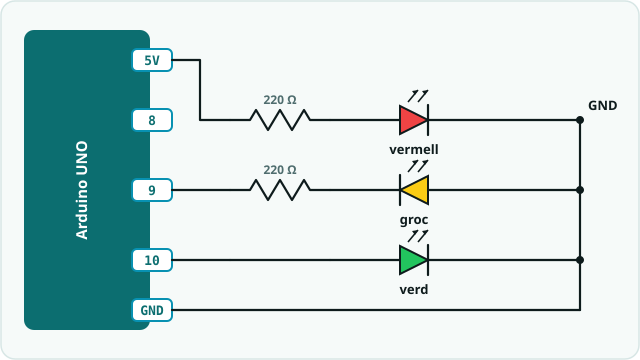
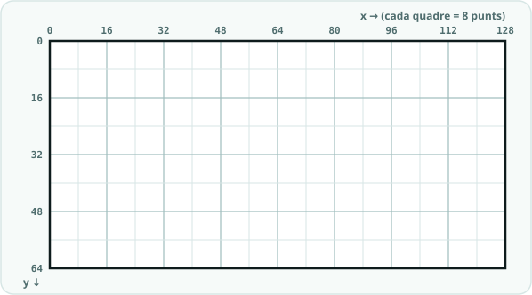

# Prova SA2-SA3 · Sortides, PWM, entrades i sensors (en paper)

**Durada:** 60 min · **Material:** bolígraf i el teu **quadern de treball** (sense ordinador ni mòbil) · **Puntuació:** 10 punts (Bloc 1: 2,5 · Bloc 2: 4 · Bloc 3: 3,5)

<!-- web:only-github -->

> El full té **dos models (A i B)** amb els mateixos exercicis i dades diferents. Cada alumne/a respon **només el seu model**. Docent: graella i logística a [`Prova_SA2_SA3_solucionari.md`](Prova_SA2_SA3_solucionari.md); per a l'alumnat, en retornar la prova: [`Prova_SA2_SA3_correccio_comentada.md`](Prova_SA2_SA3_correccio_comentada.md).

<!-- /web:only-github -->

---

<style>
@media print {
  .prose { font-size: 10pt; }
  .prose h3, .prose h4 { break-after: avoid; margin-top: .9em; }
  .prose p:has(+ .codehilite), .prose p:has(+ table), .prose p:has(+ div > table) { break-after: avoid; }
  .prose pre, .prose .highlight, .prose .codehilite, .prose table, .prose img, .prose p:has(img) { break-inside: avoid; }
  .prose hr { margin: 1.4em 0 .4em; }
}
</style>

## MODEL A

**Nom i cognoms:** ……………………………………………………… **Grup:** ………… **Data:** ……………

> ⏱️ Reparteix-te el temps: **Bloc 1 ~12 min** · **Bloc 2 ~25 min** · **Bloc 3 ~23 min**. Si una pregunta s'encalla, passa a la següent i hi tornes al final.
>
> 💡 Pots consultar el quadern, però no tindràs temps de buscar-ho tot: fes primer el que saps.

### 🔌 BLOC 1 · Circuits (2,5 punts)

#### P1. El LED i la seva resistència (0,5 p)

**a)** Per a què serveix la resistència de **220 Ω** que posem amb cada LED? Encercla'n una (0,25 p).

a) Perquè el LED faci més llum &nbsp;·&nbsp; b) Per limitar el corrent, perquè el LED no es cremi &nbsp;·&nbsp; c) Perquè el LED parpellegi &nbsp;·&nbsp; d) Perquè el LED canviï de color

**b)** Un LED té una pota **més llarga** que l'altra. Com es diu, i va cap al **pin** o cap a **GND**? (0,25 p)

_____________________________________________________________________________________

#### P2. Troba els errors del muntatge (0,75 p)

El semàfor hauria de tenir el **vermell al pin 8**, el **groc al 9** i el **verd al 10**, cadascun amb la seva resistència de **220 Ω** i el càtode (la ratlla del símbol) cap a **GND**. Aquest esquema té **3 errors**.

> 🔎 **Pista:** mira tres coses a cada LED: d'**on** surt el cable, **cap a on** apunta el LED i si **té resistència**.

{ style="max-width:80%" }

| | Quin LED | Què està malament | Què passarà |
|---|---|---|---|
| **1** | | <br><br> | |
| **2** | | <br><br> | |
| **3** | | <br><br> | |

#### P3. El polsador amb `INPUT_PULLUP` (0,5 p · 0,125 cada una)

Marca **V** (vertader) o **F** (fals). Si és fals, **corregeix-ho**.

| Afirmació | V/F | Correcció (si és falsa) |
|---|---|---|
| Amb `INPUT_PULLUP`, quan el polsador **no** està premut, `digitalRead` dona `HIGH`. | | |
| Amb `INPUT_PULLUP`, el polsador es connecta entre el pin i **5 V**. | | |
| Amb `INPUT_PULLUP` no cal posar cap resistència a la protoboard. | | |
| Un **rebot** és quan el programa es penja i s'ha de reiniciar la placa. | | |

#### P4. La llum que es gradua (PWM) (0,75 p)

**a)** El LED és al pin 9. Escriu com fa llum amb cada instrucció: **apagat**, **fluix**, **a mitges** o **màxim** (0,4 p).

| Instrucció | `analogWrite(9, 0);` | `analogWrite(9, 255);` | `analogWrite(9, 128);` | `analogWrite(9, 30);` |
|---|---|---|---|---|
| **Com fa llum** | | | | |

**b)** `analogWrite` no funciona a tots els pins. En quins funciona i com els reconeixes a la placa? (0,2 p)

_____________________________________________________________________________________

**c)** Amb PWM, el pin s'encén i s'apaga moltes vegades per segon. Per què no veiem el LED parpellejar? (0,15 p)

_____________________________________________________________________________________

### 🧠 BLOC 2 · Llegeix i prediu (4 punts)

#### P5. El `switch` (0,75 p)

La funció `color(r, g, b)` és la de la Pràctica 4 (LED RGB).

```cpp
switch (mode) {
  case 0:
    color(255, 0, 0);    // vermell
  case 1:
    color(0, 255, 0);    // verd
    break;
  case 2:
    color(0, 0, 255);    // blau
    break;
}
```

**a)** Quin color es veu quan `mode` val 0, 1 i 2? (0,45 p)

| `mode` | 0 | 1 | 2 |
|---|---|---|---|
| **Color** | | | |

**b)** Al `case 0` hi falta una cosa. Què hi falta, i què provoca que no hi sigui? (0,3 p)

_____________________________________________________________________________________

_____________________________________________________________________________________

#### P6. La llum que respira (0,75 p · 0,25 cada una)

```cpp
for (int v = 0; v <= 255; v = v + 5) {
  analogWrite(LED, v);
  delay(20);
}
```

**a)** El LED s'**encén** a poc a poc o s'**apaga** a poc a poc? _______________________________

**b)** Quin valor té `v` la **primera** vegada? ………… I l'**última**? …………

**c)** Què canviaries perquè ho fes **més a poc a poc**? _______________________________

#### P7. Colors RGB (0,5 p)

Escriu la **lletra** del color que es veu. Sobren dues lletres.

| Crida | Lletra |
|---|---|
| `color(255, 0, 0);` | |
| `color(255, 255, 0);` | |
| `color(255, 255, 255);` | |
| `color(0, 0, 0);` | |

**A.** blanc · **B.** groc · **C.** magenta (lila) · **D.** cian (blau cel) · **E.** vermell · **F.** apagat

**e)** Escriu la crida per posar el LED **verd** (0,1 p): ___________________________

#### P8. Fes de Monitor sèrie (0,75 p)

```cpp
void loop() {
  int valorLdr = analogRead(A1);
  if (valorLdr < 400) {
    digitalWrite(LED, HIGH);
    Serial.println("Fosc");
  } else {
    digitalWrite(LED, LOW);
    Serial.println("Llum");
  }
  delay(500);
}
```

Completa la taula:

| `valorLdr` | 120 | 650 | 399 | 400 |
|---|---|---|---|---|
| **El LED està…** (encès / apagat) | | | | |
| **El Monitor escriu…** | | | | |

#### P9. El polsador que compta (0,5 p)

Aquest és el codi de la Pràctica 1 de la SA3 (el polsador va al pin 2 amb `INPUT_PULLUP`):

```cpp
int estat = digitalRead(POLSADOR);
if (estat != estatAnterior && (millis() - ultimCanvi) > ANTIREBOT) {
  ultimCanvi = millis();
  if (estat == LOW) {
    comptador++;
    Serial.print("Premudes: ");
    Serial.println(comptador);
  }
  estatAnterior = estat;
}
```

**a)** Prems el polsador **3 vegades**. Què surt al Monitor sèrie? (0,25 p)

_____________________________________________________________________________________

**b)** Si deixes el polsador **premut 5 segons**, quantes premudes compta? Per què? (0,25 p)

_____________________________________________________________________________________

#### P10. Dibuixa la pantalla (0,75 p)

> 📐 **Recorda:** la pantalla fa **128 × 64** punts, el (0, 0) és **a dalt a l'esquerra** i la y creix **cap avall**. Les funcions `draw…` dibuixen només la **vora**, i les `fill…`, la figura **plena**.

```cpp
pantalla.clearDisplay();
pantalla.fillCircle(32, 32, 8, SSD1306_WHITE);        // centre (32, 32), radi 8
pantalla.drawLine(64, 16, 112, 48, SSD1306_WHITE);    // de (64, 16) a (112, 48)
pantalla.drawRect(14, 54, 100, 8, SSD1306_WHITE);     // a (14, 54): 100 d'ample, 8 d'alt
pantalla.fillRect(14, 54, 50, 8, SSD1306_WHITE);      // a (14, 54): 50 d'ample, 8 d'alt
pantalla.display();
```

**a)** Dibuixa a la graella el que es veu a la pantalla (0,5 p).

{ style="max-width:90%" }

**b)** Si esborres l'última línia (`pantalla.display();`), què es veu a la pantalla? (0,25 p)

_____________________________________________________________________________________

### 🛠️ BLOC 3 · Depura, explica i crea (3,5 punts)

#### P11. Depura el llum automàtic (1 p · 0,25 per error: trobar-lo + corregir-lo)

Aquest programa hauria de fer això: **quan la llum baixa per sota de 400, el LED s'encén a mitja potència; si no, s'apaga**. A més, ha de mostrar la lectura al Monitor sèrie. Té **4 errors**.

> 🔎 **Pista:** n'hi ha un que no deixa compilar, un en el número de pin, un que fa que el Monitor no mostri res i un a la condició de l'`if`.

```cpp
1  const int LDR = A1;
2  const int LED = 7;
3  int llindar = 400;
4
5  void setup() {
6    pinMode(LED, OUTPUT);
7  }
8
9  void loop() {
10   int llum = analogRead(LDR)
11   Serial.println(llum);
12   if (llum = llindar) {
13     analogWrite(LED, 128);
14   } else {
15     analogWrite(LED, 0);
16   }
17   delay(100);
18 }
```

| Línia | Què falla | Com ho corregeixes |
|---|---|---|
| <br> | | |
| <br> | | |
| <br> | | |
| <br> | | |

#### P12. Explica-ho com un tècnic (0,5 p)

En Marc té el panell de la Pràctica 5 de la SA2: el LED RGB als pins **9, 10 i 11** i el brunzidor al **pin 6**. Fa servir el color **lila** amb `color(128, 0, 128);`. Abans del primer bip el lila surt bé, però **després de fer sonar `tone()`, surt malament**.

**a)** Per què passa? Encercla'n una (0,25 p).

a) El brunzidor gasta massa corrent i el LED es queda sense &nbsp;·&nbsp; b) `tone()` i el pin 11 (el blau) fan servir el mateix rellotge intern de l'Arduino &nbsp;·&nbsp; c) El LED RGB s'ha cremat &nbsp;·&nbsp; d) Falta un `delay()` després del `tone()`

**b)** Proposa una solució que no obligui a treure el so (0,25 p).

_____________________________________________________________________________________

#### P13. Una funció que respon (0,75 p)

**a)** Completa els buits de la funció `nivellLlum`. Ha de retornar `0` si la lectura és més petita que **300** (fosc), `1` si és més petita que **700** (normal) i `2` en qualsevol altre cas (molta llum) (0,5 p).

```cpp
int nivellLlum(int lectura) {
  if (lectura < ______) {
    ________ 0;
  } else if (lectura < ______) {
    return ______;
  } else {
    return ______;
  }
}
```

**b)** Escriu la línia del `loop()` que **crida** la funció amb la lectura de `A1` i guarda el resultat en una variable que es digui `nivell` (0,25 p).

_____________________________________________________________________________________

#### P14. Crea: el polsador que canvia de color (1,25 p)

Hi ha un polsador al **pin 2** (`INPUT_PULLUP`) i el LED RGB amb la funció **`color(r, g, b)`** ja feta. Cada vegada que **prems** el polsador, el LED canvia de mode: **0 verd → 1 groc → 2 vermell → torna a 0**.

La detecció de la premuda ja està feta. Omple els dos **TODO**.

```cpp
int mode = 0;          // 0 verd, 1 groc, 2 vermell
int anterior = HIGH;

void loop() {
  int ara = digitalRead(2);
  if (ara == LOW && anterior == HIGH) {   // s'acaba de premer
    // (1) TODO: passa al mode seguent (despres del 2, torna al 0)


  }
  anterior = ara;

  // (2) TODO: posa el color segons el mode (amb switch o amb if)


  delay(40);
}
```

---

> 🔍 **Abans de lliurar:** com creus que t'ha anat cada bloc? Pinta 🟢 (segur), 🟡 (dubtes) o 🔴 (perdut). Quan tinguis la correcció, compara-ho: endevinar com t'ha anat també és una competència.
>
> | Bloc 1 · Circuits | Bloc 2 · Llegeix i prediu | Bloc 3 · Depura i crea |
> |---|---|---|
> | | | |

<div style="break-before: page"></div>

## MODEL B

**Nom i cognoms:** ……………………………………………………… **Grup:** ………… **Data:** ……………

> ⏱️ Reparteix-te el temps: **Bloc 1 ~12 min** · **Bloc 2 ~25 min** · **Bloc 3 ~23 min**. Si una pregunta s'encalla, passa a la següent i hi tornes al final.
>
> 💡 Pots consultar el quadern, però no tindràs temps de buscar-ho tot: fes primer el que saps.

### 🔌 BLOC 1 · Circuits (2,5 punts)

#### P1. El LED i la seva resistència (0,5 p)

**a)** Què pot passar si connectes un LED a un pin **sense resistència**? Encercla'n una (0,25 p).

a) Que no s'encengui mai &nbsp;·&nbsp; b) Que passi massa corrent i es cremi el LED o es faci malbé el pin &nbsp;·&nbsp; c) Que faci llum de colors &nbsp;·&nbsp; d) Que parpellegi sol

**b)** Un LED té una pota **més curta** que l'altra. Com es diu, i va cap al **pin** o cap a **GND**? (0,25 p)

_____________________________________________________________________________________

#### P2. Troba els errors del muntatge (0,75 p)

El semàfor hauria de tenir el **vermell al pin 8**, el **groc al 9** i el **verd al 10**, cadascun amb la seva resistència de **220 Ω** i el càtode (la ratlla del símbol) cap a **GND**. Aquest esquema té **3 errors**.

> 🔎 **Pista:** mira tres coses a cada LED: **cap a on** apunta, si **té resistència** i si el cable **arriba a GND**.

{ style="max-width:80%" }

| | Quin LED | Què està malament | Què passarà |
|---|---|---|---|
| **1** | | <br><br> | |
| **2** | | <br><br> | |
| **3** | | <br><br> | |

#### P3. El polsador amb `INPUT_PULLUP` (0,5 p · 0,125 cada una)

Marca **V** (vertader) o **F** (fals). Si és fals, **corregeix-ho**.

| Afirmació | V/F | Correcció (si és falsa) |
|---|---|---|
| Amb `INPUT_PULLUP`, quan **prems** el polsador, `digitalRead` dona `HIGH`. | | |
| Amb `INPUT_PULLUP`, el polsador es connecta entre el pin i **GND**. | | |
| La resistència de *pull-up* és **dins** del microcontrolador. | | |
| Els rebots d'un polsador duren uns quants **segons**. | | |

#### P4. La llum que es gradua (PWM) (0,75 p)

**a)** El LED és al pin 10. Escriu com fa llum amb cada instrucció: **apagat**, **fluix**, **fort** o **màxim** (0,4 p).

| Instrucció | `analogWrite(10, 255);` | `analogWrite(10, 0);` | `analogWrite(10, 64);` | `analogWrite(10, 191);` |
|---|---|---|---|---|
| **Com fa llum** | | | | |

**b)** Canvies el LED al **pin 7** i fas `analogWrite(7, 128);`. Fa mitja llum? Per què? (0,2 p)

_____________________________________________________________________________________

**c)** Quin és el valor **més alt** que accepta `analogWrite`? I el més baix? (0,15 p)

_____________________________________________________________________________________

### 🧠 BLOC 2 · Llegeix i prediu (4 punts)

#### P5. El `switch` (0,75 p)

La funció `color(r, g, b)` és la de la Pràctica 4 (LED RGB).

```cpp
switch (mode) {
  case 0:
    color(255, 0, 0);    // vermell
    break;
  case 1:
    color(0, 255, 0);    // verd
  case 2:
    color(0, 0, 255);    // blau
    break;
}
```

**a)** Quin color es veu quan `mode` val 0, 1 i 2? (0,45 p)

| `mode` | 0 | 1 | 2 |
|---|---|---|---|
| **Color** | | | |

**b)** Al `case 1` hi falta una cosa. Què hi falta, i què provoca que no hi sigui? (0,3 p)

_____________________________________________________________________________________

_____________________________________________________________________________________

#### P6. La llum que respira (0,75 p · 0,25 cada una)

```cpp
for (int v = 255; v >= 0; v = v - 5) {
  analogWrite(LED, v);
  delay(10);
}
```

**a)** El LED s'**encén** a poc a poc o s'**apaga** a poc a poc? _______________________________

**b)** Quin valor té `v` la **primera** vegada? ………… I l'**última**? …………

**c)** Què canviaries perquè ho fes **més de pressa**? _______________________________

#### P7. Colors RGB (0,5 p)

Escriu la **lletra** del color que es veu. Sobren dues lletres.

| Crida | Lletra |
|---|---|
| `color(0, 0, 255);` | |
| `color(255, 0, 255);` | |
| `color(0, 0, 0);` | |
| `color(255, 255, 0);` | |

**A.** blanc · **B.** groc · **C.** magenta (lila) · **D.** cian (blau cel) · **E.** blau · **F.** apagat

**e)** Escriu la crida per posar el LED **blanc** (0,1 p): ___________________________

#### P8. Fes de Monitor sèrie (0,75 p)

```cpp
void loop() {
  int valorLdr = analogRead(A1);
  if (valorLdr < 250) {
    digitalWrite(LED, HIGH);
    Serial.println("Fosc");
  } else {
    digitalWrite(LED, LOW);
    Serial.println("Llum");
  }
  delay(500);
}
```

Completa la taula:

| `valorLdr` | 900 | 60 | 250 | 249 |
|---|---|---|---|---|
| **El LED està…** (encès / apagat) | | | | |
| **El Monitor escriu…** | | | | |

#### P9. El polsador que compta (0,5 p)

Aquest és el codi de la Pràctica 1 de la SA3 (el polsador va al pin 2 amb `INPUT_PULLUP`):

```cpp
int estat = digitalRead(POLSADOR);
if (estat != estatAnterior && (millis() - ultimCanvi) > ANTIREBOT) {
  ultimCanvi = millis();
  if (estat == LOW) {
    comptador++;
    Serial.print("Premudes: ");
    Serial.println(comptador);
  }
  estatAnterior = estat;
}
```

**a)** Prems el polsador **2 vegades**. Què surt al Monitor sèrie? (0,25 p)

_____________________________________________________________________________________

**b)** Per a què serveix `ANTIREBOT` (40 ms)? Què passaria sense? (0,25 p)

_____________________________________________________________________________________

#### P10. Dibuixa la pantalla (0,75 p)

> 📐 **Recorda:** la pantalla fa **128 × 64** punts, el (0, 0) és **a dalt a l'esquerra** i la y creix **cap avall**. Les funcions `draw…` dibuixen només la **vora**, i les `fill…`, la figura **plena**.

```cpp
pantalla.clearDisplay();
pantalla.fillRect(8, 8, 40, 16, SSD1306_WHITE);       // a (8, 8): 40 d'ample, 16 d'alt
pantalla.drawCircle(96, 24, 12, SSD1306_WHITE);       // centre (96, 24), radi 12
pantalla.drawLine(16, 40, 64, 40, SSD1306_WHITE);     // de (16, 40) a (64, 40)
pantalla.drawRect(14, 54, 100, 8, SSD1306_WHITE);     // a (14, 54): 100 d'ample, 8 d'alt
pantalla.fillRect(14, 54, 25, 8, SSD1306_WHITE);      // a (14, 54): 25 d'ample, 8 d'alt
pantalla.display();
```

**a)** Dibuixa a la graella el que es veu a la pantalla (0,5 p).

{ style="max-width:90%" }

**b)** Per a què serveix la primera línia, `pantalla.clearDisplay();`? (0,25 p)

_____________________________________________________________________________________

### 🛠️ BLOC 3 · Depura, explica i crea (3,5 punts)

#### P11. Depura l'interruptor (1 p · 0,25 per error: trobar-lo + corregir-lo)

Aquest programa hauria de fer això: el polsador va **entre el pin 2 i GND**, sense cap resistència a la protoboard. **Cada vegada que el prems, el LED del pin 8 canvia** (si estava apagat s'encén, i a l'inrevés). Té **4 errors**.

> 🔎 **Pista:** n'hi ha un que no deixa compilar, un a la configuració del polsador, un a la condició de l'`if` i una **línia que hi falta** (digues entre quines línies l'afegiries).

```cpp
1  const int POLSADOR = 2;
2  const int LED = 8;
3  int anterior = HIGH;
4
5  void setup() {
6    pinMode(POLSADOR, INPUT);
7    pinMode(LED, OUTPUT);
8  }
9
10 void loop() {
11   int ara = digitalRead(POLSADOR);
12   if (ara == HIGH && anterior == HIGH) {
13     digitalWrite(LED, !digitalRead(LED));
14   }
15   delay(40)
16 }
```

| Línia | Què falla | Com ho corregeixes |
|---|---|---|
| <br> | | |
| <br> | | |
| <br> | | |
| <br> | | |

#### P12. Explica-ho com un tècnic (0,5 p)

La Júlia va muntar el panell amb el **brunzidor passiu connectat a través del relé**: el relé connectava el brunzidor a 5 V. El relé feia «clic», però **el brunzidor no sonava mai**.

**a)** Per què no sonava? Encercla'n una (0,25 p).

a) El relé estava espatllat &nbsp;·&nbsp; b) Un brunzidor passiu només sona amb un senyal que s'encén i s'apaga molt de pressa (`tone()`), i el relé li donava 5 V fixos &nbsp;·&nbsp; c) El brunzidor estava al revés &nbsp;·&nbsp; d) Faltava un `delay()`

**b)** Com l'hauria de connectar, i quina instrucció l'ha de fer sonar? (0,25 p)

_____________________________________________________________________________________

#### P13. Una funció que respon (0,75 p)

**a)** Completa els buits de la funció `nivellSoroll`. Ha de retornar `0` si la lectura és més petita que **200** (silenci), `1` si és més petita que **600** (soroll normal) i `2` en qualsevol altre cas (soroll fort) (0,5 p).

```cpp
int nivellSoroll(int lectura) {
  if (lectura < ______) {
    ________ 0;
  } else if (lectura < ______) {
    return ______;
  } else {
    return ______;
  }
}
```

**b)** Escriu la línia del `loop()` que **crida** la funció amb la lectura de `A0` i guarda el resultat en una variable que es digui `nivell` (0,25 p).

_____________________________________________________________________________________

#### P14. Crea: l'avís de nit (1,25 p)

La LDR va a **A1** (tapada, el número baixa), el brunzidor al **pin 6** i el LED RGB amb la funció **`color(r, g, b)`** ja feta. Quan **es fa fosc**, el LED es posa **blau** i fa **un sol bip** (no un bip a cada volta). Quan torna la llum, el LED s'apaga.

La part que recorda la volta anterior ja està feta. Omple els dos **TODO**.

```cpp
bool eraFosc = false;   // com estava a la volta anterior

void loop() {
  int llum = analogRead(A1);
  bool esFosc = (llum < 300);

  // (1) TODO: si ara es fosc I abans no ho era, fes un bip: tone(6, 1000, 200);


  // (2) TODO: si es fosc, LED blau (color(0, 0, 255)); si no, apagat (color(0, 0, 0))


  eraFosc = esFosc;
  delay(100);
}
```

---

> 🔍 **Abans de lliurar:** com creus que t'ha anat cada bloc? Pinta 🟢 (segur), 🟡 (dubtes) o 🔴 (perdut). Quan tinguis la correcció, compara-ho: endevinar com t'ha anat també és una competència.
>
> | Bloc 1 · Circuits | Bloc 2 · Llegeix i prediu | Bloc 3 · Depura i crea |
> |---|---|---|
> | | | |
