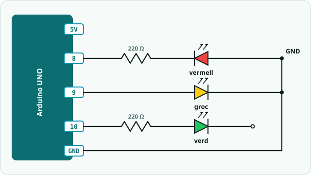

# Prova SA2-SA3 · Sortides, PWM, entrades i sensors (en paper)

**Durada:** 60 min · **Material:** bolígraf, calculadora i el teu **quadern de treball** (sense ordinador ni mòbil) · **Puntuació:** 10 punts (Bloc 1: 3 · Bloc 2: 4 · Bloc 3: 3)

<!-- web:only-github -->

> El full té **dos models (A i B)** amb els mateixos exercicis i dades diferents. Cada alumne/a respon **només el seu model**. Docent: graella i logística a [`Prova_SA2_SA3_solucionari.md`](Prova_SA2_SA3_solucionari.md); per a l'alumnat, en retornar la prova: [`Prova_SA2_SA3_correccio_comentada.md`](Prova_SA2_SA3_correccio_comentada.md).

<!-- /web:only-github -->

---

<style>
@media print {
  .prose { font-size: 10pt; }
  .prose h3, .prose h4 { break-after: avoid; margin-top: .9em; }
  .prose p:has(+ .codehilite), .prose p:has(+ table), .prose p:has(+ div > table) { break-after: avoid; }
  .prose pre, .prose .highlight, .prose .codehilite, .prose table, .prose img, .prose p:has(img) { break-inside: avoid; }
  .prose hr { margin: 1.4em 0 .4em; }
}
</style>

## MODEL A

**Nom i cognoms:** ……………………………………………………… **Grup:** ………… **Data:** ……………

> ⏱️ Reparteix-te el temps: **Bloc 1 ~15 min** · **Bloc 2 ~25 min** · **Bloc 3 ~20 min**. Si una pregunta s'encalla, passa a la següent i hi tornes al final.
>
> 💡 A cada pregunta compta **com hi arribes**, no només el resultat: escriu els càlculs i les explicacions.

### 🔌 BLOC 1 · Circuits i mesures (3 punts)

#### P1. La resistència del LED (0,5 p)

Un LED vermell funciona bé amb uns **15 mA**, i quan s'encén hi cauen **2 V**. El pin de l'Arduino dona **5 V**.

**a)** Calcula la resistència que necessita. Escriu el càlcul (0,25 p).

_____________________________________________________________________________________

**b)** A la capsa hi ha resistències de **100 Ω**, **220 Ω** i **1 kΩ**. Quina tries i per què no les altres dues? (0,25 p)

_____________________________________________________________________________________

_____________________________________________________________________________________

#### P2. Troba els errors del muntatge (0,75 p)

El semàfor hauria de tenir el **vermell al pin 8**, el **groc al 9** i el **verd al 10**, cadascun amb la seva resistència de **220 Ω** i el càtode (la ratlla del símbol) cap a **GND**. Aquest esquema té **3 errors**.

{ style="max-width:80%" }

| | Quin LED | Què està malament | Què passarà quan funcioni el programa |
|---|---|---|---|
| **1** | | <br><br> | |
| **2** | | <br><br> | |
| **3** | | <br><br> | |

#### P3. El sensor de llum (0,75 p)

La LDR està muntada com a la Pràctica 2: **5 V → LDR → A1 → 10 kΩ → GND**. La tensió que arriba a A1 es calcula així:

> **V(A1) = 5 · 10 000 / (R_LDR + 10 000)** &nbsp;&nbsp;i&nbsp;&nbsp; **lectura ≈ V(A1) / 5 · 1023**

Amb llum, la LDR fa **10 kΩ**. Tapada amb el dit, fa **40 kΩ**.

| | R de la LDR | V a A1 (càlcul) | Què llegeix `analogRead(A1)` |
|---|---|---|---|
| Amb llum | 10 kΩ | <br><br> | |
| Tapada | 40 kΩ | <br><br> | |

**c)** Quan tapes la LDR, el número **puja** o **baixa**? Per tant, a l'`if` del llum automàtic, faries servir `<` o `>`? (0,25 p)

_____________________________________________________________________________________

#### P4. El polsador amb `INPUT_PULLUP` (0,5 p · 0,125 cada una)

Marca **V** (vertader) o **F** (fals). Si és fals, **corregeix-ho**.

| Afirmació | V/F | Correcció (si és falsa) |
|---|---|---|
| Amb `INPUT_PULLUP`, quan el polsador **no** està premut, `digitalRead` dona `HIGH`. | | |
| Amb `INPUT_PULLUP`, el polsador es connecta entre el pin i **5 V**. | | |
| Si poses el pin en `INPUT` sense cap resistència, pot llegir `HIGH` i `LOW` a l'atzar. | | |
| Un **rebot** és quan el programa es penja i s'ha de reiniciar la placa. | | |

#### P5. PWM i el multímetre (0,5 p)

El programa fa `analogWrite(9, 64);` i, al **Racó de mesura**, poses el multímetre (en tensió contínua) entre el pin 9 i GND.

**a)** Quin **percentatge del temps** el pin està a 5 V? Escriu el càlcul (0,2 p).

_____________________________________________________________________________________

**b)** Quina tensió marcarà el multímetre? *(Pista: el multímetre mostra la mitjana.)* (0,15 p)

_____________________________________________________________________________________

**c)** El pin s'encén i s'apaga de debò. Per què l'ull veu el LED **fluix** però no veu que **parpelleja**? (0,15 p)

_____________________________________________________________________________________

### 🧠 BLOC 2 · Llegeix i prediu (4 punts)

#### P6. El `switch` traïdor (0,75 p)

La funció `color(r, g, b)` és la de la Pràctica 4 (LED RGB de càtode comú).

```cpp
switch (mode) {
  case 0:
    color(255, 0, 0);    // vermell
  case 1:
    color(0, 255, 0);    // verd
    break;
  case 2:
    color(0, 0, 255);    // blau
    break;
}
```

**a)** Quin color es veu quan `mode` val 0, 1 i 2? (0,45 p)

| `mode` | 0 | 1 | 2 |
|---|---|---|---|
| **Color** | | | |

**b)** Per què passa això? Què hi afegiries, i on, perquè `mode = 0` es vegi vermell? (0,3 p)

_____________________________________________________________________________________

_____________________________________________________________________________________

#### P7. Comptar voltes (0,75 p)

```cpp
for (int v = 0; v <= 255; v = v + 5) {
  analogWrite(LED, v);
  delay(20);
}
```

| Pregunta | Resposta (amb el càlcul) |
|---|---|
| **a)** Quantes vegades es repeteix el bucle? | <br><br> |
| **b)** Quant dura, aproximadament, tota la pujada? | <br><br> |
| **c)** Quin és l'últim valor que rep `analogWrite`? | <br> |

#### P8. Colors RGB (0,5 p)

LED RGB de **càtode comú** amb la funció `color(r, g, b)`. Escriu la **lletra** del color que es veu. Sobren dues lletres.

| Crida | Lletra |
|---|---|
| `color(255, 0, 255);` | |
| `color(255, 255, 255);` | |
| `color(0, 255, 255);` | |
| `color(255, 100, 0);` | |

**A.** blanc · **B.** groc · **C.** magenta (lila) · **D.** cian (blau cel) · **E.** taronja · **F.** apagat

**e)** Si el LED fos d'**ànode comú** (els valors van a l'inrevés: 255 = apagat), quin color veuries amb `color(0, 255, 255);`? (0,1 p)

_____________________________________________________________________________________

#### P9. Fes de Monitor sèrie (0,75 p)

```cpp
const int LLINDAR = 400;

void loop() {
  int valorPot = analogRead(A0);
  int valorLdr = analogRead(A1);
  int brillantor = map(valorPot, 0, 1023, 0, 255);
  if (valorLdr < LLINDAR) {
    analogWrite(LED, brillantor);
  } else {
    analogWrite(LED, 0);
  }
  delay(100);
}
```

Completa la taula per a quatre voltes del `loop()`:

| Volta | `valorPot` | `valorLdr` | `brillantor` | Què rep `analogWrite(LED, …)` |
|---|---|---|---|---|
| 1 | 1023 | 120 | | |
| 2 | 0 | 90 | | |
| 3 | 512 | 380 | | |
| 4 | 1023 | 400 | | |

#### P10. El polsador que compta (0,5 p)

Aquest és el codi de la Pràctica 1 de la SA3 (el polsador va al pin 2 amb `INPUT_PULLUP`):

```cpp
int estat = digitalRead(POLSADOR);
if (estat != estatAnterior && (millis() - ultimCanvi) > ANTIREBOT) {
  ultimCanvi = millis();
  if (estat == LOW) {
    comptador++;
    Serial.print("Premudes: ");
    Serial.println(comptador);
  }
  estatAnterior = estat;
}
```

**a)** Prems el polsador **3 vegades**, i l'última el deixes premut **2 segons**. Què surt al Monitor sèrie? (0,25 p)

_____________________________________________________________________________________

**b)** Si esborres `&& (millis() - ultimCanvi) > ANTIREBOT`, què pot passar en prémer **una** vegada? Per què? (0,25 p)

_____________________________________________________________________________________

_____________________________________________________________________________________

#### P11. Dibuixa la pantalla (0,75 p)

La pantalla OLED fa **128 × 64** punts, i el punt (0, 0) és **a dalt a l'esquerra**. El sensor de llum llegeix `llum = 512`.

```cpp
int amplada = map(llum, 0, 1023, 0, 100);

pantalla.clearDisplay();
pantalla.fillCircle(32, 32, 8, SSD1306_WHITE);        // centre (32, 32), radi 8
pantalla.drawLine(64, 16, 112, 48, SSD1306_WHITE);    // de (64, 16) a (112, 48)
pantalla.drawRect(14, 54, 100, 8, SSD1306_WHITE);     // vora de la barra
pantalla.fillRect(14, 54, amplada, 8, SSD1306_WHITE); // interior de la barra
pantalla.display();
```

**a)** Quant val `amplada`? (0,15 p) ……………

**b)** Dibuixa a la graella el que es veu a la pantalla (0,4 p).

{ style="max-width:90%" }

**c)** Si esborres l'última línia (`pantalla.display();`), què es veu a la pantalla? Per què? (0,2 p)

_____________________________________________________________________________________

### 🛠️ BLOC 3 · Depura, explica i crea (3 punts)

#### P12. Depura el llum automàtic (1 p · 0,25 per error: trobar-lo + corregir-lo)

Aquest programa hauria de fer això: **quan la llum baixa per sota de 400, el LED s'encén a mitja potència; si no, s'apaga**. A més, ha de mostrar la lectura al Monitor sèrie. Té **4 errors**.

```cpp
1  const int LDR = A1;
2  const int LED = 7;
3  int llindar = 400;
4
5  void setup() {
6    pinMode(LED, OUTPUT);
7  }
8
9  void loop() {
10   int llum = analogRead(LDR);
11   Serial.println(llum);
12   if (llum = llindar) {
13     analogWrite(LED, 512);
14   } else {
15     analogWrite(LED, 0);
16   }
17   delay(100);
18 }
```

| Línia | Què falla | Com ho corregeixes |
|---|---|---|
| <br> | | |
| <br> | | |
| <br> | | |
| <br> | | |

#### P13. Explica-ho com un tècnic (0,5 p)

En Marc té el panell de la Pràctica 5 de la SA2: el LED RGB als pins **9, 10 i 11** i el brunzidor al **pin 6**. Per a l'estat «Avís» fa servir el color **lila** amb `color(128, 0, 128);`. Abans del primer bip el lila surt bé, però **després de fer sonar `tone()`, el lila surt malament**.

**a)** Per què passa? (0,25 p)

_____________________________________________________________________________________

_____________________________________________________________________________________

**b)** Proposa una solució que no obligui a treure el so (0,25 p).

_____________________________________________________________________________________

#### P14. Una funció que respon (0,5 p)

Escriu la funció **`nivellLlum`**: rep la lectura del sensor i **retorna** `0` si la lectura és més petita que 300 (fosc), `1` si és més petita que 700 (normal) i `2` en qualsevol altre cas (molta llum).

```cpp
int nivellLlum(int lectura) {


}
```

#### P15. Crea: el polsador que canvia de color (1 p)

Hi ha un polsador al **pin 2** (`INPUT_PULLUP`, ja configurat al `setup()`) i el LED RGB amb la funció **`color(r, g, b)`** ja feta.

Cada vegada que **prems** el polsador (no mentre el mantens premut), el LED canvia de mode: **0 verd → 1 groc → 2 vermell → torna a 0**. Escriu les **variables globals** que necessitis i el **`loop()`**. Per a l'antirebot n'hi ha prou amb un `delay(40);`.

```cpp
// Variables globals


void loop() {


}
```

---

> 🔍 **Abans de lliurar:** com creus que t'ha anat cada bloc? Pinta 🟢 (segur), 🟡 (dubtes) o 🔴 (perdut). Quan tinguis la correcció, compara-ho: endevinar com t'ha anat també és una competència.
>
> | Bloc 1 · Circuits | Bloc 2 · Llegeix i prediu | Bloc 3 · Depura i crea |
> |---|---|---|
> | | | |

<div style="break-before: page"></div>

## MODEL B

**Nom i cognoms:** ……………………………………………………… **Grup:** ………… **Data:** ……………

> ⏱️ Reparteix-te el temps: **Bloc 1 ~15 min** · **Bloc 2 ~25 min** · **Bloc 3 ~20 min**. Si una pregunta s'encalla, passa a la següent i hi tornes al final.
>
> 💡 A cada pregunta compta **com hi arribes**, no només el resultat: escriu els càlculs i les explicacions.

### 🔌 BLOC 1 · Circuits i mesures (3 punts)

#### P1. La resistència del LED (0,5 p)

Un LED blau funciona bé amb uns **10 mA**, i quan s'encén hi cauen **3 V**. El pin de l'Arduino dona **5 V**.

**a)** Calcula la resistència que necessita. Escriu el càlcul (0,25 p).

_____________________________________________________________________________________

**b)** A la capsa hi ha resistències de **150 Ω**, **220 Ω** i **470 Ω**. Quina tries i per què no les altres dues? (0,25 p)

_____________________________________________________________________________________

_____________________________________________________________________________________

#### P2. Troba els errors del muntatge (0,75 p)

El semàfor hauria de tenir el **vermell al pin 8**, el **groc al 9** i el **verd al 10**, cadascun amb la seva resistència de **220 Ω** i el càtode (la ratlla del símbol) cap a **GND**. Aquest esquema té **3 errors**.

{ style="max-width:80%" }

| | Quin LED | Què està malament | Què passarà quan funcioni el programa |
|---|---|---|---|
| **1** | | <br><br> | |
| **2** | | <br><br> | |
| **3** | | <br><br> | |

#### P3. El sensor de llum (0,75 p)

La LDR està muntada com a la Pràctica 2: **5 V → LDR → A1 → 10 kΩ → GND**. La tensió que arriba a A1 es calcula així:

> **V(A1) = 5 · 10 000 / (R_LDR + 10 000)** &nbsp;&nbsp;i&nbsp;&nbsp; **lectura ≈ V(A1) / 5 · 1023**

Amb llum, la LDR fa **15 kΩ**. Tapada amb el dit, fa **90 kΩ**.

| | R de la LDR | V a A1 (càlcul) | Què llegeix `analogRead(A1)` |
|---|---|---|---|
| Amb llum | 15 kΩ | <br><br> | |
| Tapada | 90 kΩ | <br><br> | |

**c)** Vols que un LED s'encengui **quan fa fosc**. A l'`if`, faries servir `valorLdr < llindar` o `valorLdr > llindar`? Quin llindar triaries, i per què? (0,25 p)

_____________________________________________________________________________________

#### P4. El polsador amb `INPUT_PULLUP` (0,5 p · 0,125 cada una)

Marca **V** (vertader) o **F** (fals). Si és fals, **corregeix-ho**.

| Afirmació | V/F | Correcció (si és falsa) |
|---|---|---|
| Amb `INPUT_PULLUP`, quan **prems** el polsador, `digitalRead` dona `HIGH`. | | |
| Amb `INPUT_PULLUP`, el polsador es connecta entre el pin i **GND**. | | |
| La resistència de *pull-up* és **dins** del microcontrolador: no cal posar-ne cap a la protoboard. | | |
| Els rebots d'un polsador duren uns quants **segons**. | | |

#### P5. PWM i el multímetre (0,5 p)

El programa fa `analogWrite(10, 191);` i, al **Racó de mesura**, poses el multímetre (en tensió contínua) entre el pin 10 i GND.

**a)** Quin **percentatge del temps** el pin està a 5 V? Escriu el càlcul (0,2 p).

_____________________________________________________________________________________

**b)** Quina tensió marcarà el multímetre? *(Pista: el multímetre mostra la mitjana.)* (0,15 p)

_____________________________________________________________________________________

**c)** Si canvies el LED al **pin 7** i fas `analogWrite(7, 191);`, què fa el LED? Per què? (0,15 p)

_____________________________________________________________________________________

### 🧠 BLOC 2 · Llegeix i prediu (4 punts)

#### P6. El `switch` traïdor (0,75 p)

La funció `color(r, g, b)` és la de la Pràctica 4 (LED RGB de càtode comú).

```cpp
switch (mode) {
  case 0:
    color(255, 0, 0);    // vermell
    break;
  case 1:
    color(0, 255, 0);    // verd
  case 2:
    color(0, 0, 255);    // blau
    break;
}
```

**a)** Quin color es veu quan `mode` val 0, 1 i 2? (0,45 p)

| `mode` | 0 | 1 | 2 |
|---|---|---|---|
| **Color** | | | |

**b)** Per què passa això? Què hi afegiries, i on, perquè `mode = 1` es vegi verd? (0,3 p)

_____________________________________________________________________________________

_____________________________________________________________________________________

#### P7. Comptar voltes (0,75 p)

```cpp
for (int v = 255; v > 0; v = v - 15) {
  analogWrite(LED, v);
  delay(30);
}
```

| Pregunta | Resposta (amb el càlcul) |
|---|---|
| **a)** Quantes vegades es repeteix el bucle? | <br><br> |
| **b)** Quant dura, aproximadament, tota la baixada? | <br><br> |
| **c)** Quin és l'últim valor que rep `analogWrite`? El LED queda apagat del tot? | <br> |

#### P8. Colors RGB (0,5 p)

LED RGB de **càtode comú** amb la funció `color(r, g, b)`. Escriu la **lletra** del color que es veu. Sobren dues lletres.

| Crida | Lletra |
|---|---|
| `color(255, 255, 0);` | |
| `color(0, 0, 0);` | |
| `color(0, 255, 255);` | |
| `color(255, 0, 255);` | |

**A.** blanc · **B.** groc · **C.** magenta (lila) · **D.** cian (blau cel) · **E.** taronja · **F.** apagat

**e)** Si el LED fos d'**ànode comú** (els valors van a l'inrevés: 255 = apagat), quin color veuries amb `color(255, 255, 0);`? (0,1 p)

_____________________________________________________________________________________

#### P9. Fes de Monitor sèrie (0,75 p)

```cpp
const int LLINDAR = 250;

void loop() {
  int valorPot = analogRead(A0);
  int valorLdr = analogRead(A1);
  int brillantor = map(valorPot, 0, 1023, 0, 255);
  if (valorLdr < LLINDAR) {
    analogWrite(LED, brillantor);
  } else {
    analogWrite(LED, 0);
  }
  delay(100);
}
```

Completa la taula per a quatre voltes del `loop()`:

| Volta | `valorPot` | `valorLdr` | `brillantor` | Què rep `analogWrite(LED, …)` |
|---|---|---|---|---|
| 1 | 256 | 100 | | |
| 2 | 1023 | 250 | | |
| 3 | 767 | 60 | | |
| 4 | 0 | 900 | | |

#### P10. El polsador que compta (0,5 p)

Aquest és el codi de la Pràctica 1 de la SA3 (el polsador va al pin 2 amb `INPUT_PULLUP`):

```cpp
int estat = digitalRead(POLSADOR);
if (estat != estatAnterior && (millis() - ultimCanvi) > ANTIREBOT) {
  ultimCanvi = millis();
  if (estat == LOW) {
    comptador++;
    Serial.print("Premudes: ");
    Serial.println(comptador);
  }
  estatAnterior = estat;
}
```

**a)** Prems el polsador **2 vegades** i després el deixes premut **3 segons**. Què surt al Monitor sèrie? (0,25 p)

_____________________________________________________________________________________

**b)** Si esborres `estat != estatAnterior &&`, què passa mentre mantens el polsador premut? Per què? (0,25 p)

_____________________________________________________________________________________

_____________________________________________________________________________________

#### P11. Dibuixa la pantalla (0,75 p)

La pantalla OLED fa **128 × 64** punts, i el punt (0, 0) és **a dalt a l'esquerra**. El sensor de llum llegeix `llum = 256`.

```cpp
int amplada = map(llum, 0, 1023, 0, 100);

pantalla.clearDisplay();
pantalla.fillRect(8, 8, 40, 16, SSD1306_WHITE);       // a (8, 8): 40 d'ample i 16 d'alt
pantalla.drawCircle(96, 24, 12, SSD1306_WHITE);       // centre (96, 24), radi 12
pantalla.drawLine(16, 40, 64, 40, SSD1306_WHITE);     // de (16, 40) a (64, 40)
pantalla.drawRect(14, 54, 100, 8, SSD1306_WHITE);     // vora de la barra
pantalla.fillRect(14, 54, amplada, 8, SSD1306_WHITE); // interior de la barra
pantalla.display();
```

**a)** Quant val `amplada`? (0,15 p) ……………

**b)** Dibuixa a la graella el que es veu a la pantalla (0,4 p).

{ style="max-width:90%" }

**c)** Si esborres la línia `pantalla.clearDisplay();` i la llum va **baixant** a poc a poc, què veuràs a la barra? Per què? (0,2 p)

_____________________________________________________________________________________

### 🛠️ BLOC 3 · Depura, explica i crea (3 punts)

#### P12. Depura l'interruptor (1 p · 0,25 per error: trobar-lo + corregir-lo)

Aquest programa hauria de fer això: el polsador va **entre el pin 2 i GND**, sense cap resistència a la protoboard. **Cada vegada que el prems, el LED del pin 8 canvia** (si estava apagat s'encén, i a l'inrevés). Té **4 errors**.

```cpp
1  const int POLSADOR = 2;
2  const int LED = 8;
3  int anterior = HIGH;
4
5  void setup() {
6    pinMode(POLSADOR, INPUT);
7    pinMode(LED, OUTPUT);
8  }
9
10 void loop() {
11   int ara = digitalRead(POLSADOR);
12   if (ara == HIGH && anterior == HIGH) {
13     digitalWrite(LED, !digitalRead(LED));
14   }
15   delay(40)
16 }
```

| Línia | Què falla | Com ho corregeixes |
|---|---|---|
| <br> | | |
| <br> | | |
| <br> | | |
| <br> | | |

> 💡 Un dels errors no és una línia mal escrita: és una línia que **hi falta**. Digues entre quines línies l'afegiries.

#### P13. Explica-ho com un tècnic (0,5 p)

La Júlia va muntar el panell amb el **brunzidor passiu connectat a través del relé**: el pin 7 activava el relé, i el relé connectava el brunzidor a 5 V. El relé feia «clic», però **el brunzidor no sonava mai**.

**a)** Per què no sonava? (0,25 p)

_____________________________________________________________________________________

_____________________________________________________________________________________

**b)** Com l'hauria de connectar i quina instrucció l'ha de fer sonar? (0,25 p)

_____________________________________________________________________________________

#### P14. Una funció que respon (0,5 p)

Escriu la funció **`nivellSoroll`**: rep la lectura del micròfon i **retorna** `0` si la lectura és més petita que 200 (silenci), `1` si és més petita que 600 (soroll normal) i `2` en qualsevol altre cas (soroll fort).

```cpp
int nivellSoroll(int lectura) {


}
```

#### P15. Crea: l'avís de nit (1 p)

La LDR va a **A1** (amb llum el número puja i tapada baixa), el brunzidor al **pin 6** i el LED RGB amb la funció **`color(r, g, b)`** ja feta. Tot està configurat al `setup()`.

Quan **es fa fosc** (lectura < 300), el LED es posa **blau** (`color(0, 0, 255)`) i fa **un sol bip** (`tone(6, 1000, 200);`), **no un bip a cada volta**. Quan torna la llum, el LED s'apaga. Si es torna a fer fosc, torna a fer un bip. Escriu les **variables globals** que necessitis i el **`loop()`**.

```cpp
// Variables globals


void loop() {


}
```

---

> 🔍 **Abans de lliurar:** com creus que t'ha anat cada bloc? Pinta 🟢 (segur), 🟡 (dubtes) o 🔴 (perdut). Quan tinguis la correcció, compara-ho: endevinar com t'ha anat també és una competència.
>
> | Bloc 1 · Circuits | Bloc 2 · Llegeix i prediu | Bloc 3 · Depura i crea |
> |---|---|---|
> | | | |
