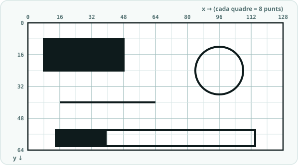

# Prova SA2-SA3 · Correcció comentada (per a l'alumnat)

**Per a qui és?** Per a tu, quan et tornin la prova corregida. **Durada:** uns 30 min · **Material:** la teva prova, aquest full i el quadern.

> 🎯 **Una prova no s'acaba quan la lliures.** El que t'ha sortit malament et diu què has de repassar, i el que t'ha sortit bé, què ja domines. Aquest full t'explica el **perquè** de cada resposta i quins són els **errors típics**, perquè sàpigues d'on ve el teu.

## Com fer servir aquest full

1. **Busca el teu model** (A o B) a cada pregunta. L'explicació (💡) i els errors típics (⚠️) serveixen per als dos models.
2. Per a cada pregunta que **no** tinguis bé, llegeix l'apartat ⚠️ **Errors típics** i troba quin ha estat el teu. No n'hi ha prou amb copiar la resposta bona: el que has d'entendre és **per què** t'has equivocat.
3. Mira el **semàfor** que vas pintar abans de lliurar (🟢🟡🔴). Coincideix amb la nota de cada bloc? Si et pensaves que un bloc t'havia anat bé i no és així, aquell és el que més has de repassar.
4. Al final, omple el **pla de millora** (3 línies al quadern).

<style>
@media print {
  .prose { font-size: 10pt; }
  .prose h3, .prose h4 { break-after: avoid; }
  .prose pre, .prose .codehilite, .prose table, .prose img, .prose p:has(img), .prose blockquote { break-inside: avoid; }
}
</style>

---

## 🔌 Bloc 1 · Circuits i mesures

### P1. La resistència del LED

| | Càlcul | Tria |
|---|---|---|
| **A** | R = (5 − 2) V / 0,015 A = **200 Ω** | **220 Ω**: hi passen 3 / 220 ≈ 13,6 mA, una mica menys dels 15 mA. |
| **B** | R = (5 − 3) V / 0,010 A = **200 Ω** | **220 Ω**: hi passen 2 / 220 ≈ 9,1 mA, una mica menys dels 10 mA. |

💡 **Per què:** la resistència s'emporta la tensió que **sobra**. Si el LED en gasta 2 V (o 3 V) i el pin en dona 5, a la resistència li toquen els 3 V (o 2 V) restants. Per això al numerador hi ha la **resta**, i no els 5 V. Si el valor exacte no existeix, s'agafa el valor comercial **immediatament superior**: passa una mica menys de corrent i el LED fa llum igualment.

⚠️ **Errors típics:**
- **Has posat 5 / 0,015 = 333 Ω?** T'has oblidat que el LED també «es menja» tensió. El LED i la resistència es reparteixen els 5 V.
- **Has posat 0,2 Ω o 200 000 Ω?** Els mA s'han de passar a A: 15 mA = **0,015 A**.
- **Has triat la de 100 Ω (o la de 150 Ω, al B)?** És més petita del que cal: hi passaria **massa corrent** (30 mA al model A). El LED dura menys i el pin treballa al límit.
- **Has triat la d'1 kΩ (o la de 470 Ω, al B)?** No és perillosa, però el LED fa **molt poca llum** (uns 3-4 mA).

🔁 **Repassa:** [Pràctica 2 · El semàfor](../Classes/SA2/codi/02_semafor/EXPLICACIO.md) (Racó de mesura).

### P2. Troba els errors del muntatge

| Model | LED | Què està malament | Què passa |
|---|---|---|---|
| **A** | vermell | El cable surt del pin **5V**, no del pin 8. | Està **sempre encès**, digui el que digui el programa. |
| **A** | groc | El LED està **al revés**: la ratlla (càtode) mira cap al pin. | **No s'encén mai**: el LED només deixa passar el corrent en un sentit. |
| **A** | verd | **No té resistència.** | Passa massa corrent: el LED es pot **cremar** i el pin es pot fer malbé. |
| **B** | vermell | El LED està **al revés**. | **No s'encén mai.** |
| **B** | groc | **No té resistència.** | Massa corrent: el LED es pot **cremar** i el pin es pot fer malbé. |
| **B** | verd | La branca **no arriba a GND**: el cable s'acaba en un punt lliure. | **No s'encén mai**: el corrent no té per on tornar (circuit obert). |

💡 **Per què:** el corrent ha de fer un **camí tancat**: surt del pin, passa per la resistència i el LED, i torna per **GND**. Si el camí no comença al pin, el programa no mana. Si el LED està al revés, el camí està tallat. Si no torna a GND, el camí no es tanca. I si no hi ha resistència, res no limita el corrent.

⚠️ **Errors típics:**
- **Has dit que el LED invertit «fa poca llum»?** No en fa gens: un LED és un **díode**, i al revés bloqueja el corrent.
- **Has trobat l'error però no què passa?** La tercera columna és la que demostra que entens el circuit. Un tècnic no diu només «això està malament», diu també **quin símptoma** veuràs.

🔁 **Repassa:** [Esquemes de connexions de la SA2](../Classes/SA2/SA2_esquemes_connexions.md).

### P3. El sensor de llum

| Model | Amb llum | Tapada | Puja o baixa? |
|---|---|---|---|
| **A** | 5 · 10 000 / 20 000 = **2,5 V** → 2,5 / 5 · 1023 ≈ **512** | 5 · 10 000 / 50 000 = **1 V** → ≈ **205** | **Baixa** → `valorLdr < llindar` |
| **B** | 5 · 10 000 / 25 000 = **2 V** → ≈ **409** | 5 · 10 000 / 100 000 = **0,5 V** → ≈ **102** | **Baixa** → `valorLdr < llindar`, amb un llindar al mig (cap a **250**) |

💡 **Per què:** la LDR i la de 10 kΩ es **reparteixen** els 5 V, i el tros més gran se l'emporta la resistència més gran. Si tapes la LDR, la seva resistència puja, s'emporta més tensió i a A1 en queda **menys**. `analogRead` converteix els 0-5 V en un número de **0 a 1023**: 2,5 V és la meitat, és a dir, uns 512.

El llindar s'ha de posar **entre** els dos valors, i millor al mig. Així, si un dia hi ha una mica més o menys de llum, el sistema continua funcionant.

⚠️ **Errors típics:**
- **T'ha sortit que tapada dona més?** Has posat la LDR al numerador en lloc de la de 10 kΩ. Fixa't en el muntatge: A1 llegeix la tensió **de la resistència de 10 kΩ**.
- **Has posat el llindar a 400 perquè «era el de Tinkercad»?** Al model B, 400 és gairebé el valor **amb llum**: el LED s'encendria amb qualsevol ombra. El llindar sempre surt de **mesurar**.
- **Has dit `>` perquè «fosc = número gran»?** Depèn de **com** està muntat. Amb aquest ordre (LDR a dalt), fosc vol dir número **petit**. Si s'inverteixen les peces, també s'inverteix la lògica: per això sempre es mira primer al Monitor sèrie.

🔁 **Repassa:** [Pràctica 2 · Potenciòmetre i sensor de llum](../Classes/SA3/codi/02_potenciometre_ldr/EXPLICACIO.md) i el [dibuix del divisor](../Classes/SA3/SA3_esquemes_connexions.md).

### P4. El polsador amb `INPUT_PULLUP`

| Model | 1 | 2 | 3 | 4 |
|---|---|---|---|---|
| **A** | **V** | **F**: va entre el pin i **GND** | **V** | **F**: un rebot és el contacte metàl·lic que **bota** uns mil·lisegons i fa semblar diverses premudes |
| **B** | **F**: premut dona **`LOW`** | **V** | **V** | **F**: duren uns pocs **mil·lisegons** (per això n'hi ha prou amb `ANTIREBOT = 40`) |

💡 **Per què:** amb `INPUT_PULLUP`, l'Arduino connecta per dins una resistència que «estira» el pin cap a 5 V. En repòs el pin llegeix **`HIGH`**. Quan prems, el polsador uneix el pin amb **GND** i llegeix **`LOW`**. És al revés del que sembla natural, i per això el codi pregunta `if (estat == LOW)` per saber si està premut.

⚠️ **Errors típics:**
- **Pensaves que premut = `HIGH`?** És l'error més freqüent de la SA3. Recorda-ho així: «pull-up: en repòs, amunt».
- **Has marcat V a la 3 sense saber per què?** Un pin en `INPUT` sense res connectat és com una antena: capta soroll elèctric i llegeix valors a l'atzar. Per això es fa servir la resistència de *pull-up*.

🔁 **Repassa:** [Pràctica 1 · El polsador](../Classes/SA3/codi/01_polsador_debounce/EXPLICACIO.md).

### P5. PWM i el multímetre

| Model | a) % del temps a 5 V | b) Multímetre | c) |
|---|---|---|---|
| **A** | 64 / 255 ≈ **25 %** | 5 · 0,25 ≈ **1,25 V** | El pin s'encén i s'apaga unes **490 vegades per segon**: l'ull no ho pot seguir i veu la mitjana, una llum fluixa. |
| **B** | 191 / 255 ≈ **75 %** | 5 · 0,75 ≈ **3,75 V** | El pin 7 **no té `~`** (no fa PWM): `analogWrite` el posa a `HIGH` si el valor és 128 o més, i a `LOW` si és menys. Amb 191, el LED queda **encès al màxim**. |

💡 **Per què:** PWM no vol dir «menys tensió». Vol dir **5 V una part del temps i 0 V la resta**, molt de pressa. El valor de `analogWrite` (0-255) diu **quina part** del temps està encès. El multímetre és lent i mostra la **mitjana**, igual que l'ull.

⚠️ **Errors típics:**
- **Has posat 64 / 1023?** El 1023 és d'`analogRead` (entrades). `analogWrite` (sortides) va de **0 a 255**.
- **Has dit que el pin «dona 1,25 V»?** El pin mai no dona 1,25 V: dona 5 V o 0 V. 1,25 V és el que **mesura** el multímetre, que fa la mitjana.

🔁 **Repassa:** [Pràctica 3 · La llum que respira](../Classes/SA2/codi/03_fade_pwm/EXPLICACIO.md).

---

## 🧠 Bloc 2 · Llegeix i prediu

### P6. El `switch` traïdor

| Model | `mode` 0 | `mode` 1 | `mode` 2 | Arreglar-ho |
|---|---|---|---|---|
| **A** | **verd** | verd | blau | Afegir **`break;`** després de `color(255, 0, 0);` (al `case 0`) |
| **B** | vermell | **blau** | blau | Afegir **`break;`** després de `color(0, 255, 0);` (al `case 1`) |

💡 **Per què:** un `case` no s'acaba sol. El programa entra al `case` que toca i continua executant les línies de sota **fins que troba un `break`**, encara que siguin d'un altre `case`. Al model A, amb `mode = 0` el LED es posa vermell i, una fracció de mil·lisegon després, verd. L'ull només veu el verd.

⚠️ **Errors típics:**
- **Has dit «vermell i després verd»?** Tècnicament és veritat, però el vermell dura **microsegons**, perquè no hi ha cap `delay`. El que **es veu** és el verd.
- **Has posat el `break` al `case` equivocat?** El `break` ha d'anar al final del `case` que «es vessa» cap al següent, no al que en rep el vessament.

🔁 **Repassa:** [Pràctica 2b · El semàfor amb `switch`](../Classes/SA2/codi/02b_semafor_switch/EXPLICACIO.md) (llegeix el comentari «sense break, cauria al case següent!»).

### P7. Comptar voltes

| Model | a) Voltes | b) Durada | c) Últim valor |
|---|---|---|---|
| **A** | v = 0, 5, 10… 255 → 255 / 5 + 1 = **52** | 52 · 20 ms = **1040 ms ≈ 1 s** | **255** (255 ≤ 255 encara és cert) |
| **B** | v = 255, 240… 15 → (255 − 15) / 15 + 1 = **17** | 17 · 30 ms = **510 ms ≈ 0,5 s** | **15**: el següent seria 0, però `0 > 0` és **fals** i el bucle s'acaba. **El LED no s'apaga del tot**: queda a 15 (un 6 %). |

💡 **Per què:** per comptar voltes, escriu els primers valors i l'**últim** que compleix la condició, i compta quants salts hi ha **més 1** (el primer valor també compta). La durada és voltes × `delay`, perquè el `analogWrite` és instantani.

⚠️ **Errors típics:**
- **Has posat 51 (A) o 16 (B)?** T'has deixat el **primer** valor. De 0 a 255 de 5 en 5 hi ha 51 salts, però 52 valors.
- **Al B, has dit que acaba a 0?** Mira la condició: `v > 0`, no `v >= 0`. Aquest error és molt real: el «fade» acaba amb el LED gairebé apagat, però no del tot. Si a la Pràctica 3 el LED no s'apagava mai del tot, ara saps per què pot ser.

🔁 **Repassa:** [Pràctica 3 · La llum que respira](../Classes/SA2/codi/03_fade_pwm/EXPLICACIO.md) i el [dibuix del programa](../Classes/SA2/SA2_diagrama_flux.md).

### P8. Colors RGB

| Model | 1a | 2a | 3a | 4a | Sobren | e) Ànode comú |
|---|---|---|---|---|---|---|
| **A** | **C** magenta | **A** blanc | **D** cian | **E** taronja | B, F | `color(0, 255, 255)` → només queda encès el R → **vermell** |
| **B** | **B** groc | **F** apagat | **D** cian | **C** magenta | A, E | `color(255, 255, 0)` → només queda encès el B → **blau** |

💡 **Per què:** el LED RGB **suma llum**: vermell + verd = groc, vermell + blau = magenta, verd + blau = cian, i tots tres = blanc. El taronja és molt vermell amb una mica de verd. En un LED d'**ànode comú** la pota comuna va a 5 V, i el LED s'encén quan el pin és a **0 V**: 0 = encès i 255 = apagat. Tot va al revés.

⚠️ **Errors típics:**
- **Has dit que vermell + verd fa marró?** Això passa amb **pintura**, que resta llum. Amb llum es **suma**, i vermell + verd fa groc.
- **A l'apartat e), has invertit només un color?** S'inverteixen **tots tres** canals.

🔁 **Repassa:** [Pràctica 4 · Colors RGB](../Classes/SA2/codi/04_rgb/EXPLICACIO.md).

### P9. Fes de Monitor sèrie

**Model A** (`LLINDAR = 400`)

| Volta | `brillantor` | `analogWrite` rep | Per què |
|---|---|---|---|
| 1 | **255** | **255** | 120 < 400: és fosc, i el potenciòmetre està al màxim. |
| 2 | **0** | **0** | És fosc (90 < 400), però el potenciòmetre està a 0: **fosc no vol dir encès**. |
| 3 | **127** | **127** | 512 · 255 / 1023 = 127,6 → `map` **talla els decimals**: 127 (també s'accepta 128). |
| 4 | **255** | **0** | 400 < 400 és **fals**: un valor igual al llindar no compta com a fosc. |

**Model B** (`LLINDAR = 250`)

| Volta | `brillantor` | `analogWrite` rep | Per què |
|---|---|---|---|
| 1 | **63** | **63** | 256 · 255 / 1023 = 63,8 → 63. És fosc (100 < 250). |
| 2 | **255** | **0** | 250 < 250 és **fals**: no és fosc. |
| 3 | **191** | **191** | 767 · 255 / 1023 = 191,2 → 191. És fosc (60 < 250). |
| 4 | **0** | **0** | Hi ha llum i, a més, el potenciòmetre està a 0. |

💡 **Per què:** `brillantor` es calcula **sempre**, però només arriba al LED si l'`if` és cert. La clau és separar les dues columnes: una cosa és el que **val** la variable i una altra el que **rep** el LED.

⚠️ **Errors típics:**
- **A la volta 4 (A) o la 2 (B) has posat el valor de la brillantor?** És la trampa del **límit**: `<` no inclou l'igual. Si volguessis incloure'l, hauries d'escriure `<=`.
- **Has posat 128 i 64 arrodonint?** `map` treballa amb nombres enters i **talla** els decimals. No passa res si has posat 128: l'important és el procediment.

🔁 **Repassa:** [Pràctica 2 · Potenciòmetre i sensor de llum](../Classes/SA3/codi/02_potenciometre_ldr/EXPLICACIO.md).

### P10. El polsador que compta

| Model | a) Monitor sèrie | b) |
|---|---|---|
| **A** | `Premudes: 1`, `Premudes: 2`, `Premudes: 3`. Mantenir-lo premut **no** suma res. | Sense l'antirebot, els **rebots** del contacte fan diversos canvis `HIGH`→`LOW` en pocs mil·lisegons: **una premuda pot comptar 2 o 3 vegades**. |
| **B** | `Premudes: 1`, `Premudes: 2`, `Premudes: 3`. La premuda llarga també és una premuda, però **compta una sola vegada**. | Sense `estat != estatAnterior`, cada 40 ms entra a l'`if` i, com que el pin està a `LOW`, **suma sense parar**: unes 25 per segon (unes 75 en 3 s). |

💡 **Per què:** el codi té dues proteccions. **`estat != estatAnterior`** fa que només compti el **canvi** (el moment de prémer), no l'estona que el tens premut. **`ANTIREBOT`** fa que no es comptin els rebots, que són canvis massa ràpids (menys de 40 ms) per ser una premuda real.

⚠️ **Errors típics:**
- **Al model B, has comptat només 2?** La premuda de 3 segons també comença amb un canvi `HIGH`→`LOW`: és la tercera.
- **Has dit que sense antirebot «no compta res»?** És al revés: en compta **de més**.

🔁 **Repassa:** [Pràctica 1 · El polsador](../Classes/SA3/codi/01_polsador_debounce/EXPLICACIO.md).

### P11. Dibuixa la pantalla

**a)** A: `map(512, 0, 1023, 0, 100)` = 51 200 / 1023 = 50,05 → **50**. B: `map(256, 0, 1023, 0, 100)` = 25 600 / 1023 = 25,02 → **25**.

**b)** Solucions:

{ style="max-width:80%" }

{ style="max-width:80%" }

**c)** **A:** sense `display()`, la pantalla queda **negra**: tot es dibuixa a la **memòria** de l'Arduino, però mai no s'envia a la pantalla. **B:** sense `clearDisplay()`, els dibuixos s'acumulen. Quan la llum baixa, la barra nova és més curta, però la llarga de les voltes anteriors **continua pintada**: la barra **no baixa mai**, es queda al valor més alt.

💡 **Per què:** la pantalla funciona com un **full a la memòria**. `clearDisplay()` el deixa en blanc, les ordres `draw…` i `fill…` hi dibuixen, i `display()` l'ensenya. `draw` dibuixa la **vora** i `fill` la figura **plena**. La y creix **cap avall**, al revés que a matemàtiques.

⚠️ **Errors típics:**
- **Has dibuixat la línia pujant?** A la pantalla, y = 48 és **més avall** que y = 16.
- **Has fet el cercle del doble de mida?** El 8 (o el 12) és el **radi**, no el diàmetre.
- **Has fet la barra plena del tot?** La vora fa 100 punts, però l'interior només fa `amplada` punts (50 o 25).

🔁 **Repassa:** [Pràctica 3 · La pantalla OLED](../Classes/SA3/codi/03_pantalla_oled/EXPLICACIO.md).

---

## 🛠️ Bloc 3 · Depura, explica i crea

### P12. Depura

**Model A** (llum automàtic)

| Línia | Què falla | Correcció |
|---|---|---|
| 2 | El pin 7 **no fa PWM** (no té `~`): `analogWrite` no pot fer «mitja potència». | `const int LED = 9;` (o qualsevol pin amb `~`: 3, 5, 6, 9, 10, 11) |
| 5-7 | Falta obrir el Monitor sèrie: el `Serial.println` no mostrarà res. | Afegir `Serial.begin(9600);` dins del `setup()` |
| 12 | `=` **assigna** (posa 400 a `llum`), no compara. A més, ha de ser «per sota de». | `if (llum < llindar) {` |
| 13 | `analogWrite` va de **0 a 255**: mitja potència és 128, no 512. | `analogWrite(LED, 128);` |

**Model B** (interruptor amb polsador)

| Línia | Què falla | Correcció |
|---|---|---|
| 6 | Sense resistència a la protoboard, el pin queda **a l'aire** i llegeix a l'atzar. | `pinMode(POLSADOR, INPUT_PULLUP);` |
| 12 | Amb *pull-up*, prémer és passar de `HIGH` a **`LOW`**. Ara canvia mentre **no** el prems. | `if (ara == LOW && anterior == HIGH) {` |
| entre 14 i 15 | **Hi falta** guardar l'estat d'aquesta volta: `anterior` sempre val `HIGH`. | Afegir `anterior = ara;` |
| 15 | Falta el `;`: no compila. | `delay(40);` |

💡 **Per què:** hi ha tres famílies d'errors, i val la pena reconèixer-les. Els de **sintaxi** (`;`) els troba el compilador. Els de **lògica** (`=` en lloc de `<`, `HIGH` en lloc de `LOW`) compilen però fan una altra cosa. Els de **maquinari** (pin sense `~`, falta de *pull-up*) només els veus si saps com funciona el circuit. Els dos últims tipus són els difícils, i són els que separen qui copia codi de qui l'entén.

⚠️ **Errors típics:**
- **Al model A no has vist el `=`?** És l'error més traïdor de C++: compila sense queixar-se. `=` vol dir «posa-hi», i `==` vol dir «és igual a?».
- **Al model B no has trobat la línia que falta?** Si una variable es diu `anterior`, en algun lloc s'ha d'**actualitzar**. Si no, no recorda res.

🔁 **Repassa:** la rutina **DEPURA** de la [fitxa de la SA2](../Classes/SA2/SA2_fitxa_alumnat.md).

### P13. Explica-ho com un tècnic

**Model A:**
- **a)** `tone()` fa servir un **rellotge intern** de l'Arduino (el *Timer2*), que és el mateix que genera el PWM del **pin 11**, el blau. Després del primer bip, aquest rellotge queda configurat per al so, i el pin 11 ja no fa bé els valors intermedis com el 128.
- **b)** Qualsevol d'aquestes solucions:
  - Fer servir el blau només amb **0 o 255** (per exemple, el magenta `color(255, 0, 255)` en lloc del lila).
  - Moure el blau a un pin PWM d'un altre rellotge, com el **pin 5**.
  - Fer servir un brunzidor **actiu**, que no necessita `tone()`.

**Model B:**
- **a)** Un brunzidor **passiu** no sona amb corrent continu: necessita un senyal que s'encengui i s'apagui **centenars o milers de vegades per segon**, i això ho fa `tone()`. El relé només dona **5 V fixos**: el brunzidor fa un «tic» i calla. A més, un relé és mecànic i no es pot obrir i tancar mil vegades per segon.
- **b)** Connectar-lo **directe** al pin 6 (pota + al pin i pota − a GND) i fer-lo sonar amb **`tone(6, freqüència, durada);`**.

💡 **Per què:** aquestes dues avaries van passar **de debò** a l'aula, i per això la Pràctica 5 ja no té relé. Explicar una avaria amb el **mecanisme** («el rellotge és compartit», «el passiu necessita oscil·lar») és el que fa un tècnic. No n'hi ha prou amb dir «no funciona».

⚠️ **Errors típics:** respondre «està mal connectat» o «el codi està malament» sense dir **què** i **per què**. Aquestes respostes no sumen punts.

🔁 **Repassa:** [Pràctica 5 · Panell de senyalització](../Classes/SA2/codi/05_panell_senyalitzacio/EXPLICACIO.md).

### P14. Una funció que respon

```cpp
int nivellLlum(int lectura) {      // model B: nivellSoroll, amb 200 i 600
  if (lectura < 300) {
    return 0;          // fosc
  } else if (lectura < 700) {
    return 1;          // normal
  } else {
    return 2;          // molta llum
  }
}
```

💡 **Per què:** `return` fa dues coses: **torna** el valor a qui ha cridat la funció i **surt** de la funció. Per això, al segon `if` no cal escriure `lectura >= 300 &&`: si hi arribes, ja saps que no era més petita que 300. L'**ordre** de les comparacions és important.

⚠️ **Errors típics:**
- **Has escrit `Serial.println(0)` en lloc de `return 0`?** Mostrar un valor no és el mateix que **retornar-lo**. Qui crida la funció (`int n = nivellLlum(llum);`) necessita el `return`.
- **Has posat les comparacions a l'inrevés** (primer `< 700` i després `< 300`)? Una lectura de 100 ja compleix `< 700`, retorna 1 i mai no arriba al 0.

🔁 **Repassa:** la funció `color()` de la [Pràctica 4](../Classes/SA2/codi/04_rgb/EXPLICACIO.md) i les funcions del [tamagotchi](../Classes/SA3/codi/05_mascota/EXPLICACIO.md).

### P15. Crea

**Model A** (polsador que canvia de color):

```cpp
int mode = 0;          // 0 verd, 1 groc, 2 vermell
int anterior = HIGH;   // amb pull-up, en repos es HIGH

void loop() {
  int ara = digitalRead(2);
  if (ara == LOW && anterior == HIGH) {   // s'acaba de premer
    mode = mode + 1;
    if (mode > 2) {
      mode = 0;                           // despres del 2, torna al 0
    }
  }
  anterior = ara;

  switch (mode) {
    case 0: color(0, 255, 0);   break;    // verd
    case 1: color(255, 255, 0); break;    // groc
    case 2: color(255, 0, 0);   break;    // vermell
  }
  delay(40);                              // antirebot senzill
}
```

**Model B** (avís de nit):

```cpp
bool eraFosc = false;   // com estava a la volta anterior

void loop() {
  int llum = analogRead(A1);
  bool esFosc = (llum < 300);

  if (esFosc && !eraFosc) {   // s'ACABA de fer fosc
    tone(6, 1000, 200);       // un sol bip
  }
  if (esFosc) {
    color(0, 0, 255);         // blau
  } else {
    color(0, 0, 0);           // apagat
  }
  eraFosc = esFosc;           // recorda-ho per a la volta seguent
  delay(100);
}
```

💡 **Per què:** els dos models amaguen **la mateixa idea**, la més important de la SA3: **detectar un canvi**, no un estat. «Està premut» passa milers de voltes seguides; «s'acaba de prémer» passa **una** sola vegada. «Fa fosc» dura hores; «s'acaba de fer fosc» és un instant. Per detectar-ho cal una variable que **recordi la volta anterior** (`anterior`, `eraFosc`) i comparar-la amb l'actual. Al T2 aquesta mateixa idea farà funcionar les màquines d'estats.

Fixa't també que el blau del model B és **0 o 255**, i per això el `tone()` no l'espatlla (P13).

⚠️ **Errors típics:**
- **Has escrit `if (digitalRead(2) == LOW) mode++;`?** Mentre el tens premut, `mode` puja **25 vegades per segon** i el color canvia sense control. Et falta comparar amb la volta anterior.
- **El `mode` no torna mai a 0?** Sense el `if (mode > 2)` (o `mode = (mode + 1) % 3;`), `mode` val 3, 4, 5… i cap `case` el recull: el LED es queda amb l'últim color.
- **Model B: has posat el `tone()` dins de `if (llum < 300)`?** Llavors sona a **cada volta**, 10 vegades per segon, mentre és fosc.
- **Has declarat `anterior` (o `eraFosc`) dins del `loop()`?** Llavors es torna a crear a cada volta i **no recorda res**. Ha de ser una variable **global**.

> ⭐ **Per anar més enllà (model B):** si la llum està just al voltant de 300, la lectura fa 299, 301, 298… i el brunzidor pot fer diversos bips seguits. La solució professional és la **histèresi**: fer-se fosc per sota de 280 i tornar la llum per sobre de 320.

🔁 **Repassa:** [Pràctica 1 · El polsador](../Classes/SA3/codi/01_polsador_debounce/EXPLICACIO.md) i el `llegeixBotons()` del [tamagotchi](../Classes/SA3/codi/05_mascota/EXPLICACIO.md).

---

## 📝 El meu pla de millora

Escriu al quadern **3 línies** (com a la prova de la SA1):

1. **Què m'ha fallat:** quin bloc o quina idea, no només «la P7».
2. **Què practicaré:** quina pràctica de les 🔁 tornaré a fer o a llegir.
3. **Com ho comprovaré:** per exemple, «tornaré a fer la P9 de l'altre model sense mirar la solució».

| Si t'ha fallat sobretot… | Vol dir que t'has de reforçar en… | Comença per… |
|---|---|---|
| **Bloc 1** (P1-P5) | Com funciona el circuit per dins: el camí del corrent, la tensió i el PWM. | [Esquemes de la SA2](../Classes/SA2/SA2_esquemes_connexions.md) i el Racó de mesura de la [Pràctica 2](../Classes/SA2/codi/02_semafor/EXPLICACIO.md) |
| **Bloc 2** (P6-P11) | Llegir codi **com ho faria l'Arduino**: línia a línia, apuntant el valor de cada variable. | Fes la taula de la P9 amb el codi de la [Pràctica 2 de la SA3](../Classes/SA3/codi/02_potenciometre_ldr/EXPLICACIO.md) |
| **Bloc 3** (P12-P15) | Escriure i corregir codi, sobretot **detectar canvis** amb una variable que recorda. | [Pràctica 1 de la SA3](../Classes/SA3/codi/01_polsador_debounce/EXPLICACIO.md) i el `llegeixBotons()` del tamagotchi |

> 💪 **Truc per estudiar:** fes **l'altre model** de la prova (si tenies l'A, fes el B) sense mirar aquest full. Després corregeix-te tu amb aquesta correcció. Si ara et surt bé, ho has après de debò.
