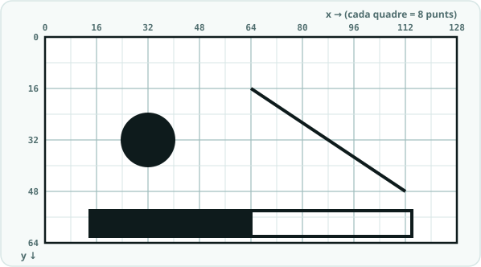

# Prova SA2-SA3 · Correcció comentada (per a l'alumnat)

**Per a qui és?** Per a tu, quan et tornin la prova corregida. **Durada:** uns 30 min · **Material:** la teva prova, aquest full i el quadern.

> 🎯 **Una prova no s'acaba quan la lliures.** El que t'ha sortit malament et diu què has de repassar, i el que t'ha sortit bé, què ja domines. Aquest full t'explica el **perquè** de cada resposta i quins són els **errors típics**, perquè sàpigues d'on ve el teu.

## Com fer servir aquest full

1. **Busca el teu model** (A o B) a cada pregunta. L'explicació (💡) i els errors típics (⚠️) serveixen per als dos models.
2. Per a cada pregunta que **no** tinguis bé, llegeix l'apartat ⚠️ **Errors típics** i troba quin ha estat el teu. No n'hi ha prou amb copiar la resposta bona: el que has d'entendre és **per què** t'has equivocat.
3. Mira el **semàfor** que vas pintar abans de lliurar (🟢🟡🔴). Coincideix amb la nota de cada bloc? Si et pensaves que un bloc t'havia anat bé i no és així, aquell és el que més has de repassar.
4. Al final, omple el **pla de millora** (3 línies al quadern).

<style>
@media print {
  .prose { font-size: 10pt; }
  .prose h3, .prose h4 { break-after: avoid; }
  .prose pre, .prose .codehilite, .prose table, .prose img, .prose p:has(img), .prose blockquote { break-inside: avoid; }
}
</style>

---

## 🔌 Bloc 1 · Circuits

### P1. El LED i la seva resistència

| Model | a) | b) |
|---|---|---|
| **A** | **b)** Per limitar el corrent, perquè el LED no es cremi. | La llarga és l'**ànode (+)** i va cap al **pin** (passant per la resistència). |
| **B** | **b)** Passa massa corrent: es pot cremar el LED o fer malbé el pin. | La curta és el **càtode (−)** i va cap a **GND**. |

💡 **Per què:** un LED, per si sol, deixa passar tot el corrent que li arribi, i se n'escalfa fins a cremar-se. La resistència fa de **fre**: deixa passar prou corrent perquè faci llum, però no tant que es faci malbé. A més, el LED només funciona en **un sentit**: el corrent entra per l'ànode (la pota llarga) i surt pel càtode (la curta, que va a GND).

⚠️ **Errors típics:**
- **Has dit que la resistència «fa més llum»?** És al revés: amb resistència el LED fa una mica **menys** de llum, però dura.
- **Has confós ànode i càtode?** Truc: el càtode és la pota **curta** i, a l'encapsulat, el costat **pla**. A l'esquema és la **ratlla** del símbol.

🔁 **Repassa:** [Pràctica 2 · El semàfor](../Classes/SA2/codi/02_semafor/EXPLICACIO.md).

### P2. Troba els errors del muntatge

| Model | LED | Què està malament | Què passa |
|---|---|---|---|
| **A** | vermell | El cable surt del pin **5V**, no del pin 8. | Està **sempre encès**, digui el que digui el programa. |
| **A** | groc | El LED està **al revés**: la ratlla (càtode) mira cap al pin. | **No s'encén mai**. |
| **A** | verd | **No té resistència.** | Passa massa corrent: el LED es pot **cremar** i el pin es pot fer malbé. |
| **B** | vermell | El LED està **al revés**. | **No s'encén mai.** |
| **B** | groc | **No té resistència.** | Massa corrent: el LED es pot **cremar** i el pin es pot fer malbé. |
| **B** | verd | La branca **no arriba a GND**: el cable s'acaba en un punt lliure. | **No s'encén mai**: el corrent no té per on tornar. |

💡 **Per què:** el corrent ha de fer un **camí tancat**: surt del pin, passa per la resistència i el LED, i torna per **GND**. Si el camí no comença al pin, el programa no mana. Si el LED està al revés, el camí està tallat. Si no torna a GND, el camí no es tanca. I si no hi ha resistència, res no frena el corrent.

⚠️ **Errors típics:**
- **Has dit que el LED invertit «fa poca llum»?** No en fa gens: al revés, el LED bloqueja el corrent.
- **Has trobat l'error però no què passa?** La tercera columna és la que demostra que entens el circuit. Un tècnic no diu només «això està malament», diu també **quin símptoma** veuràs.

🔁 **Repassa:** [Esquemes de connexions de la SA2](../Classes/SA2/SA2_esquemes_connexions.md).

### P3. El polsador amb `INPUT_PULLUP`

| Model | 1 | 2 | 3 | 4 |
|---|---|---|---|---|
| **A** | **V** | **F**: va entre el pin i **GND** | **V** | **F**: un rebot és el contacte metàl·lic que **bota** uns mil·lisegons i fa semblar diverses premudes |
| **B** | **F**: premut dona **`LOW`** | **V** | **V** | **F**: duren uns pocs **mil·lisegons** (per això n'hi ha prou amb `ANTIREBOT = 40`) |

💡 **Per què:** amb `INPUT_PULLUP`, l'Arduino connecta per dins una resistència que «estira» el pin cap a 5 V. En repòs el pin llegeix **`HIGH`**. Quan prems, el polsador uneix el pin amb **GND** i llegeix **`LOW`**. És al revés del que sembla natural, i per això el codi pregunta `if (estat == LOW)` per saber si està premut.

⚠️ **Errors típics:**
- **Pensaves que premut = `HIGH`?** És l'error més freqüent de la SA3. Recorda-ho així: «pull-up: en repòs, amunt».

🔁 **Repassa:** [Pràctica 1 · El polsador](../Classes/SA3/codi/01_polsador_debounce/EXPLICACIO.md).

### P4. La llum que es gradua (PWM)

| Model | a) | b) | c) |
|---|---|---|---|
| **A** | 0 **apagat** · 255 **màxim** · 128 **a mitges** · 30 **fluix** | Als pins amb el símbol **`~`**: 3, 5, 6, 9, 10 i 11. | S'encén i s'apaga **centenars de vegades per segon**: l'ull no ho pot seguir i veu una llum fixa més fluixa. |
| **B** | 255 **màxim** · 0 **apagat** · 64 **fluix** · 191 **fort** | **No**: el pin 7 no té `~` (no fa PWM). Amb `analogWrite`, s'encén **del tot** o s'apaga. | El més alt és **255** i el més baix, **0**. |

💡 **Per què:** PWM no vol dir «menys tensió». Vol dir **5 V una part del temps i 0 V la resta**, molt de pressa. El número de `analogWrite` (de 0 a 255) diu **quina part del temps** està encès: 0 = mai, 255 = sempre, 128 = la meitat. Només ho poden fer els pins marcats amb `~`.

⚠️ **Errors típics:**
- **Has posat que el màxim és 1023?** El 1023 és d'`analogRead` (entrades). `analogWrite` (sortides) va de **0 a 255**.
- **Has dit que el pin 7 «fa mitja llum»?** Només els pins amb `~` graduen la llum. Mira-ho sempre a la placa abans de triar el pin.

🔁 **Repassa:** [Pràctica 3 · La llum que respira](../Classes/SA2/codi/03_fade_pwm/EXPLICACIO.md).

---

## 🧠 Bloc 2 · Llegeix i prediu

### P5. El `switch`

| Model | `mode` 0 | `mode` 1 | `mode` 2 | Què hi falta |
|---|---|---|---|---|
| **A** | **verd** | verd | blau | Un **`break;`** després de `color(255, 0, 0);` |
| **B** | vermell | **blau** | blau | Un **`break;`** després de `color(0, 255, 0);` |

💡 **Per què:** un `case` no s'acaba sol. El programa entra al `case` que toca i continua executant les línies de sota **fins que troba un `break`**, encara que siguin d'un altre `case`. Al model A, amb `mode = 0` el LED es posa vermell i, una fracció de mil·lisegon després, verd. L'ull només veu el verd.

⚠️ **Errors típics:**
- **Has dit «vermell i després verd»?** Tècnicament és veritat, però el vermell dura una fracció de mil·lisegon. El que **es veu** és el verd (A) o el blau (B).

🔁 **Repassa:** [Pràctica 2b · El semàfor amb `switch`](../Classes/SA2/codi/02b_semafor_switch/EXPLICACIO.md) (llegeix el comentari «sense break, cauria al case següent!»).

### P6. La llum que respira

| Model | a) | b) | c) |
|---|---|---|---|
| **A** | S'**encén** a poc a poc (`v` puja) | Primera **0**, última **255** | Un `delay` **més gran** (per exemple `delay(40)`) o passos més petits (`v = v + 1`) |
| **B** | S'**apaga** a poc a poc (`v` baixa) | Primera **255**, última **0** | Un `delay` **més petit** (per exemple `delay(5)`) o passos més grans (`v = v - 15`) |

💡 **Per què:** el `for` té tres parts: **on comença** (`v = 0`), **fins quan** continua (`v <= 255`) i **com canvia** (`v = v + 5`). Si `v` puja, la llum puja. La velocitat depèn de dues coses: quant s'espera a cada pas (`delay`) i quants passos fa (la mida del salt).

⚠️ **Errors típics:**
- **Has posat que l'última és 250 (A) o 5 (B)?** La condició és `<=` (o `>=`): el valor del límit **també compta**.

🔁 **Repassa:** [Pràctica 3 · La llum que respira](../Classes/SA2/codi/03_fade_pwm/EXPLICACIO.md) i el [dibuix del programa](../Classes/SA2/SA2_diagrama_flux.md).

### P7. Colors RGB

| Model | 1a | 2a | 3a | 4a | Sobren | e) |
|---|---|---|---|---|---|---|
| **A** | **E** vermell | **B** groc | **A** blanc | **F** apagat | C, D | `color(0, 255, 0);` |
| **B** | **E** blau | **C** magenta | **F** apagat | **B** groc | A, D | `color(255, 255, 255);` |

💡 **Per què:** els tres números són el **vermell**, el **verd** i el **blau**, en aquest ordre. El LED RGB **suma llum**: vermell + verd = groc, vermell + blau = magenta, verd + blau = cian, i tots tres = blanc.

⚠️ **Errors típics:**
- **Has dit que vermell + verd fa marró?** Això passa amb **pintura**, que resta llum. Amb llum es **suma**, i vermell + verd fa groc.
- **Has escrit els números en un altre ordre?** L'ordre sempre és **R, G, B**.

🔁 **Repassa:** [Pràctica 4 · Colors RGB](../Classes/SA2/codi/04_rgb/EXPLICACIO.md).

### P8. Fes de Monitor sèrie

| Model | | | | |
|---|---|---|---|---|
| **A** (`< 400`) | 120 → **encès, Fosc** | 650 → **apagat, Llum** | 399 → **encès, Fosc** | 400 → **apagat, Llum** |
| **B** (`< 250`) | 900 → **apagat, Llum** | 60 → **encès, Fosc** | 250 → **apagat, Llum** | 249 → **encès, Fosc** |

💡 **Per què:** amb aquest muntatge, poca llum vol dir número **petit**. Per això «fosc» és `valorLdr < llindar`. La pregunta té trampa a l'última columna: `400 < 400` és **fals**, perquè un número no és més petit que ell mateix. Si volguessis que l'igual també comptés com a fosc, hauries d'escriure `<=`.

⚠️ **Errors típics:**
- **Has posat «encès» amb 400 (A) o amb 250 (B)?** És la trampa del **límit**: `<` no inclou l'igual.

🔁 **Repassa:** [Pràctica 2 · Potenciòmetre i sensor de llum](../Classes/SA3/codi/02_potenciometre_ldr/EXPLICACIO.md).

### P9. El polsador que compta

| Model | a) | b) |
|---|---|---|
| **A** | `Premudes: 1`, `Premudes: 2`, `Premudes: 3` | **Una sola** premuda: només compta el **moment** de prémer (el canvi de `HIGH` a `LOW`), no l'estona que el tens premut. |
| **B** | `Premudes: 1`, `Premudes: 2` | Evita els **rebots**: el contacte bota uns mil·lisegons i sembla que prems diverses vegades. Sense l'antirebot, una premuda podria comptar **2 o 3 vegades**. |

💡 **Per què:** el codi té dues proteccions. **`estat != estatAnterior`** fa que només compti el **canvi** (el moment de prémer), no l'estona que el tens premut. **`ANTIREBOT`** fa que no es comptin els rebots, que són canvis massa ràpids (menys de 40 ms) per ser una premuda real.

⚠️ **Errors típics:**
- **Al model A, has dit que en 5 segons compta moltes premudes?** Això passaria sense `estat != estatAnterior`. Amb aquesta condició, mantenir-lo premut no canvia res.

🔁 **Repassa:** [Pràctica 1 · El polsador](../Classes/SA3/codi/01_polsador_debounce/EXPLICACIO.md).

### P10. Dibuixa la pantalla

**a)** Solucions:

{ style="max-width:80%" }

{ style="max-width:80%" }

**b)** **A:** sense `display()`, la pantalla queda **negra**: tot es dibuixa a la memòria de l'Arduino, però mai no s'envia a la pantalla. **B:** `clearDisplay()` **esborra** el dibuix anterior. Sense aquesta línia, cada dibuix es pintaria a sobre de l'anterior.

💡 **Per què:** la pantalla funciona com un **full a la memòria**. `clearDisplay()` el deixa en blanc, les ordres `draw…` i `fill…` hi dibuixen, i `display()` l'**ensenya**.

⚠️ **Errors típics:**
- **Has dibuixat la línia del model A pujant?** A la pantalla, y = 48 és **més avall** que y = 16.
- **Has fet el cercle del doble de mida?** El 8 (o el 12) és el **radi**, no el diàmetre.

🔁 **Repassa:** [Pràctica 3 · La pantalla OLED](../Classes/SA3/codi/03_pantalla_oled/EXPLICACIO.md).

---

## 🛠️ Bloc 3 · Depura, explica i crea

### P11. Depura

**Model A** (llum automàtic)

| Línia | Què falla | Correcció |
|---|---|---|
| 2 | El pin 7 **no té `~`**: no pot fer «mitja potència». | `const int LED = 9;` (o un altre pin amb `~`) |
| 5-7 | Falta engegar el Monitor sèrie: el `Serial.println` no mostra res. | Afegir `Serial.begin(9600);` dins del `setup()` |
| 10 | Falta el `;`: no compila. | `int llum = analogRead(LDR);` |
| 12 | `=` **posa** el valor, no compara. A més, ha de ser «per sota de». | `if (llum < llindar) {` |

**Model B** (interruptor amb polsador)

| Línia | Què falla | Correcció |
|---|---|---|
| 6 | Sense resistència a la protoboard, el pin queda a l'aire i llegeix a l'atzar. | `pinMode(POLSADOR, INPUT_PULLUP);` |
| 12 | Amb *pull-up*, prémer és passar de `HIGH` a **`LOW`**. | `if (ara == LOW && anterior == HIGH) {` |
| entre 14 i 15 | **Hi falta** guardar l'estat d'aquesta volta: `anterior` sempre val `HIGH`. | Afegir `anterior = ara;` |
| 15 | Falta el `;`: no compila. | `delay(40);` |

💡 **Per què:** hi ha tres famílies d'errors. Els de **sintaxi** (`;`) els troba el compilador. Els de **lògica** (`=` en lloc de `<`, `HIGH` en lloc de `LOW`) compilen però fan una altra cosa. Els de **maquinari** (pin sense `~`, falta de *pull-up*) només els veus si saps com funciona el circuit.

⚠️ **Errors típics:**
- **Al model A no has vist el `=`?** És l'error més traïdor de C++: compila sense queixar-se. `=` vol dir «posa-hi», i `==` vol dir «és igual a?».
- **Al model B no has trobat la línia que falta?** Si una variable es diu `anterior`, en algun lloc s'ha d'**actualitzar**. Si no, no recorda res.

🔁 **Repassa:** la rutina **DEPURA** de la [fitxa de la SA2](../Classes/SA2/SA2_fitxa_alumnat.md).

### P12. Explica-ho com un tècnic

| Model | a) | b) |
|---|---|---|
| **A** | **b)** `tone()` i el pin 11 (el blau) fan servir el mateix rellotge intern. | Fer servir el blau només amb **0 o 255** (per exemple, el magenta `color(255, 0, 255)` en lloc del lila), o moure el blau a un altre pin PWM, com el **5**. |
| **B** | **b)** El brunzidor passiu necessita un senyal que s'encengui i s'apagui molt de pressa, i el relé li donava 5 V fixos. | **Directe** al pin (pota + al pin 6 i pota − a GND), i fer-lo sonar amb **`tone(6, freqüència, durada);`**. |

💡 **Per què:** aquestes dues avaries van passar **de debò** a l'aula, i per això la Pràctica 5 ja no té relé. Quan expliques una avaria, has de dir **com funciona** el que falla («el rellotge és compartit», «el passiu necessita oscil·lar»). No n'hi ha prou amb dir «no funciona».

🔁 **Repassa:** [Pràctica 5 · Panell de senyalització](../Classes/SA2/codi/05_panell_senyalitzacio/EXPLICACIO.md).

### P13. Una funció que respon

```cpp
int nivellLlum(int lectura) {      // model B: nivellSoroll, amb 200 i 600
  if (lectura < 300) {
    return 0;          // fosc
  } else if (lectura < 700) {
    return 1;          // normal
  } else {
    return 2;          // molta llum
  }
}
```

**b)** A: `int nivell = nivellLlum(analogRead(A1));` · B: `int nivell = nivellSoroll(analogRead(A0));`

També és correcte fer-ho en dues línies: primer `int lectura = analogRead(A1);` i després `int nivell = nivellLlum(lectura);`.

💡 **Per què:** `return` **torna** el valor a qui ha cridat la funció. Quan escrius `int nivell = nivellLlum(...)`, el valor que torna el `return` es guarda a `nivell`.

⚠️ **Errors típics:**
- **Al segon buit has posat `Serial.println`?** Mostrar un valor no és el mateix que **retornar-lo**. Per guardar-lo en una variable cal el `return`.
- **A la b) has escrit `nivellLlum();` sense res a dins dels parèntesis?** La funció necessita que li donis la lectura.

🔁 **Repassa:** la funció `color()` de la [Pràctica 4](../Classes/SA2/codi/04_rgb/EXPLICACIO.md) i les funcions del [tamagotchi](../Classes/SA3/codi/05_mascota/EXPLICACIO.md).

### P14. Crea

**Model A** (polsador que canvia de color):

```cpp
  if (ara == LOW && anterior == HIGH) {   // s'acaba de premer
    // (1)
    mode = mode + 1;
    if (mode > 2) {
      mode = 0;                           // despres del 2, torna al 0
    }
  }
  anterior = ara;

  // (2)
  switch (mode) {
    case 0: color(0, 255, 0);   break;    // verd
    case 1: color(255, 255, 0); break;    // groc
    case 2: color(255, 0, 0);   break;    // vermell
  }
```

**Model B** (avís de nit):

```cpp
  // (1)
  if (esFosc && !eraFosc) {   // ara es fosc i abans no
    tone(6, 1000, 200);
  }

  // (2)
  if (esFosc) {
    color(0, 0, 255);         // blau
  } else {
    color(0, 0, 0);           // apagat
  }
```

💡 **Per què:** els dos models amaguen **la mateixa idea**, la més important de la SA3: **detectar un canvi**, no un estat. «Està premut» passa milers de voltes seguides; «s'acaba de prémer» passa **una** sola vegada. Per detectar-ho cal una variable que **recordi la volta anterior** (`anterior`, `eraFosc`). Aquesta part ja te la donàvem feta: fixa-t'hi bé, perquè al T2 la faràs servir molt.

⚠️ **Errors típics:**
- **Model A: el `mode` no torna mai a 0?** Sense el `if (mode > 2)`, `mode` val 3, 4, 5… i cap `case` el recull: el LED es queda amb l'últim color.
- **Model A: t'has deixat algun `break`?** Ja l'has vist a la P5: el color es «vessa» al `case` següent.
- **Model B: has posat el `tone()` només amb `if (esFosc)`?** Llavors sona a **cada volta**, 10 vegades per segon, mentre és fosc. Cal `esFosc && !eraFosc`.

🔁 **Repassa:** [Pràctica 1 · El polsador](../Classes/SA3/codi/01_polsador_debounce/EXPLICACIO.md) i el `llegeixBotons()` del [tamagotchi](../Classes/SA3/codi/05_mascota/EXPLICACIO.md).

---

## 📝 El meu pla de millora

Escriu al quadern **3 línies** (com a la prova de la SA1):

1. **Què m'ha fallat:** quin bloc o quina idea, no només «la P6».
2. **Què practicaré:** quina pràctica de les 🔁 tornaré a fer o a llegir.
3. **Com ho comprovaré:** per exemple, «tornaré a fer la P8 de l'altre model sense mirar la solució».

| Si t'ha fallat sobretot… | Vol dir que t'has de reforçar en… | Comença per… |
|---|---|---|
| **Bloc 1** (P1-P4) | Com funciona el circuit: el camí del corrent, el sentit del LED, el *pull-up* i el PWM. | [Esquemes de la SA2](../Classes/SA2/SA2_esquemes_connexions.md) i la [Pràctica 1 de la SA3](../Classes/SA3/codi/01_polsador_debounce/EXPLICACIO.md) |
| **Bloc 2** (P5-P10) | Llegir codi **com ho faria l'Arduino**: línia a línia, apuntant el valor de cada variable. | Fes la taula de la P8 amb el codi de la [Pràctica 2 de la SA3](../Classes/SA3/codi/02_potenciometre_ldr/EXPLICACIO.md) |
| **Bloc 3** (P11-P14) | Escriure i corregir codi, sobretot **detectar canvis** amb una variable que recorda. | [Pràctica 1 de la SA3](../Classes/SA3/codi/01_polsador_debounce/EXPLICACIO.md) i el `llegeixBotons()` del tamagotchi |

> 💪 **Truc per estudiar:** fes **l'altre model** de la prova (si tenies l'A, fes el B) sense mirar aquest full. Després corregeix-te tu amb aquesta correcció. Si ara et surt bé, ho has après de debò.
