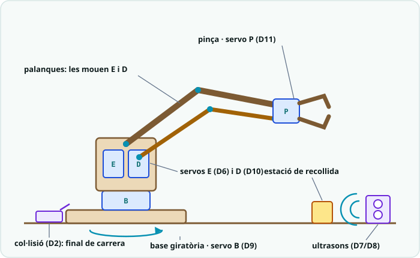
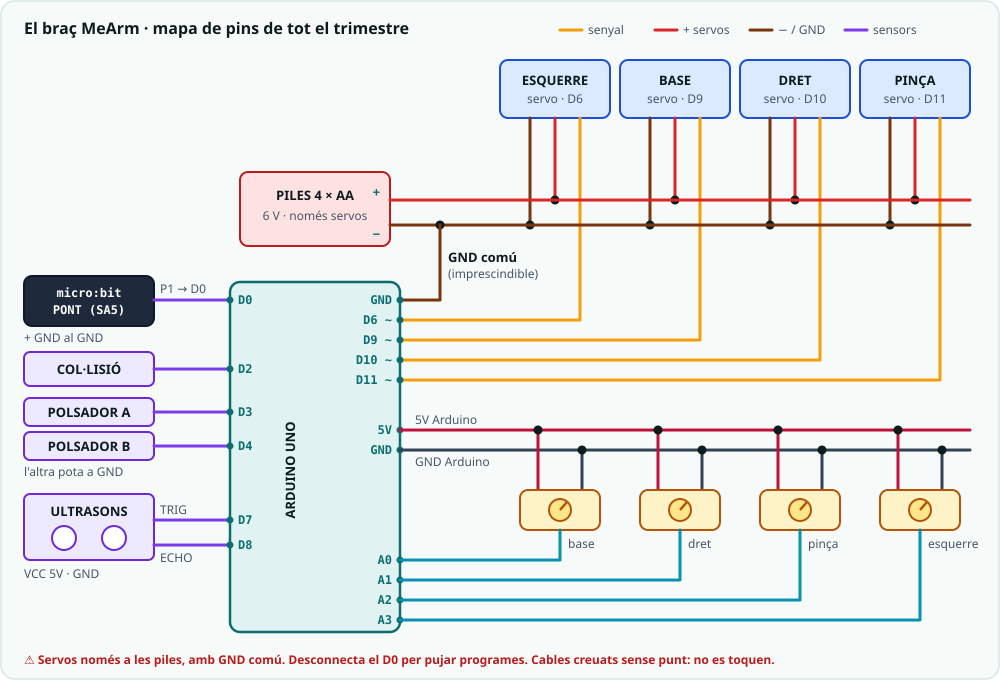

# 🦾 Projecte T2 · El braç robòtic MeArm

> **Per a qui és?** Per a cada alumne/a durant tot el 2n trimestre. És el
> dossier del segon robot del curs i el **fil conductor de SA4, SA5 i SA6**:
> cada pràctica del trimestre es fa sobre aquest braç. Aquí hi ha les peces,
> el calendari de muntatge, el cablatge complet i la rúbrica.

**Durada:** 2n trimestre (SA4-SA6) · **Maquinari:** MeArm V1.1 en DM 3 mm, 4 servos (servo Starter a la base, 2 MG90S als laterals i 1 KS0194 a la pinça), Arduino UNO + breadboard, 4 potenciòmetres, ultrasons HC-SR04, sensor de col·lisió KS0021, 2 polsadors, 2 micro:bit (comandament i pont), portapiles 4 × AA

## El robot

El **MeArm** és un braç obert de tall làser amb **4 graus de llibertat**:

- la **base** gira tot el braç a dreta i esquerra;
- el **servo esquerre** i el **servo dret**, un a cada costat, mouen les
  palanques: un fa **avançar i recular** el braç i l'altre el fa **pujar i
  baixar** (quin és quin depèn del muntatge: comprova-ho i escriu-ho a
  l'etiqueta del servo);
- la **pinça** obre i tanca.

El seu cervell és el mateix **Arduino UNO** de sempre durant **tot el
trimestre**. Cada SA hi afegeix una capa sense desfer la de l'anterior:

| SA | Què aprens | Què guanya el braç |
|---|---|---|
| **SA4** | Servos, sensors i moviment | El **cos** muntat i el **control amb 4 potenciòmetres** |
| **SA5** | micro:bit i MicroPython | Un **comandament per ràdio** que el mou a distància |
| **SA6** | Sistemes de control | **Homing**, **pinça automàtica** i la **màquina d'estats** (repòs, manual, replay, emergència) |

## Llista de peces

| Peça | Origen | Quantitat |
|---|---|---|
| Peces del MeArm V1.1 en DM 3 mm | Plantilla `brac_MeArm_v1.1.svg`, tall làser | 1 joc (30 peces) |
| Servo Starter (base) | Kit 1 | 1 |
| Micro servo MG90S (esquerre i dret: aguanten el pes del braç) | Compra del centre ([llista de compra](../../Recursos/Compra_brac_T2.xlsx)) | 2 |
| Micro servo KS0194 (pinça) | Kit 2 | 1 (l'altre queda de recanvi) |
| Potenciòmetres (control manual, SA4) | Kit 1 (3) + compra (1) | 4 |
| Ultrasons HC-SR04 + suport imprès | Kit 1 + `suport_hcsr04.scad` | 1 |
| Sensor de col·lisió KS0021 (final de carrera i emergència) | Kit 2 | 1 |
| Polsadors (botons d'estat abans del pont) | Kit 1 | 2 |
| Arduino UNO + breadboard | Kit 1 | 1 |
| Portapiles 4 × AA (només per als servos) | Material del centre | 1 |
| micro:bit pont (rep la ràdio i la passa a l'Arduino, SA5) | Kit d'aula | 1 |
| micro:bit comandament (a la mà) | Kit d'aula | 1 |
| Cargols M3 (8, 10, 12 i 20 mm) i 4 femelles | Material del centre | segons la [guia de muntatge](00_Muntatge_brac_MeArm.md) |

<!-- web:only-github -->
Plantilla de tall làser: [`../../Recursos/plantilles_laser/brac_MeArm_v1.1.svg`](../../Recursos/plantilles_laser/brac_MeArm_v1.1.svg).
Suport de l'ultrasons: [`../../Recursos/peces_3d/suport_hcsr04.scad`](../../Recursos/peces_3d/suport_hcsr04.scad).
<!-- /web:only-github -->

## El braç es construeix al llarg de tot el trimestre

Quan arribes a la SA4 tens una **caixa amb el teu nom** amb les peces ja
tallades. El muntatge segueix els blocs de la
**[guia de muntatge del MeArm](00_Muntatge_brac_MeArm.md)** i es reparteix en
**torns de taller** al final de cada sessió. Cada pràctica del trimestre es fa
sobre el braç que tens en aquell moment.

| Sessió | Pràctica (sobre el braç) | Torn de taller |
|---|---|---|
| SA4 · S1 | Servo + potenciòmetre: mous el servo de la base i **centres els 4 servos a 90°** | 35': pas 0 i blocs A-B (banyes, base i laterals) |
| SA4 · S2 | Motor DC + pont H (pràctica curta, **fora del braç**: el motor és per al rover del T3) | 40': blocs C-D (pinça i calibratge amb l'escombrada de la S1) |
| SA4 · S3 | Ultrasons → braç: la distància d'un objecte mou la base i la pinça | 45': bloc E (estructura central; el pas 15, en parella) |
| SA4 · S4 | **Producte:** el braç amb 4 potenciòmetres i angles límit | Cablatge definitiu dels 4 servos i els 4 potenciòmetres |
| SA5 · S1 | Selector d'articulació a la pantalla de la micro:bit | Cap |
| SA5 · S2 | La inclinació com a gest del comandament | 20': cable del **pont** (P1 → D0, GND) i prova d'ordres pel Monitor sèrie |
| SA5 · S3 | Ràdio: el **comandament** mou el braç | 20': el comandament sobre el braç |
| SA6 · S1 | Llaç obert vs llaç tancat: **homing** amb el final de carrera | 20': **sensor de col·lisió** a la base |
| SA6 · S2 | Histèresi: **pinça automàtica** amb l'ultrasons | 20': angles límit i cablatge **endreçat i etiquetat** (criteri R1) |
| SA6 · S3 | **Producte:** la màquina d'estats del braç | Cap: el braç ja és tancat |
| SA6 · S4 | Prova T2 | — |

> 📦 **Entre sessions, el braç viu a la seva caixa.** Cap pràctica no
> **depèn** del braç per funcionar: si un dia et falta alguna peça, la fas
> amb servos solts a la breadboard i el torn de taller es recupera a la
> sessió següent.

> 🧑‍🏫 **Per al docent: logística dels torns (des del 28-10-2026).**
> - **Tall abans de la s13, fora d'horari:** el MeArm no té zona
>   personalitzable, així que es talla per lots durant les vacances de Nadal.
>   Prepara una caixa etiquetada per alumne/a amb les peces i els cargols.
> - **D'on surten els minuts:** el motor DC és una pràctica curta, i els
>   + reptes i les pràctiques que no eren del braç (barrera, termòstat, llum
>   de nit, dau…) s'han reconvertit o retirat.
> - **Prototip abans de Nadal:** cal tallar i muntar un MeArm amb el nostre
>   DM i els nostres servos, cronometrant-ne el muntatge (taula «Registre del
>   prototip» de la [guia](00_Muntatge_brac_MeArm.md)), i validar el pont
>   micro:bit → D0 amb maquinari real.
> - **La S4 de SA4 és comprimible:** si el T2 va just, el repte de la S3 fa de
>   producte i el cablatge definitiu passa al torn de la SA5-S2.

## Muntatge

Segueix la **[guia de muntatge del MeArm](00_Muntatge_brac_MeArm.md)**: el
pas 0 (centrar els servos) i els blocs A-E, amb la pàgina del PDF oficial on
surten les fotos. Abans de donar el braç per muntat:

1. Comprova que cada articulació es mou **fluixa, com una titella**.
2. Troba els **angles límit** de cada servo (on la peça toca o està a punt de
   tocar) i anota'ls al quadern. Al codi no s'han de superar mai.
3. Munta el **sensor de col·lisió** a la base, on la palanca de la base el
   toca en girar del tot cap a un costat: és el **final de carrera** del
   homing i el sensor de l'emergència. Apunta l'angle on toca (el del homing):
   als sketches, el `BASE_MIN` ha de quedar **uns graus per sobre**, perquè en
   ús normal la base no el premi i el braç no es quedi bloquejat en emergència.
4. Munta l'**ultrasons** al seu suport, mirant l'**estació de recollida**
   (el lloc de la taula on deixaràs els objectes que ha d'agafar la pinça).

> ⚠️ **Parell insuficient:** si el braç es doblega o cau amb la pinça
> carregada, comprova que els laterals són els MG90S. També pots limitar la càrrega
> que aixeca. No és un problema de codi.

## Cablatge

Aquest és el **mapa de pins de tot el trimestre**. Totes les pràctiques de
SA4-SA6 fan servir aquests pins: el que connectes a la SA4 ja no es mou.

| Component | Pin | Des de | Notes |
|---|---|---|---|
| Servo base | D9 | SA4 | PWM (`~`). Piles. |
| Servo esquerre | D6 | SA4 | PWM (`~`). Piles. |
| Servo dret | D10 | SA4 | PWM (`~`). Piles. |
| Servo pinça | D11 | SA4 | PWM (`~`). Piles. |
| Potenciòmetre base | A0 | SA4 | Extrems a 5V i GND de l'Arduino. |
| Potenciòmetre dret | A1 | SA4 | |
| Potenciòmetre pinça | A2 | SA4 | |
| Potenciòmetre esquerre | A3 | SA4 | |
| Ultrasons TRIG / ECHO | D7 / D8 | SA4 | VCC a 5V de l'Arduino. |
| Sensor de col·lisió KS0021 | D2 | SA6 | `INPUT_PULLUP`: llegeix `LOW` quan toca. |
| Polsador A / polsador B | D3 / D4 | SA6 | `INPUT_PULLUP`, l'altra pota a GND. |
| micro:bit pont: P1 | D0 (RX) | SA5 | Ordres de ràdio, una per línia. |
| micro:bit pont: GND | GND | SA5 | GND comú amb l'Arduino. |

> ⚠️ **Mai alimentar els servos des de l'USB ni des del pin 5V de l'UNO.**
> Els quatre servos van a les **piles** (4 × AA), i el **−** de les piles va
> també al **GND de l'Arduino** (GND comú). Els potenciòmetres, l'ultrasons i
> els sensors sí que van al 5V de l'Arduino: gasten molt poc.

> ⚠️ **El cable del pont va només de la micro:bit cap a l'Arduino.** Mai
> connectis cap pin de l'Arduino (5 V) a la micro:bit (3,3 V): la
> cremaries. I **desconnecta el D0 per pujar un programa**: l'USB fa
> servir el mateix pin.

> 🔌 **Per què l'ultrasons no va als pins 12/11 de la SA3?** Perquè el D11 és
> ara el servo de la pinça. Al braç, l'ultrasons passa al **D7/D8**.

## El protocol d'ordres

A partir de la SA5, el braç obeeix **ordres de text** curtes, una per línia.
Les envia el comandament per ràdio i el pont les passa al D0. També les pots
escriure tu al **Monitor sèrie** (9600, «Nova línia») per provar el braç
sense ràdio.

| Ordre | Qui l'envia | Què fa el braç |
|---|---|---|
| `B+` / `B-` | Comandament: inclinar a dreta/esquerra | Gira la base |
| `D+` / `D-` | Comandament: inclinar enrere/endavant | Mou el servo dret |
| `E+` / `E-` | Comandament: mantenir A / mantenir B | Mou el servo esquerre |
| `P` | Comandament: A i B alhora | Obre o tanca la pinça |
| `G` | Comandament: sacsejar | Grava el punt actual (replay) |
| `A` | Pont: botó A | Repòs ↔ manual (i rearmament) |
| `R` | Pont: botó B | Reprodueix la seqüència gravada |

## La màquina d'estats del braç

És **exactament** el patró de la SA6 (`03_maquina_estats.ino`): un `enum`
amb els estats, una variable `estat` i un `switch` amb un `case` per estat.
A la pràctica de la SA6 les ordres surten dels **polsadors** D3/D4; al
producte final surten del **pont**.

| Estat | Què fa el braç | En surt quan… |
|---|---|---|
| **Repòs** | Quiet, servos a la posició actual. | `A` → manual · `R` → replay (si hi ha seqüència gravada). |
| **Manual** | Obeeix el comandament; `G` grava el punt actual. | `A` → repòs · `R` → replay. |
| **Replay** | Reprodueix la seqüència gravada, punt a punt (amb `millis()`). | En acabar, a repòs. `A` l'avorta. |
| **Emergència** | No mou res. Mana per damunt de qualsevol altre estat. | Rearmament **manual**: sensor alliberat **i** `A`. |

> 🔑 **Per al docent:** implementació completa al
> [solucionari del trimestre](../Solucionari/Solucionari_T2_SA4-SA6.md)
> (secció «Codi de referència del robot del trimestre: el braç»):
> `T2_brac_estats.ino`, `T2_brac_microbit_comandament.py` i
> `T2_brac_microbit_pont.py`.

**Producte final (SA6-S3):** el MeArm muntat amb la seva **màquina d'estats**
i el **comandament per ràdio**, capaç d'agafar un objecte de l'estació de
recollida i deixar-lo en un altre lloc. La S4 de SA6 és la prova pràctica
**T2**, amb el braç ja tancat.

## Plans B (contingència)

> 🧑‍🏫 **Pla B de l'estructura: `brac.svg` (3 servos).** Si el prototip del
> MeArm falla abans de Nadal (ranures que no encaixen, servos sense força),
> es torna al braç propi `Recursos/plantilles_laser/brac.svg`: base, colze i
> pinça. Tot el material del T2 funciona igual **sense el servo esquerre**:
> - als sketches, esborra les línies del servo esquerre (D6) i del
>   potenciòmetre A3;
> - al comandament, `E+`/`E-` deixen de tenir efecte (o es retiren);
> - la rúbrica R2 passa de «4 articulacions» a «3 articulacions»;
> - el servo dret (D10) fa de colze.
>
> **Pla B del pont: el braç governat per la micro:bit.** Si el pont sèrie
> (3,3 V cap a una entrada de 5 V) no funciona amb el maquinari real, el
> braç es pot connectar sencer a una **micro:bit V2 amb Micro:shield**:
> esquema i codi a la «Versió micro:bit» de la
> [guia de muntatge](00_Muntatge_brac_MeArm.md#versió-microbit-comandament-receptor)
> (`T2_mearm_microbit_receptor.py`, amb el mateix comandament). Cal una V2:
> la V1 no pot moure 4 servos alhora. Amb aquest pla, la màquina d'estats de
> la SA6 es fa a l'Arduino amb els polsadors i el braç de ràdio queda com a
> demostració separada.

## Rúbrica del robot (producte SA6)

| Criteri | Insuficient (0-4) | Suficient/Bé (5-6) | Notable (7-8) | Excel·lent (9-10) |
|---|---|---|---|---|
| **R1 · Fabricació i muntatge** | Estructura inestable o cablejat insegur. | Braç funcional però amb algun cable fluix o desordenat. | Braç ferm i cablejat endreçat, sense etiquetar. | Braç ferm, cablejat endreçat i etiquetat, res solt ni curtcircuitat. |
| **R2 · Moviment** | Alguna articulació no es mou o força el topall. | Les 4 articulacions es mouen, amb algun tremolor. | Les 4 articulacions es mouen de manera suau i fiable. | Moviment suau, precís i sense tremolor a les 4 articulacions. |
| **R3 · Modes i màquina d'estats** | Sense estats definits o el braç queda penjat en algun mode. | Alguns modes funcionen, sense diagrama d'estats. | Tots els modes (repòs/manual/replay/emergència) funcionen, amb diagrama d'estats inclòs. | Tots els modes funcionen de manera fiable, amb diagrama d'estats clar i emergència provada. |
| **R4 · Comandament per ràdio i demostració** | Sense comandament o no arriba a agafar cap objecte. | Comandament bàsic; agafa l'objecte amb ajuda. | Comandament fiable; agafa i mou un objecte amb èxit. | Comandament fiable i demostració fluida: agafa i mou l'objecte a la primera. |

## Problemes freqüents

| Símptoma | Causa probable | Solució |
|---|---|---|
| El servo tremola | Alimentació insuficient (des de l'USB en lloc de les piles). | Piles per als servos, amb GND comú. |
| El servo brunz i s'escalfa quiet | Força contra un topall. | Torna a trobar els angles límit i posa'ls a les constants `_MIN`/`_MAX`. |
| El braç tremola o s'encalla a mig moviment | Alguna articulació massa collada. | Afluixa mitja volta els cargols dels pivots (bloc E de la guia). |
| L'ultrasons dona 0 o valors absurds | TRIG i ECHO intercanviats o sense 5V. | TRIG a D7, ECHO a D8, VCC a 5V. |
| La ràdio no arriba | Les dues micro:bit tenen **grups diferents**. | El mateix `group` a totes dues (el teu número de llista). |
| L'Arduino no es deixa programar | El cable del pont és al **D0**. | Desconnecta el D0, puja el programa i torna'l a connectar. |
| El pont rep però el braç no obeeix | Falta el **GND comú** entre el pont i l'Arduino. | GND del pont al GND de l'Arduino. Prova les ordres des del Monitor sèrie per saber de quina banda és el problema. |
| El braç cau amb càrrega | Parell insuficient. | MG90S als dos laterals, o menys càrrega. |

---

⬅️ Torna al teu camí: [Reptes de la SA4](../../Reptes/Reptes_SA4.md) · [Reptes de la SA5](../../Reptes/Reptes_SA5.md) · [Reptes de la SA6](../../Reptes/Reptes_SA6.md) · [El fil conductor dels tres robots](00_Fil_conductor_robots.md)
