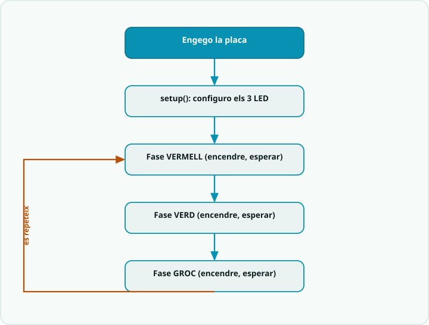

# SA2 · Diagrama de flux — Llum que respira amb PWM (bucle *fade*)

> **Per a qui és?** Per a tu. És el programa de la **llum que respira** (Sessió 2, [Pràctica 3](codi/03_fade_pwm/EXPLICACIO.md)), però **dibuixat** en lloc d'escrit. Mira'l si el codi et costa d'entendre: el dibuix i el codi diuen exactament el mateix.

## El dibuix

## Com es llegeix
- La caixa **fosca** és on **comença** el programa.
- Les caixes **verdes** `[ ... ]` són **coses que fa** el programa (una ordre).
- Els **rombes taronja** `< ... ? >` són **preguntes**: segons si la resposta és sí o no, segueixes una fletxa o una altra.
- Les **fletxes taronja que tornen enrere** vol dir que el programa **ho repeteix**.

## Del dibuix al codi
- **PUJA** és la part que fa que la llum s'encengui a poc a poc. Al codi és el primer `for` (pujar una escala esglaó a esglaó, de 0 a 255).
- **BAIXA** és la part que l'apaga a poc a poc. Al codi és el segon `for` (baixar l'escala, de 255 a 0).
- La pregunta `< v <= 255 ? >` vol dir: *encara no he arribat a dalt?* Si la resposta és sí, puja un altre esglaó. Si és no, ja ha acabat de pujar.
- L'ordre `[ analogWrite(LED, v); delay(ESPERA); ]` vol dir: *posa el llum a aquesta brillantor i espera una mica*, perquè es vegi suau.
- El **semàfor** de la Sessió 1 seria un dibuix més senzill: tres caixes seguides (vermell, verd, groc), sense preguntes, que tornen a començar.
