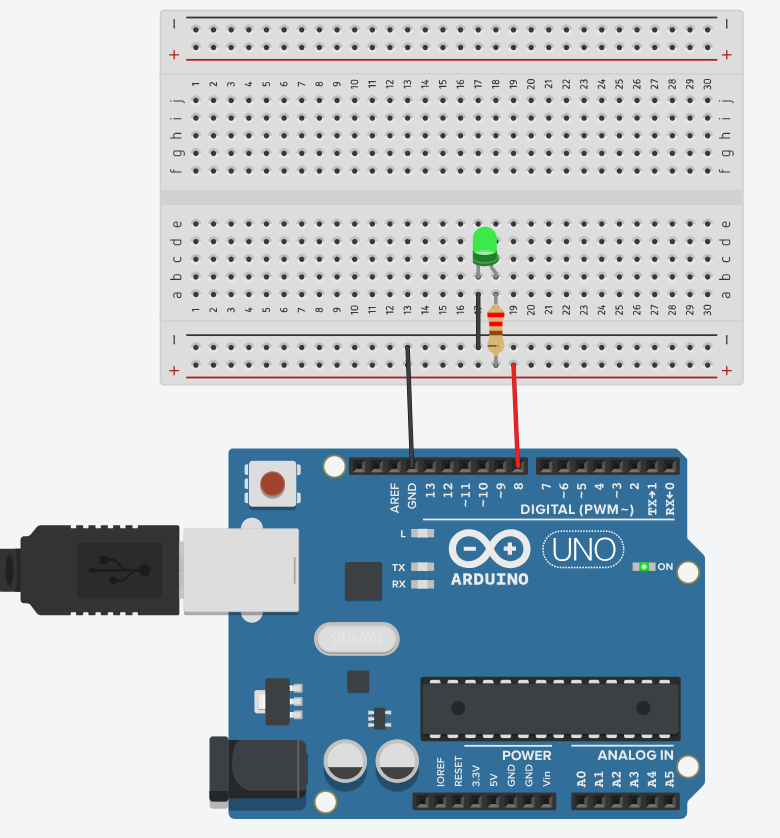
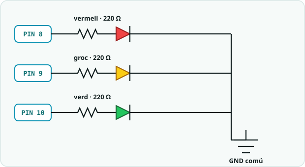
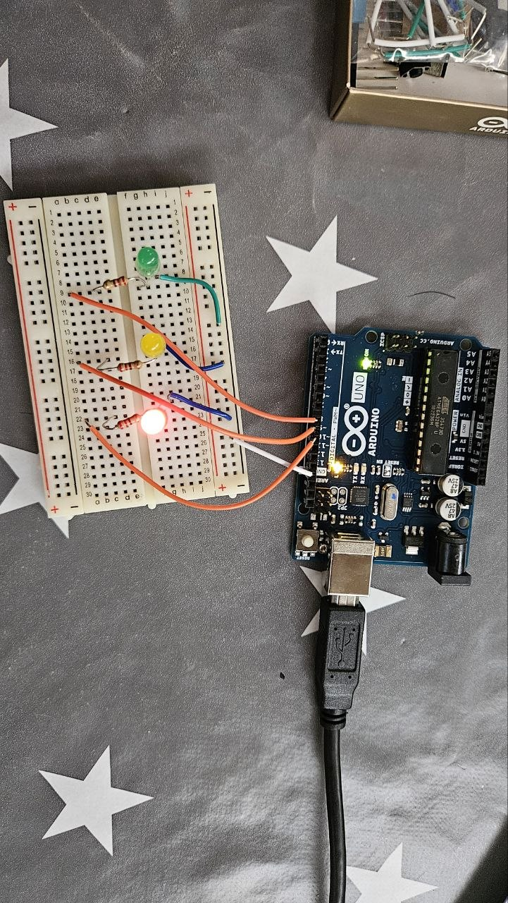
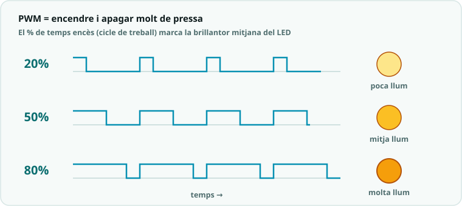
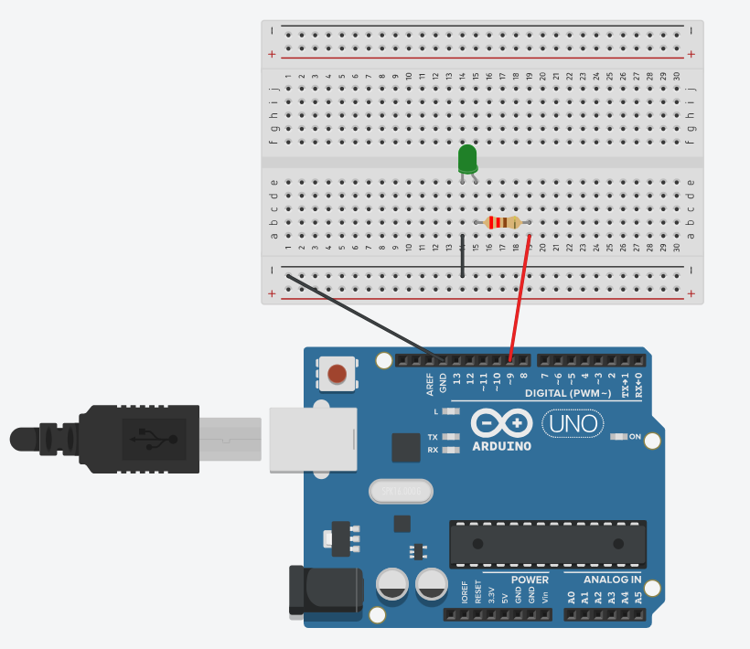
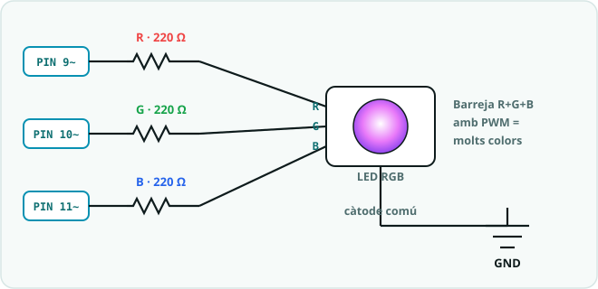

# SA2 · Esquemes i connexions

> 🧑‍🎓 **Quan toca?** Tingues aquesta pàgina oberta **mentre muntes**. L'**apartat 1** és l'ajuda d'un sol LED · l'**apartat 2** és el semàfor (Sessió 1) · els **apartats 3 i 4** són la llum que respira i el RGB (Sessió 2) · l'**apartat 5** és el panell (Sessió 3).

> 📏 **Dues regles que valen per a tots els LED:**
> 1. Cada LED porta **la seva resistència de 220 Ω**. Sense ella, el LED es crema.
> 2. La **pota llarga** del LED va cap al pin de l'Arduino. La **pota curta** va cap a **GND** (el «menys»).
>
> Tots aquests circuits els pots provar abans a **Tinkercad** o a **Wokwi**, sense cap placa.

---

## 1. Un sol LED (`01_led_basic.ino`)

| Pin de l'Arduino | Component | Passa per | I acaba a |
|---|---|---|---|
| 8 | LED | resistència de 220 Ω | GND |

> És el mateix circuit d'un LED que vas fer a la SA1: pin 8 → resistència → pota llarga del LED; pota curta → GND.
> ▶ El pots obrir fet a **Tinkercad** (amb *Copy and Tinker* el pots modificar): <https://www.tinkercad.com/things/frRjKG3t65m-sa1blinkinternledopciob?sharecode=GAxNpImV4w6b7voAyfgleBhy6jWHl5doUDeHF35HlTc>

---

## 2. Semàfor (`02_semafor.ino`)

| Pin de l'Arduino | Component | Passa per | I acaba a |
|---|---|---|---|
| 8 | LED vermell | resistència de 220 Ω | GND |
| 9 | LED groc | resistència de 220 Ω | GND |
| 10 | LED verd | resistència de 220 Ω | GND |

**El mateix circuit, muntat a la protoboard:**

> 💡 Les potes curtes dels tres LED van totes a la **mateixa fila llarga** de la protoboard (la del costat de la línia blava), i aquesta fila va amb un sol cable a GND.

**Al simulador i amb components de veritat:**

▶ **Obre la simulació a Tinkercad** (amb *Copy and Tinker* la pots modificar): <https://www.tinkercad.com/things/aYZvUenzQ6c-sa2-semafor?sharecode=RK48gLo9I5cgj1lBzIenLJUhcTMZFcBzePUGJtUvltU>

> Fixa-t'hi: a la foto els cables són taronja i blanc. **El color dels cables no importa**; el que importa és el camí: pin → resistència → pota llarga del LED → pota curta → GND.

---

## 3. La llum que respira (`03_fade_pwm.ino`)

El LED ha d'anar a un pin amb el símbol **`~`** al costat del número. Aquests pins poden encendre i apagar el LED **molt de pressa**: si està més estona encès, el veus més fort; si està més estona apagat, el veus més fluix. Això es diu **PWM**.

> A la imatge: com més estona encès (el tros de dalt de cada ona), més llum.

| Pin de l'Arduino | Component | Passa per | I acaba a |
|---|---|---|---|
| 9 ~ | LED | resistència de 220 Ω | GND |

> És igual que un sol LED, però **al pin 9**, que té `~`. Els pins amb `~` són el 3, 5, 6, 9, 10 i 11.

**Al simulador:**

▶ **Obre la simulació a Tinkercad** (amb *Copy and Tinker* la pots modificar): <https://www.tinkercad.com/things/c4frTqo45MQ-sa2-fade-pwm?sharecode=uEsFwkit-32KF6Z7yrBhDhUSFmkHnfpc53kKWrXdrfc>

---

## 4. LED RGB: el llum de colors (`04_rgb.ino`)

**El que tens al kit és un mòdul** (una placa petita amb el LED i les lletres escrites). Només calen 4 cables, sense protoboard:

| Lletra del mòdul | Pin de l'Arduino |
|---|---|
| R (vermell) | 9 |
| G (verd) | 10 |
| B (blau) | 11 |
| − (o GND) | GND |

> El mòdul ja porta les resistències a dins. Si no n'estàs segur, posar-hi una resistència de 220 Ω a cada color **no fa cap mal**: només fa una mica menys de llum.

No tens el mòdul, sinó un LED RGB solt de 4 potes? (com el de Tinkercad)

- Un LED RGB solt són **tres LED en un** (vermell, verd i blau) que comparteixen una pota: la **més llarga**, que va a **GND**.
- Cada una de les altres tres potes passa per la seva resistència de 220 Ω i va al seu pin: vermell al 9, verd al 10 i blau a l'11.
- Posa cada pota en una columna diferent de la protoboard. L'ordre més habitual és: vermell · **llarga (GND)** · verd · blau.
- ⚠️ Hi ha un tipus de LED RGB en què la pota llarga va a **5 V** en lloc de GND. Si els colors et surten «al revés», pregunta al docent.

**Al simulador:**

▶ **Obre la simulació a Tinkercad** (amb *Copy and Tinker* la pots modificar): <https://www.tinkercad.com/things/9LwYhmKU7cE-sa2-led-rgb?sharecode=t-A5r44qV1flQMonUG_rtQFte36syN3U8sCEPQt7ruo>

---

## 5. Panell de senyalització (`05_panell_senyalitzacio.ino`)

| Component | Connexió |
|---|---|
| Mòdul RGB | R → 9 · G → 10 · B → 11 · − → GND (com a l'apartat 4) |
| Brunzidor (el que fa so) | + → pin 6 · − → GND |
| Mòdul relé (l'interruptor que fa «clic») | IN → pin 7 · VCC → 5 V · GND → GND |

> ⚠️ **Seguretat:** al relé només s'hi connecten coses petites de **5 V** (un LED, un motor petit). **Mai** l'endoll de casa (230 V).

**Al simulador:**

▶ **Obre la simulació a Tinkercad** (amb *Copy and Tinker* la pots modificar): <https://www.tinkercad.com/things/3eQhVzZTaCk-sa2-panell-de-senyalitzacio?sharecode=mfYAeNXK_DMBMN2YTYYJx3SthfZXTAW_xf2isvFoPWg>

---

## Prova el semàfor sense placa (Wokwi)

El **semàfor** (apartat 2) el pots provar en directe a l'ordinador:

- ▶ **Simulació:** <https://wokwi.com/projects/468009961823220737> (obre l'enllaç i prem **▶**).
- **Fitxers del projecte:** [`Simulacions/Wokwi/SA2_semafor/`](../../Simulacions/Wokwi/SA2_semafor/), per si el vols modificar.
