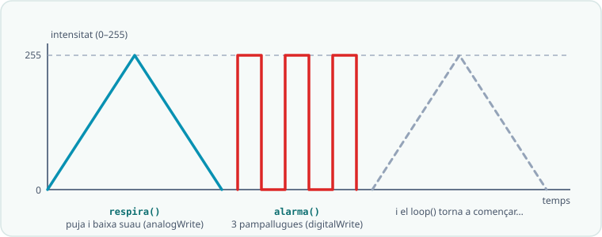

# SA2 · Exemple resolt (model «jo ho faig») — Llum de posició que respira

> 🧑‍🎓 **Quan toca mirar-lo?** **Després** d'haver provat tu la [llum que respira](codi/03_fade_pwm/EXPLICACIO.md) (Sessió 2), mai abans. No és la solució de cap pràctica: és un exemple **semblant**, fet pas a pas, perquè vegis **com es pensa** un programa. No el copiïs: entén-lo i torna a la teva pràctica.

> **Nota per al docent:** mostra'l després del primer intent amb `03_fade_pwm.ino`. Comenta en veu alta «🧭 Com ho penso» i «⚠️ Errors típics».

---



## 🔑 El problema

> Fer un **llum de posició** (com els d'un vaixell o un avió) que **respiri** a poc a poc (s'encén i s'apaga suaument) i que, de tant en tant, faci **3 pampallugues ràpides** d'avís i torni a respirar.

El circuit és el mateix de la llum que respira: **pin 9 → resistència de 220 Ω → pota llarga del LED; pota curta → GND**.


▶ **Obre la simulació a Tinkercad** (amb *Copy and Tinker* la pots modificar): <https://www.tinkercad.com/things/c4frTqo45MQ-sa2-fade-pwm?sharecode=uEsFwkit-32KF6Z7yrBhDhUSFmkHnfpc53kKWrXdrfc>

---

## 🧭 Com ho penso (abans d'escriure codi)

1. **Què ha de fer?** Dues coses diferents: **respirar** (pujar i baixar la llum a poc a poc) i **avisar** (encendre i apagar de cop, 3 vegades).
2. **Què ja sé fer?** Respirar ja ho sé fer: és la llum que respira, amb `for` i `analogWrite`. Encendre i apagar de cop també: és `digitalWrite`, com al semàfor.
3. **Com ho organitzo?** Faré **una funció per a cada cosa**: `respira()` i `alarma()`. Així el `loop()` quedarà curt i fàcil de llegir.
4. **🔮 Endevina abans de mirar el codi:** amb `analogWrite(LED, 128)`, el LED es veurà… ☐ apagat ☐ **a mitges** ☐ al màxim. I `analogWrite(LED, 255)` fa el mateix que `digitalWrite(LED, ____)`.

---

## 💡 El codi, amb explicacions

```cpp
/*
  SA2 - exemple_llum_posicio.ino  (EXEMPLE MODEL, no es el producte)
  Llum que "respira" amb PWM i que en alarma fa 3 pampallugues rapides.
  Circuit: Pin 9 (~PWM) -> [220 ohm] -> LED(+) ; LED(-) -> GND
*/

const int LED = 9;        // ha de ser un pin PWM (~): 3, 5, 6, 9, 10, 11
const int PAS = 5;        // com mes gran, mes rapida la respiracio
const int ESPERA = 12;    // ms entre passos: regula la suavitat

void respira() {
  // Puja: com que fem servir analogWrite, controlem la INTENSITAT (0-255)
  for (int v = 0; v <= 255; v += PAS) {
    analogWrite(LED, v);
    delay(ESPERA);
  }
  // Baixa fins a apagar-se del tot
  for (int v = 255; v >= 0; v -= PAS) {
    analogWrite(LED, v);
    delay(ESPERA);
  }
}

void alarma() {
  // Pampallugues: aqui NO cal PWM, encendre/apagar del tot es digitalWrite
  for (int i = 0; i < 3; i++) {   // repeteix 3 cops
    digitalWrite(LED, HIGH);
    delay(120);
    digitalWrite(LED, LOW);
    delay(120);
  }
}

void setup() {
  pinMode(LED, OUTPUT);
}

void loop() {
  respira();   // comportament normal
  alarma();    // despres, avis
}
```

**Per què està fet així (🌟):**
- **Noms en lloc de números** (`PAS`, `ESPERA`): si vull que respiri més de pressa, només canvio **una** línia.
- **Una funció per a cada cosa**: el `loop()` es llegeix com una frase: *respira, i després avisa*.
- **Cada eina per a la seva feina:** `analogWrite` per a la llum que puja i baixa a poc a poc; `digitalWrite` per encendre i apagar de cop.

<details markdown="1"><summary>🧒 Explica-m'ho encara més fàcil</summary>

Imagina que el LED és una **llumeta que dorm**. 🌙

**Les tres notes de la nevera** (les tres primeres línies). Abans de començar, apuntem tres coses perquè no se'ns oblidin:

- **On viu la llumeta?** Al pin 9. És un pin especial (té el símbol `~`) que sap fer llum forta, fluixa i mitjana. Els pins normals només saben encendre i apagar.
- **Com de gran és cada passet?** 5. Passets petits = respira a poc a poc. Passets grans = respira de pressa.
- **Quanta estona esperem a cada passet?** 12 mil·lisegons, molt poquet. És com dir «u…» abans de fer el passet següent.

**`respira()`: la llumeta agafa aire.** 😮‍💨 La primera part fa pujar la llum a poc a poc, del 0 (adormida) al 255 (ben desperta). Com quan infles un globus: buf, buf, buf… La segona part fa el contrari: desinfla el globus fins que la llum s'apaga. Pujar + baixar = una respiració.

**`alarma()`: la llumeta s'espanta!** 🚨 Fa **3 pampallugues ràpides**: encesa, apagada, encesa, apagada, encesa, apagada. El `for` compta: «una, dues i tres, prou». Aquí n'hi ha prou amb `digitalWrite`, perquè només cal encendre i apagar.

**`setup()`: preparar-se.** Només passa una vegada, quan l'endolles: li diem a l'Arduino que pel pin 9 hi **traurà** llum.

**`loop()`: el conte que no s'acaba mai.** L'Arduino fa la llista i torna a començar, per sempre: respira… 😴 s'espanta! 😱 respira… s'espanta!… fins que el desendolles.

**El truc de màgia** (com fa mitja llum?): el pin 9, en realitat, només sap encendre i apagar. Però ho fa **tan de pressa** (centenars de vegades per segon) que els teus ulls no ho veuen. Si està encès la meitat del temps, tu veus mitja llum. Això és el **PWM**.

</details>

---

## 🔬 Ho provo

- **L'endevinalla:** `analogWrite(LED, 255)` fa el mateix que `digitalWrite(LED, HIGH)`: llum al màxim.
- **Amb el multímetre:** si poses el LED a mitges (`128`), hi mesures **menys volts** que al màxim. És el truc del PWM: com que el pin s'encén i s'apaga molt de pressa, el multímetre (i el teu ull) en veu «la mitjana».
- **Per canviar la velocitat:** si respira massa de pressa, fes més gran `ESPERA`. Si la vols més ràpida, fes més gran `PAS`.

---

## ⚠️ Errors típics (i com els veus)

- **Poso el LED al pin 8** (que no té `~`) → el LED no s'encén a poc a poc, sinó de cop. **Solució:** fes servir un pin amb `~` (3, 5, 6, 9, 10 o 11).
- **M'oblido la resistència de 220 Ω** → el LED fa molta llum un moment i **es crema**. Sempre amb resistència.
- **Escric `analogWrite(LED, 300)`** → el màxim és **255**. Posar-hi més no fa més llum.
- **Poso el LED al revés** → no s'encén. La **pota llarga** va cap al pin.

---

## 📔 Com seria una bona entrada al quadern

> **Sessió 2:** He fet una llum que respira amb **PWM** (`analogWrite`, de 0 a 255) i que avisa fent pampallugues amb `digitalWrite`. Al principi el LED no s'encenia a poc a poc: l'havia posat al **pin 8, que no té `~`**. L'he canviat al pin 9 i ja ha funcionat. He après que **`analogWrite` diu quanta llum fa i `digitalWrite` només encén o apaga**. He separat el codi en dues funcions perquè s'entengui millor.
> **Prova:** una foto del muntatge i un vídeo curt de la llum respirant.

**Per què és una bona entrada:** fa servir les paraules importants (PWM, pin `~`), explica **com** ho ha fet i diu **la verdat** sobre el que li ha costat (el pin 8) i com ho ha arreglat.

---

*Exemple resolt de la SA2. Es mostra després del primer intent de l'alumnat. Es basa en `codi/03_fade_pwm` i `codi/05_panell_senyalitzacio`. Llicència CC BY-SA 4.0.*
