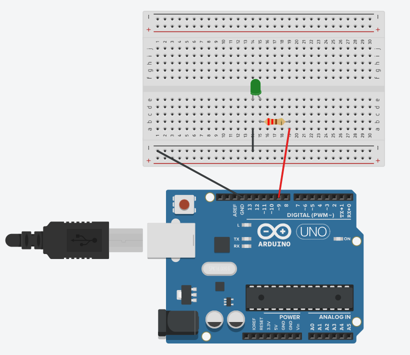

# Pràctica 3 · La llum que respira (PWM)

<div class="cap-practica" markdown="1">

🎯 **Avui aconseguiràs:** que un LED s'encengui i s'apagui **a poc a poc**, com si respirés.

⏱️ 25 min

📦 1 LED, 1 resistència de 220 Ω i 2 cables

</div>

## 🚀 Pas a pas

### Pas 1 · Munta el circuit

Posa un LED al **pin 9** amb la seva resistència de 220 Ω: la pota llarga cap al pin i la curta cap a GND.



✅ **Comprova:** al costat del número 9 de la placa hi ha el símbol **`~`**. Només els pins amb `~` poden fer que el LED brilli a mitges.

### Pas 2 · Carrega el codi

Prem **Copia**, enganxa'l a l'Arduino IDE (esborra el que hi hagués) i prem **→ Puja**.

<!-- codi-complet -->

✅ **Comprova:** el LED s'encén a poc a poc fins al màxim, s'apaga a poc a poc i torna a començar.

### Pas 3 · Busca el número que fa brillar

Mira el codi: a la línia `analogWrite(LED, valor);`, el número `valor` diu **quant** brilla el LED. Busca a les línies `for` on comença i on acaba.

✍️ **Apunta-ho:** rang de valors d'`analogWrite`: de ____ a ____.

### Pas 4 · Canvia el ritme

A les dues línies `delay(8);` posa `delay(2);` i torna'l a pujar. Després prova `delay(20);`.

✍️ **Apunta-ho:** què canvia quan poses `delay(2)`? I `delay(20)`?

### Pas 5 · Prova un pin sense `~`

Mou el cable del LED al **pin 8** i canvia `const int LED = 9;` per `const int LED = 8;`. Puja'l i mira què fa. Després torna-ho tot al 9.

✍️ **Apunta-ho:** què passa amb el LED al pin 8, que no té `~`? Per què?

### Pas 6 · Explica-ho amb les teves paraules

✍️ **Apunta-ho:** quina diferència hi ha entre `digitalWrite` i `analogWrite`?

### Pas 7 · Respon i envia

📤 [Obre la tasca «SA2 · Pràctica 3» a Classroom i envia el formulari](https://classroom.google.com/c/ODY4ODU4Njk0NTEy/a/ODk3Mzc3NjQwOTIw/details)

Hi trobaràs les mateixes preguntes ✍️ que has anat apuntant. Envia'l ara i passa a la **[Pràctica 4 · Colors RGB](../04_rgb/EXPLICACIO.md)**.

⭐ **Si acabes abans:** tria un repte a **[Reptes de la SA2](../../../../Reptes/Reptes_SA2.md)** i, quan el docent te'l validi, pinta l'estrella al [tauler de reptes](../../../00_General/00_Tauler_reptes.md).

<details markdown="1">
<summary>🧗 Si t'encalles</summary>

| Què passa | Per què | Com ho arreglo |
|---|---|---|
| El LED només fa encès/apagat, sense gradació | El pin no té `~` (no és PWM). | Torna'l al pin 9. |
| No fa res | Valors fora de 0–255, o el LED al revés. | Comprova els números i la pota llarga. |
| Respira massa de pressa o massa a poc a poc | És el `delay`. | Puja'l (més lent) o baixa'l (més ràpid). |

Encara no funciona? Mira el [dibuix del programa](../../SA2_diagrama_flux.md) o l'[esquema de connexions, apartat 3](../../SA2_esquemes_connexions.md).

</details>

<details markdown="1">
<summary>🧠 Vols saber per què funciona?</summary>

### Tros 1 — El truc del PWM: encendre i apagar molt de pressa

**Com a la vida real:** imagina que encens i apagues la llum de l'habitació **molt, molt de pressa**, centenars de vegades per segon. No veuries el parpelleig: veuries una llum **fluixa**. Si la deixes encesa més estona que apagada, la veus més forta; si la deixes més estona apagada, més fluixa.

Això és el **PWM**. L'Arduino no pot donar «mig corrent», però sí que pot encendre i apagar el pin unes 490 vegades per segon i decidir **quina part del temps** està encès. Només ho saben fer els pins marcats amb **`~`**: el 3, 5, 6, 9, 10 i 11.

```cpp
const int LED = 9;   // ha de ser un pin PWM (~)
```

### Tros 2 — `analogWrite`: dir quant ha de brillar

**Com a la vida real:** el regulador de la llum del menjador, la rodeta que la fa més forta o més fluixa.

```cpp
analogWrite(LED, valor);
```

`analogWrite` és com `digitalWrite`, però en lloc de dir només «encès» o «apagat», li dones un número **de 0 a 255**:

| Valor | El LED… |
|---|---|
| `0` | apagat |
| `64` | fluix |
| `128` | a mitges |
| `255` | al màxim |

### Tros 3 — El `for`: pujar esglaó a esglaó

**Com a la vida real:** pujar una escala. Comences al primer esglaó, puges d'un en un i pares quan arribes a dalt. A cada esglaó fas el mateix: un pas i una petita pausa.

```cpp
for (int valor = 0; valor <= 255; valor++) {
  analogWrite(LED, valor);
  delay(8);
}
```

El `for` és una **repetició amb comptador**. La primera línia té tres parts, separades per `;`:

| Part | Què vol dir |
|---|---|
| `int valor = 0` | Comença amb el comptador `valor` a 0 (el primer esglaó). |
| `valor <= 255` | Continua mentre `valor` sigui 255 o menys (encara no ets a dalt). |
| `valor++` | Després de cada volta, suma 1 a `valor` (puja un esglaó). |

El que hi ha entre `{ }` es fa a **cada esglaó**: posa la brillantor al valor actual i espera 8 mil·lisegons. Són 256 esglaons × 8 ms ≈ **2 segons** de pujada. Per això, al pas 4, un `delay` més gran fa la respiració més lenta.

### Tros 4 — Baixar: la mateixa escala, al revés

```cpp
for (int valor = 255; valor >= 0; valor--) {
  analogWrite(LED, valor);
  delay(8);
}
```

És el mateix, però girat: comença a dalt (255), continua mentre sigui 0 o més, i a cada volta **resta** 1 (`valor--`). Com que tot és dins del `loop()`, després de baixar torna a pujar: el LED respira per sempre.

### On ho aplicaràs

- **Ara mateix:** el [LED RGB](../04_rgb/EXPLICACIO.md) són **tres** LED regulats així, un per a cada color.
- **Exemple resolt:** el [llum de posició que respira](../../SA2_exemple_resolt.md) és el mateix patró amb un altre muntatge, comentat pas a pas.
- **SA4:** amb el PWM regularàs la **velocitat d'un motor**.

</details>
