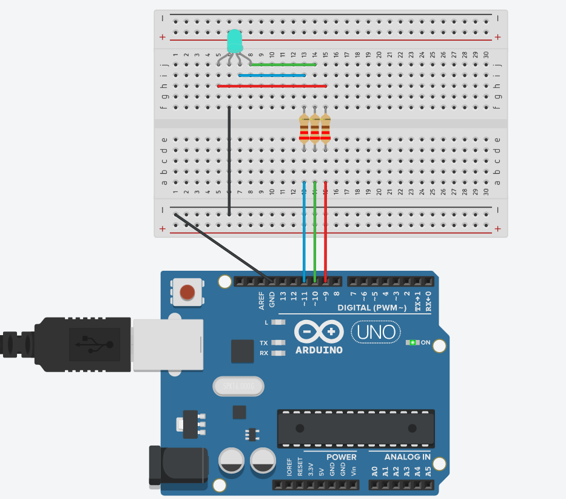

# Pràctica 4 · LED RGB: barrejar colors (i la primera funció pròpia)

<div class="cap-practica" markdown="1">

🎯 **Avui aconseguiràs:** que un sol llum faci **qualsevol color** i crear la teva primera instrucció, `color()`.

⏱️ 30 min

📦 Mòdul RGB del kit i 4 cables

</div>

## 🚀 Pas a pas

### Pas 1 · Munta el mòdul RGB

Treu el LED del pin 9 i connecta el mòdul RGB amb 4 cables:

| Pin del mòdul | Pin de l'Arduino |
|---|---|
| R | 9 |
| G | 10 |
| B | 11 |
| − (o GND) | GND |



✅ **Comprova:** el − del mòdul va a **GND**. Si no, no s'encendrà res.

### Pas 2 · Carrega el codi

Prem **Copia**, enganxa'l a l'Arduino IDE (esborra el que hi hagués) i prem **→ Puja**.

<!-- codi-complet -->

✅ **Comprova:** surten vermell, verd, blau, groc, lila i apagat, 1 segon cadascun.

### Pas 3 · Crea 3 colors teus

Canvia els números d'algunes línies `color(…)`, per exemple `color(255, 100, 0)`, i torna'l a pujar. El primer número és el vermell, el segon el verd i el tercer el blau, cadascun de 0 a 255.

✍️ **Apunta-ho:** els teus 3 colors, amb els valors R, G, B de cadascun.

### Pas 4 · Explica-ho amb les teves paraules

✍️ **Apunta-ho:** quin és el concepte nou més important d'aquesta sessió?

### Pas 5 · Respon i envia

📤 [Obre la tasca «SA2 · Pràctica 4» a Classroom i envia el formulari](https://classroom.google.com/c/ODY4ODU4Njk0NTEy/a/ODk3Mzc3OTQ0NjEx/details)

Hi trobaràs les mateixes preguntes ✍️ que has anat apuntant. Envia'l ara. A la sessió següent: **[Pràctica 5 · Panell de senyalització](../05_panell_senyalitzacio/EXPLICACIO.md)**.

⭐ **Si acabes abans:** fes que un color canviï **a poc a poc** cap a un altre (pista: és la llum que respira de la Pràctica 3, però amb dos colors alhora: un puja i l'altre baixa). Si ho fas, explica-ho a la pregunta opcional del formulari. Més reptes a **[Reptes de la SA2](../../../../Reptes/Reptes_SA2.md)**; quan el docent te'l validi, pinta l'estrella al [tauler de reptes](../../../00_General/00_Tauler_reptes.md).

<details markdown="1">
<summary>🧗 Si t'encalles</summary>

| Què passa | Per què | Com ho arreglo |
|---|---|---|
| Un color no surt mai | Aquell cable és en un altre pin o fa mal contacte. | Comprova la taula del pas 1. |
| Els colors surten «al revés» (el vermell surt cian…) | Tens un LED RGB d'**un altre tipus**, que funciona al revés (255 l'apaga). | Pregunta al docent. |
| No fa res de res | El − del mòdul no és a GND. | Connecta el − a GND. |

</details>

<details markdown="1">
<summary>🧠 Vols saber per què funciona?</summary>

### Tros 1 — Tres pins, un per a cada color

```cpp
const int R = 9;
const int G = 10;
const int B = 11;
```

R (*red*) és el vermell, G (*green*) el verd i B (*blue*) el blau. Els tres han de ser pins amb **`~`**, perquè cada color es regula de 0 a 255, com la llum que respira.

### Tros 2 — La teva primera funció: `color(r, g, b)`

**Com a la vida real:** a la cafeteria no expliques cada vegada com es fa un cafè. Dius «**un cafè amb 2 sucres**», i el cambrer ja sap què ha de fer. «Cafè» és el nom de la recepta; «2 sucres» és el detall que canvia cada vegada.

```cpp
// Funcio propia per fixar un color (modularitat)
void color(int r, int g, int b) {
  analogWrite(R, r);
  analogWrite(G, g);
  analogWrite(B, b);
}
```

Una **funció** és una recepta amb nom que escrius **una vegada** i fas servir **tantes com vulguis**.

| Tros | Què vol dir |
|---|---|
| `void` | La funció fa una feina, però no et retorna cap resultat. |
| `color` | El nom que li has posat (el «cafè»). |
| `(int r, int g, int b)` | Els tres números que li passaràs cada vegada (els «sucres»): quant vermell, quant verd i quant blau. |
| Les tres línies de dins | La feina: posa cada color a la brillantor que li has dit. |

Quan escrius `color(255, 0, 0);`, la funció rep `r = 255`, `g = 0`, `b = 0` i fa els tres `analogWrite`. **Una línia en lloc de tres**, i que diu clarament què fa.

### Tros 3 — La paleta de colors

**Com a la vida real:** barrejar **llum** no és com barrejar pintura. Si encens una llanterna vermella i una de verda apuntant al mateix lloc, no surt marró: surt **groc**. Llum + llum = més llum.

```cpp
color(255, 0, 0);   delay(1000);   // vermell
color(0, 255, 0);   delay(1000);   // verd
color(0, 0, 255);   delay(1000);   // blau
color(255, 255, 0); delay(1000);   // groc (R+G)
color(128, 0, 128); delay(1000);   // lila
color(0, 0, 0);     delay(1000);   // apagat
```

| Color | R | G | B | Per què |
|---|---|---|---|---|
| Vermell | 255 | 0 | 0 | Només el vermell, al màxim. |
| Groc | 255 | 255 | 0 | Vermell + verd al màxim. |
| Lila | 128 | 0 | 128 | Vermell + blau, a mitja potència. |
| Blanc | 255 | 255 | 255 | Els tres al màxim (prova-ho!). |
| Apagat | 0 | 0 | 0 | Cap. |

### On ho aplicaràs

- **Sessió 3:** el [panell de senyalització](../05_panell_senyalitzacio/EXPLICACIO.md) fa servir aquesta mateixa funció `color()`, sense canviar-hi res.
- **Mascota del trimestre:** aquests colors seran les **expressions** del teu robot.

</details>
