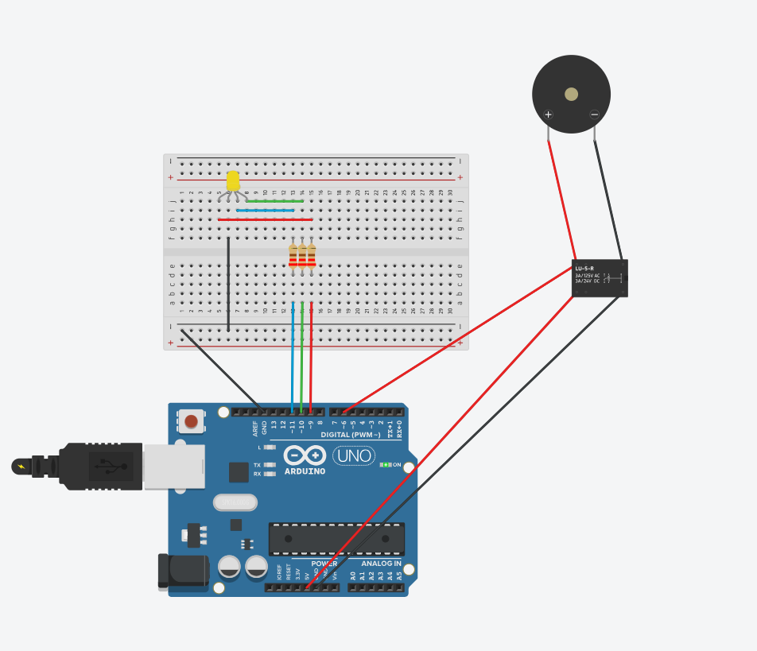

# Pràctica 5 · Producte: el panell de senyalització

<div class="cap-practica" markdown="1">

🎯 **Avui aconseguiràs:** un **panell d'avisos** amb els teus estats (color + so + relé) i defensar-lo en 1 minut. És el producte de la SA2.

⏱️ Tota la sessió

📦 Mòdul RGB, brunzidor (piezo), mòdul relé i cables

</div>

Un panell com el de les màquines de veritat. Aquest és l'exemple d'una caldera:

| Estat | Exemple: una caldera | El panell fa… |
|---|---|---|
| ✅ Tot correcte | Va bé. | Llum verda. |
| ⚠️ Avís | S'està escalfant massa. | Llum groga + un bip curt. |
| 🚨 Alarma | S'ha passat de temperatura. | Llum vermella + un bip llarg + engega un ventilador (el relé). |

El codi ja funciona. **La teva feina és fer-lo teu:** decidir els teus estats, colors i sons. Això és el que s'avalua (R1 codi + R2 circuit).

## 🚀 Pas a pas

### Pas 1 · Mini-check en paper

El docent et dona un full: escriu **de memòria** un programa que faci parpellejar un LED. Tens 10 minuts i **no compta per a nota**.

✅ **Comprova:** has entregat el full al docent.

### Pas 2 · Dissenya abans de programar

Decideix com serà cada estat: quin color, quin so i si el relé s'engega o no.

✍️ **Apunta-ho:** estat «Tot correcte»: color RGB / so (piezo) / relé.

✍️ **Apunta-ho:** estat «Avís»: color RGB / so (piezo) / relé.

✍️ **Apunta-ho:** estat «Alarma»: color RGB / so (piezo) / relé.

### Pas 3 · Munta el circuit

| Component | Connexió |
|---|---|
| Mòdul RGB | R → 9 · G → 10 · B → 11 · − → GND (com a la Pràctica 4) |
| Brunzidor (piezo) | + → pin 6 · − → GND |
| Mòdul relé | IN → pin 7 · VCC → 5 V · GND → GND |



### Pas 4 · Carrega el codi

Prem **Copia**, enganxa'l a l'Arduino IDE (esborra el que hi hagués) i prem **→ Puja**.

<!-- codi-complet -->

✅ **Comprova:** fa els tres estats, 2 segons cadascun, sense parar. Quan arriba a l'alarma, el relé fa «clic».

### Pas 5 · Fes-lo teu

Canvia els colors i els sons de cada estat perquè siguin els del teu disseny del pas 2. A «🧠 Vols saber per què funciona?», tros 3, tens què has de tocar.

- **Mínim:** 2 estats que es distingeixin bé (amb color **i** so).
- **Complet:** 3 estats + relé, cadascun en la seva funció.

✅ **Comprova:** el panell fa els estats que vas dissenyar.

### Pas 6 · Prepara la defensa d'1 minut

Pensa què diràs: què fa el teu panell i una millora que li faries.

✅ **Comprova:** ho saps explicar en 1 minut sense llegir.

### Pas 7 · Un error, apuntat

✍️ **Apunta-ho:** un error que has trobat i com l'has resolt.

### Pas 8 · Respon i envia

📤 [Obre la tasca «SA2 · Pràctica 5» a Classroom i envia el formulari](https://classroom.google.com/c/ODY4ODU4Njk0NTEy/a/ODk3Mzc4MDYxMjU5/details)

Hi trobaràs les mateixes preguntes ✍️ que has anat apuntant. Envia'l ara i, després, fes l'**[🏁 Entrega final de la SA2](../../README.md#entrega-final)**: la defensa i l'autoavaluació.

⭐ **Si acabes abans:** afegeix un quart estat (per exemple `estatManteniment()`, en blau). Més reptes a **[Reptes de la SA2](../../../../Reptes/Reptes_SA2.md)**; quan el docent te'l validi, pinta l'estrella al [tauler de reptes](../../../00_General/00_Tauler_reptes.md).

<details markdown="1">
<summary>🧗 Si t'encalles</summary>

| Què passa | Per què | Com ho arreglo |
|---|---|---|
| El relé no fa «clic» | Falta VCC o GND del mòdul, o IN no és al pin 7. | Revisa la taula del pas 3. |
| El brunzidor no sona | Està al revés o en un altre pin. | + al pin 6, − a GND. |
| Colors estranys | Cables del RGB canviats de lloc. | Mira la Pràctica 4. |
| L'IDE marca un error en vermell després de canviar-lo | Falta un `;` o un parèntesi. | Mira la línia que marca l'IDE i la de just abans. |

</details>

<details markdown="1">
<summary>🧠 Vols saber per què funciona?</summary>

Aquí no hi ha res nou de programació: hi ha **tot el que ja saps, junt**. El més important és com s'organitza.

### Tros 1 — Els components, amb nom

```cpp
const int R = 9, G = 10, B = 11;   // LED RGB
const int PIEZO = 6;               // brunzidor
const int RELE = 7;                // mòdul rele (carrega de baixa tensio)
```

Tres components diferents, cadascun amb el seu nom. Dues novetats de maquinari:

- **Brunzidor (piezo):** fa so. Més endavant tens la instrucció per fer-lo sonar.
- **Relé:** **com a la vida real**, és com un dit petit que prem l'interruptor d'una cosa més gran. L'Arduino no té prou força per engegar un ventilador, però sí per «prémer» el relé, i el relé l'engega. Quan canvia, fa «clic».

### Tros 2 — `color()`: la mateixa de la Pràctica 4

```cpp
void color(int r, int g, int b) {
  analogWrite(R, r);
  analogWrite(G, g);
  analogWrite(B, b);
}
```

És **exactament la mateixa** funció de la [Pràctica 4](../04_rgb/EXPLICACIO.md). Una funció ben feta es reaprofita tal com està.

### Tros 3 — Una funció per a cada estat (aquí és on personalitzes)

**Com a la vida real:** els botons d'una rentadora («cotó», «delicat», «ràpid»). Cada botó té un nom i, a dins, tot el que s'ha de fer en aquell programa. Tu només prems «delicat».

```cpp
void estatAvis() {
  color(255, 180, 0);        // groc
  tone(PIEZO, 1000, 150);    // bip curt (1 kHz, 150 ms)
  digitalWrite(RELE, LOW);
}
```

Cada estat és una **funció amb nom** (`estatCorrecte()`, `estatAvis()`, `estatAlarma()`) i, a dins, hi ha **tot** el que aquell estat vol dir. Per canviar l'avís, només has de tocar aquesta funció.

| Línia | Què fa | Què pots canviar |
|---|---|---|
| `color(255, 180, 0);` | Posa el llum groc. | Els tres números: el color. |
| `tone(PIEZO, 1000, 150);` | Fa un bip de 1000 Hz durant 150 ms. | 1000 → més agut o més greu (prova 500 o 2000). 150 → més curt o més llarg. |
| `noTone(PIEZO);` | Fa callar el brunzidor (és a `estatCorrecte`). | — |
| `digitalWrite(RELE, LOW);` | Relé apagat (`HIGH` l'engega). | `HIGH` o `LOW`. |

### Tros 4 — El `loop()`: passar pels estats

```cpp
void loop() {
  // Demostracio ciclica dels tres estats (en el projecte real,
  // l'estat es decidira a partir de sensors - vegeu SA3).
  estatCorrecte();  delay(2000);
  estatAvis();      delay(2000);
  estatAlarma();    delay(2000);
}
```

Com que cada estat té la seva funció, el `loop()` es llegeix com una frase: *tot correcte, espera 2 segons; avís, espera 2 segons; alarma, espera 2 segons*, i torna a començar. Ara és una **demostració**; a la SA3, qui decidirà l'estat serà un **sensor** (per exemple, un de temperatura).

**Vols un quart estat?** Escriu una funció nova (per exemple `estatManteniment()`, en blau) copiant-ne una altra, i afegeix-la al `loop()` amb el seu `delay`.

### On ho aplicaràs

- **Avui mateix:** la **defensa d'1 minut** i l'**Entrega final** de la SA2.
- **SA3:** el panell aprendrà a **percebre**: l'estat el decidirà un sensor, no el `delay`.
- **El tamagotchi del trimestre:** els estats amb color i so són els mateixos que tindrà el teu tamagotchi.

</details>
