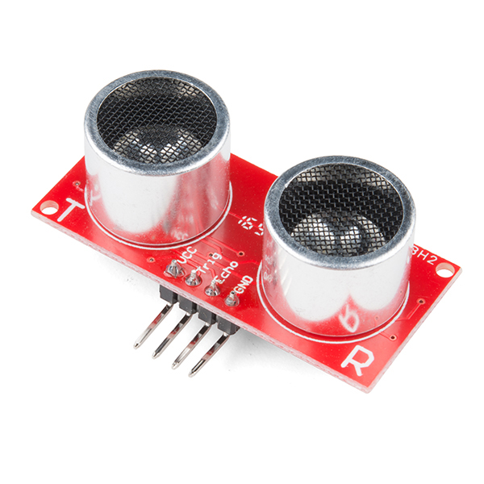

# SA3 · Entrades i sensors: el robot percep

Tercera situació d'aprenentatge (**8 h · 4 sessions**, 1r trimestre). Fins ara el teu Arduino només **feia** coses (encendre llums, fer sons). Ara aprendrà a **notar** què passa al seu voltant: si prems un botó, quanta llum hi ha, a quina distància tens la mà… I al final, la teva **mascota** reaccionarà a tot això. Programació oficial: [`Programació didàctica/12_SA3_Entrades_sensors.md`](../../Programació%20didàctica/12_SA3_Entrades_sensors.md).

> *Fotografia: HC-SR04, per [SparkFun Electronics](https://commons.wikimedia.org/wiki/File:SparkFun_HC-SR04_Ultrasonic-Sensor_13959-01a.jpg) — llicència [CC BY 2.0](https://creativecommons.org/licenses/by/2.0/).*

> 🧭 **Com treballes a la SA3 (4 regles):**
>
> 1. Obre **només la sessió d'avui** (aquí sota) i fes els passos **en ordre**. No cal mirar res més.
> 2. Cada pas té **un enllaç**: obre'l, fes el que diu i torna aquí.
> 3. Quan un pas diu **[✍️ Classroom](https://classroom.google.com/c/ODY4ODU4Njk0NTEy/a/ODcwNTE4MDEwMzM3/details)**, respon aquella pregunta a la tasca de Classroom. Hi ha **una sola tasca per a tota la SA**: cada dia respons només les preguntes que et diuen els passos d'avui.
> 4. **No premis «Envia» fins a la Sessió 3.** Si has entrat amb el compte de l'escola, el formulari desa sol el que has escrit.
>
> 💻 **Com carregar el codi d'una pràctica:** a la pàgina de la pràctica, prem **Copia**, enganxa'l a l'Arduino IDE (esborra el que hi havia) i prem **→ Puja**.
>
> 🖥️ **El Monitor sèrie** és la finestra on l'Arduino t'escriu el que llegeix. A l'Arduino IDE: **Eines → Monitor sèrie**, i a baix a la dreta tria **9600**.

## Itinerari per sessions

<strong>Sessió 1</strong> · El polsador i el Monitor sèrie

1. 🔌 **Munta** el polsador entre el **pin 2** i **GND**, i un LED al **pin 8** (amb la seva resistència). Mira-ho a l'**[esquema, apartat 1](SA3_esquemes_connexions.md)**.
2. 🔮 Obre la **[Pràctica 1](codi/01_polsador_debounce/EXPLICACIO.md)**. Abans de carregar el codi, endevina què sortirà al Monitor sèrie quan premis el botó i escriu-ho a [✍️ Classroom](https://classroom.google.com/c/ODY4ODU4Njk0NTEy/a/ODcwNTE4MDEwMzM3/details) (pregunta «PREDIU»).
3. ▶️ **Carrega el codi**, obre el **Monitor sèrie** (9600) i prem el polsador unes quantes vegades. Ho has encertat?
4. 🔍 Escriu a [✍️ Classroom](https://classroom.google.com/c/ODY4ODU4Njk0NTEy/a/ODcwNTE4MDEwMzM3/details) què llegeix el pin quan **no** prems i quan **sí** prems (HIGH o LOW). La resposta et sorprendrà: la pràctica t'explica per què.
5. ✍️ Respon a [Classroom](https://classroom.google.com/c/ODY4ODU4Njk0NTEy/a/ODcwNTE4MDEwMzM3/details) per què cal l'**antirebot** (pregunta «antirebot»). La resposta és a la pràctica.
6. ⭐ **Repte:** fes que el comptador arribi a **5** i torni a **0**. Explica a [✍️ Classroom](https://classroom.google.com/c/ODY4ODU4Njk0NTEy/a/ODcwNTE4MDEwMzM3/details) com ho has fet.
7. 📓 **Quadern (en paper):** dibuixa el circuit i apunta un error que hagis tingut.

<strong>Sessió 2</strong> · El potenciòmetre i el sensor de llum

1. 🔌 **Munta** el potenciòmetre (pota del mig a **A0**), el sensor de llum amb la seva resistència de **10 kΩ** (el punt d'unió a **A1**) i un LED al **pin 9**. Mira-ho a l'**[esquema, apartat 2](SA3_esquemes_connexions.md)**.
2. 🔮 Obre la **[Pràctica 2](codi/02_potenciometre_ldr/EXPLICACIO.md)**, carrega el codi i obre el **Monitor sèrie**. Gira el potenciòmetre i tapa el sensor amb la mà. Escriu a [✍️ Classroom](https://classroom.google.com/c/ODY4ODU4Njk0NTEy/a/ODcwNTE4MDEwMzM3/details) entre quins números es mouen les lectures (de ___ a ___).
3. ✍️ Escriu a [Classroom](https://classroom.google.com/c/ODY4ODU4Njk0NTEy/a/ODcwNTE4MDEwMzM3/details) quina instrucció passa de 0-1023 a 0-255 (la resposta és a la pràctica).
4. 📏 **Racó de mesura:** quan el docent et cridi, mesura amb el multímetre els volts del punt d'unió del sensor de llum i compara'ls amb el número del Monitor. Escriu-ho a [✍️ Classroom](https://classroom.google.com/c/ODY4ODU4Njk0NTEy/a/ODcwNTE4MDEwMzM3/details) (pregunta «Racó de mesura»).
5. 💡 **El llum automàtic:** fes que el LED s'encengui quan tapes el sensor (és a la pràctica, pas a pas). Escriu a [✍️ Classroom](https://classroom.google.com/c/ODY4ODU4Njk0NTEy/a/ODcwNTE4MDEwMzM3/details) quan s'encén el teu LED (pregunta «Llum automàtic»).
6. 📓 **Quadern (en paper):** apunta els números que dona el sensor amb llum i tapat.
7. 🏠 **Per a la propera sessió:** pensa un **nom** i un **caràcter** per a la teva mascota (és tímida? valenta? dormilega?).

**T'has encallat amb el llum automàtic?** A la Pràctica 2 hi ha la secció **🧗 Si t'encalles**, amb un esquelet a mig fer.

<strong>Sessió 3</strong> · L'ultrasons i la teva mascota (i entrega)

1. 🧠 **Mini-check** (10', en paper, **no compta per a nota**).
2. 🔌 **Munta** el sensor d'ultrasons: TRIG al **12**, ECHO a l'**11**. Mira-ho a l'**[esquema, apartat 3](SA3_esquemes_connexions.md)**.
3. 🦇 Obre la **[Pràctica 3](codi/03_ultrasons_funcio/EXPLICACIO.md)**, carrega el codi i obre el **Serial Plotter** (Eines → Serial Plotter). Mou la mà davant del sensor. Escriu a [✍️ Classroom](https://classroom.google.com/c/ODY4ODU4Njk0NTEy/a/ODcwNTE4MDEwMzM3/details) les dues preguntes de l'ultrasons (la fórmula i què **retorna** la funció).
4. 🔧 **Desmunta l'ultrasons** (el pin 11 el necessita la mascota).
5. 🐣 **La fitxa de la teva mascota:** escriu a [✍️ Classroom](https://classroom.google.com/c/ODY4ODU4Njk0NTEy/a/ODcwNTE4MDEwMzM3/details) el seu **nom**, el seu **caràcter** i les **3 reaccions** que tindrà (quin sensor → què fa → per què encaixa amb el seu caràcter).
6. 🔌 **Munta la mascota:** sensors i llums al seu pin. Mira-ho a l'**[esquema, apartat 5](SA3_esquemes_connexions.md)**.
7. 💻 Copia l'**esquelet** de la mascota (és al **[dossier](../00_General/00_Projecte_T1_Mascota.md)**, apartat «🧗 Si t'encalles: l'esquelet del programa»). La reacció del **soroll** ja està feta. Fes la de la **foscor** i la del **PIR** (algú s'acosta) copiant la mateixa idea: **llegeix → compara → reacciona**.
8. 🎤 **Defensa d'1 minut** davant del docent: presenta la teva mascota i què fa cada reacció.
9. ✅ Repassa **[el meu checklist](SA3_checklist_alumnat.md)**.
10. 📤 **Acaba la tasca:** a [✍️ Classroom](https://classroom.google.com/c/ODY4ODU4Njk0NTEy/a/ODcwNTE4MDEwMzM3/details), respon l'**autoavaluació** i les 3 preguntes del **quadern tècnic** (al final del formulari). Ara sí: prem **Envia**.

**Si acabes abans:** prova l'**[alarma d'aparcament](codi/04_alarma_aparcament/EXPLICACIO.md)** o afegeix una 4a reacció a la mascota (el polsador o la temperatura).

<strong>Sessió 4</strong> · Prova pràctica T1

📝 **Prova individual** de tota la sessió. Muntaràs i programaràs tu sol un circuit amb un sensor i un llum. **Pots consultar el teu quadern i els esquemes**: per això és tan important tenir el quadern al dia.

Per preparar-la: repassa les pràctiques 1, 2 i 3 i fes el [qüestionari de conceptes](SA3_questionari_conceptes.md).

### Si vols més (opcional)

- [Reptes de la SA3](../../Reptes/Reptes_SA3.md) ⭐ — tria el teu context.
- [Exemple resolt](SA3_exemple_resolt.md) · [Dibuix del programa del llum automàtic](SA3_diagrama_flux.md) · [Qüestionari de conceptes](SA3_questionari_conceptes.md) — per repassar a casa.
- [Fitxa base](SA3_fitxa_alumnat.md) — què aprendràs, com s'avalua i què fer si alguna cosa no funciona.
- [Fitxa ampliada](SA3_fitxa_ampliada.md) — més activitats.

## 📦 Què has d'entregar

| Quan | Què | On |
|---|---|---|
| S1 | Respostes ✍️ de la Sessió 1 (polsador) | [Tasca de Classroom](https://classroom.google.com/c/ODY4ODU4Njk0NTEy/a/ODcwNTE4MDEwMzM3/details) (una sola tasca per a tota la SA) |
| S2 | Respostes ✍️ de la Sessió 2 (potenciòmetre i llum) | Mateixa tasca de Classroom |
| S3 | **La mascota** amb 3 reaccions + la seva fitxa + defensa d'1', autoavaluació i **Envia** | A l'aula i a la mateixa tasca. Es corregeix amb la [rúbrica del robot](../00_General/00_Projecte_T1_Mascota.md) |
| S4 | **Prova pràctica T1** (individual) | A l'aula, tota la sessió |
| 📓 | El full del **quadern tècnic** de cada sessió | En paper, en acabar la sessió |
| ⭐ | Un repte (opcional) | El docent el valida al [tauler de reptes](../00_General/00_Tauler_reptes.md) |
| 🤖 | La **mascota**: és el producte d'aquesta SA i el robot del trimestre | [Dossier de la mascota](../00_General/00_Projecte_T1_Mascota.md) |

<!-- web:only-github -->
## Contingut

| Fitxer | Descripció |
|---|---|
| [`SA3_guia_docent.md`](SA3_guia_docent.md) | Guia del professorat: xuleta de sessió (a dalt), 4 sessions, mètode de projecte, mapa d'avaluació i errors freqüents. |
| [`SA3_fitxa_alumnat.md`](SA3_fitxa_alumnat.md) | **Fitxa base** (nucli d'una cara, per a tot l'alumnat): Activitats 1-3 + quadern. |
| [`SA3_fitxa_ampliada.md`](SA3_fitxa_ampliada.md) | **Versió ampliada** (aprofundiment): totes les rutines (ajuda entre iguals, revisió creuada, exit ticket, ODS, PC) i ampliacions. |
| [`SA3_checklist_docent.md`](SA3_checklist_docent.md) | **Checklist docent** (una cara): logística prèvia, punts de control per sessió, avaluació i diversitat. |
| [`SA3_checklist_alumnat.md`](SA3_checklist_alumnat.md) | **Checklist alumnat** (una cara): què he de fer/lliurar + autoavaluació amb semàfor. |
| [`SA3_esquemes_connexions.md`](SA3_esquemes_connexions.md) | Esquemes i connexions (polsador, divisor de tensió, ultrasons…). |
| `codi/` | Sketches d'Arduino (vegeu la taula següent). |

> 🗄️ Els **katas** d'aquesta SA estan arxivats (18-10-2026) a [`docs/arxiu/SA3_katas/`](../../docs/arxiu/SA3_katas/README.md).

### Codi (`codi/`)

| Sketch | Què mostra |
|---|---|
| `01_polsador_debounce.ino` | Entrada digital amb `INPUT_PULLUP` i antirebot; comptador per sèrie. |
| `02_potenciometre_ldr.ino` | Entrades analògiques (`analogRead`), `map()` i llum automàtic. |
| `03_ultrasons_funcio.ino` | Funció `mesuraDistancia()` i Serial Plotter. |
| `04_alarma_aparcament.ino` | **Referència** (no és el producte): sensor → actuador per trams de distància. |

Cada sketch té la seva **pàgina de pràctica** a la web (per què es fa + codi explicat per blocs); a GitHub, l'explicació és a l'`EXPLICACIO.md` de la carpeta del sketch.

<!-- /web:only-github -->

## Producte i avaluació

- **Producte:** **la mascota** del trimestre amb ≥3 reaccions sensor→comportament i la seva fitxa de personalitat. **Es tanca a la S3.** L'alarma d'aparcament queda com a pràctica de referència.
- **Prova T1:** la S4 sencera, individual (`Avaluació/Prova_practica_T1.md`).
- **Criteris:** CA1.1, CA2.1, CA2.2 · **Rúbriques:** la del robot (dossier de la mascota) per al producte; R1, R2 i R4 per a la prova.

## Continuïtat

Ve de la **SA2** (sortides i actuadors) i porta a la **SA4** (moviment): un cop el sistema **percep** (sensors), farem que la percepció **mogui** servos i motors.
