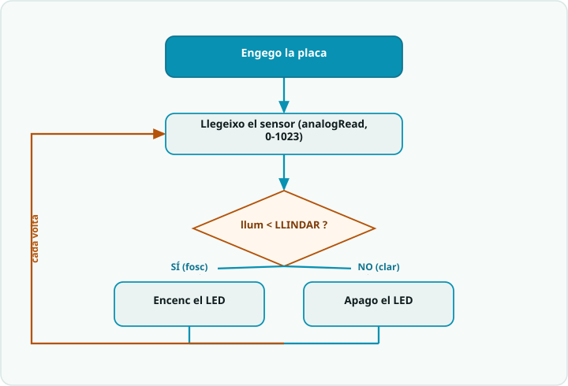

# SA3 · Diagrama de flux — Decisió per llindar (llegir → comparar → actuar)

> **Per a qui és?** Per a tu. És el **llum automàtic** de la Sessió 2 ([Pràctica 2](codi/02_potenciometre_ldr/EXPLICACIO.md)), però **dibuixat** en lloc d'escrit. És la idea més important de la SA: **llegir → comparar → actuar**. La faràs servir també a la mascota.

## El dibuix

## Com es llegeix
- La caixa **fosca** és on **comença** el programa.
- Les caixes **verdes** `[ ... ]` són **coses que fa** el programa (una ordre).
- Els **rombes taronja** `< ... ? >` són **preguntes**: segons si la resposta és sí o no, segueixes una fletxa o una altra.
- Les **fletxes taronja que tornen enrere** vol dir que el programa **ho repeteix**.

## Del dibuix al codi
- `[ llum = analogRead(LDR) ]` vol dir: *llegeix el sensor de llum* (et dona un número de 0 a 1023).
- `< llum < LLINDAR ? >` és la **pregunta**: *el número és més petit que la ratlla (el llindar)?* Al codi és un `if`.
- Si la resposta és **SÍ** (fa fosc): `digitalWrite(LED, HIGH);` → el LED s'encén.
- Si és **NO** (hi ha llum): `digitalWrite(LED, LOW);` → el LED s'apaga.
- Després espera una mica i **torna a començar**: això és el `loop()`.
