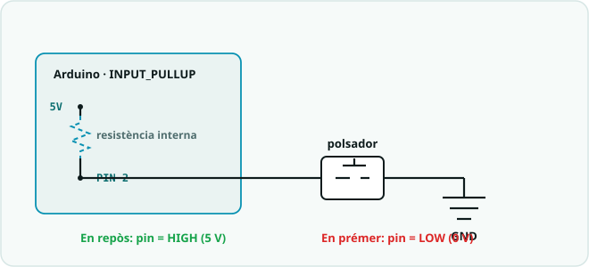
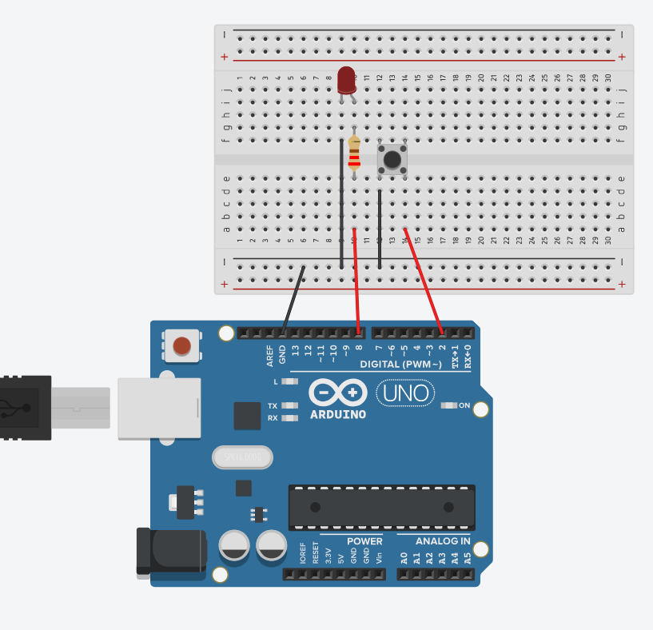
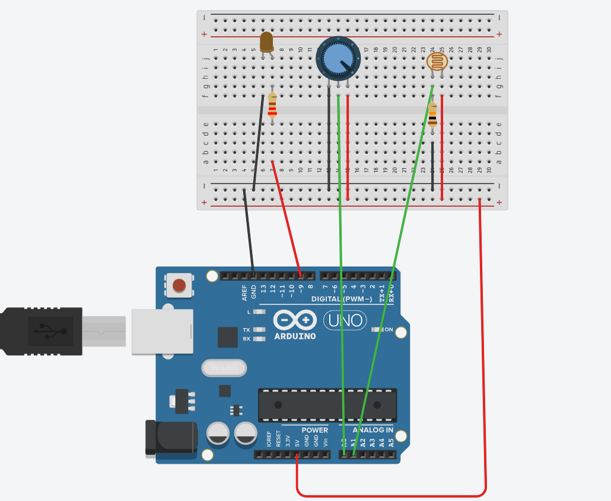
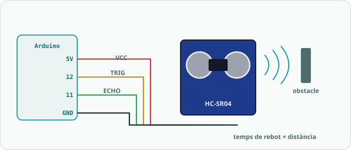
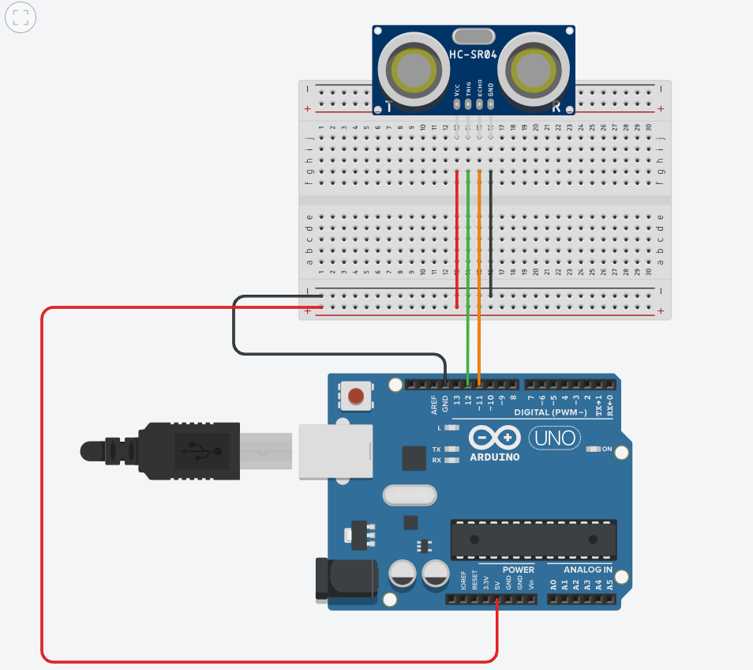
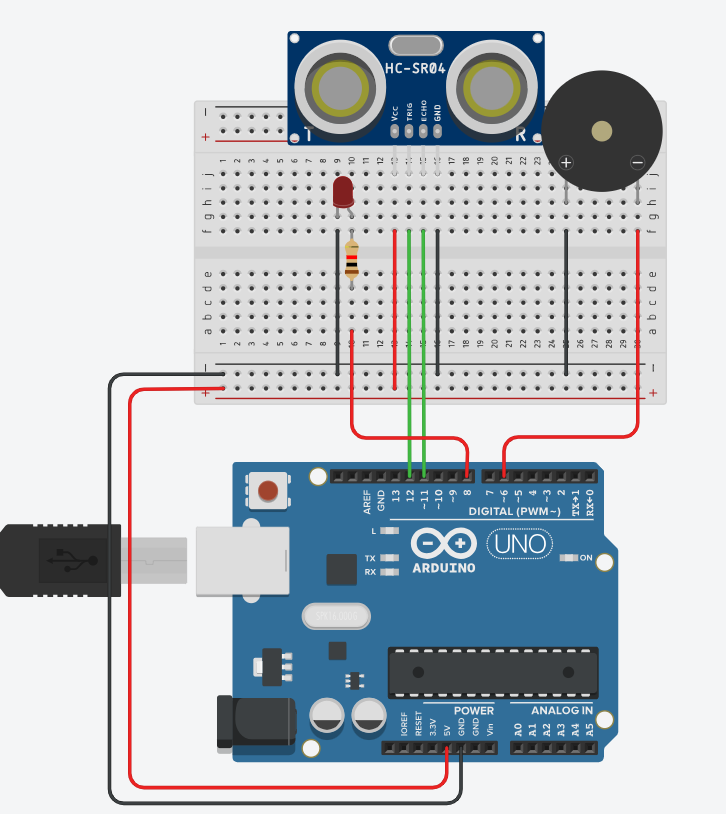

# SA3 · Esquemes i connexions

> 🧑‍🎓 **Quan toca?** Tingues aquesta pàgina oberta **mentre muntes**. L'**apartat 1** és el polsador (Sessió 1) · l'**apartat 2**, el potenciòmetre i el sensor de llum (Sessió 2) · el **3**, l'ultrasons, i el **5**, la mascota (Sessió 3) · el **4**, l'alarma d'aparcament (per a qui acabi abans).

> 📏 **Recorda:** munta i desmunta **sempre amb el cable USB desendollat**. Cada LED porta la seva resistència de 220 Ω, i la pota llarga va cap al pin. Tots aquests circuits els pots provar abans a **Tinkercad** o a **Wokwi**.

---

## 1. Polsador (`01_polsador_debounce.ino`)

| Pin de l'Arduino | Va a… | Per a què |
|---|---|---|
| 2 | una pota del polsador | llegir si està premut |
| GND | l'altra pota del polsador (la de la diagonal) | tancar el circuit |
| 8 | LED → resistència de 220 Ω → GND | el llum que s'encén i s'apaga |

> 💡 **Per què només dos cables?** L'Arduino té una resistència **a dins** que deixa el pin 2 «encès» (HIGH) mentre no toques res. Quan prems, el polsador uneix el pin amb GND i el pin passa a «apagat» (LOW). Per això en el codi diu `INPUT_PULLUP`.
>
> ⚠️ **Les potes del polsador van de dues en dues.** Posa'l **creuant el canal del mig** de la protoboard i fes servir dues potes en diagonal.

▶ **Obre la simulació a Tinkercad** (amb *Copy and Tinker* la pots modificar): <https://www.tinkercad.com/things/2RzxM2OPQiw-sa3-el-polsador-inputpullup-i-antirebot?sharecode=L4a37gBBrMnhaVjzk_PbVFSgNMSZDXq0M9WjclVEmUM>

---

## 2. Potenciòmetre i sensor de llum (`02_potenciometre_ldr.ino`)

| Pin de l'Arduino | Va a… | Per a què |
|---|---|---|
| A0 | la pota **del mig** del potenciòmetre | llegir quant l'has girat |
| 5 V i GND | les dues potes dels extrems del potenciòmetre | alimentar-lo |
| A1 | el punt on s'uneixen la LDR i la resistència de 10 kΩ | llegir quanta llum hi ha |
| 9 ~ | LED → resistència de 220 Ω → GND | el llum que es regula |

**El sensor de llum (LDR) necessita una companya:** una resistència de **10 kΩ** (marró-negre-taronja). Les dues van **una darrere l'altra** entre 5 V i GND, i el **punt on s'uneixen** va a A1.

> 💡 **Per què cal la resistència de 10 kΩ?** La LDR canvia segons la llum, però l'Arduino no pot llegir «quanta resistència» té una peça; només pot llegir **volts**. La parella LDR + 10 kΩ converteix «més o menys llum» en «més o menys volts» al punt del mig. Sense la companya, llegiries sempre 0 o 1023.

▶ **Obre la simulació a Tinkercad** (amb *Copy and Tinker* la pots modificar): <https://www.tinkercad.com/things/d9yecaFfbgt-sa3-entrades-analogiques-potenciometre-i-ldr?sharecode=loEcwJ_AnwrwHLIWY_lh5QD2k86IEoL1QVJQf4ToRfA>

---

## 3. Sensor d'ultrasons (`03_ultrasons_funcio.ino`)

> *Fotografia: HC-SR04, per [SparkFun Electronics](https://commons.wikimedia.org/wiki/File:SparkFun_HC-SR04_Ultrasonic-Sensor_13959-01a.jpg) — llicència [CC BY 2.0](https://creativecommons.org/licenses/by/2.0/).*

El sensor té 4 potes amb el nom escrit al davant:

| Pota del sensor | Pin de l'Arduino | Què fa |
|---|---|---|
| VCC | 5 V | l'alimenta |
| TRIG | 12 | l'Arduino li diu «crida!» |
| ECHO | 11 | el sensor avisa «he sentit l'eco» |
| GND | GND | tanca el circuit |

> ⚠️ Si canvies TRIG i ECHO de lloc, el sensor no mesura res. Mira bé les lletres.

▶ **Obre la simulació a Tinkercad** (amb *Copy and Tinker* la pots modificar): <https://www.tinkercad.com/things/hnsx8COkdxw-sa3-ultrasons-la-primera-funcio-que-retorna-un-valor?sharecode=YKiQREwbyIK8YqMlqZbnIwt3xpULWideirSXPxwwEz0>

---

## 4. Alarma d'aparcament (`04_alarma_aparcament.ino`) — per a qui acabi abans

| Pin de l'Arduino | Va a… |
|---|---|
| 12 i 11 | TRIG i ECHO de l'ultrasons (com a l'apartat 3) |
| 8 | LED → resistència de 220 Ω → GND |
| 6 | brunzidor (+); la seva pota − va a GND |

> És l'ultrasons de l'apartat 3 més un LED i un brunzidor. Com més a prop és l'objecte, més ràpid fa «bip».

▶ **Obre la simulació a Tinkercad** (amb *Copy and Tinker* la pots modificar): <https://www.tinkercad.com/things/bWIBhp6vaaU-sa3-producte-alarma-daparcament?sharecode=6Qc4jM_obZk1o5qQe7X2KyWSQm6Q-OwMKHttqyeN-uc>

**Prova-la sense placa (Wokwi):** <https://wokwi.com/projects/468087916595757057>. Obre l'enllaç, prem **▶**, clica el sensor i mou la distància: el LED i el brunzidor van més de pressa com més a prop. Fitxers del projecte: [`Simulacions/Wokwi/SA3_alarma_aparcament/`](../../Simulacions/Wokwi/SA3_alarma_aparcament/).

---

## 5. La mascota (Sessió 3)

> ⚠️ **Abans de començar, desmunta l'ultrasons.** La mascota fa servir el **pin 11** per al blau del LED RGB, i l'ultrasons el feia servir per a l'ECHO.

Primer, prepara les dues files llargues de la protoboard: un cable del **5V** de l'Arduino a la fila **vermella (+)** i un del **GND** a la fila **blava (−)**. Tots els components agafen el corrent d'aquí; cadascun només necessita, a més, el seu cable cap al pin de la taula.

| Component | Pin de l'Arduino | Fixa-t'hi |
|---|---|---|
| Ulls (tira NeoPixel), DIN | 6 | Connecta primer GND, després 5 V i al final DIN. |
| LED RGB (humor) | 9 · 10 · 11 | Com a la SA2. |
| Brunzidor | 8 | Pota + al 8, pota − a la fila blava. |
| Sensor de moviment (PIR, el nas) | 2 | Quan l'endolles, tarda **30-60 segons** a funcionar bé. |
| Polsador (la carícia) | 3 | Com a l'apartat 1, però al pin 3. |
| Sensor de temperatura (DHT11) | 4 | Opcional. |
| Micròfon | A0 | Mesura el soroll. |
| Sensor de llum (TEMT6000) | A1 | Mesura la llum. |

> ⚠️ Als mòduls de 3 potes (PIR, micròfon, sensor de llum), **l'ordre de les potes canvia segons el fabricant**: llegeix les lletres del mòdul (VCC, GND, OUT o S), no et fiïs de la posició.

Tots els detalls, les fotos i el muntatge a la caixa són al **[dossier de la mascota](../00_General/00_Projecte_T1_Mascota.md)**.
