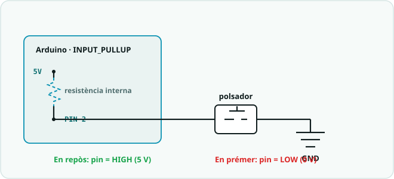
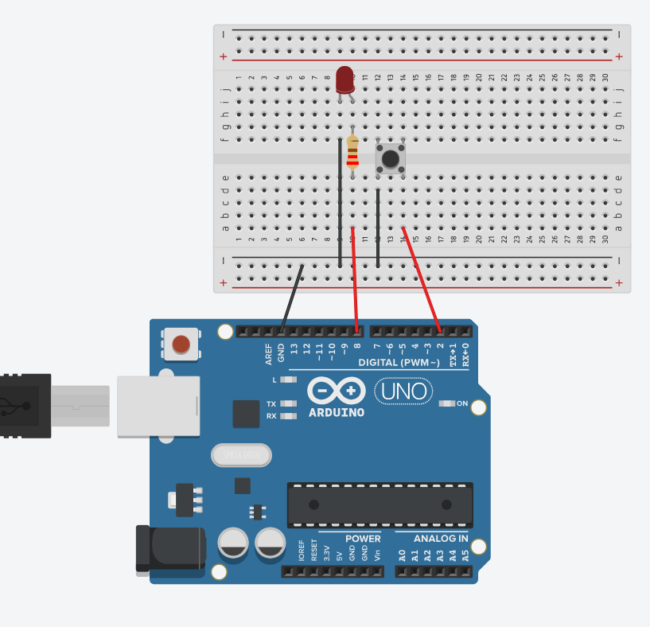
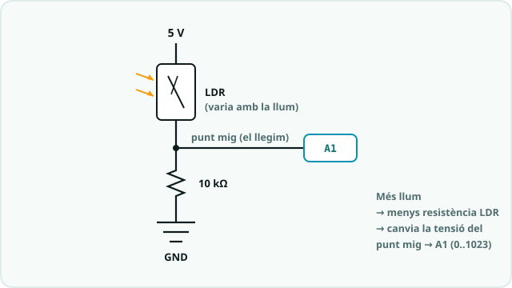
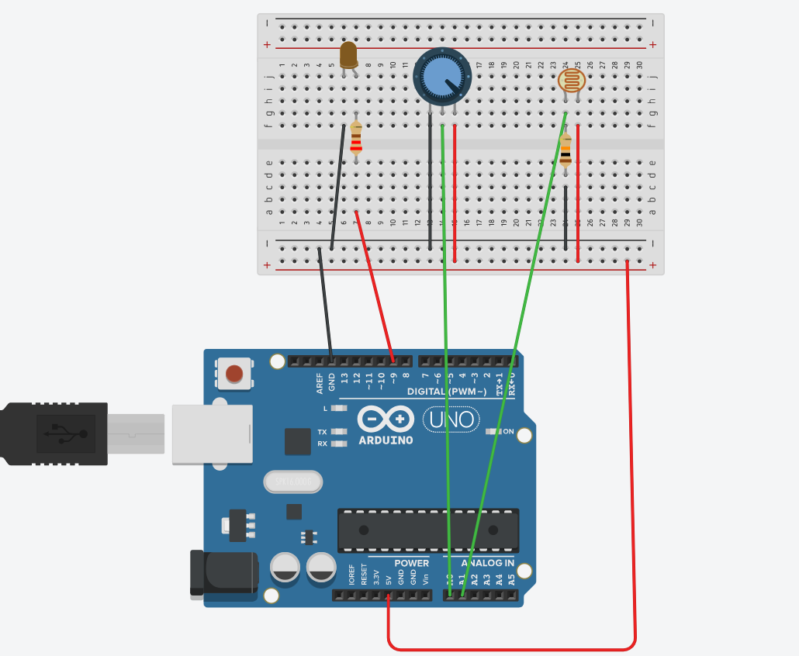

# SA3 · Esquemes i connexions

> 🧑‍🎓 **Quan toca?** Tingues aquesta pàgina oberta **mentre muntes**. L'**apartat 1** és el polsador (Sessió 1) · l'**apartat 2**, el potenciòmetre i el sensor de llum (Sessió 2) · el **3**, la pantalla OLED, i el **4**, el tamagotchi (Sessió 3).

> 📏 **Recorda:** munta i desmunta **sempre amb el cable USB desendollat**. Cada LED porta la seva resistència de 220 Ω, i la pota llarga va cap al pin. Tots aquests circuits els pots provar abans a **Tinkercad** o a **Wokwi**.

---

## 1. Polsador (`01_polsador_debounce.ino`)

| Pin de l'Arduino | Va a… | Per a què |
|---|---|---|
| 2 | una pota del polsador | llegir si està premut |
| GND | l'altra pota del polsador (la de la diagonal) | tancar el circuit |
| 8 | LED → resistència de 220 Ω → GND | el llum que s'encén i s'apaga |

> 💡 **Per què només dos cables?** L'Arduino té una resistència **a dins** que deixa el pin 2 «encès» (HIGH) mentre no toques res. Quan prems, el polsador uneix el pin amb GND i el pin passa a «apagat» (LOW). Per això en el codi diu `INPUT_PULLUP`.
>
> ⚠️ **Les potes del polsador van de dues en dues.** Posa'l **creuant el canal del mig** de la protoboard i fes servir dues potes en diagonal.

▶ **Obre la simulació a Tinkercad** (amb *Copy and Tinker* la pots modificar): <https://www.tinkercad.com/things/2RzxM2OPQiw-sa3-el-polsador-inputpullup-i-antirebot?sharecode=L4a37gBBrMnhaVjzk_PbVFSgNMSZDXq0M9WjclVEmUM>

---

## 2. Potenciòmetre i sensor de llum (`02_potenciometre_ldr.ino`)

| Pin de l'Arduino | Va a… | Per a què |
|---|---|---|
| A0 | la pota **del mig** del potenciòmetre | llegir quant l'has girat |
| 5 V i GND | les dues potes dels extrems del potenciòmetre | alimentar-lo |
| A1 | el punt on s'uneixen la LDR i la resistència de 10 kΩ | llegir quanta llum hi ha |
| 9 ~ | LED → resistència de 220 Ω → GND | el llum que es regula |

**El sensor de llum (LDR) necessita una companya:** una resistència de **10 kΩ** (marró-negre-taronja). Les dues van **una darrere l'altra** entre 5 V i GND, i el **punt on s'uneixen** va a A1.

> 💡 **Per què cal la resistència de 10 kΩ?** La LDR canvia segons la llum, però l'Arduino no pot llegir «quanta resistència» té una peça; només pot llegir **volts**. La parella LDR + 10 kΩ converteix «més o menys llum» en «més o menys volts» al punt del mig. Sense la companya, llegiries sempre 0 o 1023.

▶ **Obre la simulació a Tinkercad** (amb *Copy and Tinker* la pots modificar): <https://www.tinkercad.com/things/d9yecaFfbgt-sa3-entrades-analogiques-potenciometre-i-ldr?sharecode=loEcwJ_AnwrwHLIWY_lh5QD2k86IEoL1QVJQf4ToRfA>

---

## 3. Pantalla OLED (`03_pantalla_oled.ino`)

Deixa muntat el sensor de llum de l'apartat 2 (punt d'unió a **A1**) i afegeix-hi la pantalla OLED de 0,96" (I²C):

| Pin de la pantalla | Pin de l'Arduino |
|---|---|
| VCC | 5 V |
| GND | GND |
| SCL | A5 |
| SDA | A4 |

> ⚠️ L'ordre dels 4 pins **canvia segons el model**: llegeix les lletres de la pantalla. Cal la llibreria **U8g2** (Eines → Gestiona les biblioteques).

## 4. El tamagotchi (Sessió 3)

Primer, prepara les dues files llargues de la protoboard: un cable del **5V** de l'Arduino a la fila **vermella (+)** i un del **GND** a la fila **blava (−)**. Tots els components agafen el corrent d'aquí; cadascun només necessita, a més, el seu cable cap al pin de la taula.

| Component | Pin de l'Arduino | Fixa-t'hi |
|---|---|---|
| Pantalla OLED | SDA → A4 · SCL → A5 | Com a l'apartat 3. |
| Botó MENJAR | 3 | Una pota al pin i la diagonal a GND (com a l'apartat 1). |
| Botó JUGAR | 5 | Igual. |
| Botó DORMIR | 7 | Igual. |
| LED RGB (humor) | 9 · 10 · 11 | Com a la SA2, cada color amb la seva resistència de 220 Ω. |
| Brunzidor | 8 | Pota + al 8, pota − a la fila blava. |
| Sensor de llum | A1 | El de l'apartat 2 (o el mòdul TEMT6000). |
| Micròfon | A0 | Mesura el soroll. |
| Sensor de moviment (PIR) | 2 | Versió completa. Tarda **30-60 segons** a funcionar bé. |
| Sensor de temperatura (DHT11) | 4 | Ampliació. |

> ⚠️ Als mòduls de 3 potes (PIR, micròfon, sensor de llum), **l'ordre de les potes canvia segons el fabricant**: llegeix les lletres del mòdul (VCC, GND, OUT o S), no et fiïs de la posició.

Tots els detalls de la carcassa en forma d'ou i el muntatge són al **[dossier del tamagotchi](../00_General/00_Projecte_T1_Mascota.md)**.
