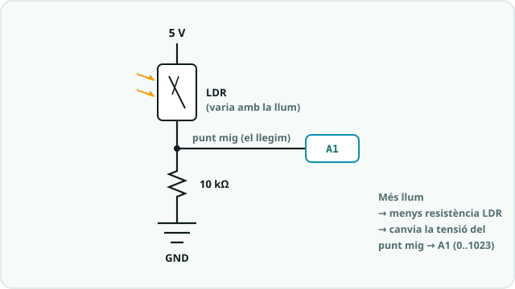

# SA3 · Exemple resolt (model «jo ho faig») — Llum de nit automàtica

> 🧑‍🎓 **Quan toca mirar-lo?** **Després** d'haver provat tu el [llum automàtic](codi/02_potenciometre_ldr/EXPLICACIO.md) (Sessió 2), mai abans. No és la solució de cap pràctica: és un exemple **semblant**, fet pas a pas, perquè vegis **com es pensa** un programa que **nota** una cosa i **decideix**. La mateixa manera de pensar et servirà per a les reaccions de la mascota.

> **Nota per al docent:** mostra'l després del primer intent amb `02_potenciometre_ldr.ino`. Comenta en veu alta «🧭 Com ho penso» i «⚠️ Errors típics». El mètode (llegir → mirar els números al Monitor → decidir per llindar → posar la lectura en una funció) és el que necessitaran per a la mascota.

---



## 🔑 El problema

> Fer una **llum de nit**: un LED que **s'encén sol quan es fa fosc** i s'apaga quan torna la llum.

El circuit és el de la Sessió 2: el **sensor de llum amb la seva resistència de 10 kΩ** (el punt d'unió a **A1**) i un **LED al pin 9** amb la seva resistència de 220 Ω.

---

## 🧭 Com ho penso (abans d'escriure codi)

1. **Què ha de notar i què ha de fer?** Ha de notar **quanta llum hi ha** i ha d'**encendre o apagar** un LED.
2. **Com ho llegeixo?** La llum no és «sí o no» com un botó: té molts valors. Per tant faig servir `analogRead`, que em dona un número de **0 a 1023**.
3. **Com decideixo?** Primer miro al **Monitor sèrie** quin número dona el sensor amb llum i a les fosques. Després trio una **ratlla** (el llindar) entre els dos. Finalment, un `if`: si el número és més petit que la ratlla, fa fosc.
4. **Com ho ordeno?** Poso la lectura dins d'una **funció**, `llegeixLlum()`. Així el `loop()` es llegeix com una frase.
5. **🔮 Endevina abans de mirar el codi:** quan **tapo** el sensor, el número… ☐ **baixa** ☐ puja ☐ no canvia. I `analogRead` dona un número entre ____ i ____.

---

## 💡 El codi, amb explicacions

```cpp
/*
  SA3 - exemple_llum_nit.ino  (EXEMPLE MODEL, no es el producte)
  Llum de nit automatica: encen un LED quan la LDR detecta foscor.
  Metode: llegir analogic -> comparar amb llindar -> decidir.
  Circuit: LDR en divisor amb 10k -> A1 ; LED -> [220 ohm] -> pin 9 (~) -> GND
*/

const int LDR = A1;        // entrada analogica (punt mig del divisor)
const int LED = 9;         // sortida (pin ~ per si despres vull graduar-lo)
const int LLINDAR = 400;   // per SOTA d'aquest valor considerem "fosc"
                           // (ajusta'l mirant el Monitor serie al teu muntatge)

// Funcio propia: llegeix i RETORNA la llum ambiental (0..1023)
int llegeixLlum() {
  return analogRead(LDR);
}

void setup() {
  pinMode(LED, OUTPUT);
  Serial.begin(9600);      // obre Eines > Serial Monitor per calibrar el llindar
}

void loop() {
  int llum = llegeixLlum();   // 0 = molt fosc ... 1023 = molt clar

  // Mostra la lectura per poder triar be el llindar
  Serial.print("Llum: ");
  Serial.println(llum);

  // Decisio per llindar: fa fosc -> encen ; hi ha llum -> apaga
  if (llum < LLINDAR) {
    digitalWrite(LED, HIGH);   // fosc: llum encesa
  } else {
    digitalWrite(LED, LOW);    // clar: llum apagada
  }

  delay(100);
}
```

**Per què està fet així (🌟):**
- **Un nom en lloc d'un número** (`LLINDAR`): quan ajusti la ratlla, només canvio **una** línia.
- **La lectura, dins d'una funció** (`llegeixLlum()`): el `loop()` es llegeix com una frase: *llegeix la llum, escriu-la, decideix*.
- **El `Serial.println` no és de decoració:** és la meva eina per **veure** els números i triar bé la ratlla.

---

## 🔬 Ho provo

- **L'endevinalla:** quan tapo el sensor, el número **baixa** (en aquest muntatge, menys llum = número més petit). I `analogRead` va de **0 a 1023**.
- **Amb el multímetre:** al punt d'unió del sensor i la resistència hi mesuro, per exemple, uns 3 V amb llum. Si el Monitor diu 600: 600 ÷ 1023 × 5 ≈ **2,9 V**. Quadra! L'Arduino converteix **volts en un número**.
- **Trio la ratlla de veritat:** el Monitor diu uns 650 amb llum i uns 180 tapat. Poso `LLINDAR` al mig, uns **400**. No l'endevino: **el miro**.
- **Per anar més lluny:** si el LED parpelleja quan la llum està just a la ratlla, faig servir **dues ratlles**: encendre per sota de 380 i apagar per sobre de 420. Així no dubta.

---

## ⚠️ Errors típics (i com els veus)

- **El sensor de llum sense la resistència de 10 kΩ** (o el punt d'unió no va a A1) → el Monitor diu **sempre 0 o sempre 1023**, encara que el tapis. **Solució:** sensor i resistència un darrere l'altre entre 5 V i GND, i el punt d'unió a A1.
- **Poso la ratlla a 255** pensant en el `analogWrite` → gairebé mai s'encén. **Solució:** `analogRead` va de **0 a 1023**; tria la ratlla mirant el Monitor.
- **M'oblido de `Serial.begin(9600)`**, o el Monitor no és a 9600 → surten símbols estranys o res. **Solució:** `Serial.begin(9600)` al `setup()` i 9600 al Monitor.
- **Poso el LED al revés o sense la resistència de 220 Ω** → no s'encén, o fa massa llum. **Solució:** la pota llarga cap al pin 9 i sempre amb resistència.

---

## 📔 Com seria una bona entrada al quadern

> **Sessió 2:** He fet una **llum de nit** amb el sensor de llum. Com que la llum té molts valors, he fet servir `analogRead` (de 0 a 1023) i no `digitalRead`. Al principi el LED estava sempre encès: havia posat la ratlla a **255**, perquè em pensava que anava de 0 a 255 com el `analogWrite`. He obert el **Monitor sèrie**, he vist que amb llum donava uns 650 i tapat uns 180, i he posat la ratlla a **400**. He posat la lectura dins d'una **funció** (`llegeixLlum()`) perquè el `loop()` s'entengui millor.
> **Prova:** una captura del Monitor amb els dos números i un vídeo tapant el sensor.

**Per què és una bona entrada:** fa servir les paraules importants (`analogRead`, 0-1023, llindar, funció), explica **com** ho ha fet (mirant el Monitor) i diu **la veritat** sobre el que li ha costat (la ratlla a 255) i com ho ha arreglat.

---

*Exemple resolt de la SA3. Es mostra després del primer intent de l'alumnat. Es basa en `codi/02_potenciometre_ldr` i, com a pont cap a la funció de la Sessió 3, en `codi/03_ultrasons_funcio`. Llicència CC BY-SA 4.0.*
