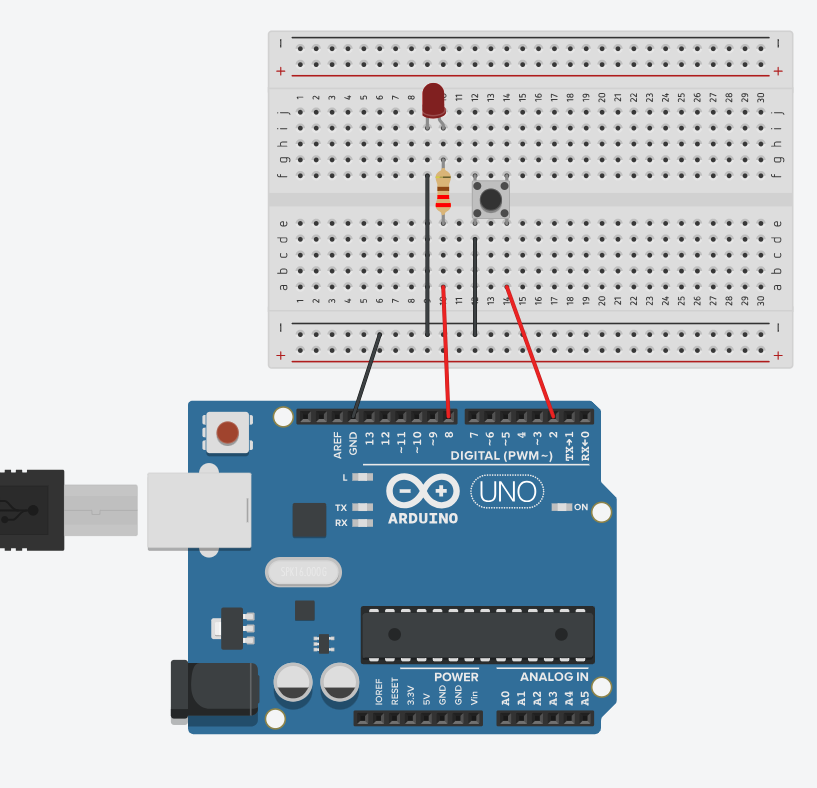

# Pràctica 1 · El polsador: INPUT_PULLUP i antirebot

<div class="cap-practica" markdown="1">

🎯 **Avui aconseguiràs:** que l'Arduino **noti** quan prems un botó, el compti i t'ho escrigui a l'ordinador.

⏱️ 50 min

📦 1 polsador, 1 LED, 1 resistència de 220 Ω i cables

</div>

## 🚀 Pas a pas

### Pas 1 · Munta el circuit

| Pin de l'Arduino | Va a… |
|---|---|
| 2 | una pota del polsador |
| GND | l'altra pota del polsador (la de la diagonal) |
| 8 | LED → resistència de 220 Ω → GND |



✅ **Comprova:** el polsador **creua el canal del mig** de la protoboard.

### Pas 2 · Endevina abans de provar

Desplega el codi complet del pas 3 i llegeix-lo. Què sortirà a l'ordinador quan premis el botó?

✍️ **Apunta-ho:** PREDIU: què sortirà al Monitor sèrie quan premis el polsador?

### Pas 3 · Carrega el codi

Prem **Copia**, enganxa'l a l'Arduino IDE (esborra el que hi hagués) i prem **→ Puja**.

<!-- codi-complet -->

### Pas 4 · Obre el Monitor sèrie

A l'Arduino IDE, **Eines → Monitor sèrie**, i a baix a la dreta tria **9600**. Prem el polsador unes quantes vegades.

✅ **Comprova:** surt `Premudes: 1`, `Premudes: 2`… i el LED s'encén i s'apaga.

✍️ **Apunta-ho:** quan no prems, el pin llegeix ____ i quan prems, ____ (HIGH o LOW). La resposta et sorprendrà: el tros 3 de «🧠 Vols saber per què funciona?» t'explica per què.

### Pas 5 · Fes un experiment

Canvia `ANTIREBOT = 40` per `ANTIREBOT = 0` i torna a pujar el codi. Prem el botó a poc a poc unes quantes vegades: és possible que **una sola premuda en compti 2 o 3**. Després, torna a posar el 40.

✍️ **Apunta-ho:** per què cal l'antirebot? (La resposta és al tros 4.)

### Pas 6 · Explica-ho amb les teves paraules

✍️ **Apunta-ho:** quin és el concepte nou més important d'aquesta pràctica?

### Pas 7 · Respon i envia

📤 [Obre la tasca «SA3 · Pràctica 1» a Classroom i envia el formulari](https://classroom.google.com/c/ODY4ODU4Njk0NTEy/a/ODk3NDAzMTY0MTI4/details)

Hi trobaràs les mateixes preguntes ✍️ que has anat apuntant. Envia'l ara. A la sessió següent: **[Pràctica 2 · Potenciòmetre i sensor de llum](../02_potenciometre_ldr/EXPLICACIO.md)**.

⭐ **Si acabes abans:** fes que el comptador arribi a **5** i torni a **0** (pista: canvia la línia `comptador++;` per `if (comptador == 5) { comptador = 0; } else { comptador++; }`: així compta 1, 2, 3, 4, 5 i torna a 0) i explica-ho a la pregunta opcional del formulari. O tria un repte a **[Reptes de la SA3](../../../../Reptes/Reptes_SA3.md)** i, quan el docent te'l validi, pinta l'estrella al [tauler de reptes](../../../00_General/00_Tauler_reptes.md).

<details markdown="1">
<summary>🧗 Si t'encalles</summary>

| Què passa | Per què | Com ho arreglo |
|---|---|---|
| «Està al revés! Diu HIGH sense tocar res» | No és un error: amb `INPUT_PULLUP` és així. | Mira el tros 3. |
| Una premuda en compta 2 o 3 | L'antirebot és massa curt (o a 0). | Torna a posar `ANTIREBOT = 40`. |
| El botó no fa res | El polsador no creua el canal del mig, o fas servir dues potes que ja estan unides. | Gira'l 90° o fes servir les potes en diagonal. |
| Al Monitor surten símbols estranys | La velocitat del Monitor no és 9600. | A baix a la dreta del Monitor, tria 9600. |

</details>

<details markdown="1">
<summary>🧠 Vols saber per què funciona?</summary>

### Tros 1 — Els noms i la memòria del programa

```cpp
const int POLSADOR = 2;
const int LED = 8;

int comptador = 0;
int estatAnterior = HIGH;          // en repos esta a HIGH
unsigned long ultimCanvi = 0;
const unsigned long ANTIREBOT = 40;  // ms
```

Les dues primeres línies ja les coneixes: diuen a quin pin està cada cosa. Les altres són la **memòria** del programa, coses que ha de recordar d'una volta a l'altra:

| Variable | Què recorda |
|---|---|
| `comptador` | Quantes vegades has premut el botó. |
| `estatAnterior` | Com estava el botó la volta anterior (premut o no). |
| `ultimCanvi` | **Quan** va canviar per última vegada. |
| `ANTIREBOT` | Quanta estona (40 mil·lisegons) cal esperar per fiar-se d'un canvi. |

### Tros 2 — `setup()`: preparar el botó i la finestra

```cpp
void setup() {
  pinMode(POLSADOR, INPUT_PULLUP);
  pinMode(LED, OUTPUT);
  Serial.begin(9600);
}
```

- `INPUT_PULLUP` vol dir que el pin 2 és una **entrada**: l'Arduino hi **escolta**, en lloc d'enviar-hi corrent.
- `Serial.begin(9600)` obre la **finestra** cap a l'ordinador (el Monitor sèrie). És com un xat: l'Arduino t'hi escriu el que passa. El 9600 és la velocitat del xat, i ha de ser la mateixa al Monitor.

### Tros 3 — La sorpresa: «al revés»

**Com a la vida real:** imagina un llum que està **sempre encès** i que només s'apaga mentre prems l'interruptor. Estrany, oi? Doncs el pin 2 fa això.

Amb `INPUT_PULLUP`, l'Arduino té una petita peça **a dins** que deixa el pin 2 «encès» (**HIGH**) tota l'estona. Quan prems el botó, uneixes el pin amb GND i passa a «apagat» (**LOW**).

| Botó | El pin llegeix |
|---|---|
| Sense prémer | `HIGH` |
| Premut | `LOW` |

Per això el codi pregunta `if (estat == LOW)` per saber si has premut. **No és un error: és com funciona.** Avantatge: només calen dos cables.

### Tros 4 — L'antirebot: la pilota que bota

**Com a la vida real:** si deixes caure una pilota, no toca terra una vegada: **bota** unes quantes vegades abans de quedar-se quieta.

Dins del botó hi ha dues peces de metall que es toquen. Quan prems, també «boten»: es toquen i se separen unes quantes vegades en molt poc temps. L'Arduino és tan ràpid que ho podria comptar com si haguessis premut **3 vegades**.

```cpp
  int estat = digitalRead(POLSADOR);

  // Detecta el canvi HIGH -> LOW (premuda) amb antirebot
  if (estat != estatAnterior && (millis() - ultimCanvi) > ANTIREBOT) {
```

- `digitalRead(POLSADOR)` llegeix el botó: `HIGH` o `LOW`.
- L'`if` demana **dues coses alhora** (el `&&` vol dir «i»):
  1. `estat != estatAnterior` → el botó **ha canviat** respecte de l'altra volta.
  2. `(millis() - ultimCanvi) > ANTIREBOT` → han passat **més de 40 mil·lisegons** des de l'últim canvi.

**`millis()` és el cronòmetre de l'Arduino:** compta els mil·lisegons des que s'ha engegat i no s'atura mai. Com que no espera res, és com mirar el rellotge de la paret. Si restes `millis() - ultimCanvi`, saps **quanta estona ha passat** des de l'últim canvi. Si han passat menys de 40 ms, és un bot i l'ignorem.

### Tros 5 — Comptar i encendre o apagar el LED

```cpp
    ultimCanvi = millis();
    if (estat == LOW) {            // s'acaba de premer
      comptador++;
      Serial.print("Premudes: ");
      Serial.println(comptador);
      digitalWrite(LED, !digitalRead(LED));  // mode toggle del LED
    }
    estatAnterior = estat;
```

| Línia | Què fa |
|---|---|
| `ultimCanvi = millis();` | Apunta l'hora d'aquest canvi. |
| `if (estat == LOW)` | Només fa la resta si el botó **s'acaba de prémer** (no quan el deixes anar). |
| `comptador++;` | Suma 1 al comptador. |
| `Serial.print(...)` i `Serial.println(...)` | Escriuen al Monitor «Premudes: » i el número. |
| `digitalWrite(LED, !digitalRead(LED));` | Mira com està el LED i el posa **al revés** (el `!` vol dir «al contrari»). |
| `estatAnterior = estat;` | Recorda com està el botó per a la volta següent. |

### On ho aplicaràs

- **Sessió 2:** el **Monitor sèrie** serà la teva eina per veure els números del sensor de llum.
- **El tamagotchi:** els tres botons (MENJAR, JUGAR, DORMIR) són aquest mateix polsador, amb el mateix antirebot.

</details>
