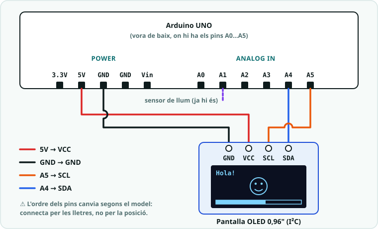

# Pràctica 3 · La pantalla OLED: text, una barra i una cara

<div class="cap-practica" markdown="1">


❓ **La pregunta:** Com dibuixa l'Arduino una cara en una pantalla?

🎯 **Avui aconseguiràs:** que una pantalla petita mostri un text, una **barra** que creix amb la llum i una **cara** que es posa trista quan és fosc. És la pantalla del teu tamagotchi.

⏱️ 25 min

📦 Pantalla OLED KS0271 de 0,96" (I²C), el sensor de llum de la Pràctica 2 i 4 cables

</div>

## 🚀 Pas a pas

### Pas 1 · La llibreria de la pantalla

El codi fa servir la llibreria **Adafruit SSD1306** (i les que necessita: Adafruit GFX i Adafruit BusIO).

- **Chromebook (Web Editor):** no cal instal·lar res. El Web Editor ja té totes les llibreries al núvol i les troba soles quan el codi diu `#include <Adafruit_SSD1306.h>`.
  ⚠️ La primera línia `#include` del codi, `#include <Adafruit_BusIO_Register.h>`, **no l'esborris**: obliga el Web Editor a triar les llibreries d'Adafruit i no unes altres que s'hi assemblen. Tampoc no importis cap llibreria (pestanya **Custom**): no cal, i pot fer que deixi de compilar.
- **PC (Arduino IDE):** **Eines → Gestiona les biblioteques**, cerca **Adafruit SSD1306** i prem **Instal·la**. Quan et pregunti si vols instal·lar també les llibreries que necessita, prem **Instal·la-ho tot**.

✅ **Comprova:** al Chromebook, passa al pas 2. Al PC, a la llista de biblioteques, Adafruit SSD1306 i Adafruit GFX diuen «Instal·lada».

### Pas 2 · Munta la pantalla

Deixa muntat el sensor de llum de la Pràctica 2 (punt d'unió a **A1**) i afegeix-hi la pantalla:

| Pin de la pantalla | Pin de l'Arduino |
|---|---|
| VCC | 5 V |
| GND | GND |
| SCL | A5 |
| SDA | A4 |



✅ **Comprova:** has llegit les lletres de la pantalla. En alguns models l'ordre és GND, VCC, SCL, SDA i en d'altres canvia.

### Pas 3 · Carrega el codi

Prem **Copia**, enganxa'l a l'Arduino IDE (esborra el que hi hagués) i prem **→ Puja**.

<!-- codi-complet -->

✅ **Comprova:** a la pantalla surten «Hola!», una cara i una barra a baix.

### Pas 4 · Tapa el sensor de llum

Tapa el sensor amb la mà i destapa'l.

✍️ **Apunta-ho:** què fan la barra i la cara quan tapes el sensor de llum? Per què? (La resposta és al tros 2.)

### Pas 5 · Canvia el text

Busca les línies `pantalla.setCursor(0, 0);` i `pantalla.print("Hola!");`. Posa-hi el **nom** que vols per al teu tamagotchi i prova de canviar els dos `0` del `setCursor`.

✅ **Comprova:** el teu text surt a la pantalla, al lloc on l'has posat.

✍️ **Apunta-ho:** quines línies has tocat i què volen dir els números de `setCursor(x, y)`?

### Pas 6 · Explica-ho amb les teves paraules

✍️ **Apunta-ho:** quin és el concepte nou més important d'aquesta pràctica?

### Pas 7 · Respon i envia

📤 [Obre la tasca «SA3 · Pràctica 3» a Classroom i envia el formulari](https://classroom.google.com/c/ODY4ODU4Njk0NTEy/a/ODk3NDE0MDkzMjg3/details)

Hi trobaràs les mateixes preguntes ✍️ que has anat apuntant. Envia'l ara i passa a la **[Pràctica 4 · El teu tamagotchi](../05_mascota/EXPLICACIO.md)**. Deixa la pantalla muntada: la faràs servir.

⭐ **Si acabes abans:** dibuixa una segona barra amb el valor del potenciòmetre (A0) o fes que la cara somrigui més com més llum hi ha. Més reptes a **[Reptes de la SA3](../../../../Reptes/Reptes_SA3.md)**; quan el docent te'l validi, pinta l'estrella al [tauler de reptes](../../../00_General/00_Tauler_reptes.md).

<details markdown="1">
<summary>🧗 Si t'encalles</summary>

| Què passa | Per què | Com ho arreglo |
|---|---|---|
| No compila: `Adafruit_SSD1306.h` no trobat | Al Chromebook: la línia `#include` està mal escrita. Al PC: falta la llibreria. | Chromebook: torna a copiar el codi sencer. PC: torna al pas 1. |
| No compila al Chromebook: centenars de línies `multiple definition of Adafruit_GFX::...` amb la paraula `EIS`, o `No such file or directory` amb el nom d'una llibreria Adafruit, encara que diguis que la tens | No és culpa teva. Al núvol hi ha llibreries d'altres marques (`EIS`) que porten còpies de les d'Adafruit, i de vegades el Web Editor tria la dolenta. A l'Arduino IDE no passa. | Comprova que la **primera** línia `#include` del codi sigui `#include <Adafruit_BusIO_Register.h>`. Si no hi és, torna a copiar el codi sencer de la pràctica. Torna a compilar. Si encara falla, ensenya l'error sencer al docent. |
| No compila: `no matching function for call to 'TwoWire::begin(uint8_t&, uint8_t&)'` i el nom `Adafruit_SSD1306_72x40` | Al teu compte del Web Editor hi ha una llibreria extra (`Adafruit_SSD1306_72x40`) feta per a una altra placa (ESP32). El Web Editor la fa servir en lloc de la bona, i l'Arduino UNO no l'entén. | Web Editor → **Libraries** → pestanya **Custom** → esborra `Adafruit_SSD1306_72x40` (i qualsevol altra que no hagis posat tu). Torna a compilar. Els avisos `Multiple libraries were found` no són errors: ignora'ls. |
| La pantalla no s'encén (el Monitor sèrie diu «La pantalla no arrenca») | SDA i SCL intercanviats, o VCC i GND al revés. | Mira les lletres de la pantalla i la taula del pas 2. |
| La pantalla està negra però abans funcionava | Un cable fa mal contacte. | Prem bé els 4 cables a la protoboard. |
| La barra no canvia mai | El sensor de llum no és a A1, o falta la resistència de 10 kΩ. | Revisa el muntatge de la [Pràctica 2](../02_potenciometre_ldr/EXPLICACIO.md). |

</details>

<details markdown="1">
<summary>🧠 Vols saber per què funciona?</summary>

### Tros 1 — La pantalla és una quadrícula de punts

La pantalla té **128 punts d'ample i 64 d'alt** (píxels). Cada punt es diu per la seva posició: **x** cap a la dreta (de 0 a 127) i **y** cap avall (de 0 a 63). El punt (0, 0) és a dalt a l'esquerra.

```cpp
pantalla.setCursor(0, 0);                              // el text comenca a x = 0, y = 0
pantalla.print("Hola!");                               // escriu el text
pantalla.drawCircle(64, 34, 14, SSD1306_WHITE);        // cercle: centre (64, 34), radi 14
pantalla.fillRect(14, 54, amplada, 8, SSD1306_WHITE);  // rectangle ple
```

Les funcions que comencen per `draw` dibuixen només la vora, i les que comencen per `fill` dibuixen la figura plena. L'últim número, `SSD1306_WHITE`, és el color: la pantalla només té punts encesos (blanc) o apagats (negre).

### Tros 2 — La barra i la cara depenen de la llum

```cpp
int llum = analogRead(SENSOR_LLUM);        // 0 ... 1023
int amplada = map(llum, 0, 1023, 0, 100);  // 0 ... 100 punts
```

És el `map()` de la Pràctica 2: converteix la lectura del sensor (0-1023) en l'amplada de la barra (0-100 punts). Si tapes el sensor, la lectura baixa, la barra s'escurça i, quan l'amplada és 30 o menys, l'`if` dibuixa la boca trista.

### Tros 3 — Dibuixar a la memòria i enviar-ho: `clearDisplay` i `display`

**Com a la vida real:** dibuixar en un full en blanc i, quan està acabat, ensenyar-lo.

```cpp
pantalla.clearDisplay();   // full en blanc (a la memoria de l'Arduino)
// ... tot el que es dibuixa ...
pantalla.display();        // ara si: envia el dibuix a la pantalla
```

Les instruccions de dibuix no toquen la pantalla: pinten una còpia que hi ha a la **memòria** de l'Arduino. La pantalla només canvia quan fas `display()`. Si te l'oblides, no veuràs res; si treus el `clearDisplay()`, cada dibuix es pinta a sobre de l'anterior.

Aquesta còpia ocupa **1 KB**, la meitat de tota la memòria de l'Arduino UNO (2 KB). Per això, si el programa fa massa coses, la pantalla pot no arrencar.

### On ho aplicaràs

- **Ara mateix:** el teu **tamagotchi** fa servir aquestes mateixes instruccions per dibuixar la cara i les barres de les necessitats.

</details>
