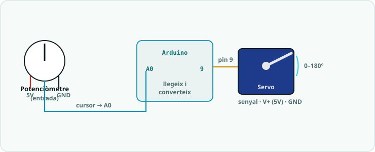

# SA4 · Moviment: servos, motors i ponts H

Quarta situació d'aprenentatge (**8 h · 4 sessions**, 2n trimestre). El sistema **es mou**, i el que es mou és el **teu braç robòtic MeArm**: cada pràctica de la SA s'hi fa a sobre i, al final de cada sessió, hi afegeixes un tros en el **torn de taller**. Aprens el **servomotor** (posició), el **motor DC amb pont H** (pràctica curta, per al rover del T3), l'**ultrasons → moviment** i `millis()`. En acabar, el braç es mou amb **quatre potenciòmetres**. Maquinari: Arduino UNO + 4 servos + potenciòmetres + ultrasons + MeArm ([dossier del braç](../00_General/00_Projecte_T2_Brac.md)). Programació oficial: [`Programació didàctica/13_SA4_Moviment_servos_motors.md`](../../Programació%20didàctica/13_SA4_Moviment_servos_motors.md).

En acabar aquesta SA podràs: 1) controlar la **posició** d'un servo dins del seu rang segur i la **velocitat i el sentit** d'un motor DC; 2) muntar circuits de potència amb **alimentació externa i massa comuna**; 3) fer que el braç respongui a un sensor i als potenciòmetres, amb funcions pròpies.

> 💻 **Com carregar el codi d'una pràctica:** dins de la pràctica, al pas «Carrega el codi», prem **Copia**, enganxa'l a l'Arduino IDE (esborra el que hi havia) i prem **→ Puja**.

## 🧭 La teva ruta

Fes les pràctiques **en ordre i al teu ritme**. Cada pràctica comença amb el **kata** (10') i acaba enviant el seu formulari de Classroom. Les 🚩 et diuen on hauries de ser al final de cada sessió.

- ① [Pràctica 1 · El servo amb potenciòmetre](codi/01_servo_potenciometre/EXPLICACIO.md) — el servo de la base segueix el potenciòmetre. **Taller:** pas 0 i blocs A-B del MeArm.

🚩 **Final de la Sessió 1:** formulari de la ① enviat, els quatre servos a 90° i etiquetats, i el full del 📓 quadern de la sessió omplert.

- ② [Pràctica 2 · Motor DC i pont H](codi/02_motor_pont_h/EXPLICACIO.md) — endavant, enrere i velocitat (pràctica curta, fora del braç). **Taller:** blocs C-D (la pinça).

🚩 **Final de la Sessió 2:** formulari de la ② enviat, la pinça muntada i calibrada, i el full del 📓 quadern omplert.

- ③ [Pràctica 3 · Del sensor al braç](codi/03_ultrasons_brac/EXPLICACIO.md) — l'ultrasons fa girar la base i obrir la pinça. **Taller:** bloc E (l'estructura central).

🚩 **Final de la Sessió 3:** formulari de la ③ enviat, el bloc E muntat i el full del 📓 quadern omplert.

- ④ [Pràctica 4 · El braç amb potenciòmetres](codi/04_brac_potenciometres/EXPLICACIO.md) — el producte: el MeArm amb quatre potenciòmetres, cada servo dins del seu rang segur. **Taller:** cablatge definitiu.

🚩 **Final de la Sessió 4:** formulari de la ④ enviat, **Entrega final** feta i el full del 📓 quadern omplert.

## 🏁 Entrega final

**Quan hagis acabat la ④:**

1. 🎤 **Defensa d'1 minut** davant del docent: com funciona el braç i una decisió tècnica (per què aquests angles límit). S'avalua amb **R1**, **R2** i **R3**.
2. 📤 Respon i envia l'[Entrega final de la SA4](https://classroom.google.com/c/ODY4ODU4Njk0NTEy/a/ODI2ODM5NDkyMjE2/details): autoavaluació i checklist final.

> ✅ **Versió nucli** (per aprovar n'hi ha prou amb): el braç es mou amb els potenciòmetres dins dels angles límit, amb la massa comuna i l'alimentació externa ben fetes.

## 📦 Què has d'entregar

| Quan | Què | On |
|---|---|---|
| S1 | Formulari de la Pràctica 1 | Una tasca de Classroom per pràctica (enllaç a l'últim pas de cada pràctica) |
| S2 | Formulari de la Pràctica 2 | La tasca de Classroom de la pràctica |
| S3 | Formulari de la Pràctica 3 | La tasca de Classroom de la pràctica |
| S4 | Formulari de la Pràctica 4 + **el braç** i defensa d'1' + **Entrega final** | A l'aula i a Classroom. S'avalua amb **R1**, **R2** i **R3** |
| ⭐ | [Repte triat (A, B o C)](../../Reptes/Reptes_SA4.md) | El docent el valida i pinteu l'estrella al [tauler de reptes](../00_General/00_Tauler_reptes.md) |
| 📓 | Full del quadern tècnic de cada sessió | En paper, en acabar la sessió |
| 🤖 | El MeArm muntat (blocs A-E) i cablejat amb els seus angles límit | Torns de taller de les S1-S4: [guia de muntatge](../00_General/00_Muntatge_brac_MeArm.md) i [dossier del braç](../00_General/00_Projecte_T2_Brac.md) |

## 📚 Per repassar a casa

- [Dues articulacions alhora amb `millis()`](codi/05_dos_servos_millis/EXPLICACIO.md) ⭐ — la bastida per a qui acabi abans (prepara la SA6).
- [Reptes de la SA4](../../Reptes/Reptes_SA4.md) — tria el teu context.
- [Exemple resolt](SA4_exemple_resolt.md) · [Diagrama de flux](SA4_diagrama_flux.md) · [Qüestionari de conceptes](SA4_questionari_conceptes.md)
- [Fitxa base](SA4_fitxa_alumnat.md) — objectius, com s'avalua i què fer si alguna cosa no funciona.
- [Fitxa ampliada](SA4_fitxa_ampliada.md) — aprofundiment i ampliacions.
- [Esquemes de connexions](SA4_esquemes_connexions.md) — tots els circuits de la SA en un sol lloc.

<!-- web:only-github -->
## Contingut

| Fitxer | Descripció |
|---|---|
| [`SA4_guia_docent.md`](SA4_guia_docent.md) | Guia del professorat: objectius, 4 sessions, mètode de projecte, mapa d'avaluació i errors freqüents. |
| [`SA4_fitxa_alumnat.md`](SA4_fitxa_alumnat.md) | **Fitxa base** (nucli d'una cara, per a tot l'alumnat): Activitats 1-4 + quadern. |
| [`SA4_fitxa_ampliada.md`](SA4_fitxa_ampliada.md) | **Versió ampliada** (aprofundiment): totes les rutines (revisió creuada de codi, exit ticket, ODS, PC) i ampliacions. |
| [`SA4_checklist_docent.md`](SA4_checklist_docent.md) | **Checklist docent** (una cara): logística prèvia, punts de control per sessió, avaluació i diversitat. |
| [`SA4_checklist_alumnat.md`](SA4_checklist_alumnat.md) | **Checklist alumnat** (una cara): què he de fer/lliurar + autoavaluació amb semàfor. |
| [`SA4_katas.md`](SA4_katas.md) | Katas d'escriptura (10'): un per sessió de codi, abans d'obrir el sketch; si ningú no el projecta, l'alumnat l'obre sol. |
| [`SA4_katas_solucions.md`](SA4_katas_solucions.md) | **Solucions dels katas** (docent): codi resolt amb els valors de la variació + comentaris per a la posada en comú. |
| [`SA4_esquemes_connexions.md`](SA4_esquemes_connexions.md) | Esquemes i connexions (servo, L298N, ultrasons al braç, braç amb 4 potenciòmetres, massa comuna, piles). |
| `codi/` | Sketches d'Arduino (vegeu la taula següent). |

### Codi (`codi/`)

| Sketch | Què mostra |
|---|---|
| `01_servo_potenciometre.ino` | Llibreria `Servo.h`; el servo de la base del braç controlat per potenciòmetre (i el pas 0: centrar els servos). |
| `02_motor_pont_h.ino` | Motor DC (fora del braç): direcció (`IN1`/`IN2`) i velocitat (PWM a `ENA`), amb funcions pròpies (amb esquelet «Si t'encalles» a la seva pàgina). |
| `03_ultrasons_brac.ino` | L'ultrasons de l'estació de recollida fa girar la base i obrir la pinça (percepció → moviment). |
| `04_brac_potenciometres.ino` | **Producte:** el MeArm amb 4 potenciòmetres, rang segur per servo i zona morta. |
| `05_dos_servos_millis.ino` | **Bastida (opcional, 10')**: base i pinça a ritmes diferents **sense `delay()`** (patró `millis()`). Prepara la **màquina d'estats de la SA6**. |

Cada sketch té la seva **pàgina de pràctica** a la web (per què es fa + codi explicat per blocs); a GitHub, l'explicació és a l'`EXPLICACIO.md` de la carpeta del sketch.

<!-- /web:only-github -->

## Producte i avaluació

- **Producte:** el braç MeArm muntat i controlat amb quatre potenciòmetres, dins dels seus angles límit.
- **Criteris:** CA1.1, CA2.1, CA3.1 · **Rúbriques:** **R1** (codi), **R2** (circuit), **R3** parcial (control).

## Continuïtat

Ve de la **SA3** (sensors) i porta a la **SA5** (micro:bit i MicroPython, **canvi de plataforma i llenguatge**), on el braç guanya un **comandament per ràdio**. El control sensor → moviment d'aquí és la llavor del **control** del braç (SA6); el pont H, de la **robòtica mòbil** (SA7).

> 🧩 **Pont cap a SA6 (recomanat):** si queda marge, fes la bastida [`05_dos_servos_millis`](codi/05_dos_servos_millis/EXPLICACIO.md) (10') per **practicar `millis()` no bloquejant abans** de la màquina d'estats del braç.
