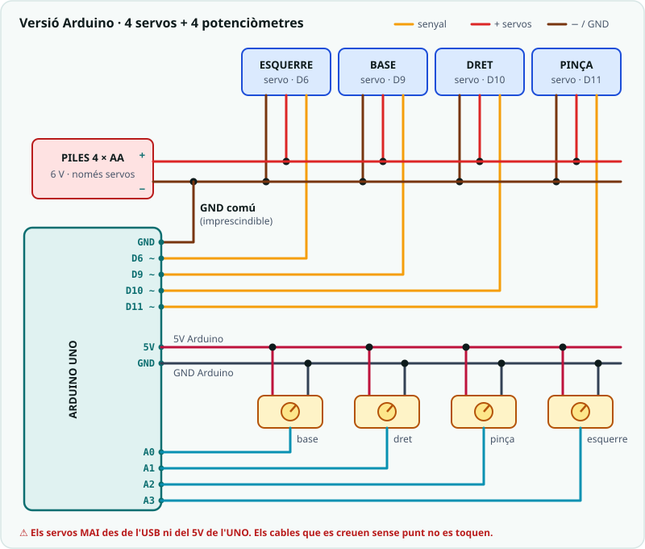

# SA4 · Qüestionari de conceptes (MeArm: servos, sensors i moviment)

> 🧑‍🎓 **Quan toca fer-lo?** En acabar les activitats de la SA, com a **consolidació** abans de repassar el checklist d'entrega — i torna-hi com a **repàs** abans de la prova T2 (la sessió 4 de la SA6). Si es fa com a prova curta qualificable, el docent anunciarà el dia.

> **Ús.** Comprovació breu dels conceptes de moviment de la SA4 sobre el braç MeArm (servo, rang segur, pont H, sensor → moviment, `millis()`).
> Es pot fer servir com a **repàs formatiu** o com a **prova curta qualificable**
> (10 preguntes × 1 punt = **nota 0-10**). Durada orientativa: **15-20 min**, individual.

> **📲 Fes-lo al Classroom.** Aquest qüestionari és una **tasca
> autocorrectiva** al Google Classroom del curs, al tema **MeArm**:
> **[obre «SA4 · Qüestionari de conceptes (MeArm)»](https://classroom.google.com/c/ODY4ODU4Njk0NTEy)**
> (cal el compte del centre). Aquesta pàgina és la versió per repassar
> o fer en paper; les solucions són al full del docent.

**Nom:** ______________________  **Grup:** __________  **Data:** __________

---

## Preguntes (tria una resposta)

1. Quina és la diferència principal entre un **servomotor** (les articulacions del braç) i un **motor DC**?
   - a) No n'hi ha cap, són el mateix.
   - b) El motor DC controla l'angle exacte i el servo gira sense parar.
   - c) El servo controla la *posició* (angle 0-180°); el motor DC fa un gir continu.
   - d) El servo només funciona amb piles i el motor DC amb USB.

2. Quina **llibreria** cal incloure per controlar els servos del braç a l'Arduino?
   - a) `Servo.h`
   - b) `Ultrasonic.h`
   - c) `Wire.h`
   - d) No cal cap llibreria.

3. Al **pas 0** del muntatge, la instrucció `servo.write(90);` serveix per…
   - a) Fer girar el servo 90 voltes.
   - b) Esperar 90 mil·lisegons.
   - c) Llegir el valor del pin 90.
   - d) Deixar el servo al centre del recorregut abans de posar-hi la banya.

4. Per què els **quatre servos** del braç van a les **piles** i no al pin 5V de l'Arduino?
   - a) Perquè els servos només funcionen amb 6 V exactes.
   - b) Perquè junts demanen més corrent del que l'USB i el 5V de l'UNO poden donar; el − de les piles s'uneix al GND de l'Arduino.
   - c) Perquè així no cal connectar cap GND.
   - d) Perquè el pin 5V només serveix per als LEDs.

5. Al braç, `map(analogRead(A0), 0, 1023, BASE_MIN, BASE_MAX)` converteix al **rang segur** i no a 0-180. Per què?
   - a) Perquè `map()` no accepta el número 180.
   - b) Perquè així el servo va més ràpid.
   - c) Perquè el servo no arribi mai al topall de la peça, on faria força i s'escalfaria.
   - d) Perquè el potenciòmetre només dona valors fins a 150.

6. Què aconsegueix la **zona morta** del producte de la SA4 (`abs(nou - actual) > ZONA_MORTA`)?
   - a) Que el braç no tremoli pel soroll del potenciòmetre.
   - b) Que el braç vagi el doble de ràpid.
   - c) Que el servo no necessiti alimentació.
   - d) Que el potenciòmetre llegeixi de 0 a 180.

7. Per què el motor DC necessita un **pont H** (L298N) i no es connecta directament a un pin?
   - a) Perquè el pin cremaria l'USB.
   - b) Un pin dona poc corrent; el driver l'amplifica amb una alimentació externa i permet invertir el sentit.
   - c) Perquè el motor només entén senyals analògics.
   - d) No cal: es pot connectar directament.

8. Al pont H, què decideixen els senyals `IN1` i `IN2`?
   - a) La velocitat del motor.
   - b) L'alimentació de l'Arduino.
   - c) La distància de l'ultrasons.
   - d) El sentit de gir del motor.

9. A la SA3 l'ultrasons anava als pins 12/11. Per què al braç passa al **D7/D8**?
   - a) Perquè el D11 és ara el servo de la pinça.
   - b) Perquè el 12 i l'11 no funcionen amb servos.
   - c) Perquè el D7 i el D8 són més ràpids.
   - d) Perquè l'ultrasons necessita pins PWM.

10. Per què `05_dos_servos_millis` fa servir `millis()` en lloc de `delay()`?
    - a) Perquè `delay()` no existeix a l'Arduino UNO.
    - b) Perquè `millis()` mou els servos més lluny.
    - c) Perquè `delay()` atura tot el programa i les dues articulacions no es podrien moure alhora.
    - d) Perquè `millis()` estalvia piles.

---

## Pregunta oberta (opcional)

11. Explica què fa la funció `mouSiCal(Servo &servo, int &actual, int nou)` del producte de la SA4 i per què porta el símbol `&` als paràmetres.

___________________________________________________________________

___________________________________________________________________

---

*Qüestionari de conceptes de la SA4, orientat al braç MeArm. Es recolza en `SA4_fitxa_alumnat.md`, `SA4_guia_docent.md`, `SA4_esquemes_connexions.md` i el dossier del braç.
Llicència CC BY-SA 4.0.*
