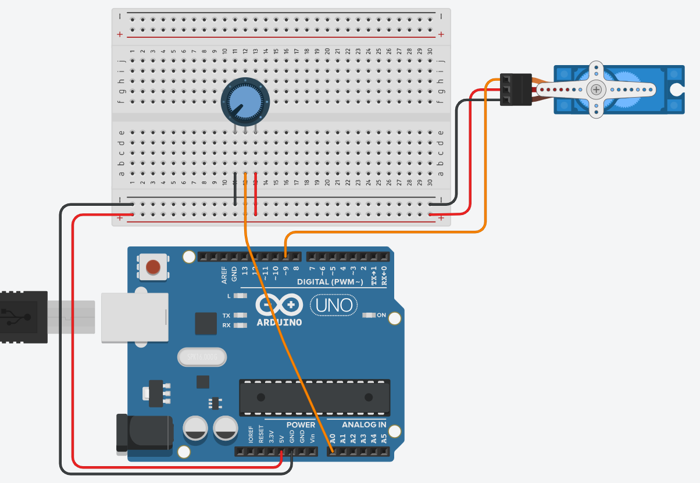

# Pràctica 1 · Servo amb potenciòmetre: posició amb una llibreria

<div class="cap-practica" markdown="1">

🎯 **Avui aconseguiràs:** que el servo de la **base del braç** segueixi el potenciòmetre, i deixar els quatre servos del MeArm a punt per muntar-los.

⏱️ La sessió (pràctica + torn de taller de 35')

📦 1 servo, 1 potenciòmetre, cables i les peces dels blocs A-B del MeArm

</div>

## 🚀 Pas a pas

### Pas 1 · Kata primer

✍️ **Kata primer!** No llegeixis encara el codi: obre el [kata d'aquesta pràctica](../../SA4_katas.md) i tens **10 minuts** per escriure el teu bloc (individual, apunts permesos). Després torna aquí i **compara**.

✅ **Comprova:** has escrit el teu bloc **abans** de mirar el codi d'aquesta pràctica.

### Pas 2 · Endevina abans de provar

Desplega el codi complet del pas 4 i mira'l sense carregar-lo: què farà el servo quan **giris el potenciòmetre a poc a poc**? On apuntarà amb el potenciòmetre al mínim (0) i al màxim (1023)?

✍️ **Apunta-ho:** PREDIU: què farà el servo de la base en girar el potenciòmetre?

### Pas 3 · Munta el circuit

Servo de la base: senyal (taronja o groc) al **pin 9**, vermell a **5V** i marró a **GND**. Potenciòmetre: la pota del mig a **A0** i les altres dues a 5V i GND.



✅ **Comprova:** el cable de senyal del servo és al 9 i la pota del mig del potenciòmetre, a A0.

### Pas 4 · Carrega el codi

Prem **Copia**, enganxa'l a l'Arduino IDE (esborra el que hi hagués) i prem **→ Puja**.

<!-- codi-complet -->

✅ **Comprova:** quan gires el potenciòmetre, el servo gira amb ell. Has encertat la predicció?

### Pas 5 · Busca els números

Al codi, mira la línia del `map(...)` i la del `servo.write(...)`.

✍️ **Apunta-ho:** rang d'angles de `write()`: de ____ a ____ graus.

✍️ **Apunta-ho:** quina funció reescala 0-1023 → 0-180?

✍️ **Apunta-ho:** quin és el concepte nou més important d'aquesta pràctica?

### Pas 6 · Torn de taller: el pas 0 del MeArm

Abans de muntar res, els **quatre servos** del braç han de quedar al centre
del recorregut (90°): si una banya es posa amb el servo en una altra posició,
després cal desmuntar mig braç. Fes-ho amb aquest mateix sketch:

1. Canvia `servo.write(angle);` per `servo.write(90);`.
2. Connecta els servos **un per un** al pin 9 (amb un sol servo, n'hi ha
   prou amb l'USB) i deixa'ls tots a 90°.
3. Enganxa una **etiqueta** a cada servo (base, esquerre, dret, pinça) i no
   els tornis a moure amb la mà.

Després, segueix els blocs A i B de la [guia de muntatge](../../../00_General/00_Muntatge_brac_MeArm.md).

✅ **Comprova:** els quatre servos són a 90°, etiquetats (base, esquerre, dret, pinça), i has fet els blocs A i B.

### Pas 7 · Respon i envia

📤 [Obre la tasca «SA4 · Pràctica 1» a Classroom i envia el formulari](https://classroom.google.com/c/ODY4ODU4Njk0NTEy/a/ODk3NDMwNTg3MDY3/details)

Hi trobaràs les mateixes preguntes ✍️ que has anat apuntant. Envia'l ara. A la sessió següent: **[Pràctica 2 · Motor DC i pont H](../02_motor_pont_h/EXPLICACIO.md)**.

⭐ **Si acabes abans:** fes que el servo faci una **escombrada** automàtica (de 0° a 180° i tornar) i explica-ho a la pregunta opcional del formulari. Guarda-la: la faràs servir per calibrar la pinça. Més reptes a **[Reptes de la SA4](../../../../Reptes/Reptes_SA4.md)**; quan el docent te'l validi, pinta l'estrella al [tauler de reptes](../../../00_General/00_Tauler_reptes.md).

<details markdown="1">
<summary>🧗 Si t'encalles</summary>

| Símptoma | Causa probable |
|---|---|
| El servo vibra o no arriba a l'angle | Alimentació insuficient: si mous més d'un servo (o el servo fa força), alimentació **externa** de 5 V amb **massa comuna**. |
| El servo no es mou gens | Falta `servo.attach(9)` al `setup()`, o el cable de senyal (taronja/groc) no és al pin 9. |
| El servo salta a llocs "aleatoris" | El cursor del potenciòmetre (pota central) no és a A0, o un extrem del potenciòmetre està desconnectat. |

</details>

<details markdown="1">
<summary>🧠 Vols saber per què funciona?</summary>

### Per què fem aquesta pràctica

Fins ara les teves sortides eren LEDs: encendre, apagar, graduar. Avui el sistema **es mou**, i no qualsevol cosa: el servo d'avui és el de la **base del teu braç MeArm**, el robot que construiràs i programaràs tot el trimestre. I la primera distinció del dia és la important: un **servo** no és un motor que gira i gira — és un motor que va a la **posició** que li demanes (un angle de 0 a 180°) i s'hi queda. Per això els braços robòtics en porten un a cada articulació: importa *on* és el braç, no *com de ràpid* gira el motor.

També estrenes una eina nova: una **llibreria** (`Servo.h`). Controlar un servo "a pèl" voldria dir generar polsos elèctrics amb una precisió de microsegons; la llibreria ho fa per tu i et deixa una ordre llegible: `write(angle)`. Aprofitar codi ja escrit i provat és com treballen els programadors de veritat.

I el tercer ingredient és el circuit sencer llegit com una **cadena entrada → càlcul → sortida**: el potenciòmetre (entrada, com a la SA3) dona un número, `map()` el converteix, i el servo (sortida) es mou. Aquesta cadena és l'esquema de tot el que faràs d'ara endavant.

### Bloc 1 — La llibreria i l'objecte servo

```cpp
#include <Servo.h>

Servo servo;
const int POT = A0;
```

Pensa en el comandament del televisor: prems «pujar volum» i no tens ni idea de quins senyals infrarojos surten volant — algú va resoldre aquesta part per tu i et va deixar els botons. Una **llibreria** és exactament això: codi que algú altre ja ha escrit i provat. `#include <Servo.h>` diu al compilador: *afegeix al meu programa tot el codi de la llibreria Servo*, i a partir d'aquí controlar el servo són "botons" llegibles (`attach`, `write`), no polsos de microsegons.

I el comandament, on és? És l'**objecte**: `Servo servo;` crea la "maneta" amb què donaràs ordres al servo físic (aquí li hem dit `servo`, però podria dir-se `barrera` o `brac`).

### Bloc 2 — Dir-li on és connectat

```cpp
void setup() {
  servo.attach(9);     // el servo esta connectat al pin 9
}
```

Un comandament acabat de treure de la capsa no mou cap televisor: primer l'has d'**aparellar** amb el teu aparell. `attach(9)` fa exactament això: lliga l'objecte `servo` amb el pin físic on has punxat el cable de senyal. Fixa-t'hi: per al servo **no cal `pinMode()`** — la llibreria se n'encarrega. I si t'oblides de l'`attach()`? El programa compila perfectament… i el servo no es mou mai: estàs prement botons d'un comandament sense aparellar. És l'oblidat clàssic del dia.

### Bloc 3 — La cadena entrada → càlcul → sortida

```cpp
void loop() {
  int valor = analogRead(POT);          // 0..1023
  int angle = map(valor, 0, 1023, 0, 180);  // 0..180 graus
  servo.write(angle);
  delay(15);           // petita pausa perque el servo arribi
}
```

Això és la dutxa de casa: tu gires la maneta (entrada), el mesclador converteix el gir en barreja d'aigua freda i calenta (càlcul), i surt l'aigua a la temperatura demanada (sortida). Aquí, tres línies, tres feines:

- `analogRead(POT)` llegeix el potenciòmetre: un número de **0 a 1023** (el conversor analògic de la SA3). És la maneta.
- `map(valor, 0, 1023, 0, 180)` **tradueix**: el potenciòmetre parla en 0..1023 i el servo en graus 0..180 — dos "idiomes" que no coincideixen. `map()` fa la regla de tres per tu. És el mesclador.
- `servo.write(angle)` demana la **posició**: 0° un extrem, 90° el centre, 180° l'altre extrem. Si demanes més de 180, el servo satura a 180 i prou. És l'aigua que surt.

I el `delay(15)` final? Pensa en una porta de garatge: l'ordre d'obrir és instantània, però la porta triga uns segons a arribar a dalt. El servo igual: la pausa li dona temps a moure's cap a la posició demanada abans de rebre la següent ordre. No és instantani: és mecànica, no electrònica.

### On ho aplicaràs

- **Ara mateix:** el repte de la S1 és l'"escombrada" automàtica (vaivé d'un extrem a l'altre) — mateix servo, però l'angle el genera un `for`, no el potenciòmetre. **Guarda-la**: a la S2 la faràs servir per calibrar la pinça del braç.
- **A la S4:** el [braç amb quatre potenciòmetres](../04_brac_potenciometres/EXPLICACIO.md) és aquesta pràctica multiplicada per quatre.
- **Al robot del trimestre:** el mapa de pins de tot el braç és al [dossier](../../../00_General/00_Projecte_T2_Brac.md#cablatge).

</details>
