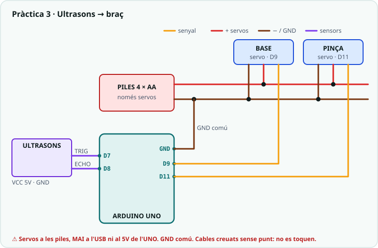

# Pràctica 3 · Del sensor al moviment: l'ultrasons mou el braç

<div class="cap-practica" markdown="1">

🎯 **Avui aconseguiràs:** que el braç **decideixi sol**: quan poses un objecte a l'estació de recollida, la base s'hi gira i la pinça s'obre.

⏱️ La sessió (pràctica + torn de taller del bloc E)

📦 L'ultrasons HC-SR04, els servos de la base i la pinça, el portapiles i cables

</div>

## 🚀 Pas a pas

### Pas 1 · Kata primer

✍️ **Kata primer!** No llegeixis encara el codi: obre el [kata d'aquesta pràctica](../../SA4_katas.md) i tens **10 minuts** per escriure el teu bloc (individual, apunts permesos). Després torna aquí i **compara**.

✅ **Comprova:** has escrit el teu bloc **abans** de mirar el codi d'aquesta pràctica.

### Pas 2 · Endevina abans de provar

Desplega el codi complet del pas 4 i mira només el `loop()`.

✍️ **Apunta-ho:** PREDIU: què farà el braç amb la mà a 10 cm? I a 30 cm?

### Pas 3 · Munta el circuit

Servo de la base al **9** i de la pinça a l'**11**, alimentats amb el **portapiles**. Ultrasons: **TRIG al 7** i **ECHO al 8** (el D11 ara és la pinça), VCC a 5V i GND a GND.



✅ **Comprova:** el GND del portapiles i el de l'Arduino estan units (massa comuna).

### Pas 4 · Carrega el codi

Prem **Copia**, enganxa'l a l'Arduino IDE (esborra el que hi hagués) i prem **→ Puja**.

<!-- codi-complet -->

✅ **Comprova:** quan poses la mà a prop de l'ultrasons, la base gira i la pinça s'obre; quan la treus, el braç torna a repòs.

### Pas 5 · Mesura i mira què fa

Obre el **Serial Plotter** (Eines → Serial Plotter, 9600) i posa un objecte a 5 cm, a 15 cm (just al llindar) i a 30 cm.

✍️ **Apunta-ho:** distància mesurada i què fa el braç amb l'objecte a 5 cm, a 15 cm i a 30 cm.

✍️ **Apunta-ho:** què és la massa comuna i per què és important?

### Pas 6 · Torn de taller: l'estructura central (bloc E)

Segueix el bloc E de la [guia de muntatge](../../../00_General/00_Muntatge_brac_MeArm.md). El pas 15 es fa **en parella**.

✅ **Comprova:** el bloc E està muntat i els servos encara són al seu angle.

### Pas 7 · Respon i envia

📤 [Obre la tasca «SA4 · Pràctica 3» a Classroom i envia el formulari](https://classroom.google.com/c/ODY4ODU4Njk0NTEy/a/ODk3NDMwMDI1NTA5/details)

Hi trobaràs les mateixes preguntes ✍️ que has anat apuntant. Envia'l ara. A la sessió següent: **[Pràctica 4 · El braç amb potenciòmetres](../04_brac_potenciometres/EXPLICACIO.md)**.

⭐ **Si acabes abans:** fes que la pinça s'obri **proporcionalment** a la distància amb `map()`, amb una guarda de seguretat, i explica-ho a la pregunta opcional del formulari. O prova la [bastida de `millis()`](../05_dos_servos_millis/EXPLICACIO.md): dues articulacions alhora. Més reptes a **[Reptes de la SA4](../../../../Reptes/Reptes_SA4.md)**; quan el docent te'l validi, pinta l'estrella al [tauler de reptes](../../../00_General/00_Tauler_reptes.md).

<details markdown="1">
<summary>🧗 Si t'encalles</summary>

| Símptoma | Causa probable |
|---|---|
| La distància sempre val 400 | TRIG i ECHO intercanviats, o l'ultrasons sense 5V. |
| La distància sempre val 0 o salta a l'atzar | L'ECHO no és al D8, o el GND de l'ultrasons no és comú amb l'Arduino. |
| El braç tremola quan es mou | Servos alimentats des de l'USB: han d'anar a les **piles**, amb GND comú. |
| El braç «balla» amb l'objecte a prop del llindar | Soroll de la mesura just al llindar: ho arreglaràs amb histèresi a la SA6. Mentrestant, allunya o acosta l'objecte. |

</details>

<details markdown="1">
<summary>🧠 Vols saber per què funciona?</summary>

### Per què fem aquesta pràctica

Fins ara el braç feia el que li manaves amb la mà (el potenciòmetre). Avui fa
el primer pas cap a un robot de debò: **decideix ell sol** a partir del que
percep. A la taula hi ha l'**estació de recollida**, el lloc on deixes els
objectes que el braç ha d'agafar, i un ultrasons que la vigila. Quan hi poses
un objecte, el braç **s'hi gira i obre la pinça** per rebre'l. Quan el treus,
torna a repòs.

És la cadena **percepció → decisió → acció** que fan servir tots els robots
industrials: un sensor detecta la peça a la cinta i el braç la va a buscar.
Avui coneixes un sensor nou, l'**ultrasons** (HC-SR04), i la teva primera
funció que **et torna un número**: `mesuraDistancia()`. Amb ella el braç sap a
quina distància és l'objecte.

### Bloc 1 — Les constants de disseny

```cpp
const int TRIG = 7;
const int ECHO = 8;

const int DIST_OBJECTE = 15;     // cm: mes a prop = hi ha un objecte
const int BASE_REPOS = 90;       // angle de la base mirant endavant
const int BASE_ESTACIO = 45;     // angle de la base mirant l'estacio
const int PINCA_TANCADA = 60;
const int PINCA_OBERTA = 120;
```

Abans de cuinar, el cuiner deixa a punt els ingredients mesurats al marbre.
Aquí, igual: cada número que decideix com es comporta el braç té **nom propi**
a dalt de tot. Si l'estació és més a la dreta, canvies `BASE_ESTACIO` i prou;
no has de buscar el `45` enmig del codi.

Fixa't en els pins: el **D11 és el servo de la pinça**, i per això l'ultrasons
va al **D7/D8**
(mapa de pins al [dossier](../../../00_General/00_Projecte_T2_Brac.md#cablatge)).

### Bloc 2 — Mesurar: el sensor és un ratpenat, i la funció et torna un número

**Com a la vida real:** els ratpenats fan un crit tan agut que nosaltres no el
sentim. El so xoca contra les coses i torna: és l'**eco**. Com més triga a
tornar, més lluny és la cosa. El sensor fa el mateix amb els seus dos «ulls»:
un **crida** (TRIG, una sortida) i l'altre **escolta l'eco** (ECHO, una entrada).

**Una funció que et torna un número:** preguntes a algú «a quina distància és
la paret?» i et **respon** amb un número, sense explicar-te com ho ha mesurat.
A la SA2 vas fer `color()`, que **feia** una feina; `mesuraDistancia()` fa la
feina i, a més, **et torna el resultat** amb `return`. La paraula `float` del
davant vol dir que tornarà un número amb decimals (els centímetres).

```cpp
float mesuraDistancia() {
  digitalWrite(TRIG, LOW);
  delayMicroseconds(2);
  digitalWrite(TRIG, HIGH);     // pols de 10 us
  delayMicroseconds(10);
  digitalWrite(TRIG, LOW);

  long temps = pulseIn(ECHO, HIGH, 30000);  // timeout 30 ms
  if (temps == 0) return 400;               // sense eco: res a la vista
  return temps * 0.034 / 2.0;               // cm
}
```

Un ratpenat crida i escolta quant triga a tornar l'eco. L'ultrasons fa el
mateix: un pols de 10 µs al `TRIG`, i `pulseIn()` mesura quant dura el retorn
a l'`ECHO`. El so fa 0,034 cm per microsegon i va i torna, d'aquí el `/ 2`.
El `timeout` de 30 ms evita que el programa es quedi esperant si no hi ha
eco: llavors la funció diu «400 cm», que vol dir *res a la vista*.

### Bloc 3 — Decidir i actuar

```cpp
void loop() {
  float d = mesuraDistancia();
  Serial.println(d);              // mira-ho al Serial Plotter

  if (d < DIST_OBJECTE) {
    base.write(BASE_ESTACIO);
    pinca.write(PINCA_OBERTA);
  } else {
    base.write(BASE_REPOS);
    pinca.write(PINCA_TANCADA);
  }

  delay(100);                     // ~10 mesures per segon
}
```

Un sensor, una pregunta (`d < DIST_OBJECTE`?), dues respostes. És un
**control tot o res**: o objecte o no-objecte, sense terme mig. Obre el
**Serial Plotter** mentre hi acostes la mà: veuràs la distància baixant i el
moment exacte en què el braç decideix girar-se.

> 🔭 **Fixa-t'hi:** què passa si l'objecte queda **just a 15 cm**? El braç fa
> un ball: gira, torna, gira… Les mesures sempre tenen una mica de soroll.
> Aquest problema té nom i solució, i el resoldràs a la SA6 amb la
> **histèresi** de la pinça automàtica.

### On ho aplicaràs

- **Repte de la S3:** que l'obertura de la pinça sigui **proporcional** a la distància amb `map()` (com més a prop, més oberta) i una **guarda de seguretat**: si l'objecte és a menys de 3 cm, el braç no es mou.
- **A la SA6:** la [pinça automàtica amb histèresi](../../../SA6/codi/02_pinca_histeresi/EXPLICACIO.md) és aquest mateix muntatge amb dos llindars en lloc d'un.
- **Al braç:** l'ultrasons es queda muntat a l'estació de recollida tot el trimestre ([dossier](../../../00_General/00_Projecte_T2_Brac.md)).

</details>
