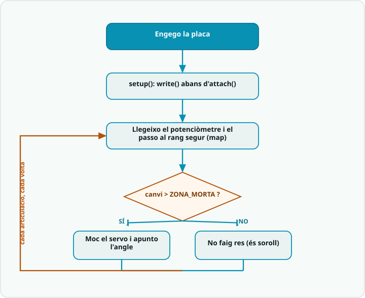

# Pràctica 4 · Producte: el braç amb quatre potenciòmetres

<div class="cap-practica" markdown="1">

🎯 **Avui aconseguiràs:** moure el teu **MeArm** amb quatre potenciòmetres, cada servo dins del seu rang segur. És el producte de la SA4.

⏱️ Tota la sessió

📦 El MeArm muntat, 4 potenciòmetres, el portapiles i cables

</div>

## 🚀 Pas a pas

### Pas 1 · Kata primer

✍️ **Kata primer!** Si avui encara no has fet cap kata (ni el mini-check), obre el [kata d'aquesta pràctica](../../SA4_katas.md): 10 minuts per escriure el teu bloc abans de llegir aquest codi. Si ja l'has fet, endavant.

✅ **Comprova:** has escrit el teu bloc **abans** de mirar el codi d'aquesta pràctica.

### Pas 2 · Dissenya abans de programar

Abans d'obrir l'editor, escriu el **pseudocodi** del control d'una articulació (3-5 línies): què llegeixes, com ho converteixes i què fas amb el servo. T'ajuda el [diagrama de flux](../../SA4_diagrama_flux.md).



✍️ **Apunta-ho:** el teu pseudocodi del control d'una articulació (3-5 línies).

### Pas 3 · Munta el cablatge definitiu

Servos: **base al 9**, **esquerre al 6**, **dret al 10** i **pinça a l'11**, tots alimentats amb el **portapiles** i amb el GND unit al de l'Arduino. Potenciòmetres (la pota del mig): **base → A0**, **dret → A1**, **pinça → A2** i **esquerre → A3**. Fixa't que l'esquerre va a l'A3.

✅ **Comprova:** massa comuna feta i cap servo connectat al 5V de l'Arduino.

### Pas 4 · Carrega el codi

Prem **Copia**, enganxa'l a l'Arduino IDE (esborra el que hi hagués) i prem **→ Puja**.

<!-- codi-complet -->

✅ **Comprova:** cada potenciòmetre mou el seu servo, i el braç no fa salts en arrencar.

### Pas 5 · Troba els angles límit

Obre el **Monitor sèrie** (9600): hi surten els angles de cada servo. Posa a les constants del principi del codi (`BASE_MIN`, `BASE_MAX`…) els angles límit que vas trobar al calibratge del bloc D, torna'l a pujar i comprova, articulació per articulació, que arriba als extrems sense forçar el topall.

✍️ **Apunta-ho:** angles límit (mínim i màxim) de la base, l'esquerre, el dret i la pinça.

✍️ **Apunta-ho:** com has trobat aquests angles límit i com saps que el servo no força el topall?

### Pas 6 · Tria la zona morta

Prova `ZONA_MORTA = 0` i després un valor més gran. Què passa amb el servo quan no toques el potenciòmetre?

✍️ **Apunta-ho:** zona morta triada (°) i per què.

### Pas 7 · Prepara la defensa d'1 minut

Pensa què diràs: com funciona i **una decisió tècnica** (per què aquests angles límit). S'avalua amb R1, R2 i R3.

✅ **Comprova:** ho saps explicar en 1 minut sense llegir.

✍️ **Apunta-ho:** un error que has trobat i com l'has resolt.

### Pas 8 · Respon i envia

📤 [Obre la tasca «SA4 · Pràctica 4» a Classroom i envia el formulari](https://classroom.google.com/c/ODY4ODU4Njk0NTEy/a/ODk3NDI5ODc5MTk4/details)

Hi trobaràs les mateixes preguntes ✍️ que has anat apuntant. Envia'l ara. Després, fes l'**[🏁 Entrega final de la SA4](../../README.md#entrega-final)**: la defensa d'1 minut i l'autoavaluació.

⭐ **Si acabes abans:** afegeix un botó que guardi una **posició** del braç i la repeteixi. Més reptes a **[Reptes de la SA4](../../../../Reptes/Reptes_SA4.md)**; quan el docent te'l validi, pinta l'estrella al [tauler de reptes](../../../00_General/00_Tauler_reptes.md).

<details markdown="1">
<summary>🧗 Si t'encalles</summary>

| Símptoma | Causa probable |
|---|---|
| Un servo brunz i s'escalfa quiet | Força contra el topall: el teu `_MIN` o `_MAX` és massa ample. Torna a mesurar. |
| El braç tremola encara que no toquis res | Servos a l'USB (han d'anar a les piles amb GND comú) o `ZONA_MORTA` massa petita. |
| Un potenciòmetre mou el servo que no toca | Cursor connectat a l'entrada analògica equivocada. Comprova A0-A3 amb el Monitor sèrie. |
| El servo va al revés del potenciòmetre | Normal: depèn de com és muntat. Intercanvia `_MIN` i `_MAX` en el `llegeixAngle()` d'aquell servo. |

</details>

<details markdown="1">
<summary>🧠 Vols saber per què funciona?</summary>

### Per què fem aquesta pràctica

El MeArm ja és muntat. Avui li dones el primer control complet: **quatre
potenciòmetres, quatre articulacions**, com el comandament de sobretaula
d'una grua. És la pràctica de la S1 multiplicada per quatre, però amb tres
idees noves que separen un braç que funciona d'un braç que es crema:

1. **Rang segur:** cada servo té els seus **angles límit** (els has anotat
   al taller). Si li demanes més, la peça toca el topall i el servo s'escalfa
   fent força. Per això `map()` ja no va a 0-180, sinó al rang de cada servo.
2. **Zona morta:** el potenciòmetre té soroll. Si el servo obeeix cada canvi
   d'1°, el braç tremola. Només el movem quan el canvi és prou gran.
3. **Funcions amb paràmetres:** quatre servos amb el mateix codi copiat quatre
   vegades és la recepta per equivocar-se. Una funció fa la feina i la
   crides quatre cops.

### Bloc 1 — Pins i rangs segurs

```cpp
const int PIN_SERVO_BASE = 9;
const int PIN_SERVO_ESQUERRE = 6;   // servo nou del MeArm
const int PIN_SERVO_DRET = 10;      // ocupa el lloc del colze del brac de 3 servos
const int PIN_SERVO_PINCA = 11;

const int BASE_MIN = 0,      BASE_MAX = 180;
const int ESQUERRE_MIN = 40, ESQUERRE_MAX = 150;
const int DRET_MIN = 40,     DRET_MAX = 150;
const int PINCA_MIN = 60,    PINCA_MAX = 120;   // tancada .. oberta
```

El cotxe d'autoescola té un segon pedal de fre al costat del professor: per
molt que l'alumne s'equivoqui, hi ha un límit que no es pot passar. Aquestes
constants són aquell fre. **Canvia-les pels angles que has anotat** al bloc D
del muntatge: els valors d'aquí són d'exemple i el teu braç és únic.

### Bloc 2 — Dues funcions per a quatre servos

```cpp
int llegeixAngle(int pinPot, int minim, int maxim) {
  return map(analogRead(pinPot), 0, 1023, minim, maxim);
}

void mouSiCal(Servo &servo, int &actual, int nou) {
  if (abs(nou - actual) > ZONA_MORTA) {
    actual = nou;
    servo.write(actual);
  }
}
```

`llegeixAngle()` és la cadena de la S1 (llegir → traduir) empaquetada: li dius
quin potenciòmetre i quin rang, i et torna l'angle.

`mouSiCal()` porta un detall nou: el `&`. Normalment, quan passes una variable
a una funció, la funció en rep una **fotocòpia**: si la canvia, l'original no
se n'assabenta. Amb `&` li passes **l'original**. Aquí cal, perquè la funció
ha de poder actualitzar l'angle guardat (`actual = nou`) i el servo de veritat.
I l'`abs(nou - actual) > ZONA_MORTA` és la zona morta: si el canvi és de 1 o
2 graus, és soroll i no fem res.

### Bloc 3 — Arrencar sense saltar

```cpp
  angleBase = llegeixAngle(PIN_POT_BASE, BASE_MIN, BASE_MAX);
  // ... igual per als altres tres ...
  base.write(angleBase);
  // ...
  base.attach(PIN_SERVO_BASE);
```

Si fas `attach()` primer, el servo s'engega a 90° i, una mil·lèsima després,
salta on diu el potenciòmetre: un cop sec que pot fer caure el que aguanta la
pinça. Fent el `write()` **abans** de l'`attach()`, el servo s'engega
directament a la posició bona.

### Bloc 4 — El `loop()` i l'informe

```cpp
void loop() {
  mouSiCal(base, angleBase, llegeixAngle(PIN_POT_BASE, BASE_MIN, BASE_MAX));
  // ... esquerre, dret i pinca ...

  if (millis() - tDarrerInforme > 500) {
    tDarrerInforme = millis();
    Serial.print("base=");
    // ...
  }
  delay(20);
}
```

Quatre línies, quatre articulacions: el `loop()` es llegeix sol. I l'informe
al **Monitor sèrie** fa servir `millis()` en lloc de `delay(500)`: si
s'esperés mig segon, el braç també reaccionaria cada mig segon. És el mateix
truc de la [bastida de la S3](../05_dos_servos_millis/EXPLICACIO.md).

### On ho aplicaràs

- **Reptes de la SA4:** el [repte B](../../../../Reptes/Reptes_SA4.md) converteix aquest braç en un dispensador automàtic, i el C li dona memòria (gravar i reproduir).
- **A la SA5:** els potenciòmetres es queden, però hi arriba un **comandament per ràdio** que fa la mateixa feina sense fils.
- **A la SA6:** la màquina d'estats del braç fa servir aquest control com a mode **manual**.

</details>
