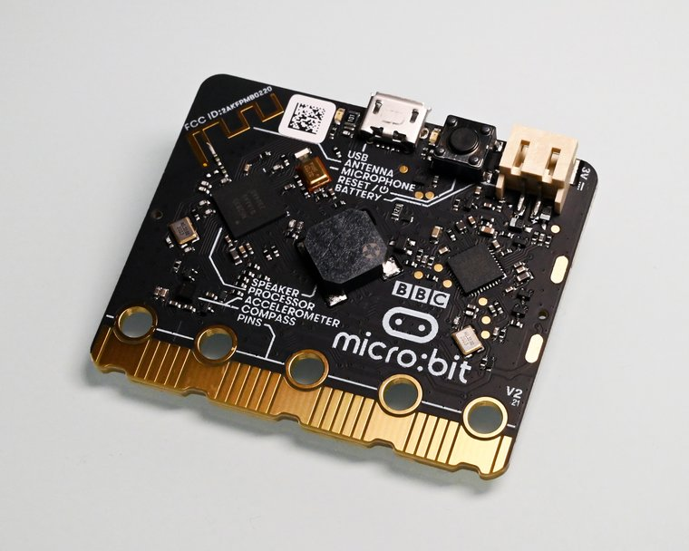

# SA5 · micro:bit i MicroPython: un altre paradigma

Cinquena situació d'aprenentatge (**6 h · 3 sessions** + 4a opcional d'ampliació, 2n trimestre). **Canvi de plataforma i de llenguatge**: de l'Arduino (C/C++) a la **micro:bit** amb **MicroPython**. I tot serveix per a una cosa: el **comandament sense fils del teu braç MeArm**. Es treballen la matriu LED i els botons (el selector), l'**acceleròmetre** (la inclinació com a gest), la **comunicació per ràdio** (el comandament i el pont cap a l'Arduino del braç) i una **comparació explícita C/C++ ↔ Python** (el mateix protocol d'ordres en tots dos llenguatges). Programació oficial: [`Programació didàctica/14_SA5_microbit_micropython.md`](../../Programació%20didàctica/14_SA5_microbit_micropython.md).

> *Fotografia: micro:bit, per [SimonWaldherr](https://commons.wikimedia.org/wiki/File:Bbc_micro_bit.jpg) — llicència [CC BY-SA 4.0](https://creativecommons.org/licenses/by-sa/4.0/).*

En acabar aquesta SA podràs: 1) escriure programes en **MicroPython** ben indentats per a la micro:bit; 2) fer servir l'**acceleròmetre** amb un llindar; 3) comunicar dues plaques per **ràdio** i moure el teu braç a distància; 4) comparar el mateix programa en **C++ i Python**.

> 💻 **Com carregar el codi d'una pràctica:** dins de la pràctica, al pas «Carrega el codi», prem **Copia** i enganxa'l a l'editor **[python.microbit.org](https://python.microbit.org)** (micro:bit) o a l'Arduino IDE (la Pràctica 3, del braç).

## 🧭 La teva ruta

Fes les pràctiques **en ordre i al teu ritme**. Cada pràctica comença amb el **kata** (10') i acaba enviant el seu formulari de Classroom. Les 🚩 et diuen on hauries de ser al final de cada sessió.

- ① [Pràctica 1 · El selector d'articulació](codi/01_selector_articulacio_EXPLICACIO.md) — el teu primer MicroPython: la micro:bit tria quina articulació mouràs.

🚩 **Final de la Sessió 1:** formulari de la ① enviat i el full del 📓 quadern de la sessió omplert.

- ② [Pràctica 2 · La inclinació com a gest](codi/02_inclinacio_EXPLICACIO.md) — l'acceleròmetre converteix la inclinació en un gest.
- ③ [Pràctica 3 · El braç obeeix ordres](codi/04_brac_ordres/EXPLICACIO.md) — **taller:** l'Arduino del MeArm obeeix ordres escrites al Monitor sèrie.

🚩 **Final de la Sessió 2:** formularis de la ② i la ③ enviats, el braç obeint ordres i el full del 📓 quadern omplert.

- ④ [Pràctica 4 · Ràdio: el comandament del braç](codi/03_radio_comandament_EXPLICACIO.md) — el producte: el comandament, el pont cap al braç i la comparació C++ ↔ Python.

🚩 **Final de la Sessió 3:** formulari de la ④ enviat, **Entrega final** feta i el full del 📓 quadern omplert.

> 🧩 **Sessió 4 (opcional, d'ampliació):** reptes ⭐ de la SA5 o millores del comandament.

## 🏁 Entrega final

**Quan hagis acabat la ④:**

1. 🎤 **Defensa d'1 minut** davant del docent: el braç movent-se amb el comandament i una diferència entre C++ i Python. S'avalua amb **R1** (codi) i **R4** (comparació).
2. 📤 Respon i envia l'[Entrega final de la SA5](https://classroom.google.com/c/ODY4ODU4Njk0NTEy/a/ODk3NDM3MjAxNDEy/details): autoavaluació i checklist final.

> ✅ **Versió nucli** (per aprovar n'hi ha prou amb): el comandament mou almenys una articulació del braç per ràdio, i la taula comparativa C++ ↔ Python és completa.

## 📦 Què has d'entregar

| Quan | Què | On |
|---|---|---|
| S1 | Formulari de la Pràctica 1 | Una tasca de Classroom per pràctica (enllaç a l'últim pas de cada pràctica) |
| S2 | Formularis de les Pràctiques 2 i 3 | Les tasques de Classroom de les pràctiques |
| S3 | Formulari de la Pràctica 4 + **el comandament** i defensa d'1' + **Entrega final** | A l'aula i a Classroom. S'avalua amb **R1** i **R4** |
| ⭐ | [Repte triat (A, B o C)](../../Reptes/Reptes_SA5.md) | El docent el valida i pinteu l'estrella al [tauler de reptes](../00_General/00_Tauler_reptes.md) |
| 📓 | Full del quadern tècnic de cada sessió | En paper, en acabar la sessió |
| 🤖 | El braç obeint ordres (S2) i movent-se amb el comandament per ràdio a través del pont (S3) | Torns de taller de les S2-S3: [dossier del braç](../00_General/00_Projecte_T2_Brac.md) |

## 📚 Per repassar a casa

- [Reptes de la SA5](../../Reptes/Reptes_SA5.md) — tria el teu context.
- [Exemple resolt](SA5_exemple_resolt.md) · [Diagrama de flux del comandament](SA5_diagrama_flux.md) · [Qüestionari de conceptes](SA5_questionari_conceptes.md)
- [Fitxa base](SA5_fitxa_alumnat.md) — objectius, com s'avalua i què fer si alguna cosa no funciona.
- [Fitxa ampliada](SA5_fitxa_ampliada.md) — aprofundiment i ampliacions.
- [Connexions i entorn](SA5_connexions.md) — l'editor, el simulador i el cable del pont.

<!-- web:only-github -->
## Contingut

| Fitxer | Descripció |
|---|---|
| [`SA5_guia_docent.md`](SA5_guia_docent.md) | Guia del professorat: objectius, sessions, mètode de projecte, mapa d'avaluació i errors freqüents. |
| [`SA5_fitxa_alumnat.md`](SA5_fitxa_alumnat.md) | **Fitxa base** (nucli d'una cara, per a tot l'alumnat): Activitats 1-4 + quadern. |
| [`SA5_fitxa_ampliada.md`](SA5_fitxa_ampliada.md) | **Versió ampliada** (aprofundiment): totes les rutines (revisió creuada de codi, exit ticket, ODS, PC) i ampliacions. |
| [`SA5_checklist_docent.md`](SA5_checklist_docent.md) | **Checklist docent** (una cara): logística prèvia, punts de control per sessió, avaluació i diversitat. |
| [`SA5_checklist_alumnat.md`](SA5_checklist_alumnat.md) | **Checklist alumnat** (una cara): què he de fer/lliurar + autoavaluació amb semàfor. |
| [`SA5_katas.md`](SA5_katas.md) | Katas d'escriptura (10'): un per sessió de codi, abans d'obrir el sketch; si ningú no el projecta, l'alumnat l'obre sol. |
| [`SA5_katas_solucions.md`](SA5_katas_solucions.md) | **Solucions dels katas** (docent): codi resolt amb els valors de la variació + comentaris per a la posada en comú. |
| [`SA5_connexions.md`](SA5_connexions.md) | Entorn de la micro:bit i el cable del pont cap a l'Arduino del braç. |
| `codi/` | Programes MicroPython (vegeu la taula següent). |

### Codi (`codi/`)

| Programa | Què mostra |
|---|---|
| [`01_selector_articulacio.py`](codi/01_selector_articulacio.py) | Matriu LED, botons i llistes; indentació de Python. El selector del comandament. |
| [`02_inclinacio.py`](codi/02_inclinacio.py) | Acceleròmetre amb llindars: la inclinació com a gest (i el sacseig). |
| [`03_radio_comandament.py`](codi/03_radio_comandament.py) | El comandament per ràdio. La seva pàgina inclou el receptor de prova i el **pont** cap a l'Arduino. |
| [`04_brac_ordres.ino`](codi/04_brac_ordres/04_brac_ordres.ino) | **Arduino (C++):** el braç obeeix les ordres de text que li arriben pel Serial. |

Cada programa té la seva **pàgina de pràctica** a la web (per què es fa + codi explicat per blocs); a GitHub, l'explicació és al `<nom>_EXPLICACIO.md` del costat de cada `.py` (i a l'`EXPLICACIO.md` de la carpeta del `.ino`).

<!-- /web:only-github -->

## Producte i avaluació

- **Producte:** el **comandament per ràdio del braç** (comandament + pont, el braç obeint) + **taula comparativa C++/Python**.
- **Criteris:** CA1.2 (MicroPython i comparació amb C/C++), CA3.1 · **Rúbriques:** **R1** (codi) i **R4** (documentació/comparativa).

## Continuïtat

Ve de la **SA4** (el braç amb potenciòmetres) i porta a la **SA6** (la màquina d'estats del braç, torna a Arduino). Aquí s'obre el **fil dels dos llenguatges**: els mateixos conceptes (variables, funcions, sensors, bucles) en **dos paradigmes**. Aquest fil es reprendrà a la **SA8** (telemetria i IA amb micro:bit/Python).
