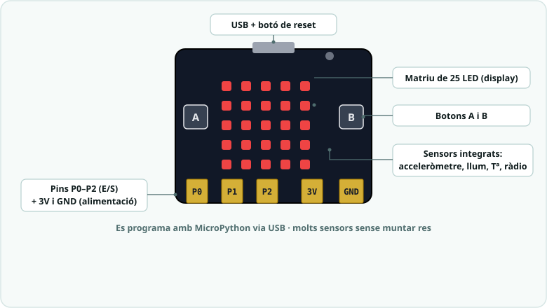
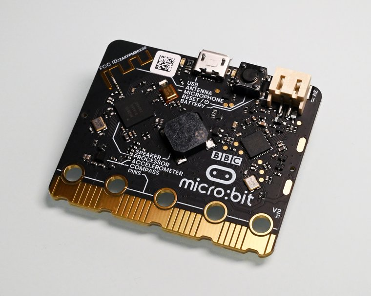
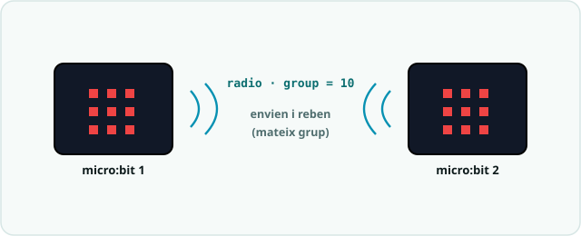

# SA5 · Connexions i entorn

> 🧑‍🎓 **Quan toca?** Obre-la a la **S1** per preparar l'**entorn** i torna-hi quan una activitat usi maquinari: acceleròmetre → Activitat 2 (S2) · cable del pont al braç → taller de la S2 · ràdio i pont → Activitat 3 (S3).

> La micro:bit porta molts sensors **integrats**, així que les activitats de la micro:bit **no necessiten muntatge**. L'únic cable de la SA és el del **pont**: dos fils de la micro:bit a l'Arduino del braç.

> *Fotografia: micro:bit, per [SimonWaldherr](https://commons.wikimedia.org/wiki/File:Bbc_micro_bit.jpg) — llicència [CC BY-SA 4.0](https://creativecommons.org/licenses/by-sa/4.0/).*

## Entorn de programació
- **Editor Python micro:bit:** https://python.microbit.org (recomanat; té simulador).
- **Thonny:** opció d'escriptori (mode "BBC micro:bit").
- **MakeCode** (https://makecode.microbit.org): pont blocs→Python.
- Connexió: cable **USB**; la placa apareix com una unitat; "Flash" per carregar.

## Sensors integrats usats
| Sensor | Funció MicroPython | SA |
|---|---|---|
| Matriu LED 5×5 | `display.show()`, `display.scroll()` | 01, 02, 03 |
| Botons A/B | `button_a.was_pressed()`, `button_a.is_pressed()` | 01, 03 |
| Acceleròmetre | `accelerometer.get_x()`, `get_y()`, `was_gesture()` | 02, 03 |
| Ràdio | mòdul `radio` | 03 |
| Sèrie pel pin P1 (pont) | `uart.init()`, `uart.write()` | 03 |

## El pont cap al braç (SA5-S3)

El braç continua amb l'**Arduino** tot el trimestre. La micro:bit **pont** rep
les ordres del comandament per ràdio i les passa a l'Arduino per un cable:

| Des de (micro:bit pont) | Cap a (Arduino UNO) | Notes |
|---|---|---|
| P1 | D0 (RX) | Les ordres, una per línia (`uart`, 9600). |
| GND | GND | GND comú: sense ell l'Arduino no entén res. |

> ⚠️ **Quatre servos a les piles, MAI a l'USB ni al pin 5V de l'UNO.** El −
> de les piles va també al GND de l'Arduino (GND comú), com a la SA4.

A l'Arduino hi ha d'haver el programa [`04_brac_ordres`](codi/04_brac_ordres/EXPLICACIO.md).
El codi del pont és a la [pràctica 3](codi/03_radio_comandament_EXPLICACIO.md).

> ⚠️ **El cable va només de la micro:bit cap a l'Arduino.** Mai connectis un
> pin de l'Arduino (5 V) a la micro:bit (3,3 V): la cremaries. El pont
> s'alimenta pel seu USB o amb el seu portapiles.

> ⚠️ **Desconnecta el D0 per pujar un programa a l'Arduino:** l'USB fa servir
> el mateix pin. Torna'l a connectar després.

## Perifèrics externs amb Micro:shield (opcional)
Els pins **0, 1, 2** són d'E/S de propòsit general (cocodril o shield):
| Ús | Pin |
|---|---|
| LED/actuador extern | P0 |
| Potenciòmetre/sensor analògic | P1 (`pin1.read_analog()` → 0-1023) |
| Polsador extern | P2 (`pin2.read_digital()`) |

> Els pins **P0, P1, P2** i l'alimentació **3V**/**GND** són al connector de vora (vegeu la placa etiquetada de dalt); s'hi accedeix amb pinces de cocodril o el Micro:shield.

## Per a la ràdio (SA5 · Activitat 3, S3)
Calen **2 micro:bit** amb el **mateix `group`** (p. ex. `radio.config(group=10)`). Cada placa pot enviar i rebre.

