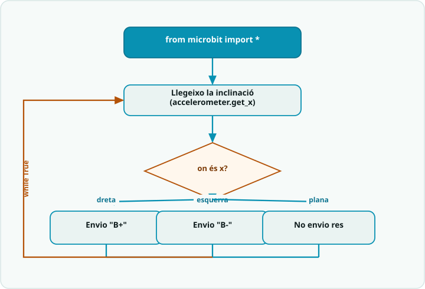

# SA5 · Diagrama de flux — el comandament del braç (micro:bit + MicroPython)

> **Per a qui és?** Alumnat. És el **comandament per ràdio** de l'**Activitat 3 (S3)**, però **dibuixat** (només la base, per fer-lo curt). Mira'l **abans de programar** aquella activitat; després el codi. A la S2 ja et serveix: la decisió del rombe és la mateixa de les fletxes de `02_inclinacio`.

## El flux

## Llegenda
- Caixa **fosca** = **inici**.
- Caixa **teal** `[ ... ]` = una **acció** (una instrucció o bloc de codi).
- **Rombe ambre** `< ... ? >` = una **decisió** (`if`): en surt una branca per cada cas.
- **Fletxa ambre** = **bucle**: torna enrere i es repeteix.

## Del diagrama al codi
- **Engegar la ràdio (fora del bucle)** → `radio.on()` i `radio.config(group=GRUP)`, **abans** del `while True:` (només cal una vegada).
- **while True:** → el bucle infinit; tot el que es repeteix va **indentat a dins** (4 espais = la sintaxi de Python).
- **Llegeixo la inclinació** → `x = accelerometer.get_x()`.
- **On és x?** → `if x > LLINDAR:` … `elif x < -LLINDAR:` … i, si no, res: és la **zona morta** de la placa plana.
- **Envio "B+" / "B-"** → `radio.send("B+")`. A l'altra banda, el pont fa `uart.write(ordre + "\n")` i l'Arduino del braç ho obeeix.
- Per a la resta d'articulacions, el rombe té més branques (`y` per al servo dret, A+B per a la pinça), però el patró és el mateix.
