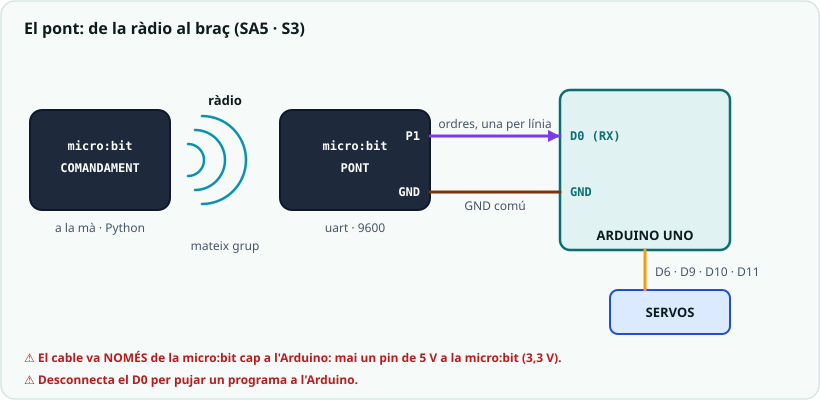

# SA5 · Qüestionari de conceptes (MeArm: el comandament amb micro:bit)

> 🧑‍🎓 **Quan toca fer-lo?** En acabar les activitats de la SA, com a **consolidació** abans de repassar el checklist d'entrega — i torna-hi com a **repàs** abans de la prova T2 (la sessió 4 de la SA6). Si es fa com a prova curta qualificable, el docent anunciarà el dia.

> **Ús.** Comprovació breu dels conceptes de MicroPython, l'acceleròmetre, la ràdio i el pont cap al braç de la SA5.
> Es pot fer servir com a **repàs formatiu** o com a **prova curta qualificable**
> (10 preguntes × 1 punt = **nota 0-10**). Durada orientativa: **15-20 min**, individual.

> **📲 Fes-lo al Classroom.** Aquest qüestionari és una **tasca
> autocorrectiva** al Google Classroom del curs, al tema **MeArm**:
> **[obre «SA5 · Qüestionari de conceptes (MeArm)»](https://classroom.google.com/c/ODY4ODU4Njk0NTEy)**
> (cal el compte del centre). Aquesta pàgina és la versió per repassar
> o fer en paper; les solucions són al full del docent.

**Nom:** ______________________  **Grup:** __________  **Data:** __________

---

## Preguntes (tria una resposta)

1. En Python, què marca quines línies són **dins** d'un `while True:` o d'un `if`?
   - a) Les claus `{ }`.
   - b) El punt i coma `;` al final.
   - c) La indentació (els espais del principi de la línia).
   - d) Una línia en blanc.

2. Quina línia importa a dalt de tot la pantalla, els botons i els sensors de la micro:bit?
   - a) `from microbit import *`
   - b) `#include <microbit.h>`
   - c) `import Servo`
   - d) `void setup()`

3. Al selector, `ARTICULACIONS = ["B", "E", "D", "P"]`. Què val `ARTICULACIONS[0]`?
   - a) `"E"`
   - b) `"P"`
   - c) Dona error: les llistes comencen per 1.
   - d) `"B"`

4. Quina diferència hi ha entre `button_a.was_pressed()` i `button_a.is_pressed()`?
   - a) Cap: són el mateix.
   - b) `was_pressed()` diu si s'ha premut des de l'última vegada (una premuda = un pas); `is_pressed()` diu si està premut ara.
   - c) `is_pressed()` només funciona amb el botó B.
   - d) `was_pressed()` esborra el programa.

5. Al comandament, per què la inclinació compta a partir de `LLINDAR = 300` i no de 0?
   - a) Perquè la placa mai és perfectament plana i la mà tremola: sense marge, el braç no pararia mai quiet.
   - b) Perquè l'acceleròmetre no mesura valors menors de 300.
   - c) Perquè 300 és el màxim de l'acceleròmetre.
   - d) Perquè la ràdio només envia números majors de 300.

6. Perquè el comandament mogui **el teu** braç i no el d'un company, les dues micro:bit…
   - a) Han de tenir el mateix `group`, diferent del dels companys (el teu número de llista).
   - b) Han d'estar connectades per cable.
   - c) Han de tenir `group` diferents entre elles.
   - d) No cal configurar res.

7. Què retorna `radio.receive()` si no ha arribat cap missatge?
   - a) `0`
   - b) `""` (text buit)
   - c) `None`
   - d) Un error que atura el programa.

8. Com es connecta la **micro:bit pont** a l'Arduino del braç?
   - a) 5V de l'Arduino al 3V de la micro:bit.
   - b) D0 de l'Arduino al P1 de la micro:bit i res més.
   - c) Amb un cable USB entre les dues plaques.
   - d) P1 de la micro:bit al D0 de l'Arduino, i GND a GND; mai un pin de l'Arduino cap a la micro:bit.

9. Per què cal **desconnectar el cable del D0** abans de pujar un programa a l'Arduino?
   - a) Perquè el D0 crema la micro:bit en pujar.
   - b) Perquè l'USB fa servir el mateix pin per carregar el programa.
   - c) Perquè el programa s'esborra si el D0 hi és.
   - d) No cal desconnectar-lo.

10. El comandament (Python) i `04_brac_ordres` (C++) parlen el mateix **protocol** (`B+`, `D-`, `P`…). Quina equivalència és correcta?
    - a) En Python cada instrucció acaba amb `;` com en C++.
    - b) On C++ delimita els blocs amb `{ }`, Python ho fa amb la indentació.
    - c) `while True:` de Python equival a `setup()` de C++.
    - d) En Python cal declarar el tipus: `int x = 0`.

---

## Pregunta oberta (opcional)

11. Explica el **protocol d'ordres** del braç: quines ordres envia el comandament, qui les rep i què fa l'Arduino amb cadascuna. Per què ha de ser el mateix a les dues bandes?

___________________________________________________________________

___________________________________________________________________

---

*Qüestionari de conceptes de la SA5, orientat al braç MeArm. Es recolza en `SA5_fitxa_alumnat.md`, `SA5_guia_docent.md`, `SA5_connexions.md` i el dossier del braç.
Llicència CC BY-SA 4.0.*
