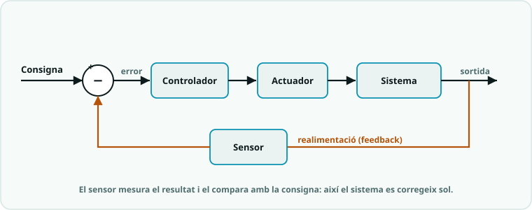

# SA6 · Sistemes de control: llaç obert/tancat i màquines d'estats

Sisena situació d'aprenentatge (**8 h · 4 sessions**, 2n trimestre). El sistema passa de *reaccionar* a **regular-se sol**: **llaç obert vs tancat**, realimentació, consigna i error, control **tot/res amb histèresi**, **màquines d'estats** (`enum`/`switch`) i introducció al **control proporcional**. Maquinari: el teu braç MeArm (Arduino UNO, 4 servos), el sensor de col·lisió i l'ultrasons. Programació oficial: [`Programació didàctica/15_SA6_Sistemes_control.md`](../../Programació%20didàctica/15_SA6_Sistemes_control.md).

En acabar aquesta SA podràs: 1) distingir **llaç obert** i **llaç tancat** i explicar el teu braç amb un **diagrama de blocs**; 2) fer una **pinça automàtica amb histèresi**; 3) construir la **màquina d'estats del braç**, que no es bloqueja.

> 💻 **Com carregar el codi d'una pràctica:** tornem a l'**editor d'Arduino** ([Web Editor al Chromebook](../SA0/SA0_guia_web_editor_chromebook.md)) i al C++. Dins de la pràctica, al pas «Carrega el codi», prem **Copia**, enganxa'l i prem **→ Puja**.

## 🧭 La teva ruta

Fes les pràctiques **en ordre i al teu ritme**. Cada pràctica comença amb el **kata** (10') i acaba enviant el seu formulari de Classroom. Les 🚩 et diuen on hauries de ser al final de cada sessió.

- ① [Pràctica 1 · El homing del braç](codi/01_llac_obert_vs_tancat/EXPLICACIO.md) — llaç obert vs llaç tancat: la base troba sola el seu zero. **Taller:** el sensor de col·lisió a la base.

🚩 **Final de la Sessió 1:** formulari de la ① enviat, el sensor de col·lisió muntat i el full del 📓 quadern de la sessió omplert.

- ② [Pràctica 2 · La pinça automàtica](codi/02_pinca_histeresi/EXPLICACIO.md) — histèresi: la pinça agafa i deixa anar sense «clic-clic». **Taller:** angles límit i cablatge endreçat.

🚩 **Final de la Sessió 2:** formulari de la ② enviat, els angles límit anotats i el full del 📓 quadern omplert. Per a la prova, repassa la [targeta exprés de MicroPython](../00_General/00_Repas_expres_MicroPython.md) (10-15').

- ③ [Pràctica 3 · La màquina d'estats del braç](codi/03_maquina_estats/EXPLICACIO.md) — el producte: repòs, manual, replay i emergència, amb el comandament per ràdio.

🚩 **Final de la Sessió 3:** formulari de la ③ enviat, **Entrega final** feta i el full del 📓 quadern omplert. El producte **es tanca avui**.

🚩 **Sessió 4 · Prova pràctica T2:** individual, la sessió sencera. Pots consultar el teu quadern i els esquemes. El nucli és la pinça amb histèresi.

> ⭐ **Ampliació:** el [control proporcional](codi/04_control_proporcional/EXPLICACIO.md), perquè el braç freni sol en arribar. No entra a la prova.

## 🏁 Entrega final

**Quan hagis acabat la ③:**

1. 🎤 **Defensa de 2-3'** a peu de taula: problema → solució → **una decisió tècnica justificada** (per què aquests llindars? per què aquests estats?) + 2 preguntes ([guia de la defensa oral](../00_General/00_Guia_defensa_oral.md)). S'avalua amb **R1**, **R3** i **R4**.
2. 📤 Respon i envia l'[Entrega final de la SA6](https://classroom.google.com/c/ODY4ODU4Njk0NTEy/a/ODk5NDU1MTk5Njc5/details): autoavaluació i checklist final.

> ✅ **Versió nucli** (per aprovar n'hi ha prou amb): la pinça amb **histèresi** funcionant i la màquina d'estats amb repòs, manual i emergència, documentades amb els diagrames.

## 📦 Què has d'entregar

| Quan | Què | On |
|---|---|---|
| S1 | Formulari de la Pràctica 1 | Una tasca de Classroom per pràctica (enllaç a l'últim pas de cada pràctica) |
| S2 | Formulari de la Pràctica 2 | La tasca de Classroom de la pràctica |
| S3 | Formulari de la Pràctica 3 + **el braç amb màquina d'estats** i defensa de 2-3' + **Entrega final** | A l'aula i a Classroom. S'avalua amb **R1**, **R3** i **R4** |
| S4 | **Prova pràctica T2 (individual)** | A l'aula, sessió sencera |
| ⭐ | [Repte triat (A, B o C)](../../Reptes/Reptes_SA6.md) | El docent el valida i pinteu l'estrella al [tauler de reptes](../00_General/00_Tauler_reptes.md) |
| 📓 | Full del quadern tècnic de cada sessió | En paper, en acabar la sessió |
| 🤖 | El braç amb màquina d'estats i emergència (el producte de la SA, es tanca a la S3) | És el robot del trimestre: [dossier del braç](../00_General/00_Projecte_T2_Brac.md) |

## 📚 Per repassar a casa

- [Reptes de la SA6](../../Reptes/Reptes_SA6.md) — tria el teu context.
- [Exemple resolt](SA6_exemple_resolt.md) · [Diagrama de flux de la pinça](SA6_diagrama_flux.md) · [Qüestionari de conceptes](SA6_questionari_conceptes.md)
- [Fitxa base](SA6_fitxa_alumnat.md) — objectius, com s'avalua i què fer si alguna cosa no funciona.
- [Fitxa ampliada](SA6_fitxa_ampliada.md) — aprofundiment i ampliacions.
- [Esquemes i connexions](SA6_esquemes_connexions.md) — el mapa de pins del braç.

<!-- web:only-github -->
## Contingut

| Fitxer | Descripció |
|---|---|
| [`SA6_guia_docent.md`](SA6_guia_docent.md) | Guia del professorat: objectius, 4 sessions, mètode de projecte, mapa d'avaluació i errors freqüents. |
| [`SA6_fitxa_alumnat.md`](SA6_fitxa_alumnat.md) | **Fitxa base** (nucli d'una cara, per a tot l'alumnat): Activitats 1-4 + quadern. |
| [`SA6_fitxa_ampliada.md`](SA6_fitxa_ampliada.md) | **Versió ampliada** (aprofundiment): totes les rutines (revisió creuada de codi, exit ticket, ODS, PC) i ampliacions. |
| [`SA6_checklist_docent.md`](SA6_checklist_docent.md) | **Checklist docent** (una cara): logística prèvia, punts de control per sessió, avaluació i diversitat. |
| [`SA6_checklist_alumnat.md`](SA6_checklist_alumnat.md) | **Checklist alumnat** (una cara): què he de fer/lliurar + autoavaluació amb semàfor. |
| [`SA6_katas.md`](SA6_katas.md) | Katas d'escriptura (10'): un per sessió de codi, abans d'obrir el sketch; si ningú no el projecta, l'alumnat l'obre sol. |
| [`SA6_katas_solucions.md`](SA6_katas_solucions.md) | **Solucions dels katas** (docent): codi resolt amb els valors de la variació + comentaris per a la posada en comú. |
| [`SA6_esquemes_connexions.md`](SA6_esquemes_connexions.md) | Esquemes i connexions del braç (col·lisió, ultrasons, polsadors, mapa de pins). |
| `codi/` | Sketches d'Arduino (vegeu la taula següent). |

### Codi (`codi/`)

| Sketch | Què mostra |
|---|---|
| `01_llac_obert_vs_tancat.ino` | La base del braç en llaç obert vs **homing** amb el final de carrera (llaç tancat). |
| `02_pinca_histeresi.ino` | La **pinça automàtica**: control tot/res amb dos llindars (histèresi). |
| `03_maquina_estats.ino` | La **màquina d'estats del braç** amb `enum`/`switch` i `millis()` (amb esquelet «Si t'encalles» a la seva pàgina). |
| `04_control_proporcional.ino` | Moviment proporcional de la base: frena sol en arribar (base del PID). |

Cada sketch té la seva **pàgina de pràctica** a la web (per què es fa + codi explicat per blocs); a GitHub, l'explicació és a l'`EXPLICACIO.md` de la carpeta del sketch.

<!-- /web:only-github -->

## Producte i avaluació

- **Producte:** el **braç MeArm amb la seva màquina d'estats** (repòs, manual, replay, emergència) i el comandament per ràdio, amb **diagrama d'estats** i **diagrama de blocs**. **Es tanca a la S3.**
- **Prova T2:** la S4 sencera, individual (`Avaluació/Prova_practica_T2.md`).
- **Criteris:** CA3.1, CA1.1 · **Rúbriques:** **R1** (codi), **R3** (control), **R4** (documentació).

## Continuïtat

Ve de la **SA5** (el comandament del braç) i porta a la **SA7** (robòtica mòbil). El **llaç tancat** i les **màquines d'estats** d'aquí són la base dels **comportaments autònoms** del robot (evitar obstacles, seguir línia).
