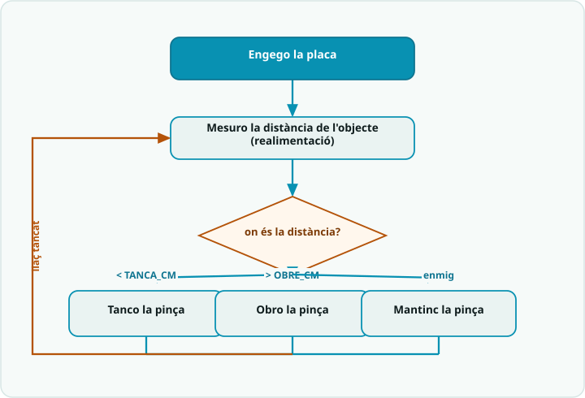

# SA6 · Diagrama de flux — la pinça automàtica amb histèresi

> **Per a qui és?** Alumnat. És la **pinça automàtica** de l'**Activitat 2 (S2)**, però **dibuixada**; la mateixa forma (mesurar → decidir segons on som → actuar) és la base de la **màquina d'estats del braç** de l'Activitat 3. Mira'l **abans de programar**; després l'exemple resolt i el codi.

## El flux

## Llegenda
- Caixa **fosca** = **inici**.
- Caixa **teal** `[ ... ]` = una **acció** (una instrucció o bloc de codi).
- **Rombe ambre** `< ... ? >` = una **decisió** (`if`): en surt una branca per cada cas.
- **Fletxa ambre** = **bucle**: torna enrere i es repeteix.

## Del diagrama al codi
- `[ Mesuro la distància ]` → `float d = mesuraDistancia();` — la realimentació del **llaç tancat**: es llegeix a cada volta, mai dins d'un `delay` llarg.
- `< on és la distància? >` → dues condicions que també miren l'**estat**: `if (!pincaTancada && d < TANCA_CM)` … `else if (pincaTancada && d > OBRE_CM)`.
- **Mantinc la pinça** → no hi ha cap `else`: entre `TANCA_CM` i `OBRE_CM` no es fa res, i la pinça **manté** el que feia → sense «clic-clic». Aquesta és la **histèresi**.
- A la **màquina d'estats** (S3), el rombe es converteix en `switch (estat)` i cada branca en un `case`: el braç decideix *segons on és* (repòs, manual, replay, emergència), exactament com la pinça decideix segons si és oberta o tancada.
