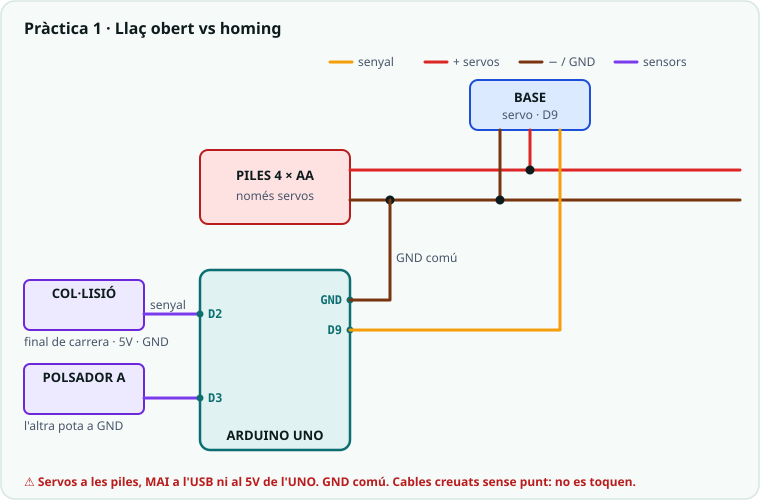
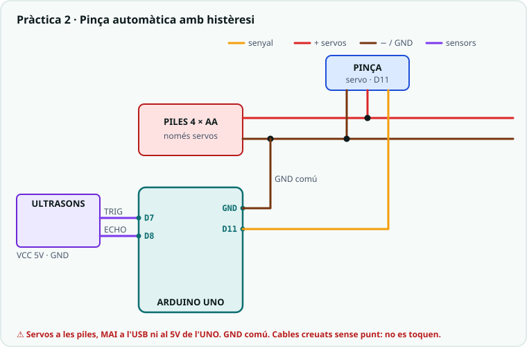
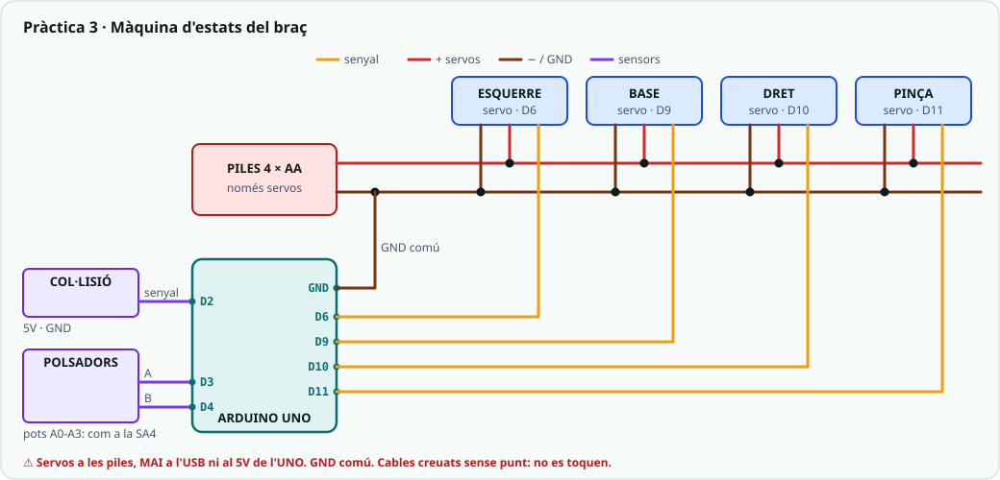

# SA6 · Esquemes i connexions

> 🧑‍🎓 **Quan toca?** Tingues aquesta pàgina oberta **mentre muntes**. Correspondència amb la fitxa: **§1** → Activitat 1 (S1, homing) · **§2** → Activitat 2 (S2, pinça amb histèresi) · **§3** → Activitat 3 (S3, màquina d'estats) · **§4** → ampliació (control proporcional) · el **resum de pins** és el mapa del braç de tot el trimestre.

> Tot es munta **sobre el braç MeArm**, amb els pins definitius del
> [dossier](../00_General/00_Projecte_T2_Brac.md#cablatge): el que connectes
> avui ja no es mou. Els servos sempre a les **piles** amb **GND comú**.

---

## 1. Llaç obert vs homing (`01_llac_obert_vs_tancat.ino`)

| Component | Pin | Notes |
|---|---|---|
| Servo base | 9 | Piles + GND comú |
| Sensor de col·lisió KS0021 | 2 | Senyal al D2, VCC 5V, GND. `INPUT_PULLUP`: llegeix `LOW` quan toca. Muntat a la base, on la palanca el toca en girar del tot. |
| Polsador A | 3 | L'altra pota a GND (`INPUT_PULLUP`) |

---

## 2. Pinça automàtica amb histèresi (`02_pinca_histeresi.ino`)

| Component | Pin | Notes |
|---|---|---|
| Servo pinça | 11 | Piles + GND comú |
| Ultrasons TRIG / ECHO | 7 / 8 | VCC 5V, GND. Al seu suport, mirant l'estació de recollida. |

---

## 3. Màquina d'estats del braç (`03_maquina_estats.ino`)

El braç sencer: els 4 servos i els 4 potenciòmetres de la SA4, més el sensor
de col·lisió i els dos polsadors.

| Component | Pin | Notes |
|---|---|---|
| Servos base / esquerre / dret / pinça | 9 / 6 / 10 / 11 | Piles + GND comú |
| Potenciòmetres base / dret / pinça / esquerre | A0 / A1 / A2 / A3 | 5V i GND de l'Arduino |
| Sensor de col·lisió | 2 | `LOW` = xoc → EMERGÈNCIA |
| Polsador A / polsador B | 3 / 4 | A: repòs ↔ manual, rearmament · B: grava / reprodueix |

> **Producte (S3):** la mateixa màquina amb el **comandament per ràdio**: el
> pont de la SA5 (P1 → D0) porta les ordres `A`, `R` i `G` en lloc dels
> polsadors. Esquema complet al [dossier](../00_General/00_Projecte_T2_Brac.md#cablatge).

---

## 4. Control proporcional (`04_control_proporcional.ino`, ampliació)

Només el servo de la base (9) i el seu potenciòmetre (A0): el muntatge del
§3 ja els té.

---

## Resum de pins (el braç de tot el trimestre)

| Senyal | Pin |
|---|---|
| Servo base / esquerre / dret / pinça | 9 / 6 / 10 / 11 |
| Potenciòmetres base / dret / pinça / esquerre | A0 / A1 / A2 / A3 |
| Sensor de col·lisió | 2 |
| Polsadors A / B | 3 / 4 |
| Ultrasons TRIG / ECHO | 7 / 8 |
| micro:bit pont (SA5) | 0 (RX) |

---

## Simulació interactiva (Wokwi)

- ▶ **Simulació conceptual de la histèresi** (un potenciòmetre fa de distància i un LED de pinça): <https://wokwi.com/projects/468088291274023937>
- **Projecte al repositori:** [`Simulacions/Wokwi/SA6_termostat_histeresi/`](../../Simulacions/Wokwi/SA6_termostat_histeresi/) (`diagram.json` + `sketch.ino`).

> Obre l'enllaç i prem **▶**. Gira el **potenciòmetre** (A0) lentament i comprova que el LED **no vibra** a la zona entre els dos llindars: és la mateixa histèresi de la pinça, sense el braç.
