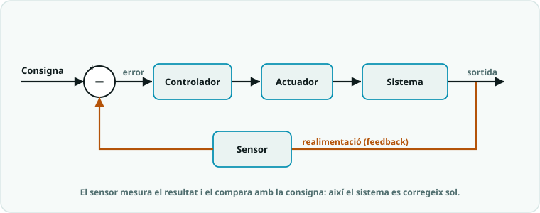

# SA6 · Fitxa base — Sistemes de control · *que el sistema es reguli sol*

<!-- web:only-github -->

**Nom:** ______________________  **Data:** __________

<!-- /web:only-github -->

> Faràs que el **teu braç MeArm es controli sol**: que trobi el seu zero (homing), que la pinça agafi sola els objectes (histèresi) i que tingui modes i una emergència (màquina d'estats). El control proporcional és **+ampliació** (opcional).

> 💻 **On programo?** Tornem a l'**editor d'Arduino** ([Web Editor al Chromebook](../SA0/SA0_guia_web_editor_chromebook.md), o l'IDE si treballes en un PC) i al **C++** (el parèntesi Python de la SA5 s'ha acabat): `;`, `{}` i compilar+pujar, com a SA1-SA4. Res de `main.py` ni d'indentació obligatòria — però l'hàbit d'indentar bé, conserva'l.

## 🎯 Objectius i avaluació

**En acabar aquesta SA podré:**
1. Distingir **llaç obert** i **llaç tancat** i explicar el meu braç amb un **diagrama de blocs**.
2. Fer una **pinça automàtica amb histèresi** (dos llindars, sense "clic-clic").
3. Construir la **màquina d'estats del braç**, que no es bloqueja (`millis()`).
4. *(+Ampliació opcional)* Provar el **control proporcional**.

| Què lliuro | Rúbrica | On compta |
|---|---|---|
| **El braç amb màquina d'estats** (producte, **S3**) + defensa de 2-3' | **R1**, **R3** i **R4** | Projectes (45 %) |
| **Prova T2** (individual, **la S4 sencera**; el nucli és la histèresi) | **R1, R3, R4** | Proves (20 %) |
| **Quadern tècnic** (diagrama d'estats, diagrama de blocs, errors) | **R4** | Quadern tècnic i pràctiques (25 %) |
| Mini-check individual (inici S3) | semàfor | **No qualifica** (m'avisa abans de la prova) |

> 🪜 **Versió nucli (ja és assoliment satisfactori):** pinça amb **histèresi** que funciona i màquina d'estats amb repòs, manual i emergència, documentades amb els diagrames. **Versió completa:** hi afegeix el replay no bloquejant (`millis()`) i el comandament per ràdio, amb llindars i estats justificats — i, si vols, el moviment proporcional.

> Escala de nota 0-10, rúbriques i tot el sistema: **[Com s'avalua la matèria](../00_General/00_Avaluacio_per_alumnat.md)**.

> ✍️ **Rutina de la SA:** cada sessió amb pràctica comença amb un **kata de 10 minuts**: escriure de zero (individual, amb apunts) el bloc central del programa del dia, ABANS d'obrir el codi donat. Si ningú no el projecta, reclameu-lo! El dia del mini-check, el mini-check fa de kata.

---

## Les activitats · al Google Classroom

Aquesta fitxa es respon **en línia**, a la tasca de Google Classroom (val **10 punts**). **No cal que la responguis d'entrada**: cada activitat porta el seu **enunciat dins de la tasca**, i l'**itinerari de la portada de la SA** et diu quina toca a cada sessió. Obre-la quan comencis a treballar-hi i ves-la responent a mesura que avances:

> 👉 **[Obre la tasca: SA6 · Fitxa base (Google Classroom)](https://classroom.google.com/c/ODY4ODU4Njk0NTEy/a/ODcwNTE2NDU2MzYx/details)**

Si la tasca encara no t'apareix al Classroom, és que la SA encara no ha començat. En aquesta pàgina hi tens els **objectius i l'avaluació** (a dalt) i la rutina **DEPURA** (a sota).

<!-- web:only-github -->

## El que has de fer

### 1 · Llaç obert vs llaç tancat (S1)
0. **PREDIU:** mirant `01_llac_obert_vs_tancat.ino`, en quin mode la base acabarà tocant el final de carrera si l'has muntat a 30°? ______________________
1. **Taller:** munta el sensor de col·lisió a la base (D2). Carrega, prova els dos modes i mou el sensor de lloc. Fixa't en el diagrama de blocs del **llaç tancat**:

2. Diferència principal entre llaç obert i tancat: ______________________
3. Dibuixa el **diagrama de blocs del teu braç** (què és la consigna, l'actuador i el sensor?).

### 2 · Pinça automàtica amb histèresi (S2)
1. Carrega `02_pinca_histeresi.ino`. Llindars: es tanca a ____ cm · s'obre a ____ cm
2. Què passaria **sense** histèresi (un sol llindar)? ______________________
3. **Taller:** angles límit definitius de cada servo: base ____ · esquerre ____ · dret ____ · pinça ____

### 3 · La màquina d'estats del braç (S3)
1. Carrega `03_maquina_estats.ino`. Estats: ______________________
2. Dibuixa el **diagrama d'estats** del braç (estats i transicions).
3. **Producte:** la mateixa màquina amb el **comandament per ràdio** (ordres `A`, `R` i `G` pel pont). Prova final: agafar un objecte i deixar-lo en un altre lloc.

> 💡 Si t'encalles muntant el patró, parteix de l'**esquelet** de la secció «Si t'encalles» de la [pàgina de la pràctica de la màquina d'estats](codi/03_maquina_estats/EXPLICACIO.md) (el patró `enum`/`switch` + `millis()` ja hi és; tu omples els `// TODO`). El `millis()` no bloquejant ja el vas practicar a la SA4 (`05_dos_servos_millis`). Vols la **recepta del patró** (per què `enum` + `switch` i no una pila d'`if-else`) amb les 3 regles? → [fitxa ampliada, «La recepta»](SA6_fitxa_ampliada.md).

### 4 · Prova pràctica T2 (S4, individual)
La sessió 4 **sencera** és la **prova T2**: individual, dues parts (pinça amb histèresi + comandament micro:bit), i pots consultar **el teu quadern i els esquemes**. El nucli (histèresi) ben fet = 5-6; ampliacions = 7-10.

> 🐍 **La Part B és en MicroPython i fa setmanes que fas C++!** Abans de la prova, repassa la targeta [`00_Repas_expres_MicroPython.md`](../00_General/00_Repas_expres_MicroPython.md) (10-15': taula C++↔Python, els 5 patrons de la prova i un autotest). Si no superes l'autotest, refés les activitats 1-2 de la [fitxa de la SA5](../SA5/SA5_fitxa_alumnat.md).

### +Ampliació (opcional) · Control proporcional
> **Per a qui vagi sobrat** (dins S2/S3 si acabes aviat, a casa amb Wokwi, o com a ampliació de la prova): el nucli de la SA són la histèresi i la màquina d'estats.
1. Carrega `04_control_proporcional.ino`. Què és l'**error**? ______________________
2. Com afecta `K` al moviment de la base? ______________________
3. **Repte:** compara el salt (`K = 1`) amb el moviment proporcional al Serial Plotter. Quin deixaria caure menys l'objecte? ____

> ✏️ **Dissenya abans de codificar:** aquí el pseudocodi és el **diagrama d'estats** que has dibuixat (activitat 3.2): cada estat i cada fletxa han d'existir abans que el `switch`. No escriguis cap `case` que no sigui al dibuix.

**Producte:** el braç amb la seva màquina d'estats i el comandament, **tancat a la S3**. S'avalua amb **R1**, **R3** i **R4** (i amb la [rúbrica del braç](../00_General/00_Projecte_T2_Brac.md#rúbrica-del-robot-producte-sa6)).
**Defensa (2-3', a peu de taula durant la S3, nivell T2):** problema → solució → **una decisió tècnica justificada** (per què aquests llindars? per què aquests estats?) + 2 preguntes. Ja no n'hi ha prou amb el minut de T1: vegeu l'escala a [`../00_General/00_Guia_defensa_oral.md`](../00_General/00_Guia_defensa_oral.md).

<!-- /web:only-github -->

## Producte · El braç amb màquina d'estats
Es **tanca a la S3**: el teu MeArm amb **màquina d'estats** (repòs, manual, replay, emergència), comandament per ràdio, **diagrama d'estats** i llindars justificats. **Defensa de 2-3'** (nivell T2): problema → solució → una **decisió tècnica justificada** + 2 preguntes ([guia de la defensa oral](../00_General/00_Guia_defensa_oral.md)). S'avalua amb **R1**, **R3** i **R4**.

## Si t'encalles (DEPURA)
> **D**escriu · **E**xamina (**Serial Plotter**: la sortida segueix la consigna o oscil·la?) · **P**rova una hipòtesi cada cop · **U**bica · **R**epara · **A**punta-ho. Encara encallat? **[Targeta de rescat](../00_General/00_Targetes_rescat.md)** (comença per la 🟢).

<!-- web:only-github -->

## M'autoavaluo (Insuficient · Suficient/Bé · Notable · Excel·lent — la nota és 0-10)
| Criteri | Insuficient | Suficient/Bé | Notable | Excel·lent |
|---|---|---|---|---|
| Distingeixo llaç obert i llaç tancat | ☐ | ☐ | ☐ | ☐ |
| Implemento la histèresi de la pinça i la màquina d'estats del braç | ☐ | ☐ | ☐ | ☐ |
| Explico el diagrama de blocs i el diagrama d'estats del meu braç | ☐ | ☐ | ☐ | ☐ |

## Quadern tècnic

> 📓 Escriu-ho a la teva entrada del **[quadern tècnic](../00_General/00_Quadern_tecnic.md)** (guia + plantilla; compta el 25 %).
- **Què és la realimentació en un sistema de control?** _________________
- **Per què serveix la histèresi?** ___________________________________
- **Un error i com l'he resolt:** _____________________________________

<!-- /web:only-github -->

> 📌 **Vols més?** +[Reptes ⭐](../../Reptes/Reptes_SA6.md) (pinça amb LED d'estat, homing + seqüència segura, moviment proporcional de les 4 articulacions), revisió creuada de codi, exit ticket, pensament computacional i ODS → **[SA6_fitxa_ampliada.md](SA6_fitxa_ampliada.md)**

> 🤖 **El robot del trimestre:** avui tanques el **braç**: tot el que has fet en aquesta SA és el seu control (homing, pinça automàtica, repòs/manual/replay/**emergència**). Rúbrica i presentació: **[dossier del braç](../00_General/00_Projecte_T2_Brac.md)**.
