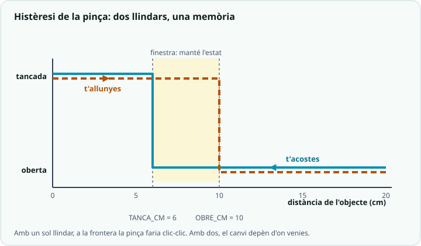

# SA6 · Qüestionari de conceptes (MeArm: homing, histèresi i màquina d'estats)

> 🧑‍🎓 **Quan toca fer-lo?** En acabar les activitats de la SA, com a **consolidació** abans de repassar el checklist d'entrega — i torna-hi com a **repàs** abans de la prova T2 (la sessió 4 de la SA6). Si es fa com a prova curta qualificable, el docent anunciarà el dia.

> **Ús.** Comprovació breu dels conceptes de sistemes de control de la SA6 sobre el braç MeArm.
> Es pot fer servir com a **repàs formatiu** o com a **prova curta qualificable**
> (10 preguntes × 1 punt = **nota 0-10**). Durada orientativa: **15-20 min**, individual.

> **📲 Fes-lo al Classroom.** Aquest qüestionari és una **tasca
> autocorrectiva** al Google Classroom del curs, al tema **MeArm**:
> **[obre «SA6 · Qüestionari de conceptes (MeArm)»](https://classroom.google.com/c/ODY4ODU4Njk0NTEy)**
> (cal el compte del centre). Aquesta pàgina és la versió per repassar
> o fer en paper; les solucions són al full del docent.

**Nom:** ______________________  **Grup:** __________  **Data:** __________

---

## Preguntes (tria una resposta)

1. Quina diferència hi ha entre moure la base «a cegues» a 20° i fer el **homing** amb el final de carrera?
   - a) Cap: tots dos són llaç tancat.
   - b) El primer és llaç tancat i el homing, llaç obert.
   - c) El primer és llaç obert (confia que hi ha arribat); el homing és llaç tancat (el sensor diu quan hi és).
   - d) El homing no fa servir cap sensor.

2. En un sistema de control, la **realimentació** és…
   - a) Mesurar la sortida i tornar-la a l'entrada per comparar-la amb la consigna.
   - b) Apagar el sistema quan hi ha un error.
   - c) Un tipus de sensor de temperatura.
   - d) Fer que el servo vagi més ràpid.

3. Per què el homing porta la guarda `else if (angle <= 0)`?
   - a) Perquè el servo no admet angles negatius al `write()`.
   - b) Perquè si el sensor falla o s'ha desconnectat, el braç no es quedi empenyent per sempre.
   - c) Perquè així el homing va més ràpid.
   - d) Perquè el zero sempre és a 0°.

4. La **histèresi** de la pinça automàtica consisteix a…
   - a) Fer servir un sol llindar de distància.
   - b) Tancar la pinça només amb un botó.
   - c) Mesurar la distància dues vegades.
   - d) Fer servir dos llindars: tancar per sota d'un i obrir només per sobre d'un altre.

5. Si la pinça es tanca a `d < 8` i s'obre a `d >= 8`, què passa amb l'objecte just a uns 8 cm?
   - a) La pinça es queda oberta per sempre.
   - b) La pinça fa clic-clic: es tanca i s'obre contínuament pel soroll de la mesura.
   - c) La pinça es tanca i no s'obre mai.
   - d) L'ultrasons deixa de funcionar.

6. Amb `TANCA_CM = 6` i `OBRE_CM = 10`, l'objecte és a 8 cm. Què fa la pinça?
   - a) Manté l'estat que tenia (oberta o tancada).
   - b) Sempre es tanca.
   - c) Sempre s'obre.
   - d) S'obre i es tanca cada 60 ms.

7. A la màquina d'estats del braç, per a què serveix el `break` al final de cada `case`?
   - a) Per aturar el braç.
   - b) Per sortir del `loop()`.
   - c) Perquè el programa no continuï executant el `case` següent.
   - d) Per esperar 20 ms.

8. Per què l'**emergència** es comprova **abans** del `switch` i no dins d'un `case`?
   - a) Perquè així el codi és més curt.
   - b) Perquè el `switch` no admet sensors.
   - c) Perquè només es pot comprovar un cop.
   - d) Perquè així mana per damunt de tot: un xoc porta a EMERGÈNCIA estigui on estigui el braç.

9. Com se surt de l'estat EMERGÈNCIA?
   - a) Sol, passats 2 segons.
   - b) Amb el sensor alliberat **i** prement el polsador A (rearmament manual).
   - c) Prement el polsador B.
   - d) Desendollant les piles.

10. Amb el moviment proporcional `angle = angle + K * (consigna - angle)`, què passa amb `K = 1`?
    - a) El servo salta directament a la consigna, sense suavitat.
    - b) El servo no es mou mai.
    - c) El servo va més lent que amb `K = 0.1`.
    - d) El servo oscil·la sense parar.

---

## Pregunta oberta (opcional)

11. Dibuixa o descriu el **diagrama d'estats** del teu braç: els quatre estats (repòs, manual, replay, emergència) i què fa passar d'un a l'altre.

___________________________________________________________________

___________________________________________________________________

---

*Qüestionari de conceptes de la SA6, orientat al braç MeArm. Es recolza en `SA6_fitxa_alumnat.md`, `SA6_guia_docent.md`, `SA6_esquemes_connexions.md` i el dossier del braç.
Llicència CC BY-SA 4.0.*
