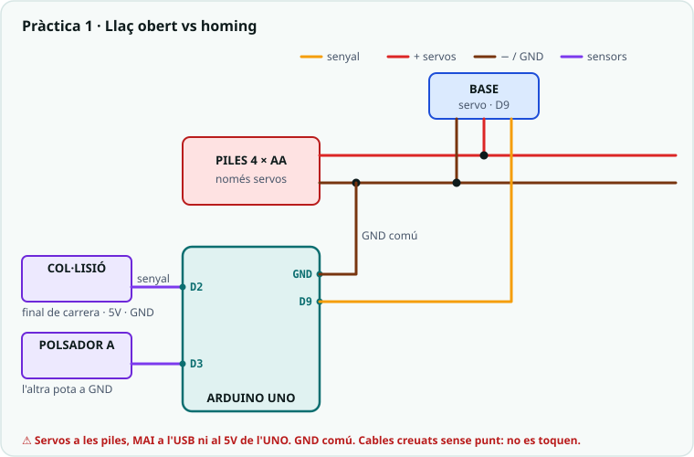
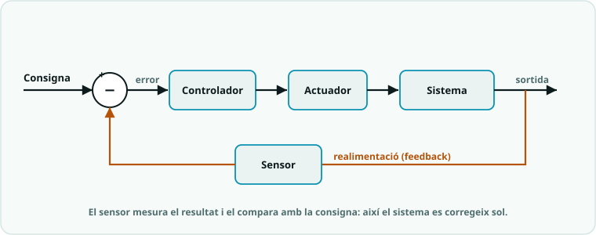

# Pràctica 1 · Llaç obert vs llaç tancat: el homing del braç

<div class="cap-practica" markdown="1">

❓ **La pregunta:** Com sap el braç on és quan s'engega?

🎯 **Avui aconseguiràs:** que la base del teu braç **trobi sola el seu zero** tocant un final de carrera, i veure per què un braç que només «confia» no n'hi ha prou.

⏱️ La sessió (torn de taller de 20' + pràctica)

📦 El MeArm, el sensor de col·lisió (final de carrera), 1 polsador i cables

</div>

## 🚀 Pas a pas

### Pas 1 · Torn de taller: munta el final de carrera

Fixa el **sensor de col·lisió** a la base, on la palanca de la base el toca en girar del tot cap a un costat. Serà el final de carrera d'avui i l'**emergència** de la Pràctica 3.

✅ **Comprova:** gira la base a mà (amb el braç desconnectat) i el sensor fa *clic* abans que la base arribi al topall.

### Pas 2 · Munta el circuit

Servo de la base al **pin 9** (alimentat amb les piles i GND comú), sensor de col·lisió al **D2** i polsador A entre el **D3** i GND.



✅ **Comprova:** el servo va a les **piles**, no al 5V de l'Arduino, i el − de les piles toca el GND de l'Arduino.

### Pas 3 · Endevina abans de provar

Desplega el codi complet del pas 4 i mira'l sense carregar-lo. En mode **obert**, la base va directament a 20°. En mode **tancat**, baixa grau a grau fins que el sensor toca.

✍️ **Apunta-ho:** PREDIU: si has muntat el final de carrera a 30°, en quin mode la base l'acabarà tocant? I si fos a 15°?

### Pas 4 · Carrega el codi

Prem **Copia**, enganxa'l a l'Arduino IDE (esborra el que hi hagués) i prem **→ Puja**. Obre el **Monitor sèrie** (9600).

<!-- codi-complet -->

✅ **Comprova:** el Monitor diu «Mode TANCAT (homing)» i la base baixa a poc a poc fins que el sensor toca.

### Pas 5 · Troba el zero real

Deixa que el homing acabi i llegeix el missatge del Monitor sèrie.

✍️ **Apunta-ho:** a quants graus ha tocat el final de carrera en mode tancat (el zero real de la teva base)?

### Pas 6 · Compara els dos modes

Prem el polsador A: passa a mode **obert**. Torna'l a prémer per tornar al tancat. Després mou el sensor uns graus i repeteix-ho en els dos modes.

✅ **Comprova:** en mode tancat la base troba el sensor allà on el posis; en mode obert va sempre a 20°, hi sigui o no.

✍️ **Apunta-ho:** diferència principal entre llaç obert i llaç tancat.

### Pas 7 · Dibuixa el diagrama de blocs

Mira el diagrama del llaç tancat i fes el del **teu braç** al full del quadern.



✍️ **Apunta-ho:** el diagrama de blocs del teu braç: quina és la consigna, quin l'actuador i quin el sensor?

✍️ **Apunta-ho:** què és la realimentació en un sistema de control?

### Pas 8 · Respon i envia

📤 [Obre la tasca «SA6 · Pràctica 1» a Classroom i envia el formulari](https://classroom.google.com/c/ODY4ODU4Njk0NTEy/a/ODk5NDU2MDAyODQy/details)

Hi trobaràs les mateixes preguntes ✍️ que has anat apuntant. Envia'l ara. A la sessió següent: **[Pràctica 2 · La pinça automàtica](../02_pinca_histeresi/EXPLICACIO.md)**.

⭐ **Si acabes abans:** fes que, després del homing, la base vagi sola a 90° i hi esperi. Més reptes a **[Reptes de la SA6](../../../../Reptes/Reptes_SA6.md)** (el B és el homing amb una seqüència segura); quan el docent te'l validi, pinta l'estrella al [tauler de reptes](../../../00_General/00_Tauler_reptes.md).

<details markdown="1">
<summary>🧗 Si t'encalles</summary>

| Símptoma | Causa probable |
|---|---|
| En mode tancat diu «final de carrera a 90 graus» de seguida | El sensor llegeix `LOW` sense tocar: falta `INPUT_PULLUP` o el cable és a un altre pin. |
| La base arriba a 0° i el sensor no toca | El sensor és massa lluny de la palanca de la base: acosta'l. |
| El servo brunz contra el sensor | El sensor és **darrere** d'un topall mecànic: el braç no hi pot arribar. Mou-lo. |
| El polsador canvia de mode dues vegades | Rebot: el `while` que espera que el deixis anar és imprescindible. |

</details>

<details markdown="1">
<summary>🧠 Vols saber per què funciona?</summary>

### Per què fem aquesta pràctica

Quan un braç industrial s'engega, la primera cosa que fa és buscar el seu
**zero**: gira cada articulació a poc a poc fins que toca un petit interruptor
(un **final de carrera**), i a partir d'aquí sap exactament on és. Es diu
**homing**. Per què no s'hi envia directament i prou? Perquè un servo pot
lliscar, una banya pot haver saltat una dent… i el programa no ho sabria.

- **Llaç obert:** envies l'ordre i **confies**. Ràpid i senzill, però cec.
- **Llaç tancat:** un sensor **comprova** el resultat i el programa actua segons
  el que realment ha passat. És la **realimentació**.

### Bloc 1 — On creiem que és vs on és

```cpp
const int ANGLE_INICI = 90;
const int ANGLE_OBJECTIU = 20;         // on CREIEM que hi ha el final de carrera
const unsigned long PAS_HOMING = 30;   // ms per grau: a poc a poc
```

`ANGLE_OBJECTIU` és una **suposició**: el número que algú va apuntar. El llaç
obert hi confia cegament. El llaç tancat no el necessita: el troba.

### Bloc 2 — Llaç obert: una ordre i prou

```cpp
  if (!modeTancat) {
    base.write(ANGLE_OBJECTIU);
    Serial.println("... Toca el final de carrera? No ho se.");
    delay(2000);
    base.write(ANGLE_INICI);
    acabat = true;
  }
```

Com tirar a cistella amb els ulls tancats: llances i no saps si has encertat.
No hi ha cap `digitalRead()`: el programa **no pregunta res al món**. Passats
2 s, la base torna a l'inici: si el sensor era abans de l'objectiu, el servo hi
estaria empenyent i s'escalfaria. És una protecció que hi posem nosaltres,
perquè el llaç obert, sol, no se n'adonaria mai.

### Bloc 3 — Llaç tancat: el sensor diu prou

```cpp
    if (digitalRead(PIN_COLLISIO) == LOW) {
      Serial.print("Final de carrera a ");
      Serial.print(angle);
      acabat = true;
    } else if (angle <= 0) {
      Serial.println("No he trobat el final de carrera!");
      acabat = true;
    } else {
      angle = angle - 1;
      base.write(angle);
      delay(PAS_HOMING);
    }
```

Com baixar una escala a les fosques tocant amb el peu: un graó cada vegada,
i t'atures quan **notes** el terra. Cada volta: si el sensor toca, ja hi som
(i l'angle d'aquell moment és el zero real); si no, un grau més. La branca
`angle <= 0` és una **guarda**: si el sensor s'ha desconnectat, el braç no
s'ha de quedar empenyent per sempre.

### Bloc 4 — El diagrama de blocs

```
 consigna ──▶ [controlador] ──▶ [servo] ──▶ base
                   ▲                          │
                   └──── [final de carrera] ◀─┘   (realimentació)
```

En llaç obert, la fletxa de baix **no existeix**.

### On ho aplicaràs

- **A la Pràctica 3:** el sensor de col·lisió es queda muntat i és l'**emergència** de la màquina d'estats.
- **A la Pràctica 2:** la [pinça automàtica](../02_pinca_histeresi/EXPLICACIO.md) és un altre llaç tancat (l'ultrasons tanca el llaç).
- **Repte B de la SA6:** fer el homing en engegar i després una seqüència que s'atura si xoca.

</details>
