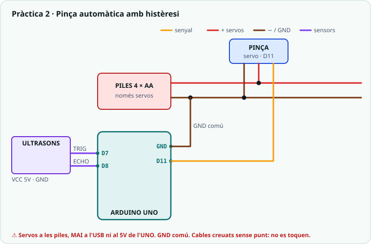
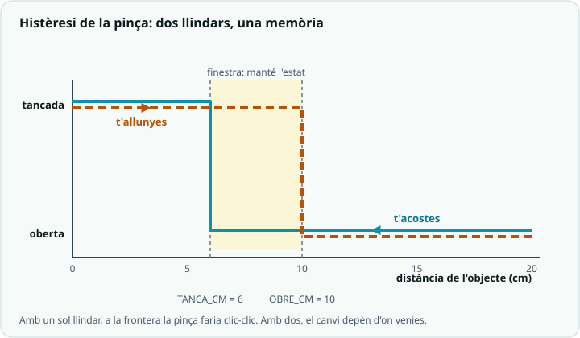

# Pràctica 2 · Histèresi: la pinça automàtica

<div class="cap-practica" markdown="1">

❓ **La pregunta:** Com agafa sola un objecte sense fer clic-clic?

🎯 **Avui aconseguiràs:** que la pinça del braç **agafi sola** un objecte quan s'hi acosta i el deixi anar quan s'allunya, sense fer «clic-clic».

⏱️ La sessió (pràctica + torn de taller de 20')

📦 El MeArm, l'ultrasons HC-SR04 i cables

</div>

## 🚀 Pas a pas

### Pas 1 · Munta el circuit

Servo de la pinça al **pin 11** (piles i GND comú). Ultrasons: **TRIG al 7**, **ECHO al 8**, VCC a 5V i GND a GND.



✅ **Comprova:** l'ultrasons mira endavant, cap a on arribarà l'objecte, i no veu la taula ni la mateixa pinça.

### Pas 2 · Endevina abans de provar

La pinça es tanca quan l'objecte és a **menys de 6 cm**, però només s'obre quan s'allunya **més de 10 cm**.

✍️ **Apunta-ho:** PREDIU: acostes la mà de 20 cm a 3 cm i després l'allunyes. A quina distància es tanca la pinça? A quina s'obre? I si deixes la mà quieta a 8 cm?

### Pas 3 · Carrega el codi

Prem **Copia**, enganxa'l a l'Arduino IDE (esborra el que hi hagués) i prem **→ Puja**.

<!-- codi-complet -->

✅ **Comprova:** quan acostes la mà, la pinça es tanca; quan l'allunyes prou, s'obre.

### Pas 4 · Mira-ho al Serial Plotter

Obre el **Serial Plotter** (9600). Hi veuràs quatre línies: la distància, els dos llindars i l'estat de la pinça (0 oberta, 15 tancada). Mou la mà a poc a poc endavant i enrere.



✅ **Comprova:** la pinça canvia a **llindars diferents** segons si t'acostes o t'allunyes.

✍️ **Apunta-ho:** llindars del codi: es tanca a ____ cm · s'obre a ____ cm.

### Pas 5 · Treu la histèresi

Canvia `OBRE_CM` perquè valgui el mateix que `TANCA_CM` (6) i puja-ho. Posa la mà just a 6 cm i escolta la pinça. Després torna-ho a deixar a 10.

✅ **Comprova:** amb un sol llindar, la pinça fa *clic-clic* a la frontera; amb dos, s'està quieta.

✍️ **Apunta-ho:** què passaria sense histèresi (amb un sol llindar)?

✍️ **Apunta-ho:** per què serveix la histèresi?

### Pas 6 · Torn de taller: angles límit i cablatge

Mou cada servo amb el sketch de la SA4 (`04_brac_potenciometres`) i troba fins on pot anar **sense forçar**. Deixa el cablatge **endreçat i etiquetat**: és un criteri de la rúbrica del braç.

✅ **Comprova:** cap servo brunz ni força un topall als seus angles límit.

✍️ **Apunta-ho:** taller: angles límit definitius de cada servo (base · esquerre · dret · pinça).

### Pas 7 · Respon i envia

📤 [Obre la tasca «SA6 · Pràctica 2» a Classroom i envia el formulari](https://classroom.google.com/c/ODY4ODU4Njk0NTEy/a/ODk5NDU1ODk4MjQ5/details)

Hi trobaràs les mateixes preguntes ✍️ que has anat apuntant. Envia'l ara. A la sessió següent: **[Pràctica 3 · La màquina d'estats del braç](../03_maquina_estats/EXPLICACIO.md)**.

⭐ **Si acabes abans:** afegeix un LED que s'encengui quan la pinça és tancada (és el Repte A; al formulari hi ha una pregunta opcional per explicar-lo). Més reptes a **[Reptes de la SA6](../../../../Reptes/Reptes_SA6.md)**, i el [control proporcional](../04_control_proporcional/EXPLICACIO.md) com a ampliació; quan el docent te'l validi, pinta l'estrella al [tauler de reptes](../../../00_General/00_Tauler_reptes.md).

<details markdown="1">
<summary>🧗 Si t'encalles</summary>

| Símptoma | Causa probable |
|---|---|
| La pinça fa clic-clic igualment | Els dos llindars són massa a prop (o iguals): eixampla la finestra. |
| La pinça no s'obre mai | Les condicions estan intercanviades (`d < OBRE_CM` per obrir). |
| La pinça es tanca sola sense res a davant | L'ultrasons veu la taula o la mateixa pinça: canvia'n l'angle o puja'l. |
| El gràfic és pla a 400 | Sense eco: TRIG/ECHO intercanviats o sense 5V. |

</details>

<details markdown="1">
<summary>🧠 Vols saber per què funciona?</summary>

### Per què fem aquesta pràctica

Recordes el **«ball»** del braç a la SA4, quan l'objecte era just a la
distància del llindar? Una mesura deia «a prop», la següent «lluny», i el braç
anava i venia. Amb una pinça és pitjor: **clic-clic-clic**, l'objecte cau i
el servo pateix.

La solució es diu **histèresi**: en lloc d'**un** llindar, en fas servir
**dos**. Entre 6 i 10 cm, la pinça **fa el que ja feia**. És el que fan tots
els termòstats. La clau és que ara el sistema té **memòria**: per decidir, cal
recordar si la pinça és oberta o tancada.

### Bloc 1 — Dos llindars i una memòria

```cpp
const int TANCA_CM = 6;      // llindar BAIX: mes a prop, es tanca
const int OBRE_CM = 10;      // llindar ALT: mes lluny, s'obre

bool pincaTancada = false;   // l'ESTAT: la memoria del sistema
```

Pensa en una porta automàtica de supermercat: s'obre quan t'acostes a 1 m,
però no es tanca fins que ets a 2 m. La diferència entre els dos llindars
(4 cm) és la **finestra d'histèresi**.

### Bloc 2 — Decidir amb la memòria

```cpp
  if (!pincaTancada && d < TANCA_CM) {
    pincaTancada = true;
    pinca.write(PINCA_TANCADA);
  } else if (pincaTancada && d > OBRE_CM) {
    pincaTancada = false;
    pinca.write(PINCA_OBERTA);
  }
  // Entre TANCA_CM i OBRE_CM: no es toca res (la histeresi)
```

Cada condició mira **la distància i l'estat**. I el millor és el que **no** hi
és: no hi ha cap `else` final. Si no es compleix cap condició, no es fa res.

### Bloc 3 — Veure-ho al Serial Plotter

```cpp
  Serial.print(d);
  Serial.print(" ");
  Serial.print(TANCA_CM);
  Serial.print(" ");
  Serial.print(OBRE_CM);
  Serial.print(" ");
  Serial.println(pincaTancada ? 15 : 0);
```

El `? 15 : 0` és una manera curta d'escriure *«si és tancada, 15; si no, 0»*.

### On ho aplicaràs

- **Prova T2:** el nucli de la prova és **aquesta pinça amb histèresi**.
- **Repte A de la SA6:** la pinça automàtica amb LED d'estat i finestra ajustable.
- **Pràctica 3:** els angles límit d'avui són els de la màquina d'estats.

</details>
