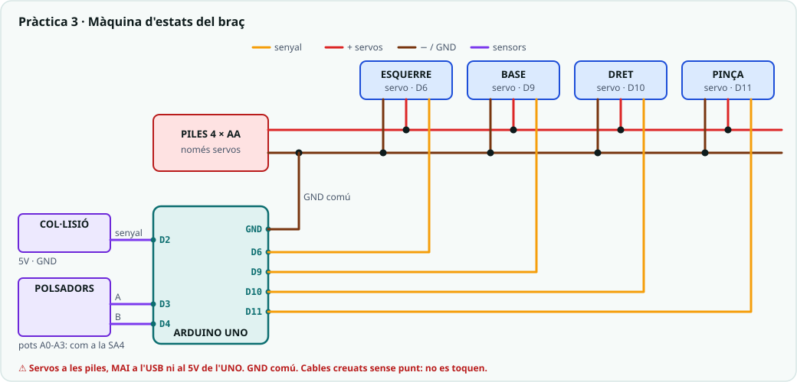

# Pràctica 3 · La màquina d'estats del braç: enum, switch i millis()

<div class="cap-practica" markdown="1">

❓ **La pregunta:** Com decideix el braç què ha de fer ara?

🎯 **Avui aconseguiràs:** el **producte del trimestre**: el teu braç amb quatre modes (repòs, manual, replay i emergència) que obeeix el comandament per ràdio.

⏱️ La sessió (és la sessió de producte: es tanca avui)

📦 El MeArm sencer (4 servos i 4 potenciòmetres), el sensor de col·lisió, 2 polsadors, les dues micro:bit (comandament i pont)

</div>

## 🚀 Pas a pas

### Pas 1 · Kata primer

✍️ **Kata primer!** Avui la sessió comença amb el **mini-check**, que fa de kata. Si no l'has fet, obre el [kata d'aquesta pràctica](../../SA6_katas.md): 10 minuts per escriure el teu bloc abans de llegir aquest codi.

✅ **Comprova:** has fet el mini-check (o el kata) **abans** de mirar el codi d'aquesta pràctica.

### Pas 2 · Dissenya el diagrama d'estats

Abans de cap línia de codi, dibuixa al full del quadern els **quatre estats** (cercles) i les fletxes entre ells. Aquest és el comportament que vols:

| Estat | Què fa | En surt quan… |
|---|---|---|
| **REPÒS** | Quiet. | A → MANUAL · B → REPLAY (si hi ha punts) |
| **MANUAL** | Els potenciòmetres el mouen; B grava el punt. | A → REPÒS |
| **REPLAY** | Reprodueix els punts gravats, un cada 700 ms. | En acabar o amb A → REPÒS |
| **EMERGÈNCIA** | No mou res. | Sensor alliberat **i** A → REPÒS |

✍️ **Apunta-ho:** el teu diagrama d'estats: escriu una línia per fletxa (ESTAT → ESTAT quan …).

### Pas 3 · Munta el circuit

El braç sencer de la SA4 i el sensor de col·lisió de la Pràctica 1, més dos polsadors: **A al D3** i **B al D4** (cada un a GND).



✅ **Comprova:** servos a 9, 6, 10 i 11 (piles i GND comú), potenciòmetres a A0-A3, col·lisió al D2.

### Pas 4 · Endevina abans de provar

Desplega el codi complet del pas 5 i busca el bloc de l'emergència i el `case REPLAY`.

✍️ **Apunta-ho:** PREDIU: si toques el sensor de col·lisió a mig replay, què fa el braç? I si després el deixes anar però no prems A?

### Pas 5 · Carrega el codi

Prem **Copia**, enganxa'l a l'Arduino IDE (esborra el que hi hagués) i prem **→ Puja**. Obre el **Monitor sèrie** (9600).

<!-- codi-complet -->

✅ **Comprova:** el Monitor diu `Estat: REPOS` i el braç no es mou encara que giris els potenciòmetres.

### Pas 6 · Prova els quatre estats

Prem **A** (manual), mou el braç i prem **B** en tres posicions. Prem **A** (repòs) i després **B** (replay). Mentre reprodueix, toca el sensor amb el dit.

✅ **Comprova:** el replay repeteix els tres punts; en tocar el sensor diu `Estat: EMERGENCIA` i no se'n surt fins que deixes anar el sensor **i** prems A.

✍️ **Apunta-ho:** per què la comprovació de l'emergència va abans del `switch` i no dins d'un `case`?

### Pas 7 · Producte: el comandament mana

Ara les ordres arriben pel **pont de la SA5** (micro:bit → D0) en lloc dels polsadors. Fes tres canvis al teu sketch:

1. Afegeix la funció `llegeixOrdre()` (és a «🧗 Si t'encalles») i crida-la a dalt del `loop()`: `String ordre = llegeixOrdre();`.
2. Fes que les ordres facin de polsadors: **`A`** com el polsador A, **`R`** reprodueix i **`G`** grava.
3. A `MANUAL`, canvia `segueixPots()` per les ordres `B+`, `B-`, `D+`… de la [Pràctica 3 de la SA5](../../../SA5/codi/04_brac_ordres/EXPLICACIO.md).

✅ **Comprova:** primer des del Monitor sèrie (9600, «Nova línia»): `A`, `B+`, `G`, `A`, `R`. Després, amb el comandament i el pont (desconnecta el D0 per pujar el programa).

✍️ **Apunta-ho:** producte: quina ordre del comandament fa cada canvi d'estat? (A, R, G)

### Pas 8 · Prova final del braç

Amb el comandament, agafa un objecte de l'estació de recollida i deixa'l en un altre lloc. Grava-ho i reprodueix-ho.

✅ **Comprova:** el braç ho fa sense forçar cap servo, i el sensor de col·lisió l'atura en qualsevol moment.

✍️ **Apunta-ho:** un error que has trobat i com l'has resolt.

### Pas 9 · Respon i envia

📤 [Obre la tasca «SA6 · Pràctica 3» a Classroom i envia el formulari](https://classroom.google.com/c/ODY4ODU4Njk0NTEy/a/ODk5NDU1NTU4ODE4/details)

Hi trobaràs les mateixes preguntes ✍️ que has anat apuntant. Envia'l ara i passa a l'**[Entrega final](../../README.md#entrega-final)**: defensa de 2-3' i autoavaluació.

⭐ **Si acabes abans:** el [control proporcional](../04_control_proporcional/EXPLICACIO.md) perquè el braç freni sol en arribar. Més reptes a **[Reptes de la SA6](../../../../Reptes/Reptes_SA6.md)**; quan el docent te'l validi, pinta l'estrella al [tauler de reptes](../../../00_General/00_Tauler_reptes.md).

<details markdown="1">
<summary>🧗 Si t'encalles</summary>

| Símptoma | Causa probable |
|---|---|
| Un `case` fa també la feina del següent | Falta el `break`. |
| Una premuda fa dues coses (entra a MANUAL i grava) | Has llegit el botó amb `digitalRead()` directe en lloc de `premut()`. |
| L'emergència no salta durant el replay | Hi ha un `delay()` llarg dins del replay, o la comprovació és dins d'un `case` i no abans del `switch`. |
| En sortir d'emergència el braç torna a xocar de seguida | El rearmament no exigeix el sensor alliberat (`!xoc`). |
| El braç entra sol en emergència al límit de la base i no en surt | `BASE_MIN` deixa arribar la base al final de carrera: posa'l uns graus per sobre de l'angle del homing (Pràctica 1). |
| Error en pujar el programa | El cable del pont és al **D0**: desconnecta'l per pujar. |

**Llegir ordres sense bloquejar el braç.** `readStringUntil()` (el de la SA5) s'espera; aquesta funció no: va guardant lletres i només torna l'ordre quan és sencera. Mentrestant torna `""` i el `loop()` continua vigilant el sensor.

```cpp
String linia = "";

// Torna l'ordre sencera quan arriba el salt de linia; si no, ""
String llegeixOrdre() {
  while (Serial.available() > 0) {
    char c = Serial.read();
    if (c == '\n') {
      String ordre = linia;
      linia = "";
      ordre.trim();          // treu el '\r' si n'hi ha
      return ordre;
    }
    linia += c;
  }
  return "";
}
```

**L'esquelet.** Si el patró se't fa bola, no comencis de zero: parteix d'aquest esquelet. L'estructura difícil ja està muntada (`enum`, `switch`, `canviaEstat()`, les entrades i la prioritat de l'emergència); tu només omples els `// TODO:` de cada estat. Compila tal qual. Vols la **recepta del patró** (les 3 regles) abans de començar? → [fitxa ampliada, «La recepta»](../../SA6_fitxa_ampliada.md).

```cpp
/*
  SA6 - maquina d'estats del brac, bastida (esquelet per comencar)

  El patro dificil ja esta muntat: enum d'estats, switch, canviaEstat(),
  lectura de les entrades i la PRIORITAT de l'emergencia.
  Tu nomes has d'OMPLIR els // TODO: que fa cada estat i quan canvia.
  Per simplificar, aquest esquelet nomes mou la BASE (potenciometre A0).

  Circuit: servo base=9 (piles + GND comu); col.lisio D2 (LOW = xoc);
           polsador A D3, polsador B D4.
*/

#include <Servo.h>

const int PIN_COLLISIO = 2;
const int BOTO_A = 3;
const int BOTO_B = 4;

Servo base;

enum Estat { REPOS, MANUAL, EMERGENCIA };
Estat estat = REPOS;

int anteriorA = HIGH, anteriorB = HIGH;

bool premut(int pin, int &anterior) {
  int ara = digitalRead(pin);
  bool flanc = (ara == LOW && anterior == HIGH);
  anterior = ara;
  return flanc;
}

void canviaEstat(Estat nou) {
  estat = nou;
  Serial.print("Estat: ");
  Serial.println(nou);       // 0 = REPOS, 1 = MANUAL, 2 = EMERGENCIA
}

void setup() {
  Serial.begin(9600);
  pinMode(PIN_COLLISIO, INPUT_PULLUP);
  pinMode(BOTO_A, INPUT_PULLUP);
  pinMode(BOTO_B, INPUT_PULLUP);
  base.attach(9);
  base.write(90);
}

void loop() {
  bool xoc = (digitalRead(PIN_COLLISIO) == LOW);
  bool a = premut(BOTO_A, anteriorA);
  bool b = premut(BOTO_B, anteriorB);

  if (xoc && estat != EMERGENCIA) {
    canviaEstat(EMERGENCIA);   // la seguretat mana per damunt de tot
  }

  switch (estat) {
    case REPOS:
      // TODO: quan s'ha de passar a MANUAL? (pista: el polsador A)
      break;

    case MANUAL:
      // TODO: que fa el brac en manual? (pista: map() del potenciometre A0)
      // TODO: quan torna a REPOS?
      break;

    case EMERGENCIA:
      // TODO: no es mou res. Quan se'n surt? (dues condicions alhora!)
      break;
  }
  delay(20);
}
```

</details>

<details markdown="1">
<summary>🧠 Vols saber per què funciona?</summary>

### Per què fem aquesta pràctica

El teu braç ja sap fer moltes coses: moure's amb potenciòmetres, gravar
punts, reproduir-los, aturar-se si xoca. El problema és posar-les **juntes**
sense que es trepitgin. La solució és pensar el braç com un aparell amb
**modes**, igual que una rentadora: en cada moment és en **un sol estat**,
cada estat sap què ha de fer i quan s'ha de passar a un altre. Això és una
**màquina d'estats**.

### Bloc 1 — Estats amb nom: `enum`

```cpp
enum Estat { REPOS, MANUAL, REPLAY, EMERGENCIA };
Estat estat = REPOS;
```

Un `enum` és una llista de noms per a uns pocs valors possibles. Amb noms, el
codi s'explica sol, i el compilador et renya si escrius un estat que no existeix.

### Bloc 2 — Una sola porta per canviar d'estat

```cpp
void canviaEstat(Estat nou) {
  estat = nou;
  switch (nou) {
    case REPOS:      Serial.println("Estat: REPOS");      break;
    // ...
  }
}
```

Tots els canvis d'estat passen per aquesta funció. Si un dia vols encendre un
LED per estat, ho canvies **aquí** i ja funciona a tot arreu.

### Bloc 3 — Les entrades, una vegada per volta

```cpp
  bool xoc = (digitalRead(PIN_COLLISIO) == LOW);
  bool a = premut(BOTO_A, anteriorA);
  bool b = premut(BOTO_B, anteriorB);
```

`premut()` torna cert només **en el moment** de prémer (el flanc), com el
`was_pressed()` de la micro:bit: així una premuda és una sola acció.

### Bloc 4 — L'emergència, abans de tot

```cpp
  if (xoc && estat != EMERGENCIA) {
    canviaEstat(EMERGENCIA);
  }
```

Aquesta línia va **abans** del `switch`. Estigui on estigui el braç, un xoc el
porta a emergència a l'instant. La seguretat mana per damunt de tot.

### Bloc 5 — Un `switch`, un `case` per estat

```cpp
  switch (estat) {
    case MANUAL:
      segueixPots();
      if (a) {
        canviaEstat(REPOS);
      } else if (b) {
        gravaPunt();
      }
      break;
    // ...
  }
```

Cada `case` és un estat: **què fa** (`segueixPots()`) i **quan en surt**
(`if (a)`). Sense el `break`, el programa continuaria executant el `case` següent.

### Bloc 6 — El replay sense `delay()`

```cpp
      } else if (millis() - tPunt >= PAUSA_PUNT) {
        tPunt = millis();
        if (puntReplay < numPunts) {
          escriu(seqBase[puntReplay], seqEsq[puntReplay],
                 seqDret[puntReplay], seqPinca[puntReplay]);
          puntReplay++;
        } else {
          canviaEstat(REPOS);
        }
      }
```

És el patró de la bastida [`05_dos_servos_millis`](../../../SA4/codi/05_dos_servos_millis/EXPLICACIO.md)
de la SA4. Amb `delay(700)`, durant aquells 700 ms el braç seria **sord i
cec**: no veuria el xoc ni el botó A. Amb `millis()`, a cada volta
l'emergència es torna a comprovar.

### On ho aplicaràs

- **La llavor de la SA2:** el [semàfor amb `switch`](../../../SA2/codi/02b_semafor_switch/EXPLICACIO.md) té la mateixa estructura.
- **SA7:** els comportaments autònoms del rover (buscar, esquivar, seguir línia) es programen com a estats.

</details>
