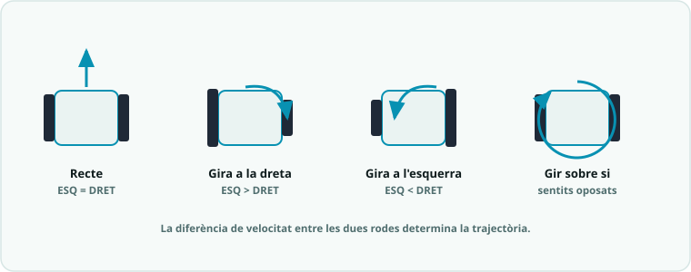

# SA7 · Robòtica mòbil: cinemàtica i trajectòries

Setena situació d'aprenentatge (**8 h · 4 sessions** + sessió 0 de muntatge, 3r trimestre). El robot **es mou sol**: control diferencial de motors, **trajectòries** programades (quadrat, recorregut) i **comportaments autònoms** (evita-obstacles amb ultrasons, seguidor de línia amb IR), amb proves i **iteració**. Maquinari: **el teu rover**, el robot que muntes a la **sessió 0** ([dossier del rover](../00_General/00_Projecte_T3_Rover.md)); la placa Imagina 3dBot queda de **reserva** (pla B). Programació oficial: [`Programació didàctica/16_SA7_Robotica_mobil.md`](../../Programació%20didàctica/16_SA7_Robotica_mobil.md).

> ⚙️ **Important:** els `.ino` de la SA7 estan escrits per a la placa 3dBot (un pin de direcció per motor). El **L298N del rover** en fa servir dos: no n'hi ha prou de canviar els números. A la [Pràctica 1](codi/01_moviment_basic/EXPLICACIO.md) (pas 4) hi tens el **bloc del rover** que substitueix els pins i la funció `motors()`; a les altres pràctiques es fa igual. Si treballes amb la 3dBot de reserva, posa-hi els pins reals del seu manual. La lògica no s'ha de tocar.

En acabar aquesta SA podràs: 1) moure el teu rover amb funcions pròpies (cinemàtica diferencial); 2) programar i **calibrar** una trajectòria; 3) fer-lo **autònom**: evitar obstacles i seguir una línia, iterant per millorar.

> 💻 **Com carregar el codi d'una pràctica:** dins de la pràctica, al pas «Carrega el codi», prem **Copia**, enganxa'l a l'Arduino IDE, canvia-hi el **bloc de pins del rover** (Pràctica 1, pas 4) i prem **→ Puja**.

## 🧭 La teva ruta

Fes les pràctiques **en ordre i al teu ritme**. Cada pràctica acaba enviant el seu formulari de Classroom i la foto de la pràctica. Les 🚩 et diuen on hauries de ser al final de cada sessió.

- ⓪ **Sessió 0 · Munta el teu rover** — peces, muntatge, cablatge i test de fum, al **[dossier del rover](../00_General/00_Projecte_T3_Rover.md)**.

🚩 **Final de la Sessió 0:** el rover muntat, cablejat i amb el test de fum superat.

- ① [Pràctica 1 · Moviment bàsic](codi/01_moviment_basic/EXPLICACIO.md) — cinc funcions per moure el rover, i el codi adaptat als seus pins.

🚩 **Final de la Sessió 1:** formulari de la ① enviat i el full del 📓 quadern de la sessió omplert.

- ② [Pràctica 2 · Trajectòria en quadrat](codi/02_trajectoria_quadrat/EXPLICACIO.md) — calcules i calibres el gir de 90°.

🚩 **Final de la Sessió 2:** formulari de la ② enviat i el full del 📓 quadern omplert.

- ③ [Pràctica 3 · Evita-obstacles](codi/03_evita_obstacles/EXPLICACIO.md) — el primer comportament autònom: percepció, decisió, acció.

🚩 **Final de la Sessió 3:** formulari de la ③ enviat i el full del 📓 quadern omplert.

- ④ [Pràctica 4 · Seguidor de línia](codi/04_seguidor_linia/EXPLICACIO.md) — el producte: el rover segueix la pista i en millores el temps de volta.

🚩 **Final de la Sessió 4:** formulari de la ④ enviat, **Entrega final** feta i el full del 📓 quadern omplert.

## 🏁 Entrega final

**Quan hagis acabat la ④:**

1. 🎤 **Demostració a la pista i defensa de 2'**: el rover seguint la línia, i una decisió tècnica (per què aquest llindar, aquesta velocitat). S'avalua amb **R1**, **R3** i **R4**.
2. 📤 Respon i envia l'[Entrega final de la SA7](https://classroom.google.com/c/ODY4ODU4Njk0NTEy/a/ODk5NDU4NTg5Nzkz/details): autoavaluació i checklist final.

> ✅ **Versió nucli** (per aprovar n'hi ha prou amb): el rover es mou amb funcions pròpies, evita obstacles i fa almenys una volta a la pista seguint la línia, amb el registre d'iteracions.

## 📦 Què has d'entregar

| Quan | Què | On |
|---|---|---|
| S1 | Formulari i foto de la Pràctica 1 | Tasques de Classroom (enllaços a l'últim pas de cada pràctica) |
| S2 | Formulari i foto de la Pràctica 2 | Les tasques de Classroom de la pràctica |
| S3 | Formulari i foto de la Pràctica 3 | Les tasques de Classroom de la pràctica |
| S4 | Formulari i foto de la Pràctica 4 + **el rover autònom**, demostració i defensa de 2' + **Entrega final** | A l'aula i a Classroom. S'avalua amb **R1**, **R3** i **R4** |
| ⭐ | [Repte triat (A, B o C)](../../Reptes/Reptes_SA7.md) | El docent el valida i pinteu l'estrella al [tauler de reptes](../00_General/00_Tauler_reptes.md) |
| 📓 | Full del quadern tècnic de cada sessió | En paper, en acabar la sessió |
| 🤖 | El rover muntat i funcionant | És la plataforma de tota la SA: [dossier del rover](../00_General/00_Projecte_T3_Rover.md) |

## 📚 Per repassar a casa

- [Reptes de la SA7](../../Reptes/Reptes_SA7.md) — tria el teu context.
- [Exemple resolt](SA7_exemple_resolt.md) · [Diagrama de flux](SA7_diagrama_flux.md) · [Qüestionari de conceptes](SA7_questionari_conceptes.md)
- [Fitxa base](SA7_fitxa_alumnat.md) — objectius, com s'avalua i què fer si alguna cosa no funciona.
- [Fitxa ampliada](SA7_fitxa_ampliada.md) · [Recursos de vídeo](SA7_recursos_video_IA.md) · [Esquemes i connexions](SA7_esquemes_connexions.md)

<!-- web:only-github -->
## Contingut

| Fitxer | Descripció |
|---|---|
| [`SA7_guia_docent.md`](SA7_guia_docent.md) | Guia del professorat: objectius, 4 sessions, mètode de projecte, mapa d'avaluació i errors freqüents. |
| [`SA7_fitxa_alumnat.md`](SA7_fitxa_alumnat.md) | **Fitxa base** (nucli d'una cara, per a tot l'alumnat): Activitats 1-4 + quadern. |
| [`SA7_fitxa_ampliada.md`](SA7_fitxa_ampliada.md) | **Versió ampliada** (aprofundiment): totes les rutines (ajuda entre iguals, revisió creuada, exit ticket, ODS, PC) i ampliacions. |
| [`SA7_checklist_docent.md`](SA7_checklist_docent.md) | **Checklist docent** (una cara): logística prèvia, punts de control per sessió, avaluació i diversitat. |
| [`SA7_checklist_alumnat.md`](SA7_checklist_alumnat.md) | **Checklist alumnat** (una cara): què he de fer/lliurar + autoavaluació amb semàfor. |
| [`SA7_esquemes_connexions.md`](SA7_esquemes_connexions.md) | Esquemes i connexions (motors, sensors de línia/distància). |
| `codi/` | Sketches d'Arduino (vegeu la taula següent). |

### Codi (`codi/`)

| Sketch | Què mostra |
|---|---|
| `01_moviment_basic.ino` | Funcions de moviment i cinemàtica diferencial. |
| `02_trajectoria_quadrat.ino` | Trajectòria programada i calibratge del gir de 90°. |
| `03_evita_obstacles.ino` | Comportament reactiu (llaç tancat) amb ultrasons (amb esquelet «Si t'encalles» a la seva pàgina). |
| `04_seguidor_linia.ino` | Seguidor de línia amb sensors IR. |

Cada sketch té la seva **pàgina de pràctica** a la web (per què es fa + codi explicat per blocs); a GitHub, l'explicació és a l'`EXPLICACIO.md` de la carpeta del sketch.

<!-- /web:only-github -->

## Producte i avaluació

- **Producte:** robot mòbil que completa un repte autònom (seguir línia o evitar obstacles) amb codi modular i **registre d'iteracions**.
- **Criteris:** CA4.1, CA3.1, CA1.1 · **Rúbriques:** **R1** (codi), **R3** (robot/control), **R4** (documentació).

## Continuïtat

Ve de la **SA6** (control: llaç tancat i màquines d'estats) i porta a la **SA8** (IoT i IA). Aquí el control es posa **en moviment**; després el robot es **connectarà** i prendrà **decisions intel·ligents**.
