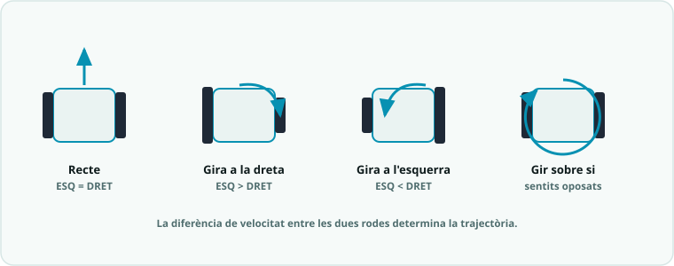
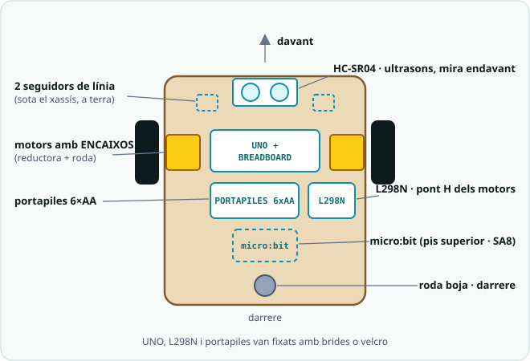

# Pràctica 1 · Moviment bàsic: funcions per moure el rover

<div class="cap-practica" markdown="1">

❓ **La pregunta:** Com gira un robot que no té volant?

🎯 **Avui aconseguiràs:** que el teu rover avanci, giri i s'aturi amb cinc funcions amb nom, i entendre per què gira quan les dues rodes fan coses diferents.

⏱️ La sessió (el rover ja és muntat de la Sessió 0)

📦 El teu rover amb el portapiles carregat, el cable USB i una capsa per aixecar-lo

</div>

## 🚀 Pas a pas

### Pas 1 · Endevina abans de provar

El rover no té volant: cada roda té el seu motor. Mira aquestes funcions del codi.

```cpp
void endavant()      { motors(HIGH, VEL, HIGH, VEL); }
void gira_dreta()    { motors(HIGH, VEL, LOW,  VEL); }   // esq endavant, dret enrere
void atura()         { motors(HIGH, 0, HIGH, 0); }
```



✍️ **Apunta-ho:** PREDIU: què farà el rover amb `gira_dreta()`? Què fa cada roda?

### Pas 2 · Prepara el rover

Posa el rover **sobre una capsa**, amb les rodes a l'aire: així no sortirà corrent de la taula mentre proves. Portapiles connectat i interruptor engegat.



✅ **Comprova:** el L298N té el LED encès i les rodes poden girar lliures.

### Pas 3 · Copia el codi (encara no el pugis)

Prem **Copia** i enganxa'l a l'Arduino IDE (esborra el que hi hagués). **No el pugis encara:** està escrit per a una altra placa i al pas següent l'adaptes al teu rover.

<!-- codi-complet -->

### Pas 4 · Adapta'l al teu rover

El L298N del rover fa servir **dos pins de direcció per motor**. Al codi, esborra les **quatre línies de pins dels motors** (`ESQ_DIR`, `ESQ_VEL`, `DRET_DIR`, `DRET_VEL`) i la funció `motors()`, i enganxa-hi aquest bloc al seu lloc. **Deixa la línia de `VEL`**: el programa ja la té. Després, al `setup()`, canvia els quatre `pinMode` dels motors per una sola línia: `setupMotors();`.

```cpp
// === PINS DEL ROVER (L298N) ===
const int ESQ_ENA = 5, ESQ_IN1 = 4, ESQ_IN2 = 3;   // motor esquerre
const int DRET_ENB = 6, DRET_IN3 = 7, DRET_IN4 = 8; // motor dret

void motors(int dirEsq, int velEsq, int dirDret, int velDret) {
  digitalWrite(ESQ_IN1, dirEsq);
  digitalWrite(ESQ_IN2, !dirEsq);      // el contrari del primer
  analogWrite(ESQ_ENA, velEsq);
  digitalWrite(DRET_IN3, dirDret);
  digitalWrite(DRET_IN4, !dirDret);
  analogWrite(DRET_ENB, velDret);
}

void setupMotors() {   // crida-la des de setup()
  pinMode(ESQ_ENA, OUTPUT);  pinMode(ESQ_IN1, OUTPUT);  pinMode(ESQ_IN2, OUTPUT);
  pinMode(DRET_ENB, OUTPUT); pinMode(DRET_IN3, OUTPUT); pinMode(DRET_IN4, OUTPUT);
}
```

✅ **Comprova:** l'IDE **compila** sense errors (botó ✔).

✍️ **Apunta-ho:** pins dels motors del teu rover: esquerre (ENA, IN1, IN2) i dret (ENB, IN3, IN4).

### Pas 5 · Puja-ho i prova-ho

Prem **→ Puja** amb el rover sobre la capsa. Mira les rodes: endavant, aturat, gir. Després posa'l a terra.

✅ **Comprova:** a terra, el rover avança una mica, s'atura i gira cap a la dreta, i ho repeteix. Si una roda gira al revés, intercanvia els dos cables d'aquell motor al L298N.

✍️ **Apunta-ho:** per girar a la dreta, què ha de fer la roda esquerra respecte de la dreta?

### Pas 6 · Fes el teu ball

Canvia el `loop()` per una **seqüència de ball** teva: combina les cinc funcions amb els teus temps (`delay`).

✍️ **Apunta-ho:** la teva seqüència de ball: quines funcions i quins temps?

✍️ **Apunta-ho:** per què tot el moviment passa per una sola funció, `motors()`?

### Pas 7 · Respon i envia

📤 [Obre la tasca «SA7 · Pràctica 1» a Classroom i envia el formulari](https://classroom.google.com/c/ODY4ODU4Njk0NTEy/a/ODk5NDU1ODk1NDU0/details)

📷 [Penja la foto de la teva pràctica a la tasca «Foto · SA7 · Pràctica 1»](https://classroom.google.com/c/ODY4ODU4Njk0NTEy/a/ODk5NDUyNjQ2NDYw/details)

Hi trobaràs les mateixes preguntes ✍️ que has anat apuntant. Envia'l ara. A la sessió següent: **[Pràctica 2 · Trajectòria en quadrat](../02_trajectoria_quadrat/EXPLICACIO.md)**.

⭐ **Si acabes abans:** fes que el rover vagi **recte de debò**: si es desvia, abaixa una mica la velocitat de la roda ràpida dins `endavant()`. Més reptes a **[Reptes de la SA7](../../../../Reptes/Reptes_SA7.md)**; quan el docent te'l validi, pinta l'estrella al [tauler de reptes](../../../00_General/00_Tauler_reptes.md).

<details markdown="1">
<summary>🧗 Si t'encalles</summary>

| Símptoma | Causa probable |
|---|---|
| El robot no es mou gens | Pins que no són els del rover, o bateria descarregada (l'USB sol no alimenta els motors). |
| No va recte: es desvia sempre cap a un costat | Motors desiguals (cap robot real és perfecte). Compensa: abaixa una mica la `VEL` de la roda ràpida dins `endavant()`. |
| Un moviment surt al revés | Cables d'un motor invertits al L298N: intercanvia'ls (no toquis el codi). |
| Error en compilar: `ESQ_DIR` no declarat | Has esborrat els pins però no els `pinMode` antics del `setup()`: canvia'ls per `setupMotors();`. |
| Error en compilar: `redefinition of 'const int VEL'` | Has enganxat una `VEL` de més: deixa'n només una. |

</details>

<details markdown="1">
<summary>🧠 Vols saber per què funciona?</summary>

### Per què fem aquesta pràctica

El teu rover gira amb **cinemàtica diferencial**: cada roda té el seu motor, i el que decideix la trajectòria és la **diferència** entre elles. Dues rodes a la mateixa velocitat = recte; velocitats o sentits diferents = gir. Tota la robòtica mòbil de la SA7 penja d'aquesta idea.

L'altra idea és de programació: en lloc d'escampar `digitalWrite` i `analogWrite` pel `loop()`, empaquetes cada moviment en una **funció amb nom**. A partir d'avui, programar el robot és **combinar aquestes crides**.

### Bloc 1 — `motors()`: una funció que ho governa tot

Tot el control del robot passa per `motors()`: direcció i velocitat de cada roda, en una sola crida. És l'única funció que toca els pins dels motors. Per això adaptar el codi al rover ha costat **una sola funció**: les altres només decideixen quins valors passar-li.

### Bloc 2 — El vocabulari de moviments

```cpp
void endavant()      { motors(HIGH, VEL, HIGH, VEL); }
void enrere()        { motors(LOW,  VEL, LOW,  VEL); }
void gira_dreta()    { motors(HIGH, VEL, LOW,  VEL); }   // esq endavant, dret enrere
void gira_esquerra() { motors(LOW,  VEL, HIGH, VEL); }
void atura()         { motors(HIGH, 0, HIGH, 0); }
```

`gira_dreta()`: roda esquerra **endavant**, roda dreta **enrere** → el robot pivota sobre si mateix. `atura()` posa les dues velocitats a **0**: un motor a velocitat 0 no gira, tant se val cap on apunti.

### Bloc 3 — Una seqüència de prova

```cpp
void loop() {
  endavant();      delay(1500);
  atura();         delay(500);
  gira_dreta();    delay(600);
  atura();         delay(500);
}
```

Una funció de moviment **engega** els motors i el `delay` decideix **quanta estona** duren. Aquest matís és clau per a la Pràctica 2.

### On ho aplicaràs

- **Tota la SA:** el [quadrat](../02_trajectoria_quadrat/EXPLICACIO.md), l'[evita-obstacles](../03_evita_obstacles/EXPLICACIO.md) i el [seguidor de línia](../04_seguidor_linia/EXPLICACIO.md) reutilitzen aquestes mateixes funcions: només canvia **qui decideix** quan cridar-les.
- **Robot del trimestre:** aquest sketch és la base de moviment del teu **rover** ([dossier](../../../00_General/00_Projecte_T3_Rover.md)).

</details>
