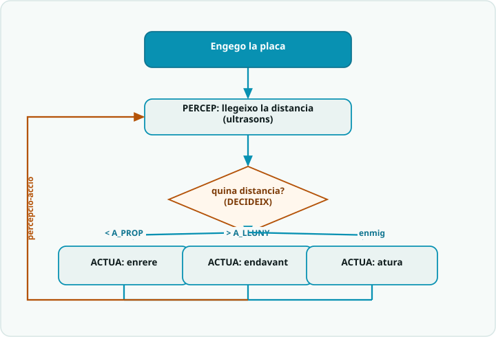

# Pràctica 3 · Evita-obstacles: percepció, decisió, acció

<div class="cap-practica" markdown="1">

❓ **La pregunta:** Com decideix sol un robot per on ha de passar?

🎯 **Avui aconseguiràs:** el primer comportament **autònom** del rover: avança i, quan l'ultrasons veu un obstacle, recula i busca via lliure.

⏱️ La sessió

📦 El teu rover amb l'ultrasons HC-SR04 al davant, un regle i unes quantes capses per fer obstacles

</div>

## 🚀 Pas a pas

### Pas 1 · Comprova l'ultrasons

L'ultrasons va al davant del rover: **TRIG al D12** i **ECHO al D11**, VCC a 5V i GND a GND. El rover avança, **percep**, **decideix** i **actua**, una vegada i una altra:



✅ **Comprova:** l'ultrasons mira endavant, recte, i no toca cap cable ni la roda.

### Pas 2 · Endevina abans de provar

Desplega el codi complet del pas 3 i busca `DIST_MIN` i la branca de l'`if`.

✍️ **Apunta-ho:** PREDIU: a quina distància deixarà d'avançar? Què farà quan detecti l'obstacle, i en quin ordre?

### Pas 3 · Carrega el codi

Prem **Copia** i enganxa'l a l'Arduino IDE. Canvia el bloc de pins i `motors()` pel **bloc del rover** de la [Pràctica 1](../01_moviment_basic/EXPLICACIO.md) (pas 4). `TRIG` i `ECHO` ja són 12 i 11. Prem **→ Puja**.

<!-- codi-complet -->

✅ **Comprova:** a terra, el rover avança i, davant d'una capsa, s'atura, recula i gira.

### Pas 4 · Calibra el llindar

Posa una capsa davant del rover i mesura amb el regle a quina distància reacciona. Si toca la capsa abans d'aturar-se, apuja `DIST_MIN`; si «té por» de tot, abaixa'l.

✍️ **Apunta-ho:** a quina distància gira el teu rover? Quin `DIST_MIN` has triat i per què?

### Pas 5 · Millora l'estratègia

Fes un petit laberint amb capses i mira on s'encalla. Canvia la maniobra: recular més, girar més, o girar a un costat aleatori amb `random(2)`.

✍️ **Apunta-ho:** quina millora has fet a la maniobra i per què?

✍️ **Apunta-ho:** què és el cicle percepció → decisió → acció? Explica'l amb el teu rover.

### Pas 6 · Respon i envia

📤 [Obre la tasca «SA7 · Pràctica 3» a Classroom i envia el formulari](https://classroom.google.com/c/ODY4ODU4Njk0NTEy/a/ODk5NDU4MTk1MDE0/details)

📷 [Penja la foto de la teva pràctica a la tasca «Foto · SA7 · Pràctica 3»](https://classroom.google.com/c/ODY4ODU4Njk0NTEy/a/ODk5NDU4NTI1MDY0/details)

Hi trobaràs les mateixes preguntes ✍️ que has anat apuntant. Envia'l ara. A la sessió següent: **[Pràctica 4 · Seguidor de línia](../04_seguidor_linia/EXPLICACIO.md)**.

⭐ **Si acabes abans:** com més a prop és l'obstacle, gir més tancat. Compara el teu raonament amb l'[exemple resolt](../../SA7_exemple_resolt.md) (el robot «prudent»). Més reptes a **[Reptes de la SA7](../../../../Reptes/Reptes_SA7.md)**; quan el docent te'l validi, pinta l'estrella al [tauler de reptes](../../../00_General/00_Tauler_reptes.md).

<details markdown="1">
<summary>🧗 Si t'encalles</summary>

| Símptoma | Causa probable |
|---|---|
| Sempre avança (i xoca) o sempre està evitant | `TRIG` i `ECHO` intercanviats, o falta `pinMode(ECHO, INPUT)`: `distancia()` retorna sempre 400 o sempre 0. |
| Es queda encallat en una cantonada | Estratègia massa simple per a aquell racó: allarga el gir o recula més. És el repte del pas 5, no un error. |
| Reacciona tard i toca l'obstacle | `DIST_MIN` massa petit per a la velocitat que porta: apuja el llindar o abaixa `VEL`. |
| No detecta la pota de la cadira | L'ultrasons vol superfícies que tornin l'eco: objectes prims o en angle el despisten. Prova amb una capsa. |

**L'esquelet.** Si el cicle no et surt, parteix d'aquest esquelet: les funcions de moviment i `distancia()` ja estan fetes; tu omples els `// TODO:` del `loop()`. Té **dos llindars** i una zona intermèdia, com l'[exemple resolt](../../SA7_exemple_resolt.md). Recorda canviar-hi el bloc de pins pel del rover.

```cpp
/*
  SA7 - robot reactiu (BASTIDA / esquelet per comencar)
  Les funcions de MOVIMENT i de PERCEPCIO (distancia()) ja estan fetes.
  Tu nomes has d'OMPLIR el loop(): PERCEPCIO -> DECISIO -> ACCIO.
*/

// === PINS (canvia'ls pel bloc del rover de la Practica 1) ===
const int ESQ_DIR = 4;
const int ESQ_VEL = 5;
const int DRET_DIR = 7;
const int DRET_VEL = 6;

const int TRIG = 12;
const int ECHO = 11;

const int VEL = 180;
const int A_PROP  = 12;   // cm: per sota, obstacle a prop
const int A_LLUNY = 25;   // cm: per sobre, via lliure

void motors(int dirEsq, int velEsq, int dirDret, int velDret) {
  digitalWrite(ESQ_DIR, dirEsq);
  analogWrite(ESQ_VEL, velEsq);
  digitalWrite(DRET_DIR, dirDret);
  analogWrite(DRET_VEL, velDret);
}
void endavant()      { motors(HIGH, VEL, HIGH, VEL); }
void enrere()        { motors(LOW,  VEL, LOW,  VEL); }
void gira_dreta()    { motors(HIGH, VEL, LOW,  VEL); }
void gira_esquerra() { motors(LOW,  VEL, HIGH, VEL); }
void atura()         { motors(HIGH, 0, HIGH, 0); }

float distancia() {
  digitalWrite(TRIG, LOW);  delayMicroseconds(2);
  digitalWrite(TRIG, HIGH); delayMicroseconds(10);
  digitalWrite(TRIG, LOW);
  long t = pulseIn(ECHO, HIGH, 30000);   // timeout 30 ms
  if (t == 0) return 400;                // res detectat -> molt lluny
  return t * 0.034 / 2.0;
}

void setup() {
  pinMode(ESQ_DIR, OUTPUT);  pinMode(ESQ_VEL, OUTPUT);
  pinMode(DRET_DIR, OUTPUT); pinMode(DRET_VEL, OUTPUT);
  pinMode(TRIG, OUTPUT);     pinMode(ECHO, INPUT);
  atura();
}

void loop() {
  float d = distancia();          // 1) PERCEPCIO
  if (d < A_PROP) {
    // TODO: obstacle a prop. Que fa el robot?
    atura();
  } else if (d > A_LLUNY) {
    // TODO: via lliure. Que fa el robot?
    atura();
  } else {
    // TODO: zona intermedia. Que decideixes aqui?
    atura();
  }
  delay(30);                      // ritme del cicle: curt
}
```

</details>

<details markdown="1">
<summary>🧠 Vols saber per què funciona?</summary>

### Per què fem aquesta pràctica

Fins ara el robot executava un pla cec. Avui **percep l'entorn i decideix sol**. És **control en llaç tancat** (SA6): el sensor mana sobre l'acció, no el rellotge. El patró **percepció → decisió → acció** és el que fa, milers de vegades per segon, un cotxe autònom.

### Bloc 1 — La percepció: `distancia()`

El **timeout de 30 ms** de `pulseIn` és vital amb el robot en marxa (sense ell, esperaria fins a 1 s). I el `return 400` vol dir «res al davant = molt lluny».

### Bloc 2 — La decisió: un llindar amb nom

```cpp
const int DIST_MIN = 15;            // cm: per sota, evita
```

Tota l'«intel·ligència» del robot és aquesta frontera, i s'ha de **calibrar** a la teva pista.

### Bloc 3 — El cicle i la maniobra

```cpp
  if (d < DIST_MIN) {
    atura();        delay(150);
    enrere();       delay(400);
    atura();        delay(150);
    gira_dreta();   delay(450);
    atura();        delay(150);
  } else {
    endavant();
  }
  delay(30);
```

Primer **recula** (per fer-se lloc) i després gira. El `delay(30)` final és curt a consciència: mentre hi ha un `delay`, el robot **no mesura**.

### On ho aplicaràs

- **Pràctica 4:** el seguidor de línia és el mateix cicle amb sensors IR.
- **Robot del trimestre:** el comportament autònom estrella del teu **rover** ([dossier](../../../00_General/00_Projecte_T3_Rover.md)).

</details>
