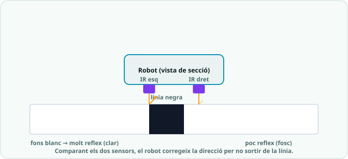

# Pràctica 4 · Seguidor de línia: dos sensors IR i correcció

<div class="cap-practica" markdown="1">

❓ **La pregunta:** Com segueix un robot una línia pintada a terra?

🎯 **Avui aconseguiràs:** el **producte de la SA**: el rover segueix la línia de la pista tot sol, i tu en millores el temps de volta iterant.

⏱️ La sessió (és la sessió de producte: es tanca avui)

📦 El teu rover amb els dos seguidors de línia sota el xassís, la pista i un cronòmetre (el mòbil)

</div>

## 🚀 Pas a pas

### Pas 1 · Calibra els sensors

Els dos seguidors de línia van a **A0** (esquerre) i **A1** (dret). Carrega aquest sketch curt, obre el **Monitor sèrie** (9600) i posa cada sensor sobre la **línia** i sobre el **fons**.

```cpp
void setup() { Serial.begin(9600); }
void loop() {
  Serial.print(analogRead(A0));
  Serial.print("  ");
  Serial.println(analogRead(A1));
  delay(200);
}
```



✅ **Comprova:** els números canvien clarament entre línia i fons. El **llindar** és el número del mig.

✍️ **Apunta-ho:** el valor «línia» i el valor «fons» de cada sensor, i el llindar que tries.

### Pas 2 · Endevina abans de provar

Desplega el codi complet del pas 4 i mira la cadena `if / else if` del `loop()`.

✍️ **Apunta-ho:** PREDIU: què farà el rover si **només** el sensor esquerre veu la línia? I si **cap** dels dos no la veu?

### Pas 3 · Adapta'l al rover

El codi està escrit per a sensors digitals als pins 2 i 3, i al rover el **D2 és el para-xocs** i el **D3 és un motor**. Fes aquests canvis:

1. Adapta'l al rover com a la [Pràctica 1](../01_moviment_basic/EXPLICACIO.md) (pas 4): la línia de pins dels motors i `motors()` pel **bloc del rover**, i els `pinMode` dels motors del `setup()` per `setupMotors();`.
2. Canvia els sensors i la manera de llegir-los, amb el teu llindar:

```cpp
const int S_ESQ = A0;
const int S_DRET = A1;
const int LLINDAR_LINIA = 500;   // <-- el teu llindar del pas 1

  bool liniaEsq  = (analogRead(S_ESQ)  > LLINDAR_LINIA);
  bool liniaDret = (analogRead(S_DRET) > LLINDAR_LINIA);
```

✅ **Comprova:** si al pas 1 la línia donava números **més petits** que el fons, canvia el `>` per `<`.

### Pas 4 · Carrega el codi

Prem **Copia**, enganxa'l a l'Arduino IDE, fes-hi els canvis del pas 3 i prem **→ Puja**.

<!-- codi-complet -->

✅ **Comprova:** posat sobre la línia, el rover la segueix i corregeix quan se'n desvia.

### Pas 5 · Repte de pista

Fes **tres voltes** a la pista i cronometra-les. Entre volta i volta, canvia **una sola cosa** (la `VEL`, el llindar, la correcció) i apunta què has canviat.

✍️ **Apunta-ho:** temps de volta: intent 1, intent 2 i intent 3.

✍️ **Apunta-ho:** quines millores has fet entre intents i quina ha funcionat millor?

✍️ **Apunta-ho:** un error que has trobat i com l'has resolt.

### Pas 6 · Respon i envia

📤 [Obre la tasca «SA7 · Pràctica 4» a Classroom i envia el formulari](https://classroom.google.com/c/ODY4ODU4Njk0NTEy/a/ODk5NDU3NDY4NjM5/details)

📷 [Penja la foto de la teva pràctica a la tasca «Foto · SA7 · Pràctica 4»](https://classroom.google.com/c/ODY4ODU4Njk0NTEy/a/ODk5NDU4MjAxNjAx/details)

Hi trobaràs les mateixes preguntes ✍️ que has anat apuntant. Envia'l ara i passa a l'**[Entrega final](../../README.md#entrega-final)**: demostració a la pista i autoavaluació.

⭐ **Si acabes abans:** correcció **proporcional**: com més desviat, més gir. És la resposta de veritat a la ziga-zaga (la idea de la SA6). I recorda que **un** dels reptes de la SA s'escriu ✏️ **a full en blanc**: editor buit, només el teu pseudocodi. Més reptes a **[Reptes de la SA7](../../../../Reptes/Reptes_SA7.md)**; quan el docent te'l validi, pinta l'estrella al [tauler de reptes](../../../00_General/00_Tauler_reptes.md).

<details markdown="1">
<summary>🧗 Si t'encalles</summary>

| Símptoma | Causa probable |
|---|---|
| No detecta mai la línia | Llindar mal triat o sensors massa alts: els IR volen estar a pocs mil·límetres del terra. Torna al pas 1 amb la pista real (la llum de l'aula hi influeix). |
| Fa just el contrari: fuig de la línia | Comparació al revés: canvia el `>` per `<` al pas 3. |
| En llegir un sensor es mou un motor | Has deixat els pins 2 i 3 del sketch original: al rover són A0 i A1. |
| Fa molta ziga-zaga | En part és normal: la correcció és tot o res. Abaixa `VEL`… o prova la correcció proporcional. |
| Perd la línia a les corbes tancades | Va massa ràpid per a la corba: abaixa `VEL`. |

</details>

<details markdown="1">
<summary>🧠 Vols saber per què funciona?</summary>

### Per què fem aquesta pràctica

Als magatzems hi ha robots (AGV) que es passen el dia seguint línies pintades a terra. Dos sensors **IR** miren el terra i distingeixen la línia negra (poc reflex) del fons clar (molt reflex). Si **només un** veu la línia, el robot s'ha desviat i **corregeix** cap a la línia.

### Bloc 1 — Corregir = frenar una roda

```cpp
void corregeix_dreta(){ motors(HIGH, VEL, HIGH, 0); }   // frena roda dreta
void corregeix_esq()  { motors(HIGH, 0,  HIGH, VEL); }  // frena roda esquerra
```

No cal posar una roda enrere: n'hi ha prou de **frenar-ne una** i deixar que l'altra empenyi.

### Bloc 2 — Quatre situacions, quatre respostes

```cpp
  if (liniaEsq && liniaDret) {
    endavant();
  } else if (liniaEsq && !liniaDret) {
    corregeix_esq();
  } else if (!liniaEsq && liniaDret) {
    corregeix_dreta();
  } else {
    endavant();                 // cap sensor: continua
  }
  delay(10);
```

Dos sensors amb dos valors = **4 combinacions**, i la cadena les cobreix totes. Quan cap sensor veu la línia, aquest codi continua recte: és una **decisió de disseny** (funciona als encreuaments).

### On ho aplicaràs

- **D'on ve:** el cicle reactiu de l'[evita-obstacles](../03_evita_obstacles/EXPLICACIO.md); aquí només canvia el sensor i la finor de l'acció.
- **Robot del trimestre:** un dels comportaments de demostració del teu **rover** ([dossier](../../../00_General/00_Projecte_T3_Rover.md)).

</details>
