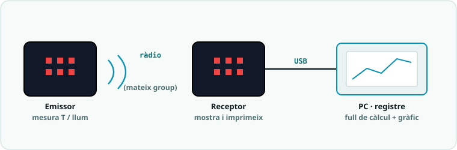

# SA8 · IoT i IA: el robot connectat i intel·ligent

Vuitena situació d'aprenentatge (**6 h · 3 sessions**, 3r trimestre). El sistema es **connecta** i comença a **decidir**: **telemetria** (enviar/rebre dades de sensors per ràdio), concepte d'**Internet de les coses** amb les seves aplicacions i **riscos**, i una **introducció a la IA** (classificar gestos amb l'acceleròmetre), amb reflexió **ètica i de privacitat**. Maquinari: micro:bit + Micro:shield (ESP32 opcional). Programació oficial: [`Programació didàctica/17_SA8_IoT_IA.md`](../../Programació%20didàctica/17_SA8_IoT_IA.md).

En acabar aquesta SA podràs: 1) enviar i rebre **dades de sensors** per ràdio (telemetria); 2) analitzar els **riscos** d'un producte IoT real; 3) entendre com **classifica** una IA, amb regles i amb exemples, i on falla.

> 💻 **Com carregar el codi d'una pràctica:** dins de la pràctica, al pas «Carrega el codi», prem **Copia** i enganxa'l a **[python.microbit.org](https://python.microbit.org)**.

## 🧭 La teva ruta

Fes les pràctiques **en ordre i al teu ritme**. Cada pràctica acaba enviant el seu formulari de Classroom i la foto de la pràctica. Les 🚩 et diuen on hauries de ser al final de cada sessió.

- ① [Pràctica 1 · L'emissor](codi/01_telemetria_emissor_EXPLICACIO.md) — una micro:bit mesura i envia dades etiquetades.
- ② [Pràctica 2 · El receptor](codi/02_telemetria_receptor_EXPLICACIO.md) — l'altra micro:bit les rep, avisa i les registra.

🚩 **Final de la Sessió 1:** formularis de la ① i la ② enviats i el full del 📓 quadern de la sessió omplert.

- ③ [Pràctica 3 · Auditoria d'un producte IoT](SA8_auditoria_iot.md) — fas d'auditor/a de privacitat d'un producte real.

🚩 **Final de la Sessió 2:** formulari de la ③ enviat, l'informe guardat i el full del 📓 quadern omplert.

- ④ [Pràctica 4 · IA de gestos](codi/03_ia_gestos_EXPLICACIO.md) — classificar amb regles fetes a mà.
- ⑤ [Pràctica 5 · Teachable Machine](SA8_practica_teachable_machine.md) — el producte: una IA que aprèn d'exemples, i on falla.

🚩 **Final de la Sessió 3:** formularis de la ④ i la ⑤ enviats, **Entrega final** feta i el full del 📓 quadern omplert.

> ⭐ **Ampliació:** l'[ESP32 per WiFi](codi/04_esp32_telemetria/EXPLICACIO.md), el pas cap a l'IoT real.

## 🏁 Entrega final

**Quan hagis acabat la ⑤:**

1. 🎤 **Demostració d'1-2'**: el teu classificador funcionant i on falla, amb una decisió sobre les dades. S'avalua amb **R1**, **R3** i **R4**.
2. 📤 Respon i envia l'[Entrega final de la SA8](https://classroom.google.com/c/ODY4ODU4Njk0NTEy/a/ODk5NDU3MTc5NjE4/details): autoavaluació i checklist final.

> ✅ **Versió nucli** (per aprovar n'hi ha prou amb): la telemetria funcionant entre dues plaques, l'informe d'auditoria amb diagrama, un risc i una recomanació, i el classificador entrenat amb la reflexió sobre el biaix.

## 📦 Què has d'entregar

| Quan | Què | On |
|---|---|---|
| S1 | Formularis i fotos de les Pràctiques 1 i 2 | Tasques de Classroom (enllaços a l'últim pas de cada pràctica) |
| S2 | Formulari i foto de la Pràctica 3 (l'informe d'auditoria) | Les tasques de Classroom de la pràctica |
| S3 | Formularis i fotos de les Pràctiques 4 i 5 + **el classificador** i demostració + **Entrega final** | A l'aula i a Classroom. S'avalua amb **R1**, **R3** i **R4** |
| ⭐ | [Repte triat (A, B o C)](../../Reptes/Reptes_SA8.md) | El docent el valida i pinteu l'estrella al [tauler de reptes](../00_General/00_Tauler_reptes.md) |
| 📓 | Full del quadern tècnic de cada sessió | En paper, en acabar la sessió |
| 🤖 | La telemetria del rover (micro:bit al rover + base amb OLED) | Es registra al [dossier del rover](../00_General/00_Projecte_T3_Rover.md) |

## 📚 Per repassar a casa

- [Reptes de la SA8](../../Reptes/Reptes_SA8.md) — tria el teu context.
- [Exemple resolt](SA8_exemple_resolt.md) · [Diagrama de flux](SA8_diagrama_flux.md) · [Qüestionari de conceptes](SA8_questionari_conceptes.md)
- [Fitxa base](SA8_fitxa_alumnat.md) — objectius, com s'avalua i què fer si alguna cosa no funciona.
- [Fitxa ampliada](SA8_fitxa_ampliada.md) · [Connexions i entorn](SA8_connexions.md)

<!-- web:only-github -->
## Contingut

| Fitxer | Descripció |
|---|---|
| [`SA8_guia_docent.md`](SA8_guia_docent.md) | Guia del professorat: objectius, 3 sessions, mètode de projecte, mapa d'avaluació i errors freqüents. |
| [`SA8_fitxa_alumnat.md`](SA8_fitxa_alumnat.md) | **Fitxa base** (nucli d'una cara, per a tot l'alumnat): Activitats 1-3 + quadern. |
| [`SA8_fitxa_ampliada.md`](SA8_fitxa_ampliada.md) | **Versió ampliada** (aprofundiment): totes les rutines (ajuda entre iguals, revisió creuada, exit ticket, ODS, PC) i ampliacions. |
| [`SA8_checklist_docent.md`](SA8_checklist_docent.md) | **Checklist docent** (una cara): logística prèvia, punts de control per sessió, avaluació i diversitat. |
| [`SA8_checklist_alumnat.md`](SA8_checklist_alumnat.md) | **Checklist alumnat** (una cara): què he de fer/lliurar + autoavaluació amb semàfor. |
| [`SA8_auditoria_iot.md`](SA8_auditoria_iot.md) | **Auditoria d'un producte IoT** (S2): 8 targetes de producte + informe d'auditoria + peritatge creuat. |
| [`SA8_connexions.md`](SA8_connexions.md) | Connexions (micro:bit emissor/receptor, Micro:shield, ESP32 opcional). |
| `codi/` | Programes MicroPython + un sketch ESP32 (vegeu la taula següent). |

### Codi (`codi/`)

| Programa | Què mostra |
|---|---|
| [`01_telemetria_emissor.py`](codi/01_telemetria_emissor.py) | micro:bit que envia dades de sensors per ràdio (amb esquelet «Si t'encalles» a la seva pàgina). |
| [`02_telemetria_receptor.py`](codi/02_telemetria_receptor.py) | micro:bit que rep, mostra i registra pel port sèrie. |
| [`03_ia_gestos.py`](codi/03_ia_gestos.py) | Classificació de gestos amb l'acceleròmetre (IA basada en regles). |
| [`04_esp32_telemetria.ino`](codi/04_esp32_telemetria/04_esp32_telemetria.ino) | *(Opcional)* ESP32 que publica dades per WiFi. |

Cada sketch té la seva **pàgina de pràctica** a la web (per què es fa + codi explicat per blocs); a GitHub, l'explicació és al `*_EXPLICACIO.md` del costat de cada `.py` (i a l'`EXPLICACIO.md` de la carpeta de l'ESP32).

<!-- /web:only-github -->

## Producte i avaluació

- **Producte:** sistema connectat (telemetria) **o** classificador de gestos amb IA, + **reflexió escrita** sobre ètica i privacitat.
- **Criteris:** CA4.2, CA3.1 · **Rúbriques:** **R1** (codi), **R3** (sistema/decisió), **R4** (documentació/reflexió).

## Continuïtat

Ve de la **SA7** (robot mòbil) i porta a la **SA9** (projecte final). Reprèn el **fil dels dos llenguatges** obert a la **SA5** (Python a micro:bit; C++ a l'ESP32 opcional) i hi afegeix **dades, connexió i decisió** — peces que es poden integrar al projecte final.
