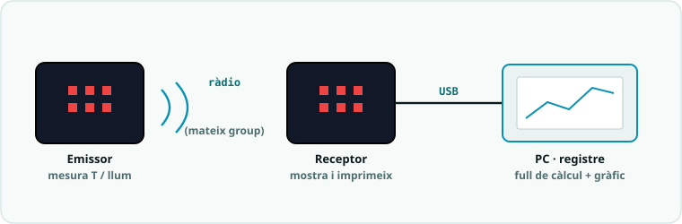

# Pràctica 1 · Telemetria, l'emissor: mesurar aquí, enviar allà

<div class="cap-practica" markdown="1">

❓ **La pregunta:** Com envia dades un robot sense cap cable?

🎯 **Avui aconseguiràs:** que una micro:bit mesuri la temperatura i la llum i les enviï per ràdio, etiquetades, cada 2 segons.

⏱️ La primera part de la sessió (després, la Pràctica 2)

📦 Dues micro:bit amb el cable USB (avui fas servir la primera)

</div>

## 🚀 Pas a pas

### Pas 1 · Tria el teu canal

La ràdio de la micro:bit funciona per **canals** (`group`). Fes servir el **teu número de llista**: així no interferiràs els companys. La ràdio et sona llunyana? Repassa-la en 10' amb la targeta **[Repàs exprés de la ràdio](../../00_General/00_Repas_expres_Radio.md)**.



✅ **Comprova:** saps el teu número de `group` i és diferent del dels companys de taula.

### Pas 2 · Endevina abans de provar

Desplega el codi complet del pas 3 i mira la línia del `radio.send(...)`.

✍️ **Apunta-ho:** PREDIU: què veuràs a la pantalla de l'emissora? I si la receptora té un `group` diferent, què li arribarà?

### Pas 3 · Carrega el codi

Prem **Copia**, enganxa'l a **[python.microbit.org](https://python.microbit.org)** i canvia el `group=10` pel teu número. Després, **Send to micro:bit** a la primera placa.

<!-- codi-complet -->

✅ **Comprova:** a la pantalla apareix una fletxa cada 2 segons: l'emissora és viva i enviant.

✍️ **Apunta-ho:** quines magnituds envies i cada quant?

### Pas 4 · Fes-la teva

Canvia el ritme (`sleep`) o afegeix una tercera magnitud amb la seva etiqueta (per exemple, `"I:"` amb la inclinació `accelerometer.get_x()`).

✍️ **Apunta-ho:** per què les dades s'envien **etiquetades** (`"T:23;L:120"`) i no només el número?

### Pas 5 · Respon i envia

📤 [Obre la tasca «SA8 · Pràctica 1» a Classroom i envia el formulari](https://classroom.google.com/c/ODY4ODU4Njk0NTEy/a/ODk5NDU3OTEwMTA5/details)

📷 [Penja la foto de la teva pràctica a la tasca «Foto · SA8 · Pràctica 1»](https://classroom.google.com/c/ODY4ODU4Njk0NTEy/a/ODk5NDU3NjY1NzIy/details)

Hi trobaràs les mateixes preguntes ✍️ que has anat apuntant. Envia'l ara i continua amb la **[Pràctica 2 · El receptor](02_telemetria_receptor_EXPLICACIO.md)**: sense receptora, ningú no escolta l'emissora.

⭐ **Si acabes abans:** compara-ho amb l'[exemple resolt](../SA8_exemple_resolt.md) (el sensor de moviment sense fils). Més reptes a **[Reptes de la SA8](../../../Reptes/Reptes_SA8.md)**; quan el docent te'l validi, pinta l'estrella al [tauler de reptes](../../00_General/00_Tauler_reptes.md).

<details markdown="1">
<summary>🧗 Si t'encalles</summary>

| Símptoma | Causa probable |
|---|---|
| La receptora no rep mai res | `group` **diferent** a cada placa: el mateix número a les dues. |
| Error en executar `radio.send(...)` | Envies un **número**: converteix-lo a text amb `str(...)`. O falta `radio.on()` abans. |
| Les dades arriben barrejades | Enviades **sense etiqueta**: posa `"T:"`, `"L:"`… i un separador (`;`). |
| Tothom rep les dades de tothom | Tota l'aula amb el mateix `group`: cadascú el seu número. |

**L'esquelet.** Si no et surt ni la primera dada, parteix d'aquest esquelet: la ràdio i el bucle ja hi són; tu omples els `# TODO:`.

```python
# SA8 - emissor de telemetria (esquelet per comencar)
from microbit import *
import radio

GROUP = 10        # el teu numero de llista
PERIODE = 2000    # ms entre enviaments

radio.on()
radio.config(group=GROUP)

while True:
    # TODO 1: mesura el sensor. Ex.: t = temperature()
    valor = 0
    # TODO 2: envia la dada ETIQUETADA. Ex.: radio.send("T:" + str(valor))
    pass
    display.show(Image.ARROW_N)
    sleep(PERIODE)
```

</details>

<details markdown="1">
<summary>🧠 Vols saber per què funciona?</summary>

### Per què fem aquesta pràctica

A la SA5 vas enviar **missatges** per ràdio. Aquí la ràdio envia **dades de sensors**: mesurar en un lloc i transmetre-ho a un altre és la **telemetria**, la base de tot l'IoT. La telemetria sempre són **dues meitats**: una placa que mesura i envia (aquesta) i una que rep i registra (la Pràctica 2).

### Bloc 1 — Engegar la ràdio i sintonitzar el canal

```python
radio.on()
radio.config(group=10)   # emissor i receptor han de compartir group
```

El `group` és com sintonitzar una emissora: només es «senten» les plaques amb **el mateix número**.

### Bloc 2 — Mesurar i enviar la dada etiquetada

```python
    t = temperature()
    llum = display.read_light_level()
    radio.send("T:" + str(t) + ";L:" + str(llum))
```

`radio.send()` només accepta **text**: per això `str(t)`. I l'**etiqueta** (`T:`, `L:`) amb el separador `;` és el que permetrà a la receptora separar les dades amb `split()`.

### On ho aplicaràs

- **Cap al rover:** la micro:bit del **rover del trimestre** és aquest programa amb altres sensors: mesura a bord i envia a la base.

</details>
