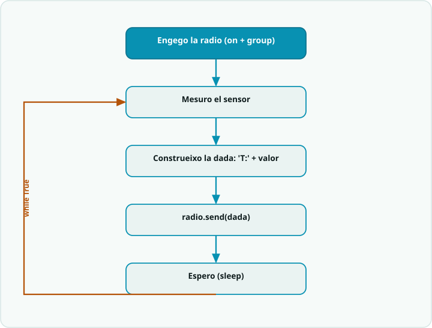

# Pràctica 2 · Telemetria, el receptor: rebre, interpretar i registrar

<div class="cap-practica" markdown="1">

❓ **La pregunta:** Com entén la base les dades que li arriben per ràdio?

🎯 **Avui aconseguiràs:** que la segona micro:bit rebi les dades de l'emissora, les desmunti, avisi si fa massa calor i les registri a l'ordinador per fer-ne un gràfic.

⏱️ La segona part de la sessió

📦 Les dues micro:bit: l'emissora de la Pràctica 1 amb pila i la receptora connectada per USB

</div>

## 🚀 Pas a pas

### Pas 1 · Endevina abans de provar

Desplega el codi complet del pas 2 i mira el bloc del `split`.



✍️ **Apunta-ho:** PREDIU: què mostrarà la pantalla si arriba `"T:31;L:80"`? I si arriba `"hola"`?

### Pas 2 · Carrega el codi a la segona placa

Prem **Copia**, enganxa'l a **[python.microbit.org](https://python.microbit.org)**, posa-hi **el mateix `group`** que a l'emissora i envia'l a la **segona** placa. Deixa-la connectada per USB.

<!-- codi-complet -->

✅ **Comprova:** amb l'emissora engegada, la receptora mostra ✔ (o ✘ si fa calor), i al monitor sèrie (botó **Show serial**) apareixen els missatges `T:..;L:..`.

### Pas 3 · Registra i fes el gràfic

Deixa-ho funcionant 2 minuts. Escalfa la micro:bit emissora amb la mà, o tapa-li la llum, perquè les dades canviïn. Copia les lectures del monitor sèrie a un full de càlcul i fes-ne el gràfic.

✍️ **Apunta-ho:** què mostra el teu gràfic? Quan han canviat les dades i per què?

### Pas 4 · Ajusta l'alerta

Mira els valors reals de temperatura que arriben i tria un `LLINDAR_TEMP` que salti quan escalfes l'emissora amb la mà.

✍️ **Apunta-ho:** quin `LLINDAR_TEMP` has triat i per què?

### Pas 5 · Una meitat, a full en blanc

Tria **una** de les dues meitats (emissora o receptora) i torna-la a escriure des de l'**editor buit**: només el teu pseudocodi i la xuleta de `radio`. Prova que funciona amb l'altra meitat.

✍️ **Apunta-ho:** quina meitat has escrit a full en blanc i què t'ha costat més?

✍️ **Apunta-ho:** què és la telemetria? Posa'n un exemple real.

### Pas 6 · Respon i envia

📤 [Obre la tasca «SA8 · Pràctica 2» a Classroom i envia el formulari](https://classroom.google.com/c/ODY4ODU4Njk0NTEy/a/ODk5NDU4NjMyMzI2/details)

📷 [Penja la foto de la teva pràctica a la tasca «Foto · SA8 · Pràctica 2»](https://classroom.google.com/c/ODY4ODU4Njk0NTEy/a/ODk5NDU4MjU3OTAy/details)

Hi trobaràs les mateixes preguntes ✍️ que has anat apuntant. Envia'l ara. A la sessió següent: **[Pràctica 3 · Auditoria d'un producte IoT](../SA8_auditoria_iot.md)**.

⭐ **Si acabes abans:** gestiona també la segona dada (`L:`) amb una altra alerta, o compara-ho amb l'[exemple resolt](../SA8_exemple_resolt.md). Més reptes a **[Reptes de la SA8](../../../Reptes/Reptes_SA8.md)**; quan el docent te'l validi, pinta l'estrella al [tauler de reptes](../../00_General/00_Tauler_reptes.md).

<details markdown="1">
<summary>🧗 Si t'encalles</summary>

| Símptoma | Causa probable |
|---|---|
| Pantalla en blanc, no arriba mai res | `group` diferent del de l'emissora, o l'emissora no està engegada (li parpelleja la fletxa?). |
| Sempre surt la cara `CONFUSED` | El missatge no té el format esperat: l'emissora envia sense etiqueta o amb un altre separador. |
| Al monitor sèrie no hi veig res | Monitor no obert o placa equivocada: obre el de la placa **receptora** (la de l'USB). |
| Sempre ✔ (o sempre ✘) | Llindar mal triat: mira els valors reals i ajusta `LLINDAR_TEMP`. |

</details>

<details markdown="1">
<summary>🧠 Vols saber per què funciona?</summary>

### Per què fem aquesta pràctica

L'emissora llança dades a l'aire; sense ningú que les escolti, es perden. La receptora **rep, interpreta i registra**: desmunta el text i el torna a convertir en números, i el registra pel port sèrie. Sense registre no hi ha dades; sense dades, no hi ha res a analitzar (ni IA possible, com veuràs a la S3).

### Bloc 1 — Rebre sense aturar-se

```python
    missatge = radio.receive()
    if missatge is not None:
```

`radio.receive()` **no espera**: torna el missatge si n'hi ha, o `None`.

### Bloc 2 — Desmuntar el protocol i decidir

```python
        try:
            parts = missatge.split(";")
            t = int(parts[0].split(":")[1])
            if t > LLINDAR_TEMP:
                display.show(Image.NO)
            else:
                display.show(Image.YES)
        except:
            display.show(Image.CONFUSED)
```

`split(";")` parteix el missatge; `split(":")` separa l'etiqueta del valor; `int(...)` torna el text en número. El `try/except` és l'assegurança: si arriba un missatge estrany, el programa no mor i **continua escoltant**.

### On ho aplicaràs

- **Cap al rover:** la **base** del rover del trimestre és aquest programa amb pantalla OLED: rep la telemetria del rover i la mostra.

</details>
