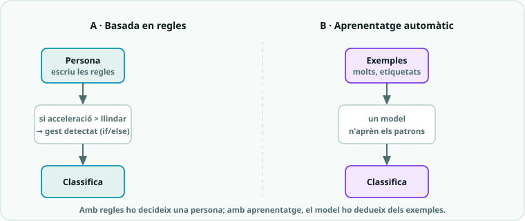

# Pràctica 4 · IA de gestos: classificar amb regles fetes a mà

<div class="cap-practica" markdown="1">

❓ **La pregunta:** Com reconeix una màquina un gest?

🎯 **Avui aconseguiràs:** que la micro:bit endevini com la tens (plana, cap per avall, inclinada, sacsejada) amb regles que tu mateix ajustes mesurant.

⏱️ La primera part de la Sessió 3 (després, la Pràctica 5)

📦 Una micro:bit amb el cable USB (només sensors integrats)

</div>

## 🚀 Pas a pas

### Pas 1 · Endevina abans de provar

L'acceleròmetre dona tres números (x, y, z) en mil·li-g: cap a on estira la gravetat en cada eix. Amb la placa plana, la gravetat cau tota a l'eix z.

✍️ **Apunta-ho:** PREDIU: amb la placa plana sobre la taula, quant valdran x, y i z? Quin gest dirà el programa?

### Pas 2 · Carrega el codi

Prem **Copia**, enganxa'l a **[python.microbit.org](https://python.microbit.org)** i envia'l a la placa. Obre el monitor sèrie (**Show serial**).

<!-- codi-complet -->

✅ **Comprova:** plana surt ✔, cap per avall surt ✘, i al monitor sèrie surt el gest amb els tres valors.

### Pas 3 · Ajusta les regles mesurant

Mou la placa a poc a poc i mira al monitor sèrie **els valors reals** de cada posició. Canvia un llindar que no t'encaixi (per exemple el `600` de la inclinació) i torna a provar. Mai «a ull»: sempre amb els números del sèrie.



✍️ **Apunta-ho:** quins gestos classifica el programa, i quin llindar has canviat (abans i després)?

✍️ **Apunta-ho:** per què importa l'**ordre** dels `if` al classificador?

### Pas 4 · Respon i envia

📤 [Obre la tasca «SA8 · Pràctica 4» a Classroom i envia el formulari](https://classroom.google.com/c/ODY4ODU4Njk0NTEy/a/ODk5NDU4MzU2NzU2/details)

📷 [Penja la foto de la teva pràctica a la tasca «Foto · SA8 · Pràctica 4»](https://classroom.google.com/c/ODY4ODU4Njk0NTEy/a/ODk5NDU4ODExMTU2/details)

Hi trobaràs les mateixes preguntes ✍️ que has anat apuntant. Envia'l ara i continua amb la **[Pràctica 5 · Teachable Machine](../SA8_practica_teachable_machine.md)**: el mateix problema, però les regles les aprèn la màquina.

⭐ **Si acabes abans:** afegeix una **classe nova** de gest (per exemple, «inclinat cap enrere»). Més reptes a **[Reptes de la SA8](../../../Reptes/Reptes_SA8.md)**; quan el docent te'l validi, pinta l'estrella al [tauler de reptes](../../00_General/00_Tauler_reptes.md).

<details markdown="1">
<summary>🧗 Si t'encalles</summary>

| Símptoma | Causa probable |
|---|---|
| Sempre diu la mateixa classe | Llindars mal ajustats: mira els valors reals pel sèrie **abans** de tocar els números. |
| El `SACSEIG` no surt mai | `was_gesture` mira si **acaba** de passar: sacseja fort i observa el sèrie. |
| Confon dues classes veïnes | Els llindars es toquen: separa'ls o replanteja la regla. |
| Al simulador no surt cap gest | Al simulador has de moure la placa amb els controls d'acceleròmetre. |

</details>

<details markdown="1">
<summary>🧠 Vols saber per què funciona?</summary>

### Per què fem aquesta pràctica

**Classificar** (decidir una categoria a partir de valors) és el que fa tota IA. Aquesta pràctica és el segon graó d'una escala de tres: **un llindar** (l'alarma de la SA3), **regles combinades** (avui: tres valors i diverses regles escrites a mà) i **aprenentatge automàtic** (la Pràctica 5: les regles s'aprenen dels exemples). La diferència no és *què* fa el sistema, sinó *d'on surten les regles*.

### Bloc 1 — El classificador: una funció que decideix

```python
def classifica(x, y, z):
    if accelerometer.was_gesture("shake"):
        return "SACSEIG"
    if z < -700:
        return "PLA (cara amunt)"
    if z > 700:
        return "CAP PER AVALL"
    if y > 600:
        return "INCLINAT ENDAVANT"
```

**Cada `if` és una regla escrita a mà**: transparent (pots llegir per què ha decidit), però limitada al que el programador ha previst. I **l'ordre importa**: el primer `return` que es dispara guanya.

### Bloc 2 — Mesurar per ajustar

```python
    gest = classifica(x, y, z)
    print(gest, x, y, z)
```

Pel sèrie surt la classe i els tres valors que l'han provocada: és **així** com s'ajusten els llindars.

### On ho aplicaràs

- **Pràctica 5:** la [pràctica de Teachable Machine](../SA8_practica_teachable_machine.md), on les regles s'aprenen d'exemples.

</details>
