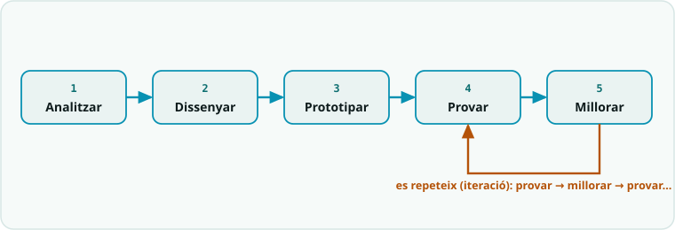

# SA9 · Repte final integrador (opció competició)

Novena i última situació d'aprenentatge (**10 h · 5 sessions**, 3r trimestre). És el **projecte de síntesi** del curs: **cadascú** dissenya, construeix, programa, documenta i defensa **el seu** sistema robòtic autònom que resol un repte real, integrant **tot l'après (SA1-SA8)**. Opció de vincular-lo a una **competició** (WRO, RoboCup Junior, FTC) o al **Treball de Recerca**. Maquinari i llenguatge **lliures**. Programació oficial: [`Programació didàctica/18_SA9_Projecte_final.md`](../../Programació%20didàctica/18_SA9_Projecte_final.md).

En acabar aquesta SA podràs: 1) **gestionar un projecte sencer** (idear, prototipar, provar i comunicar); 2) **integrar** electrònica, programació i control en un sistema propi; 3) **documentar-lo** i **defensar-lo**.

> 👤 **El projecte és individual:** el teu repte, el teu dossier i la teva defensa. Si voleu ajuntar-vos per a un repte més gros, proposeu-ho al docent: al dossier hi ha de constar **qui ha fet què** i **cadascú defensa tot el sistema** sol.

## 🧭 La teva ruta

Cada fase del projecte és una pràctica. Fes-les **en ordre**: cada una acaba enviant el seu formulari de Classroom i la foto del projecte. Les 🚩 et diuen on hauries de ser al final de cada sessió.

- ① [Pràctica 1 · Idear](SA9_practica_1_idear.md) — el repte, els requisits mínims, el disseny i les fites.

🚩 **Final de la Sessió 1:** formulari de la ① enviat, el taulell àgil omplert i el full del 📓 quadern de la sessió.

- ② [Pràctica 2 · Prototipar](SA9_practica_2_prototipar.md) — el prototip mínim i el primer codi, mòdul a mòdul.

🚩 **Final de la Sessió 2:** formulari de la ② enviat i el full del 📓 quadern omplert.

- ③ [Pràctica 3 · Provar](SA9_practica_3_provar.md) — proves contra els requisits, primera iteració i revisió creuada.

🚩 **Final de la Sessió 3:** formulari de la ③ enviat i el full del 📓 quadern omplert.

- ④ [Pràctica 4 · Comunicar](SA9_practica_4_comunicar.md) — el producte: dossier, defensa a la mostra i retrospectiva del curs.

🚩 **Final de la Sessió 4:** formulari de la ④ enviat i **Entrega final** feta.

🚩 **Sessió 5 · Prova pràctica T3:** individual, per torns (el robot a la pista i la micro:bit a la taula). Comença per la Part B (MicroPython): repassa la [targeta exprés](../00_General/00_Repas_expres_MicroPython.md). Els últims 15' es desmunta i es retorna l'electrònica als kits.

## 🏁 Entrega final

**Quan hagis acabat la ④:**

1. 🎤 **Defensa oral individual (5' + preguntes)** amb demostració, a la mostra de la S4. S'avalua amb **totes** les rúbriques (R1-R5).
2. 📤 Respon i envia l'[Entrega final de la SA9](https://classroom.google.com/c/ODY4ODU4Njk0NTEy/a/ODk5NDU4ODg0ODM0/details): autoavaluació i checklist final.

> ✅ **Versió nucli** (per aprovar n'hi ha prou amb): els **requisits mínims** complerts i demostrables en directe, amb el dossier a les seccions essencials.

## 📦 Què has d'entregar

| Quan | Què | On |
|---|---|---|
| S1 | Formulari i foto de la Pràctica 1 (Idear) | Tasques de Classroom (enllaços a l'últim pas de cada pràctica) |
| S2 | Formulari i foto de la Pràctica 2 (Prototipar) | Les tasques de Classroom de la pràctica |
| S3 | Formulari i foto de la Pràctica 3 (Provar) | Les tasques de Classroom de la pràctica |
| S4 | Formulari i foto de la Pràctica 4 + **el sistema funcional**, [dossier tècnic](plantilles/Dossier_tecnic_PLANTILLA.md) i defensa + **Entrega final** | A la mostra i a Classroom. S'avalua amb **R1-R5** |
| S5 | **Prova pràctica T3 (individual, per estacions)** | A l'aula, sessió sencera |
| ⭐ | [Repte final integrador](plantilles/Banc_de_reptes.md) | El docent el valida com a part del producte, a la defensa de la S4 |
| 📓 | Full del quadern tècnic de cada sessió | En paper, en acabar la sessió |
| 🤖 | El rover al repte final, demostrat a la **mostra** de la S4 | Es tanca al [dossier del rover](../00_General/00_Projecte_T3_Rover.md) |

## 📚 Per repassar a casa

- [Banc de reptes](plantilles/Banc_de_reptes.md) · [Taulell àgil](plantilles/Planificacio_agile_PLANTILLA.md) · [Dossier tècnic](plantilles/Dossier_tecnic_PLANTILLA.md)
- [Exemple resolt (el robot repartidor)](SA9_exemple_resolt.md) · [Diagrama del mètode](SA9_diagrama_flux.md) · [Qüestionari de conceptes](SA9_questionari_conceptes.md)
- [Fitxa base](SA9_fitxa_alumnat.md) · [Fitxa ampliada](SA9_fitxa_ampliada.md)

<!-- web:only-github -->
## Contingut

| Fitxer | Descripció |
|---|---|
| [`SA9_guia_docent.md`](SA9_guia_docent.md) | Guia del professorat: sentit, 4 sessions de projecte + prova T3 (S5), planificació individual, mapa d'avaluació i gestió de projecte. |
| [`SA9_fitxa_alumnat.md`](SA9_fitxa_alumnat.md) | **Fitxa base** individual: repte, les quatre feines, disseny, planificació, iteracions, defensa, checklist. |
| [`SA9_fitxa_ampliada.md`](SA9_fitxa_ampliada.md) | **Versió ampliada**: guió complet + rutines (revisió creuada, exit ticket final, PC). |
| [`SA9_checklist_docent.md`](SA9_checklist_docent.md) | **Checklist docent** (una cara): plantilles a punt, fites parcials per sessió, avaluació (R1–R5) i diversitat. |
| [`SA9_checklist_alumnat.md`](SA9_checklist_alumnat.md) | **Checklist de l'alumnat** (una cara): fites per sessió, entrega final i autoavaluació amb semàfor. |
| `plantilles/` | Plantilles de treball (vegeu la taula següent). |

### Plantilles (`plantilles/`)

| Plantilla | Ús |
|---|---|
| `Banc_de_reptes.md` | Llista de reptes amb nivells de dificultat (atenció a la diversitat). |
| `Planificacio_agile_PLANTILLA.md` | Taulell de tasques personal (To Do / Fent / Fet) amb etiquetes de feina. |
| `Dossier_tecnic_PLANTILLA.md` | Estructura del dossier tècnic a lliurar. |
| `Codi_base_PLANTILLA/` | Esquelet de codi modular per començar (sketch en carpeta pròpia). |

<!-- /web:only-github -->

## Producte i avaluació

- **Producte:** sistema robòtic autònom funcional + **dossier tècnic** + **defensa oral individual**.
- **Criteris:** CA1.x, CA2.1, CA3.1, CA4.1, **CA5.1, CA5.2, CA5.3** · **Rúbriques:** **R1, R2, R3, R4, R5** (totes).

## Continuïtat

És la **culminació del curs**: integra electrònica (SA2-SA4), programació en dos llenguatges (SA1-SA5, SA8), control (SA6), robòtica mòbil (SA7) i IoT/IA (SA8). Aquí es tanca el **mètode de projecte** introduït a la **SA1** (*analitzar → dissenyar → prototipar → provar → millorar*), ara aplicat de forma completa i autònoma.
