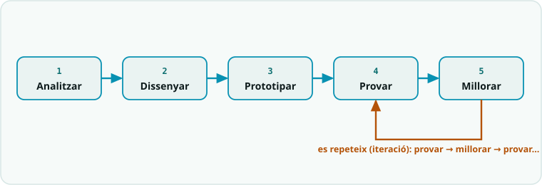
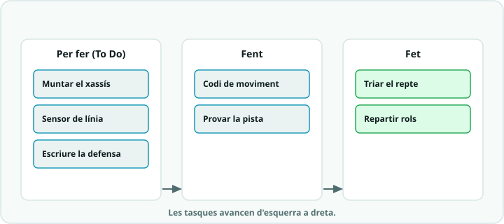

# Pràctica 1 · Idear: el meu repte i el meu disseny

❓ **La pregunta:** Quin problema real resoldrà el teu robot?

🎯 **Avui aconseguiràs:** triar el teu repte, fixar-ne els requisits mínims, dissenyar el sistema i planificar les fites del projecte.

⏱️ La Sessió 1

📦 El quadern, el [banc de reptes](plantilles/Banc_de_reptes.md) i el [taulell àgil](plantilles/Planificacio_agile_PLANTILLA.md)

> 👤 **El projecte és individual:** el teu repte, el teu dossier i la teva defensa. Si tu i un company voleu fer un repte més gros junts, proposeu-ho al docent: al dossier hi ha de constar **qui ha fet què**, i **cadascú defensa tot el sistema** sol.

## 🚀 Pas a pas

### Pas 1 · Tria el teu repte

Obre el **[banc de reptes](plantilles/Banc_de_reptes.md)** i tria'n un, o proposa'n un de teu que resolgui un problema real. Pot ser el teu rover amb un comportament nou, o un altre sistema.

✍️ **Apunta-ho:** el repte que tries i el problema real que resol.

### Pas 2 · Fixa els requisits mínims

Escriu **tres requisits** que el teu sistema ha de complir sí o sí. Han de ser comprovables en una demostració («el robot s'atura a menys de 10 cm d'un obstacle», no «el robot és intel·ligent»).

✍️ **Apunta-ho:** els teus 3 requisits mínims.

### Pas 3 · Mira com es gestiona un projecte

Llegeix l'**[exemple resolt: el robot repartidor](SA9_exemple_resolt.md)**. No és per copiar-lo: és per veure com es planifica, es prova i es documenta un projecte.

✅ **Comprova:** saps quines són les fases del mètode de projecte i en quina ets.

### Pas 4 · Dissenya el sistema

Al quadern, dibuixa un **esbós** del sistema: què hi ha, on va cada sensor i cada actuador, i com es connecten.

✍️ **Apunta-ho:** els sensors (entrada), els actuadors (sortida) i el tipus de control (llaç obert, llaç tancat o màquina d'estats).

### Pas 5 · Planifica les fites

Omple el **[taulell àgil](plantilles/Planificacio_agile_PLANTILLA.md)** (Per fer · Fent · Fet) amb les tasques del projecte. Hi ha d'haver almenys una targeta de cadascuna de les quatre feines: **planificació, maquinari, programació i documentació**.

✍️ **Apunta-ho:** les teves fites: què tindràs fet al final de la S2, de la S3 i de la S4.

✍️ **Apunta-ho:** de les quatre feines, quina et costarà més i com evitaràs oblidar-la?

### Pas 6 · Respon i envia

📤 [Obre la tasca «SA9 · Pràctica 1» a Classroom i envia el formulari](https://classroom.google.com/c/ODY4ODU4Njk0NTEy/a/ODk5NDU4NTU4Nzc4/details)

📷 [Penja la foto de la teva pràctica a la tasca «Foto · SA9 · Pràctica 1»](https://classroom.google.com/c/ODY4ODU4Njk0NTEy/a/ODk5NDU4NjcxODkx/details)

Hi trobaràs les mateixes preguntes ✍️ que has anat apuntant. Envia'l ara. A la sessió següent: **[Pràctica 2 · Prototipar](SA9_practica_2_prototipar.md)**.

⭐ **Si acabes abans:** comença el **[dossier tècnic](plantilles/Dossier_tecnic_PLANTILLA.md)** ara mateix, amb el repte i el disseny: la documentació és la feina que més s'oblida.
