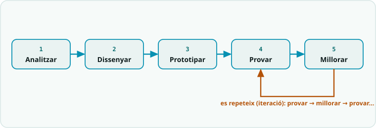

# Pràctica 3 · Provar: proves, iteració i revisió creuada

❓ **La pregunta:** Com saps que el teu robot funciona de veritat?

🎯 **Avui aconseguiràs:** provar el sistema de manera sistemàtica contra els teus requisits, fer la **primera iteració** i revisar el codi d'un company.

⏱️ La Sessió 3

📦 El prototip de la S2, els teus 3 requisits mínims i el codi d'un company

## 🚀 Pas a pas

### Pas 1 · Prova contra els requisits

Prova **cada requisit mínim** tres vegades seguides i apunta què passa. Un requisit que funciona una vegada de cada tres no està complert.

✍️ **Apunta-ho:** versió 1: quins requisits es compleixen i què fallava?

### Pas 2 · Itera

Tria **una** cosa que fallava, canvia-la i torna a provar-ho tot. Una sola cosa cada vegada: si en canvies tres, no sabràs quina ha funcionat.

✍️ **Apunta-ho:** versió 2: què has canviat i quin ha estat el resultat?

### Pas 3 · Revisa el codi d'un company

Intercanvieu el codi amb un company. Llegeix el seu i dona-li **una millora concreta** i **un dubte** (alguna cosa que no entens).

✅ **Comprova:** el company t'ha retornat la seva revisió del teu codi.

✍️ **Apunta-ho:** la millora i el dubte que has donat al company.

✍️ **Apunta-ho:** què has après de la primera iteració?

### Pas 4 · Respon i envia

📤 [Obre la tasca «SA9 · Pràctica 3» a Classroom i envia el formulari](https://classroom.google.com/c/ODY4ODU4Njk0NTEy/a/ODk5NDUzMzgyMDE4/details)

📷 [Penja la foto de la teva pràctica a la tasca «Foto · SA9 · Pràctica 3»](https://classroom.google.com/c/ODY4ODU4Njk0NTEy/a/ODk5NDU4NjU3OTY1/details)

Hi trobaràs les mateixes preguntes ✍️ que has anat apuntant. Envia'l ara. A la sessió següent: **[Pràctica 4 · Comunicar](SA9_practica_4_comunicar.md)**. Si ja tens el prototip llest, potser defenses avui: el docent avança 1-2 defenses.

⭐ **Si acabes abans:** fes la segona iteració i apunta-la a la taula d'iteracions del dossier.
